# 5. 复制 Replication 

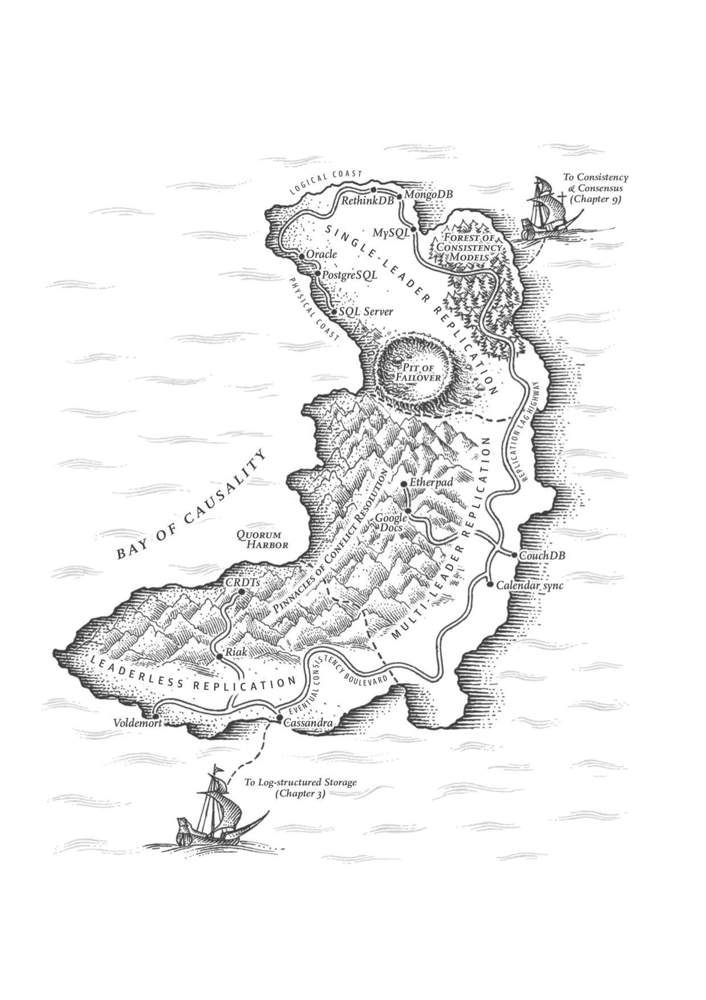

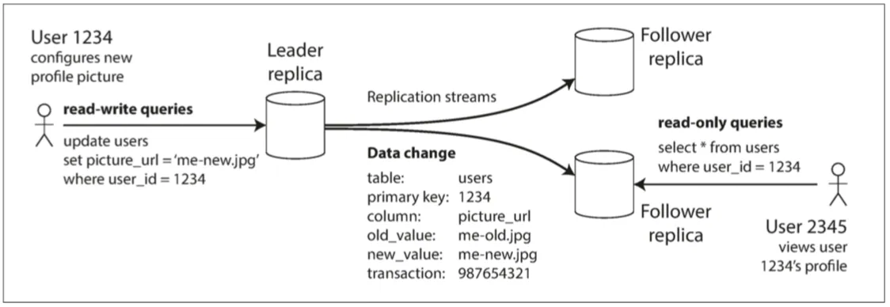
##### 图5-1 

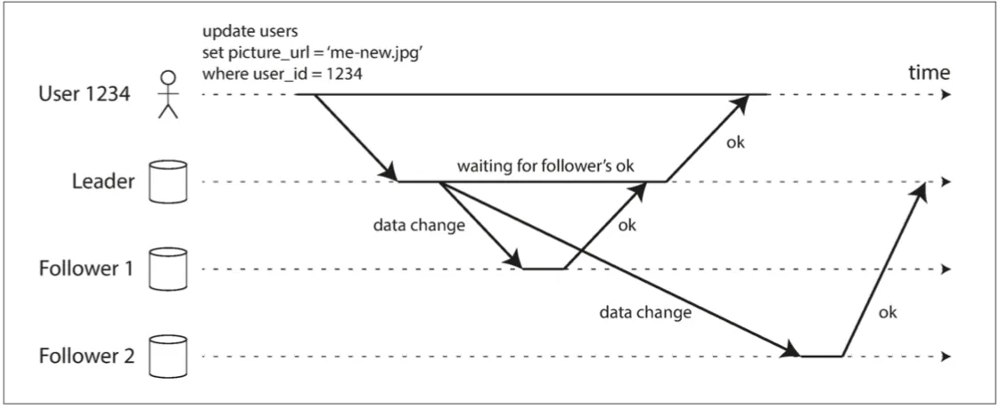
##### 图5-2

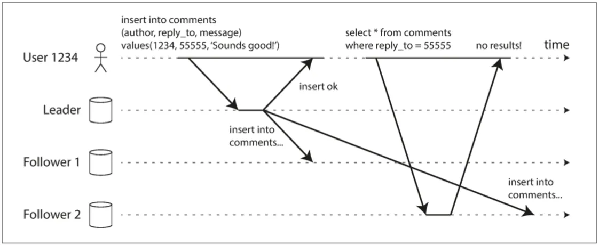
##### 图5-3

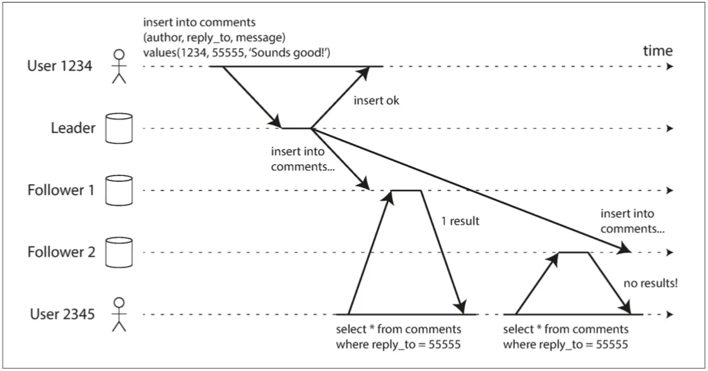
##### 图5-4

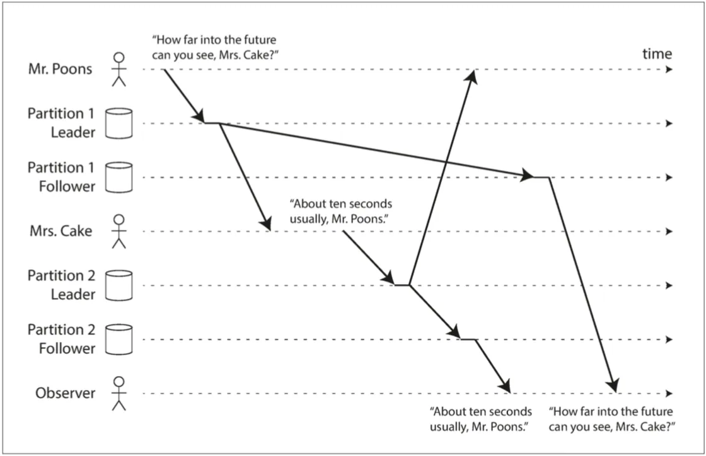
##### 图5-5

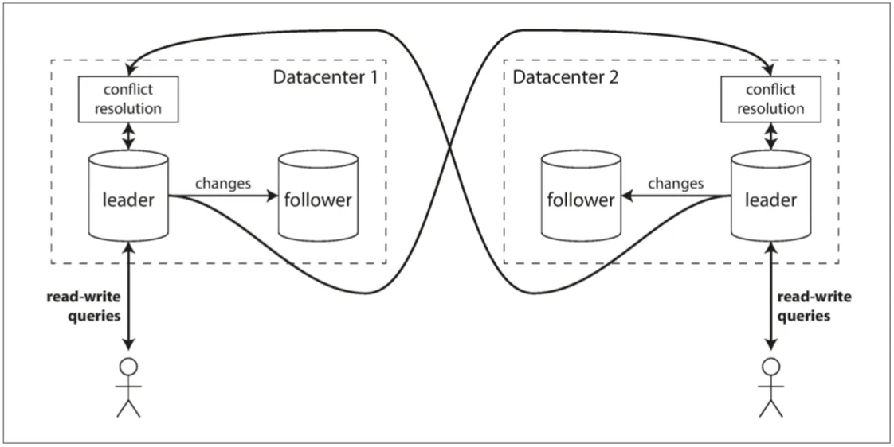
##### 图5-6

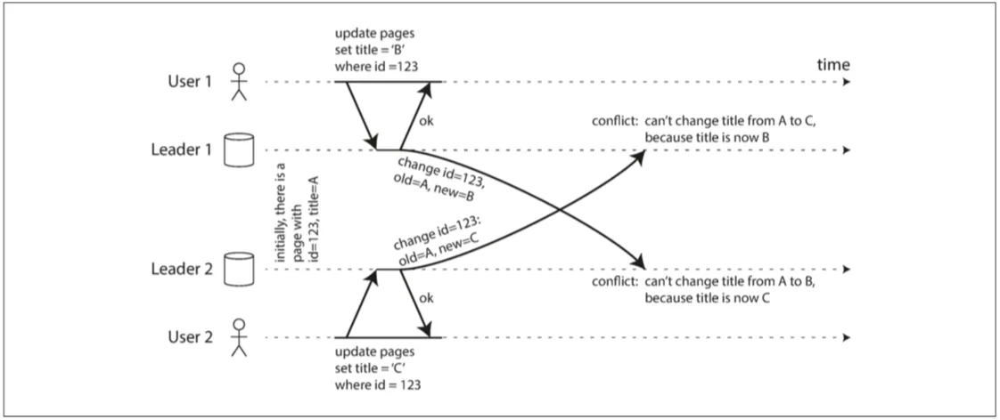
##### 图5-7

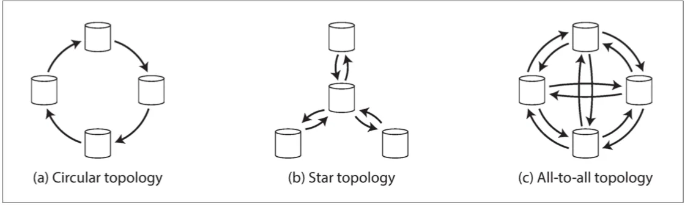
##### 图5-8

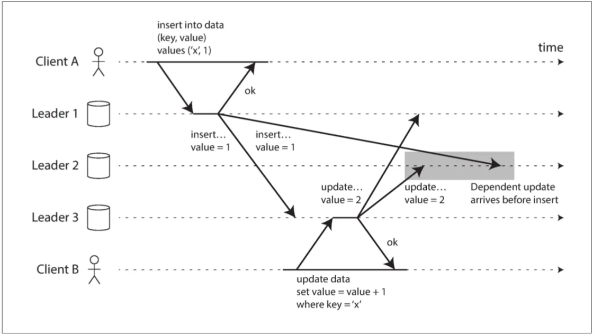
##### 图5-9

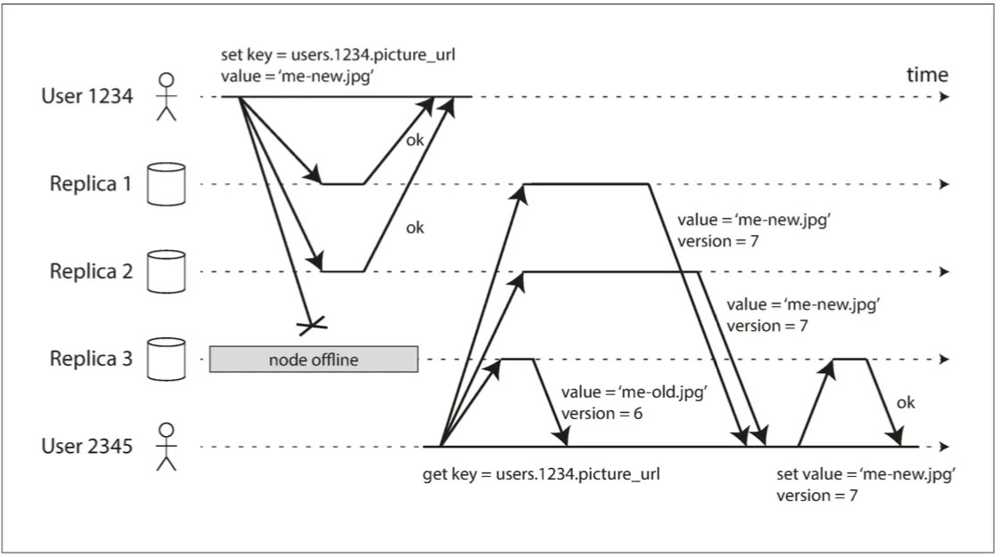
##### 图5-10

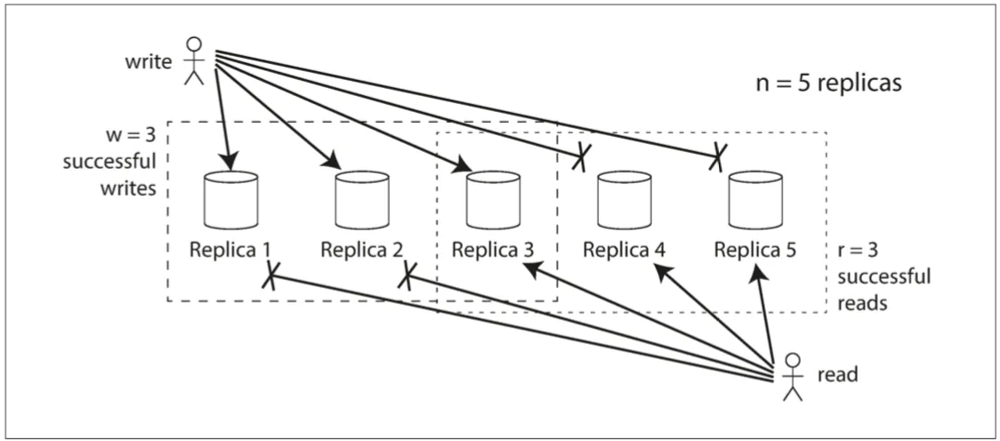
##### 图5-11

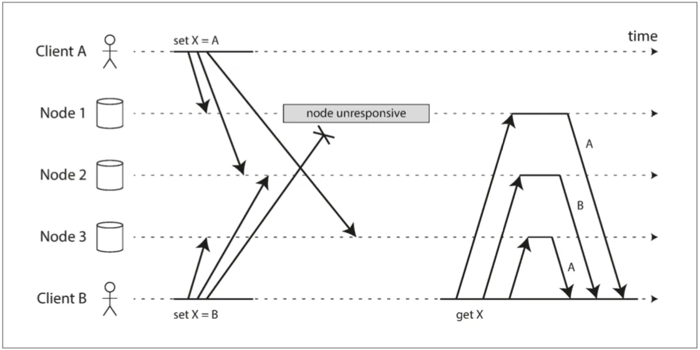
##### 图5-12

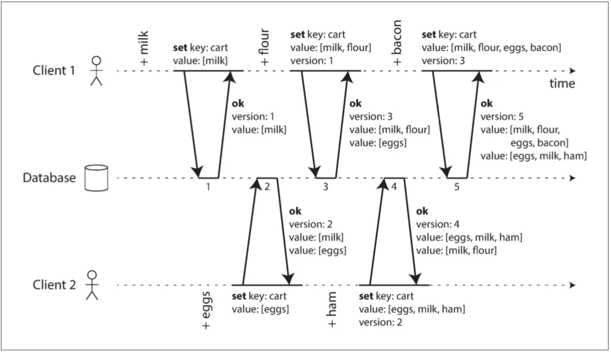
##### 图5-13

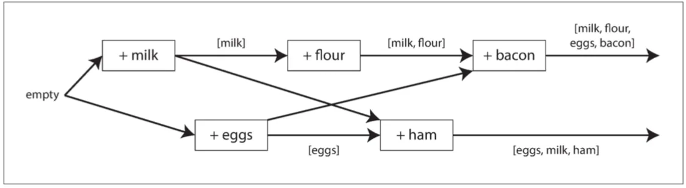
##### 图5-14

