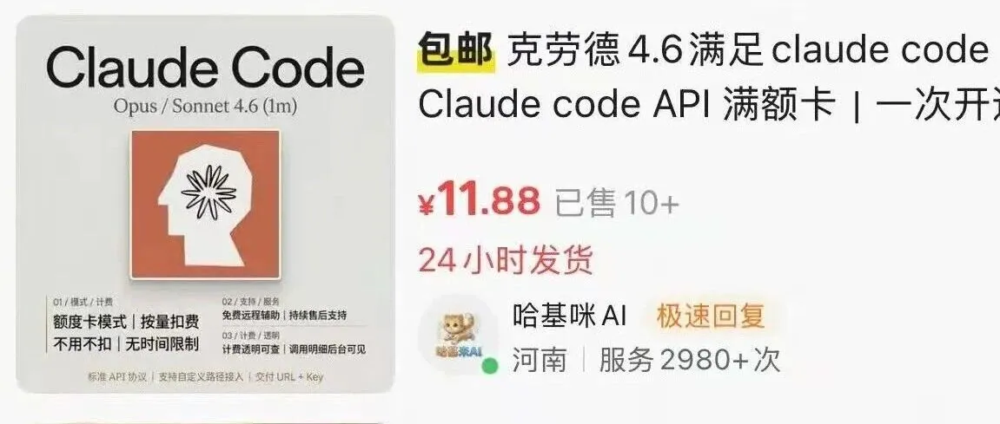

# 我花了半个月，把 AI 中转站这门生意从头到尾扒透

> 利润、搭建、教程、内幕全在这里

## 前言

前阵子朋友圈冒出来一批做 AI 中转站的。咸鱼挂着十块钱的 Claude Code 车位，淘宝一搜 AI 就给你推一堆面板源码，小红书里一半帖子在教你怎么搭，另一半在骂哪家又跑路了。

OpenAI 和 Anthropic 官方 API 太贵，国内用卡、付款、IP 一连串问题都卡着你。于是有人批量搞海外账号打通成一个池子，套层壳重新对外卖，接口跟官方一模一样，价格能低到官方的三到五折。这就是中转站。

**注意：本文所有教程均只作为参考，不涉及任何教导的违法行行为。**

---

## 一、利润

以 Claude Code Max 方案为例。闲鱼一个 Business 号成本 50 到 150，一个 Max 账号一个月大约能提供 1500 美金左右的官方额度消耗能力。你把它切成 5、10、50 美金不等的车位倒手卖。

真正跑起来的工作室号池 100 到 500 之间，月流水 5 万到 30 万，净利 1 万到 8 万。认识一个做了两年的朋友号池 200 个，团队他加一个兼职客服，一个月净到手三五万。他说这生意最反直觉的一点，是钱不是赚号差价赚的，是赚人没空操心赚的。用户图的就是省事，少配一行变量、少看一封报警，他就愿意为你多付 20%。所以稳定性和售后才是真护城河。

这行的暴利点是**超售**。官方 Business 账号按座位计费一个席位只能一人用，但大部分用户一天调 API 不超过两小时。运营方就把同一个账号切给五到十个用户共享，负载调度做好用户感知不到冲突。成本不变收入翻五倍，毛利率从 30%拉到 70%。这就是为什么有人敢打三折价，他们是把你们几个人打包塞进同一个账号。

混合 API 利润结构更复杂。同一个模型 ID 在不同分组能挂五到七个价位，便宜的 0.35 倍，贵的 2.4 倍，差出将近七倍。跟航空公司舱位一个逻辑，把同一份算力切成不同 SKU 卖给不同付费意愿的人。

最骚的玩法是定价跟时段挂钩。白天美西凌晨调用便宜，晚高峰加倍计费。后台看着是稳定供货，实际上整个号池被切成了动态调度的拼车系统。

---

## 二、上下游链条

这门生意上下游链条比想的长。上游是卡商、号商、IP 代理、逆向方，中游是中转站本体（API 面板+支付+分销+号池运维），下游是 Cursor 里用 Claude Code 的开发者和二次分销商。

你几乎不可能吃掉全链路，大部分人只能占一两个环节，但每个环节做到极致都能赚钱。

想下场做，准备这几样：

- 一台腾讯云 VPS（Ubuntu 24.04 LTS，年付几百）
- 一个域名（最便宜 10 块一年）
- 一个 Cloudflare 账号托管域名做 Tunnel
- 一个 Neon PostgreSQL 免费版存数据
- 一个 Upstash Redis 免费版做缓存
- 闲鱼买两个靠谱的 Business 号

**提醒一个坑**：Neon 和 Upstash 一定要选跟 VPS 同地区，不然跨区延迟能把体验搞烂。

懒得自己搭的淘宝 600 块能请人帮搭，但建议自己搭一遍，花钱买服务对方装完就走，后面风控崩盘你还是不知道怎么救。

---

## 三、搭建教程

### 第一步：装 Cloudflare WARP

整条链路的灵魂。直接用服务器 IP 调 Anthropic 风控分分钟干掉你。挂 WARP 之后出境流量走 CF 网络伪装成普通用户。

```bash
warp-cli registration new
warp-cli connect
# 切proxy模式监听40000端口
curl ifconfig.me  # 验证返回warp=on
```

**偷懒不做号池三天废一半**。见过一个朋友图省事跳过这一步，上线第二天整段 IP 被风控连带同一台 VPS 上其他号集体阵亡，换 IP 又被秒杀，折腾两周才明白。

### 第二步：域名托管给 Cloudflare

腾讯云 DNS 改成 CF 给的两个 ns 地址，十分钟生效。隐藏真实 IP 避免 DDoS，白嫖 HTTPS。

### 第三步：Cloudflare Tunnel 内网穿透

Zero Trust 里 Add a Tunnel 拿 token。让服务器不用开放公网端口，用户通过 CF 边缘节点访问，躲在一个巨大的保镖后面。

### 第四步：Docker 起 Sub2Api

```bash
curl -fsSL https://get.docker.com | sh
# 写docker-compose.yml把Neon、Upstash、Cloudflared的token填进去
docker-compose up -d
```

**有个坑**：装了 WARP 就把 HTTP_PROXY 几行注释掉，不然容器请求走两次代理延迟爆炸。

### 第五步：进面板配账号测效果

新建分组添加账号，闲鱼买的号登进去拿 subscription 链接粘面板生成 API Key。Cursor 里改 base_url 指到域名，测一轮 Sonnet 4.6 不卡不降智计费准就算跑通。

整套第一次四到六小时，第二次一小时。但搭完你会发现这只是 10%的工作量。剩下 90%是凌晨两点号被风控群里炸锅，是用户填错 base_url 得从头讲，是 Stripe 发邮件要冻结你，是二道贩子拿你的 API 倒手出事反过来找你。这些没一个能靠技术解决。

---

## 四、内幕

### 最大坑：模型造假

2026 年 CISPA 的论文《Real Money, Fake Models》审计 17 家主流中转站近 45%在造假。你前端调 GPT-4 后台给你路由到开源 GLM 或 Qwen，短时间感知不到，时间长了发现代码能力明显差，已经充进去几百美金。

**两个最简单的鉴假方法**：

1. **看响应 ID 前缀**：Anthropic 官方返回`msg_`开头，AWS Bedrock 渠道返回`msg_bdrk_`开头。抓一次响应看 ID 就知道有没有偷偷换后端。

2. **有些中转连错误信息都不脱敏**直接把`upstream_provider`打出来，抓包一看 ID 是`msg_bdrk`开头，直接暴露 AWS Bedrock 后端。

其他风险：流量虚扣（多计 10%到 30%）、卷款跑路、数据泄露、高并发掉线。

中转站的真实威胁等级，从模型替换到 credential 盗窃，风险一级级往上叠。

### 三个产业内幕

**一是号源**。闲鱼上三百块的 Max 号来自三条路：教育邮箱批量注册、美国本土真人代实名。一百块以下基本是洗过几轮的垃圾号，充三百美金第二天号没了。

**二是逆向**。所有主流中转站背后都养着一组逆向工程师追着官方反爬更新跑，灰产圈月薪三五万。小型中转方养不起只能跟着上游社区走，上游一断更 48 小时崩一半。

**三是分销金字塔**。能追溯到源头的就七八家大号池，同一个 Max 月度车位小站 198 源头 89，中间 109 块被三四层二道贩子分掉。终端用户直接找源头，看开票能力、SLA 承诺、Telegram 群里大佬背书。

### 合规层面

转卖 API 在 Anthropic 的 ToS 里禁止，但国内法律没对应条款，你承担的是账号封禁和支付冻结不是人身风险。做到年流水千万级别税务会突然成为天大的问题，这也是为什么中转站老板很少高调露脸。

### 数据安全

你的每行代码、每段对话、每个商业问题，都从你的电脑出发过中转方的服务器再到模型那边。中间这一站想看就能看，想存就能存。你以为是点对点，其实是点对点对点。这门生意之所以信任成本这么高，根源就在这里。

---

## 最后

扒这半个月越扒越觉得，这是一个非常典型的 AI 套利。上游是硅谷顶级公司用最贵算力堆出来的智能，下游是一群想用 AI 改变生活的普通开发者。中间这层人用逆向、闲鱼号、Cloudflare、Docker，硬生生搭出一条让下游能用上的桥。

你可以骂他们灰色，但不能否认他们确实在磨平一种信息差。在这个时代最好的 AI 工具明明已经存在，但因为各种原因大部分中国开发者够不到。有人愿意冒着风险做这件事，哪怕动机是赚钱，其实也是在给整个生态输血。

想做这门生意别只想赚快钱，把稳定性和售后做扎实，利润率压到合理区间。这个赛道里能熬三年以上的玩家都活得不错，三个月跑路的那批大多翻车了。想用中转站选源头，便宜到反常的站子要么造假要么倒计时跑路。

**说到底这是一个关于信任的生意。**

---

> 作者：艺枢 ArtPivot / 拟像 AIGC
> 原文：https://mp.weixin.qq.com/s/GDZHJaaohJRw540_IzcEAA