# 研发 Loop 的上下文优化与多 Agent 协作实践

> 作者：李天鹏（资源运营部）

在 Workspace 上做研发时，Loop 每轮都要重装上下文，代码读写与工具结果又不断叠加，触发压缩后还会损伤任务依赖的操作规范。本文从上下文优化、Skill 结构优化、Subagent 任务拆分三方面改造流程，使多轮复杂任务执行更快、结果更准确，以研发测试交付全流程无人工介入的案例演示效果。

## 1. 问题：当前研发流程慢在哪里

### 1.1 人工参与频次高

### 一次典型的研发流程

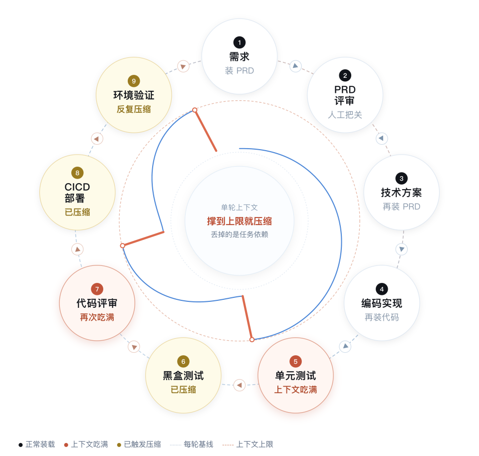

### 1.2 可用上下文窗口大小逐渐减小，注意力随时间衰减

研发 Loop 指「需求 → 方案 → 实现 → 测试 → 评审 → 验证」这条闭环。六个环节本身不慢，慢的是每一步都要把历史上下文重新装载一遍：PRD、代码、测试输出、模型思考、历史轮次全部挤在同一个窗口里，越往后越贵，也越容易漏。
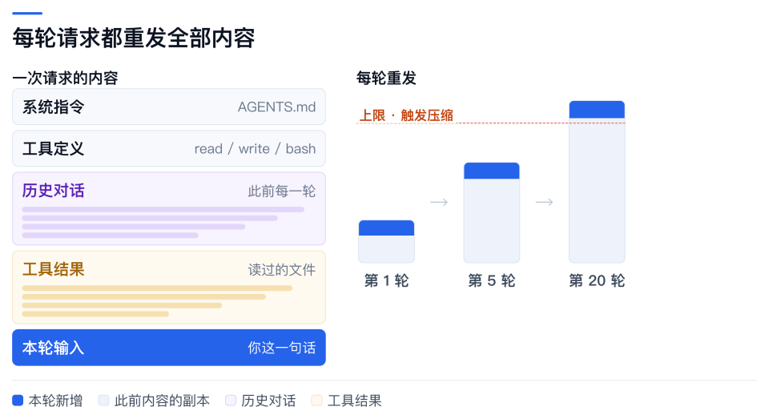
达到模型最大上下文、触发压缩之后：
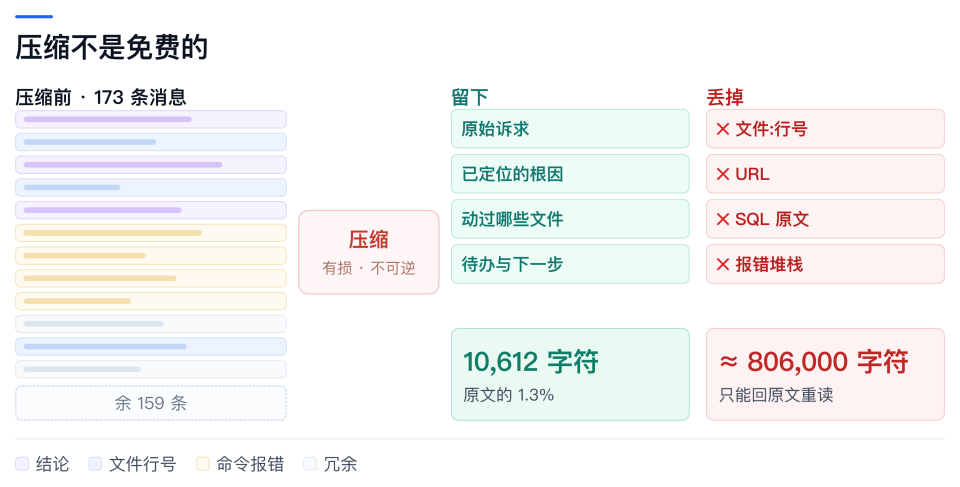
把这件事量化，会看到三条叠加的约束：
上下文窗口有限。 模型配额 max_tokens 为 256k，推理与思考内容一并计入。底座与 Skill 正文属于每轮必带的固定成本，工具结果与思考块属于越滚越大的变动成本。
底座内容每轮重发。 典型排查会话优化前每轮需承载 84k tokens。上下文越长，每轮延迟与 token 成本越高；反过来说，固定成本一旦削减，每一轮调用都持续受益。
注意力衰减。 上下文越长，位于中部的信息越容易被忽略（lost-in-the-middle）；而超限触发的自动压缩是有损的——被丢弃的不只是冗余信息，还有完成任务所依赖的操作规范。这一点在下一节的两起事故里有具体表现。
结论：上下文不是越大越好。「只装载当轮必需的信息」应该是一条硬性工程约束，不是风格偏好。

### 1.3 压缩的问题，压缩不是免费的

事故一：6.7k 的操作规范被压成 0.2k 摘要。一份 SKILL.md 因上下文超限被自动压缩，摘要保留了「是什么」，丢掉了「怎么做」——具体命令、路径、边界条件。后续三步全部按压缩后的摘要执行，直到测试环节才发现口径不对。这不是模型的错，是压缩把「任务依赖的操作规范」当成了冗余信息。代价是可量化的：门控顺序连续 4 轮受阻，反复 validate 却只能反复试错，最终为重新摸索流程消耗了 74k tokens。
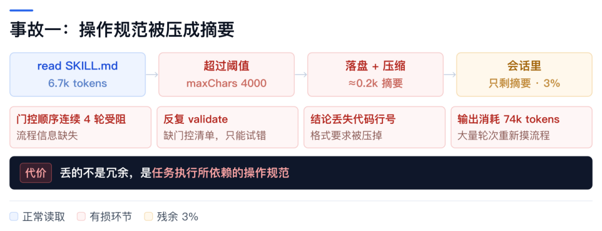
事故二：8 分钟内 74 次 DOM 快照。主会话承担前端验证时，为定位一个渲染问题连续抓取页面快照，把主上下文撑爆；随后触发的压缩又丢掉了正在使用的那份失败日志。时间线很清楚：00 开始验证、02 累计超过 20 次、04 触发第一次压缩并丢掉部分页面认知、06 因不确定而重复读取再次压缩、08 共 74 次调用且主任务进度被页面验证操作挤占——从「读得快」直接滑进「读不完」。
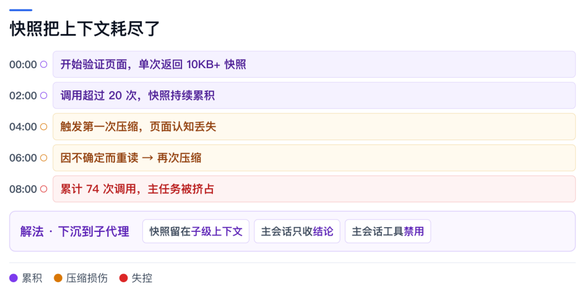
两次事故的共同点：问题不在「上下文不够大」，而在「该省的没省、该留的被压掉了」。判断一条信息该不该进入上下文，标准不是「有没有用」，而是「是不是这一轮决策的直接依赖」。

## 2. 解决方案

两条路径，各自治一种成本：
A 指令拆分，治「每轮必带」的固定成本。控制指令分量：主路径常驻，细则与异常分支外置按需加载。
B 多 Agent 拆分，治「每轮新产生」的增量成本。控制输出回流：拆的不是 Agent，而是「文件读取发生在谁的上下文里」。
两条路径必须一起上，只做一半都不成立：
只做 A：工具结果照样把主上下文撑到 30k 以上。
只做 B：每个子 Agent 开局仍带着 19~23k 的固定注入（底座 + Skill 正文），拆得越多，固定成本付得越多。
A 是每轮必带的固定成本，一次削减长期受益；B 是每轮新产生的增量成本，作用于每一轮调用。前者一次性投入，后者逐轮兑现。
合起来，典型会话每轮 84k → 28k（−67%）。下面第三节分别展开这两条路径。
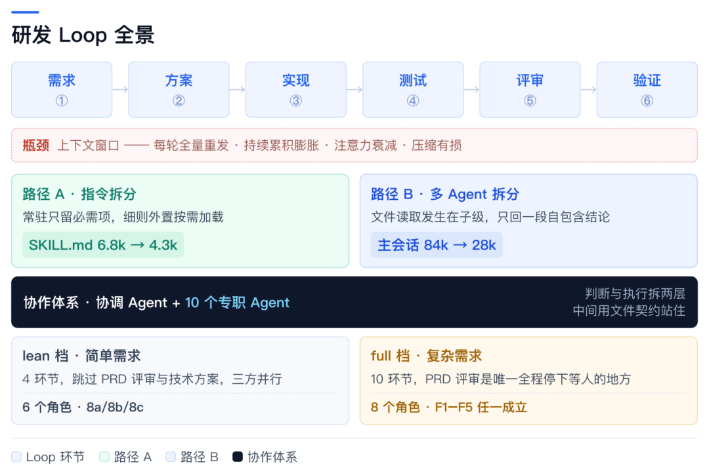

## 3. 具体做法

### 3.1 指令拆分的五项措施与实测收益

按成本性质把措施分成两组：前三条削「每轮必带」的固定成本，后两条削「每轮新产生」的增量成本。
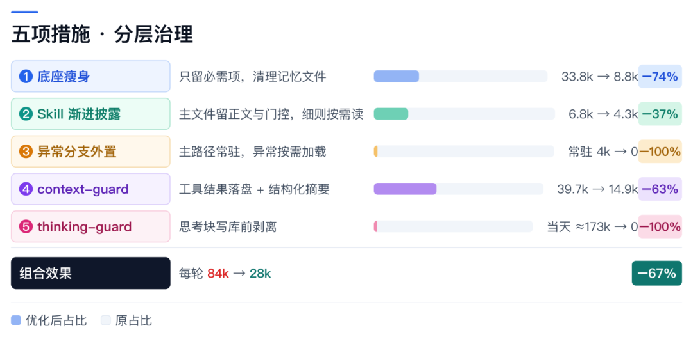
两点说明：①②③ 属于指令治理，重构一次就长期生效；④⑤ 属于运行时治理，作用在每一轮调用上，需要插件机制配合。直接砍 SKILL.md 会伤功能。做法是把指令分成两层：主路径正文常驻，细则与异常处理外置成可按需读取的片段；触发条件写进入文件，正文里只留「什么时候该去读哪一段」。
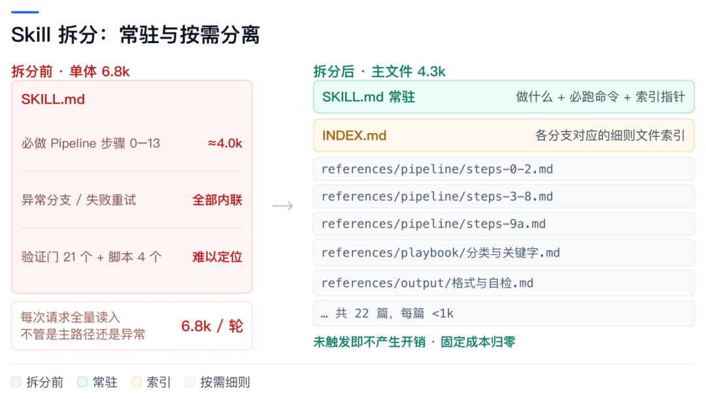
关键前提是常驻部分必须能独立完成常见请求。否则模型每次都要去读片段，往返次数增加，总成本反而上升。

### 3.2 多 Agent 拆分：过程隔离，只把结论带回来

指令侧优化后，剩下的大头是工具结果。一次排查要读二十来个文件、跑几轮命令，全部原文进入上下文，很快又回到 30k 以上。
做法是把「读文件」这件事从主会话移到子任务：子任务在自己的上下文里读完、判完，只回一段自包含结论。主会话不读 DOM 快照、不读全量 diff、不读被读过的源码。
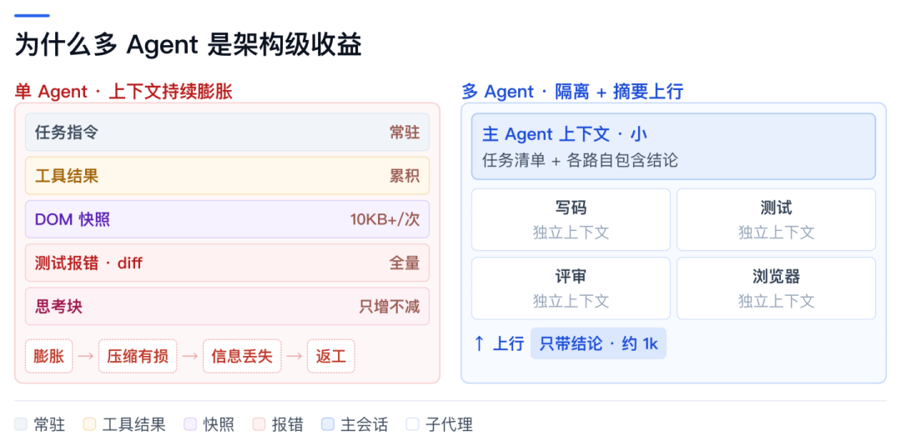
同样的任务，主会话自己读二十多个文件时，约 40k+ tokens 全部进入上下文；压缩一旦发生，丢的很可能是刚读进来的那个文件，于是回头再读，形成读取循环。拆出去之后，主会话只收到约 1k tokens 的自包含结论，过程细节零回流。
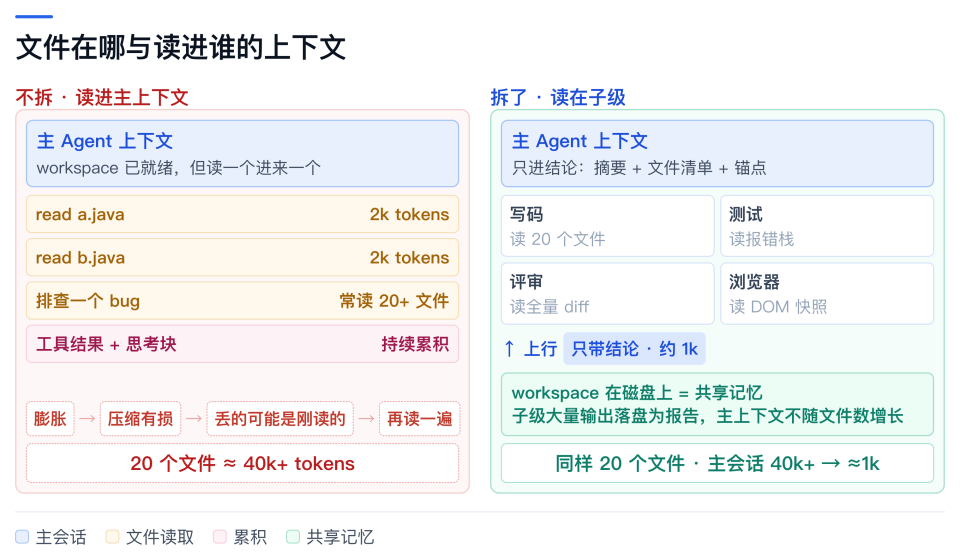
这里要区分清楚：拆的不是「Agent」，而是「文件读取发生在谁的上下文里」。子任务读的是同一份文件，读进来的内容也只占它自己的上下文。

#### 3.2.1 什么时候拆，什么时候不拆

拆不是越多越好。判断标准是反馈循环的紧密度：反馈循环紧的环节（改一行看一眼、反复微调）合在一起做，反馈循环松的环节（读一批文件、出一份结论）拆出去做。
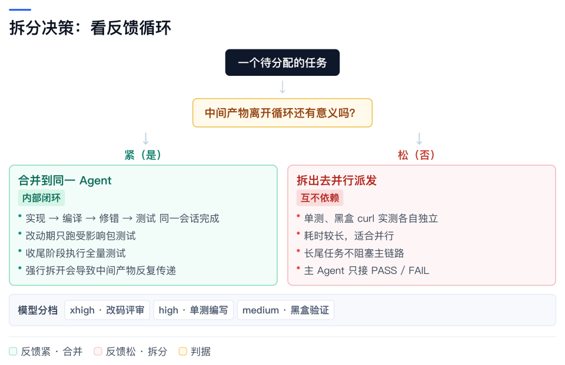

#### 3.2.2 研发 Loop 场景下要怎么拆

按上面的标准，一条研发 Loop 拆成一个协调 Agent 加十个专职 Agent：
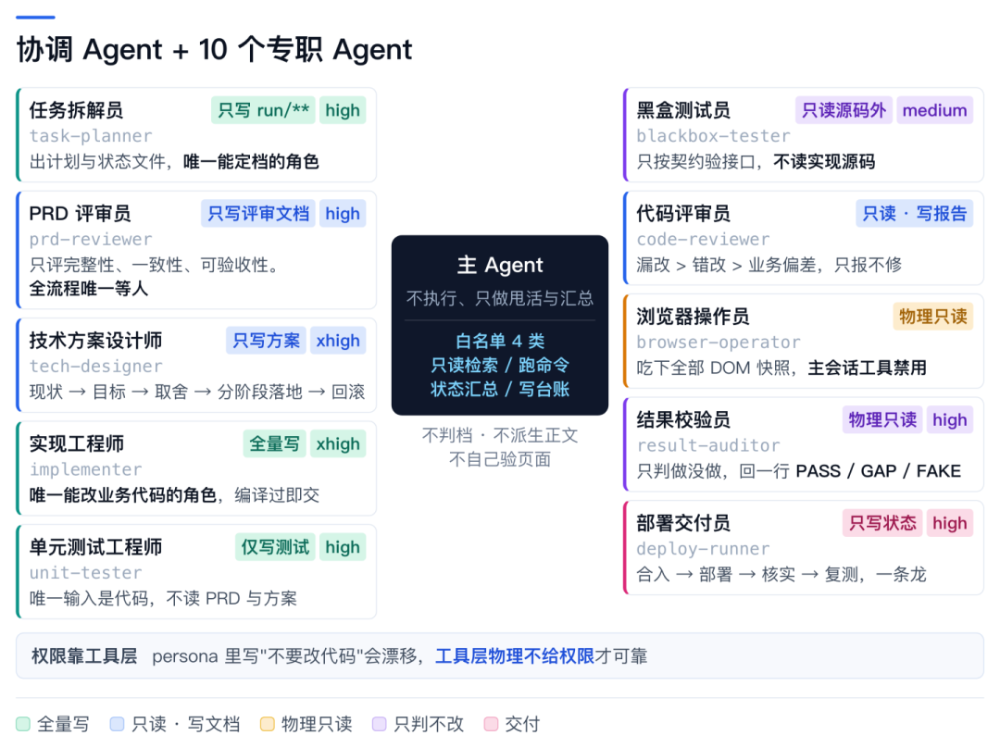
权限不靠提示词约束。「不要改生产代码」这类约束写在提示词里，模型在高负荷下会漂移；可靠的做法是在工具层直接不给写权限，主会话本身也不开浏览器工具。黑盒测试员额外禁止读取实现源码，因为一个读过实现的测试者写不出真正独立的断言。

#### 3.2.3 多 Agent 协作约定

主会话的职责只有四件：拆任务清单、派发、对账、汇总交付。它能做什么，取决于它拒绝做什么——不自己开浏览器验证、不读 DOM 快照、不读全量 diff、不猜、不原地修。四条通信约定：
下发自带上下文：目标、URL、账号、验证清单、报告路径随任务一起下发，子任务不「先问一句」。
回复自包含：结论 + 汇总 + 逐项明细 + 归因 + 产物路径，主会话不需要回读过程就能验收。
清单先行：只执行清单逐项对账，不自行扩充或缩减；清单与文档冲突时交回主会话裁定。
大块产物落盘：报告写文件，回复只带路径与摘要，上下文里不放整段原文。
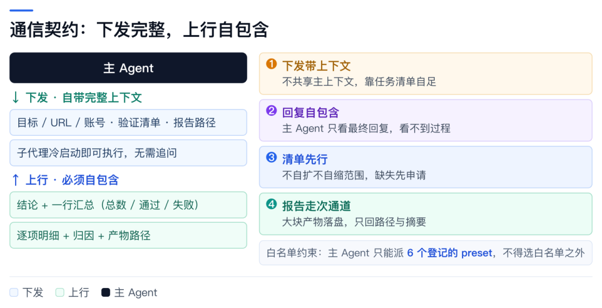
状态码是这套约定的机器可判定部分。主会话的下一步动作由状态码决定，不需要读懂全文：
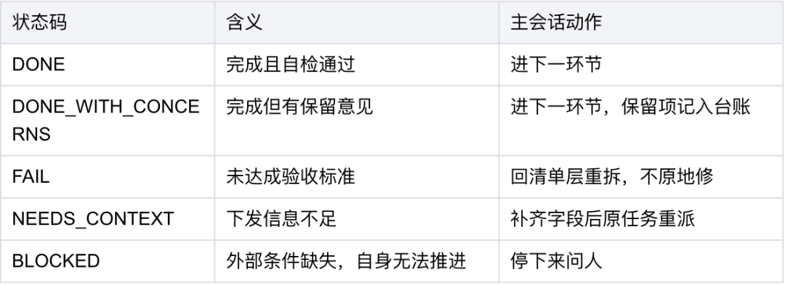
另有一条自洽校验：子 Agent 声称 PASS、但报告里出现失败项，判定为契约违约，结论不予采信。

#### 3.2.4 拆的任务粒度与验收门禁

一个子任务 = 一个可独立验收的最小交付物。三条可判定的边界：下限——能写出验收清单；上限——单任务的上下文装得下验收标准；范围——必须显式声明，不含「顺便」。
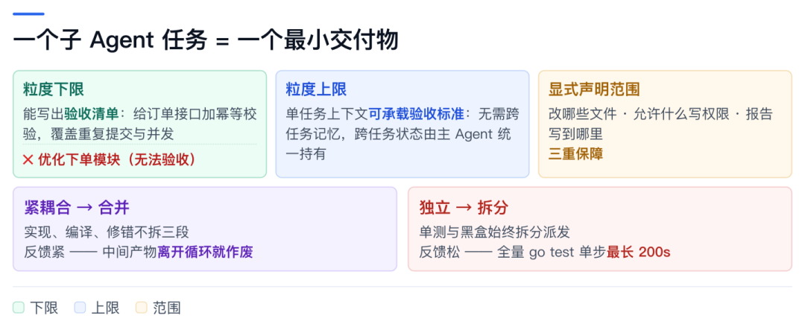
出环要有门禁。四道门的判据都是命令能跑出来、结果能数出来的，不用形容词：
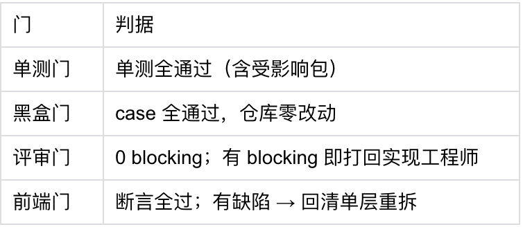
「不原地修」是硬纪律：缺陷一律回到清单层重新拆分，保证每一轮的收益可归因。

## 4. 端到端交付完整流程

### 4.1 一次完整的研发 Loop 时序

按复杂度分两档，同一套角色定义，只差启用几个、走几个环节：
lean 档（简单需求，默认）：4 环节——定档 → 编码 → 测试段（三路并行）→ 收口。6 个子 Agent 各占一个节点，零人工点。
full 档（复杂需求）：10 环节、13 个节点，10 个角色全部出场。PRD 评审是全流程唯一停下来等人的环节。
档位由五条判据决定。F1—F5 全部不成立即 lean；任一成立即 full：
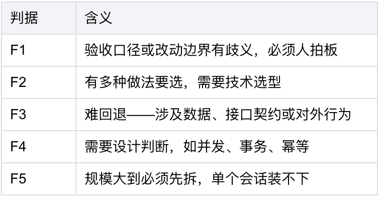
判不出来也按 lean：full 判错的代价是多一轮 PRD 评审的人工往返，lean 判错的代价只是少一轮评审与方案，执行角色照跑。lean 只减环节，不减角色。
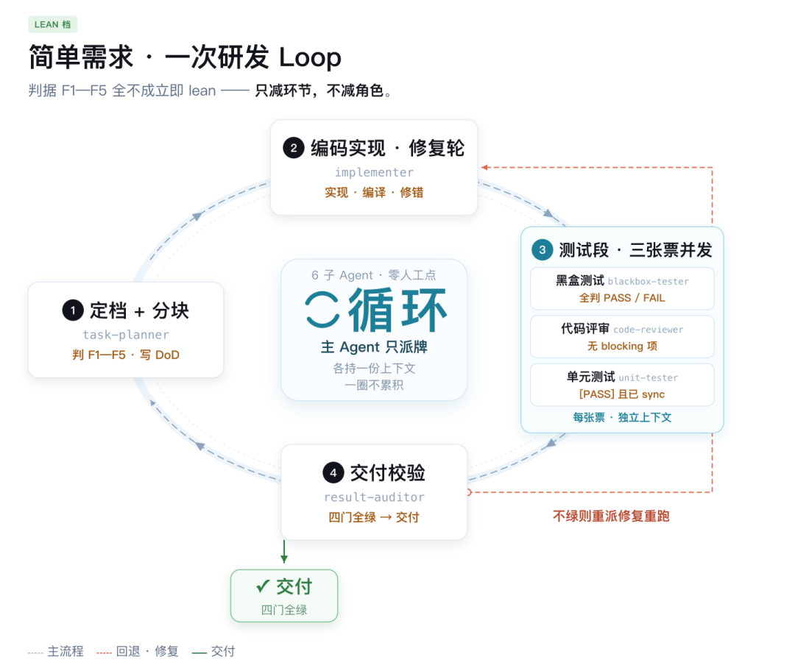
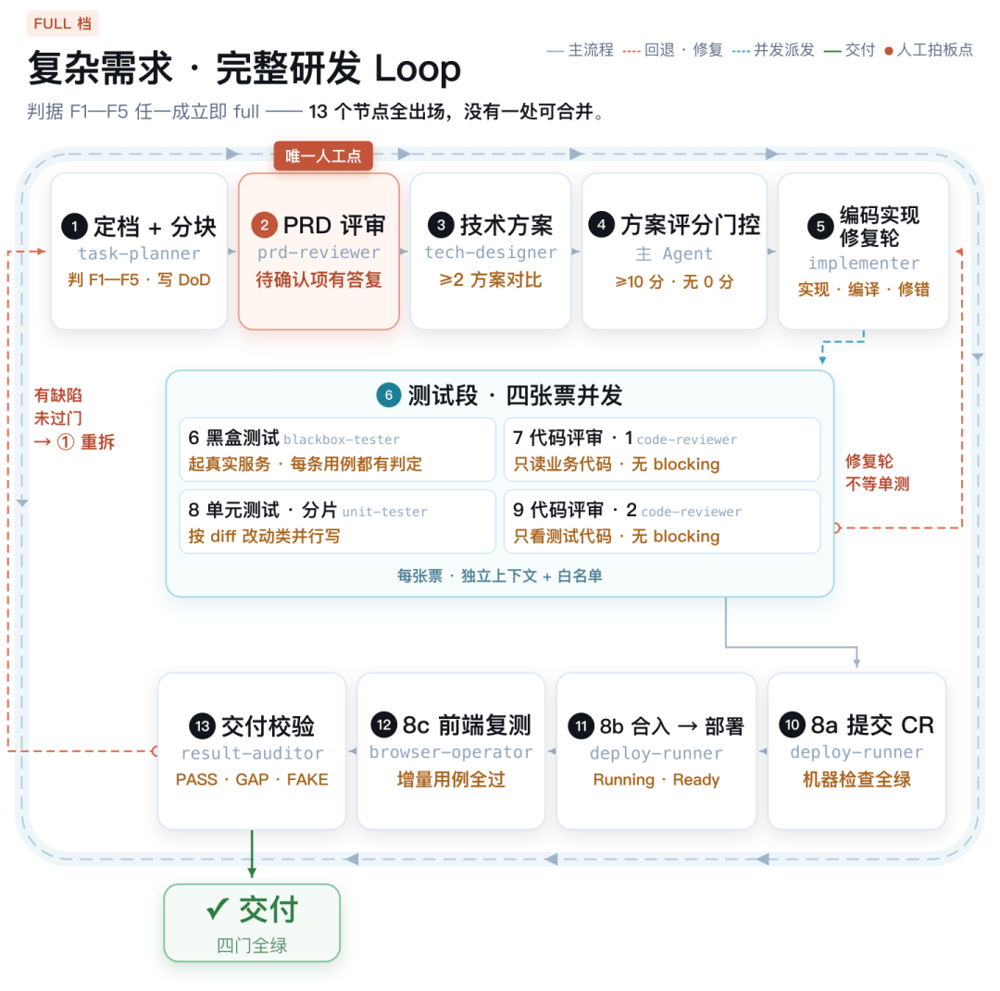
主会话全程只持有两样东西：任务清单状态、各环节的自包含结论。并行点出现在测试阶段——单测与黑盒测试并行派发，互不阻塞。

### 4.2 一次完整端到端交付

需求是内部交付系统的「订单到达分析」。从提需求（PRD已提前放到项目根目录），到 CR 合入、pipeline 部署 QA、前端增量复测通过。
人一共出现 4 次：提需求、PRD 评审、技术方案确认、验收。中间两次是要人拍板的判断门，其余环节全自动。

#### 执行流程

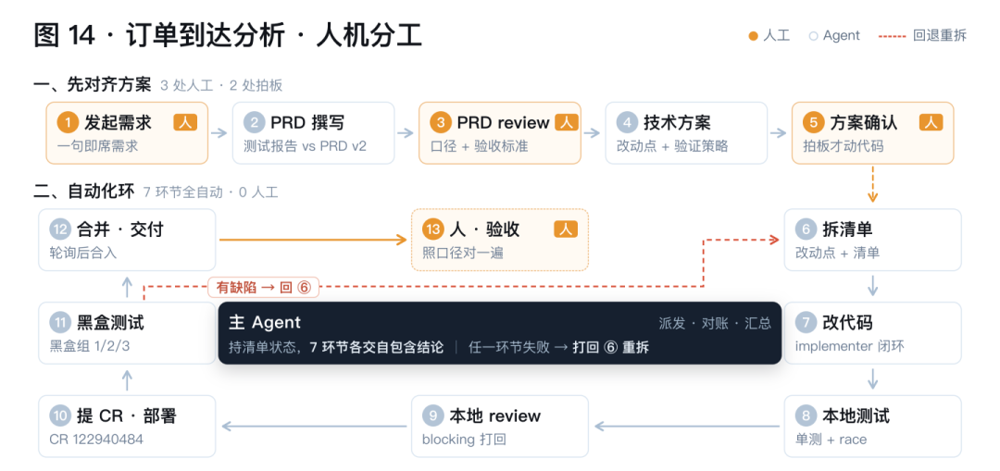
需求之后的七个执行环节依次推进：拆清单 → 改代码 → 本地测试 → 本地 review → 提 CR 与部署 → 黑盒与前端验证 → 交付。测试有缺陷则从验证环节回到清单重新拆，四门全绿才出环。
合并动作由部署交付员在 iCode 上完成：评审人 4 小时未打分即触发提醒通知，随后轮询评审状态并合并。提 CR 阶段产出 CR 与 pipeline 两次执行记录。
> 为什么人只在这 4 处出现：人该出现的位置不是「环节多」，而是「信息最不确定」。验收口径怎么算、改动边界划到哪，这两件事拿不准，后面所有验证都白做；一旦定下来，实现过程就是可被验证的执行——所以两道门之后，7 个执行环节不用人盯，出问题由门禁自动打回重拆。
为什么人只在这 4 处出现：人该出现的位置不是「环节多」，而是「信息最不确定」。验收口径怎么算、改动边界划到哪，这两件事拿不准，后面所有验证都白做；一旦定下来，实现过程就是可被验证的执行——所以两道门之后，7 个执行环节不用人盯，出问题由门禁自动打回重拆。

## 5. 上下文优化的可复用判断

先削「每轮都带」的固定成本，再治「每轮新产生」的增量——前者一次性投入、长期收益。
指令分层的前提是常驻部分能独立完成常见请求，否则按需加载会变成更多往返。
把读文件类工作移出主会话，是收益最大的一刀；主会话只收结论。
权限与边界要落到工具层，不要指望提示词。
压缩是有损的：要么让信息在落盘后可回读，要么别让它进入上下文。

## 6. 实践：把研发工作流改造成多 Agent 工作流的提示词

前面几节是结论。这一节把它变成可复用的一步：让 Agent 按固定工序，把你手上那条研发工作流拆成多 Agent 方案，并保证拆出来的东西在「上下文成本」和「可验收性」上都站得住。

### 6.1 怎么用

把下面的内容换成你自己的流程。越具体越好——有几步、每步产出什么、谁验收、最容易返工的是哪一步。
整段贴给具备文件与命令工具能力的 Agent（公司内的 DSH，或 Claude Code、Cursor 一类），不需要额外说明。
它会先追问缺的信息，再出方案。方案出来后按节改，不用从头再来。

### 6.2 提示词（可直接复制）

```text
你是研发流程架构师。你的任务不是写代码，而是把我现有的研发工作流拆成一套多 Agent 协作方案，并保证这套方案在「上下文成本」和「可验收性」上都站得住。
【我现有的流程】
-环节：<按顺序列出，例如 需求澄清 → 方案设计 → 编码 → 自测 → 评审 → 提测 → 上线>
-每一步的产出物：<例如 方案文档 / 代码 diff / 单测报告 / 评审意见 / 测试报告>
-验收人：<谁签字才算过>
-最容易返工的地方：<例如 需求理解偏差 / 自测覆盖不足 / 评审反复>
【目标】用尽可能少的主会话上下文跑完同一条链路；每个环节的产出都必须可判定。
【必须输出的内容，按这个顺序】
1.角色表：角色名 / 一句话职责 / 输入 / 输出 / 写权限（全量写 · 仅测试目录 · 仅方案与台账文档 ·物理只读）/ 模型档位 / 为什么需要它。某环节不需要独立角色时明确写「合并」，并说明理由。
2.拆分判据：逐个环节判断「反馈循环紧不紧」，紧的合并、松的拆出，给出依据而不是结论。
3.单个子任务的粒度定义：下限（能写出验收清单）、上限（上下文装得下验收标准）、范围（显式声明，不含「顺便」）。
4.交接协议：主会话下发任务必须带哪些字段；子任务回报必须带哪些字段；状态码集合及每个状态码对应的动作。
5.验收门禁表：每道门的判据必须是可执行的命令或可数的数字，不许用「质量良好」「基本通过」这类形容词。
6.失败处理：子任务返回 FAIL / BLOCKED / NEEDS_CONTEXT 时主会话分别做什么；什么情况下必须停下来问人。
7. 权限与安全边界：哪些能力必须从工具层禁用而不是写在提示词里；哪些动作必须保留人工门禁。
8. 迁移步骤：从现有流程切到新方案，先做哪一步、怎么灰度、怎么回退。
【约束】
- 不要发明新名词。角色就叫「做什么的人」，不要用「一主六从」「舰队」这类缩写。
- 不要假设我有人力扩充；方案必须在「1 个人 + 1 个 Agent 工具」的规模下成立。
- 每个环节都要能回答「这一步省了什么」：上下文 token、往返次数，或返工次数。
- 信息不足时先提问，不要编。一次最多问 5 个问题，且必须是你确实无法从上面推断的。
【输出格式】Markdown。第 1、5、6、7 项用表格，其余用短段落。全文不超过 1500 字，宁可少写也不要重复。
```
