# 动态图解：DeepSeek 的 Super-agent 架构

> **摘要**：DeepSeek Harness 团队的架构实践，用 30 张动态图解讲透 Super-agent。**核心矛盾**：Session 为主的 Agent 撑不起多任务协作——DeepSeek 观察到一个 人通常只能同时跟进 3 到 5 个活跃 Session。**四个特征**：连续、高效、主动、持久。**五个模块**：双层架构（Router + Worker）、事件驱动、面向人的交互、计算/状态/环境分离、Watchdog。方法论上大量借用经典系统设计——**Fast Path/Slow Path** 做事件过滤与路由、**Thread 订阅直通** 绕开 Router、**Inline/Spill** 管上下文窗口、**链式召回（Chain of Recall）** 按需取回旧任务、**投机执行** 做提前行动、**存算分离** 解绑设备生命周期、**异步 ReAct Loop**（start/stop）消掉阻塞。消融实验：Super-agent 完成时间 P50 **12.4 分钟**，显著优于单 Session + Subagent（中性提示 20.4 分钟）；直通机制让 Router 的决定量少 30%、token 少约 37%。Router 批处理实验证明一个常驻 Router 扛得住每分钟 40 条 Trigger。

```markmap height=480
# DeepSeek Super-agent 架构
## 问题：Session 撑不起多任务
- 单 Session 串行·上下文混
- 一事件一 Session·结果割裂
- 人只能跟进 3~5 个活跃 Session
- 单任务能做多好=看模型
- 同时能做几件=看人的注意力
- 需要 Agent 与「一次会话」解绑
## 四个特征
- 连续：跨信道同一 Agent
- 高效：并行做完好几件
- 主动：自己挑值得处理的
- 持久：在线·异常能自恢复
## 五个模块
- 双层架构 → 连续+高效
- 事件驱动 → 主动
- 面向人的交互 → 连续+高效
- 计算/状态/环境分离 → 跨设备在线
- Watchdog → 异常自恢复
## 双层架构
### 根本权衡
- 连续性 vs 吞吐量
- 全同一 Session：连续但慢
- 每事件一 Session：快但割裂
### Router 层
- 常驻·全局序点/协调点/记忆
- 只管交互和分派·连 Bash 都省
- 与 Agent Team 的区别
  - Team Lead 深入细节重推理
  - Router 只管任务间高层关联
- 层内切分粒度问题未解
### Worker 层
- 上下文隔离·最强模型
- 只汇报状态·推理留在内部
- 撞车点在共享工作环境
  - 同一 PR/Thread 都订阅
  - 自行发现自行解决冲突
- Worker 内可再开 Subagent
  - 甚至本身是 Agent Team
## 事件驱动
### 一、过滤（Fast/Slow Path）
- 大模型=慢路径·规则=快路径
- 程序层 Fast Path
  - 来源/群组/白名单准入
- 语义层 Slow Path
  - LLM 按提示词策略判断
  - 也是自然语言扩展点
### 二、路由
- Thread=同一话题的连续事件流
- 已订阅 Fast Path
  - 程序直接送 Worker
  - 可退订或交回 Router
- 未订阅 Slow Path
  - Router 判断新事件
- Thread↔Worker 多对多
- 直通价值：Router 决定量少 30%
### 三、上下文放多少
- 塞多挤占窗口·塞少反复调工具
- 浪费上下文=浪费模型智能
### Inline / Spill
- Inline 内联近期大概率用到
- Spill 溢出留引用或摘要
- 局部性原则逐步展开
- 超出上限截断+留续读入口
### 链式召回 Chain of Recall
- Trigger/Thread/Session 分配唯一 ID
- 内联紧密关联对象 ID
- 底层连成引用图
- 每次召回又内联下一跳
- 长周期运行的关键
### 四、提前行动（投机执行）
- 结果不确定先后台试
- 会议邀约→查冲突+备草稿
- DeepSeek Harness 静默复现并修复
## 面向人的交互
### 全双工
- 经典 ReAct 同步阻塞
- 异步 start()/stop()
- 已启动即返回·结果当新事件
- 已实现但未默认开启
### 多信道
- 即时通讯信道
  - 少打扰·只在需决策时通知
  - 单次回复不超过 100 词
- 异步信道
  - PR/邮件/文档
  - 结构化高密度交付
## 一直在线（存算分离）
### 现状问题
- 计算+状态+环境绑同一设备
- 休眠即全停
### 第一步 计算与状态分离
- 无状态弹性计算容器
- Session 状态存数据库
- 容器可扩可换可重启
### 第二步 计算与环境分离
- 云端重建环境成本高
  - 未提交修改/私有凭据/内网依赖
- 端侧轻量 daemon
  - 只执行命令返回结果
  - 环境留在原地
- 与 Anthropic 脑手分离一致
  - 区别：Anthropic 讲托管服务
  - DeepSeek 先接个人开发机
- 支持 BYOM
- 设备上线自动接活
## Watchdog
- 主系统外独立 Control Loop
- 异常常出在模型身上
  - 进程活着但陷入无效循环
- 既盯基础设施也盯任务进展
- Watchdog 自己是 Agent Session
  - 可用自然语言问故障原因
  - 可在线改主系统行为
## 消融实验
- 合成负载·简化环境·仅初步参考
- 群聊+CI 两路·300 条消息
  - 约 20 条工作请求
  - 每方案跑 5 次
- 四方案对比
  - Super-agent P50 12.4 分钟
  - 去直通 12.6 分钟
  - 单 Session 中性提示 20.4 分钟
    - 5 次一次 Subagent 没调
  - 提示优先委派 13.8 分钟
    - 4 次委派·1 次自己干=长尾
- 分工由系统定，不由提示词定
- 直通省 Router 决定量 30%
  - token 2323 万→3177 万（+37%）
## Router 批处理实验
- Router 真实模型·Worker Mock
- Trigger 到达 1→40 条/分钟
- 平均批 1.0→2.8 条
- 单次请求 2.5→3.9 秒
- 每个决定摊推理 6.4→1.6 秒
- 结论：自动合并积压提有效吞吐
  - 一个 Router 够用
## 四个开放问题
- 双层架构怎么扩展
  - Router 何时切分/粒度
  - 同层 Worker 直接通信拓扑
  - 模型与系统协同设计
  - 长程记忆是扩展瓶颈
- 没了 Session 人怎么协作
  - 交互往专属界面迁移
  - 可见会话≠底层单 Session
  - 需支持中途插手接管
  - 形态高度定制化
- 上下文边界与 A2A
  - 组织范围=划共享隔离边界
  - 实例间安全可靠协作
- 安全与隐私
  - 云端 Agent Loop 接不可信输入
  - 端侧有私有代码和凭据
  - 云端失守→所有端侧被控
```

---

本文紧随：Super-agent 设计探索：迈向更自主的 Agent 系统

本文用更加可视化的表达来展示 DeepSeek Harness 团队的工程实践，以及架构思路探讨

作为一个引子，在 DeepSeek 内部有 Super-agent ，它能够常驻在公司的群聊和 GitHub 里，并同时推进多件事儿
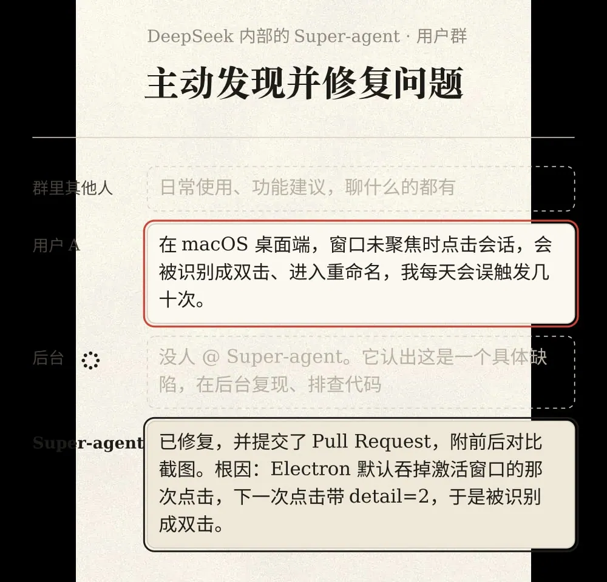

在这个过程中，群里有人抱怨了一个 bug（并没有 @ Agent），但 Agent 自己便可以去复现、找到根因，把修复的 Pull Request 交了上来

## 卡住在人

过去一年，以 Coding Agent 为代表的单任务 Agent，已经证明了模型能用工具解决复杂问题，而且越来越少需要人在旁边盯着、一步步干预

同时，模型的多 Agent 协同能力也在变强，跨会话去组织、调度一批 Agent，开始变得可行

于是人的角色开的发生变化：底层执行插手得越来越少，精力更多放在决策和验收上

最近集中冒出来的个人助手（Personal Agent）就是这么来的：直接接进日常的消息、日程、邮件和工作平台，一直看着信息流，顺手把事情办了

这种「一直在线、来了事件就处理」的工作方式，个人助手只是其中一种用法；放在软件开发这类商业场景里，一样很有价值

问题在于，今天主流的 Agent 设计，撑不起多任务、团队协作这个规模

Agent 多以单个 Session 为基本单位，Session 和 Session 之间互不相通。当你需要同时推进几件事，就得自己在几个 Session 之间来回切，还得记住每个 Session 里聊到了哪

DeepSeek 观察下来，一个人通常只能同时跟进 `3 到 5 个`活跃的 Session

Session 一多，人就顾不过来了，看一看：
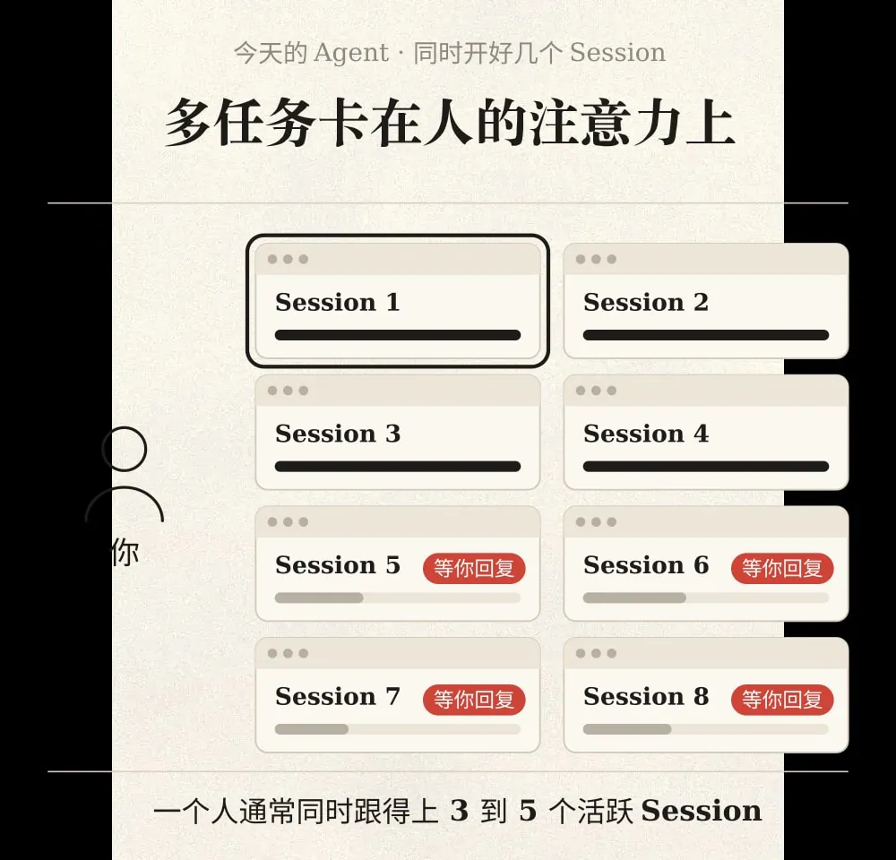

换句话说：**单任务能做多好，看模型；同时能做几件，看人的注意力**

那给现有的 Agent 接上 CLI、MCP 或者外部连接器，让它也能收外部消息，行不行？

可以，但是有问题的：单个会话是同步阻塞的，一件事没做完，下一件进不来；多个任务的上下文搅在一起；本地电脑一离线，Agent 也就停了。维护它，要花大量的人力

所以我们需要把把 Agent 和「人手动开的某一次会话」解绑，让它变成一个连续存在的实体：跨会话记得上下文，同时推进好几件复杂的事，彼此不打架

这种 Agent 形态，连同它背后的系统架构，DeepSeek 叫它 Super-agent

还是以 DeepSeek 内部，那个基于 DeepSeek Harness 跑着着的 Super-agent 作为例子：同一个开发任务，可以在群聊里提、在 GitHub 上接着改

一件事换了地方说，它照样接得上，看一看：
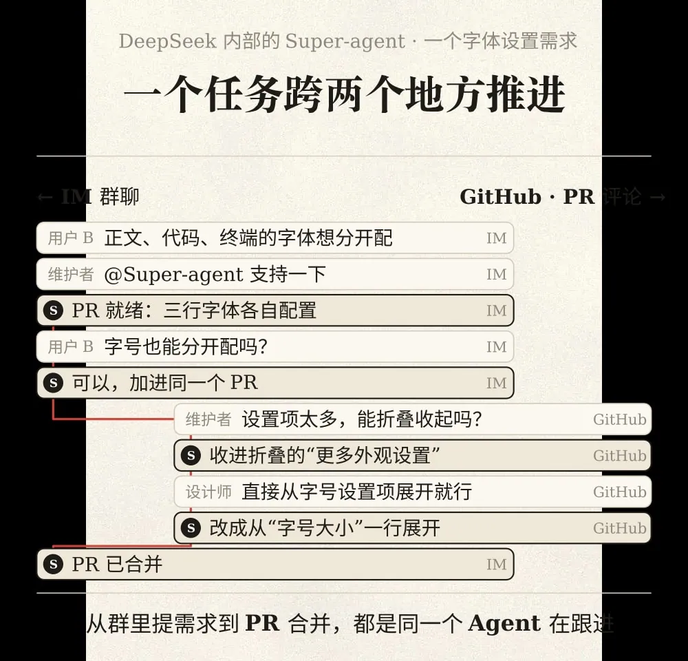

开头那个「没人 @ 也自己修 bug」的场景，也来自这个实例：它一直看着公共群聊里的反馈，在没人 @ 它的情况下，主动定位根因、提交修复

## 四个特征，五个模块

DeepSeek 给 Super-agent 定了四个基础特征：
- **连续**：你在群聊、GitHub 评论这些熟悉的地方跟它说话，感觉始终只有一个 Agent，「Session X 的上下文里有没有 Y 这条信息」，交给它自己操心。比如你先在群里定了方案 A，后来在 Pull Request 评论里改成方案 B，它能理解，并跟着调整
- **高效**：回话快，同时能并行、高质量地做完好几件复杂的事；上一个命令、上一个任务还没完，就能接下一条指令
- **主动**：它自己看着环境里发生的事，挑值得处理的往前推；用不着它的时候，就安静待着
- **持久**：一直在线，直接接进你真实的工作环境，长期跑下来出了异常，能自己恢复

这四个特征落到具体场景里，是这样的：
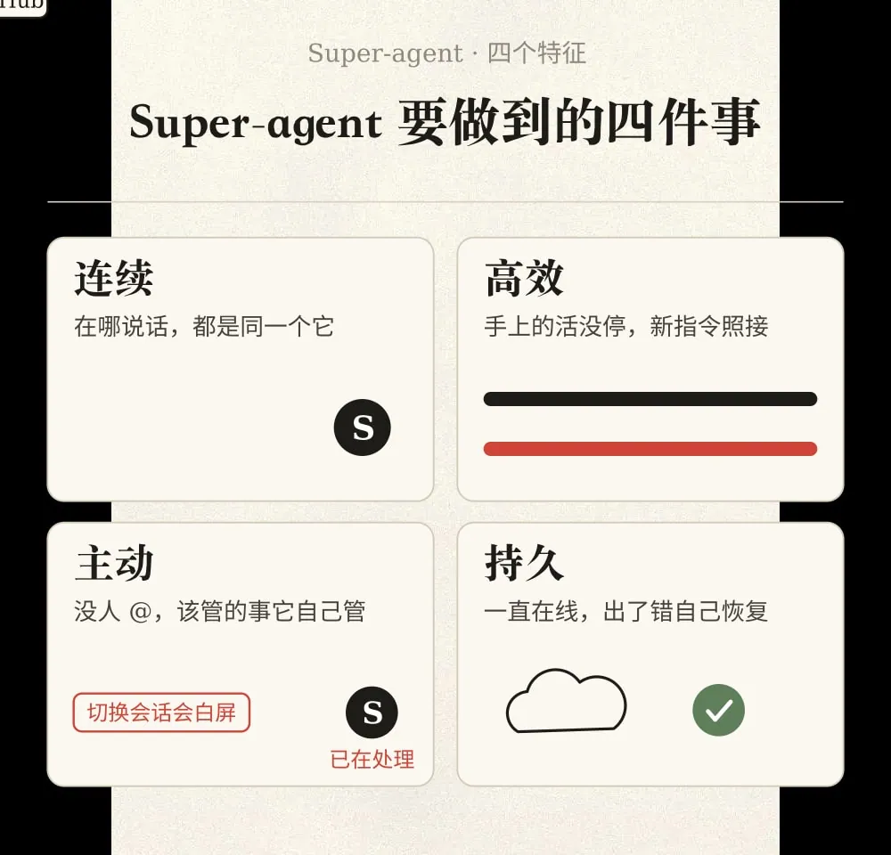

一个 ReAct Loop（模型想一步、调一次工具、看结果、再想下一步的循环）同时撑不住这四条，底下得有一套相应的架构

相似的设计约束，会推出相似的架构。不管是个人助手，还是软件开发里的 Agent，只要目标是「一直在线、并发响应环境里的事件」，底层大概率会长得差不多

而且一路遇到的问题，和传统计算机系统研究了几十年的问题高度相似，所以很多经典的系统设计思想，在这里照样好用。后面你会反复看到 Fast Path、缓存、局部性、投机执行、存算分离这些老面孔

具体落地会有各种变体，但 DeepSeek 认为，下面五个模块是撑起这四个特征的基本框架：
- 双层架构：同时做到连续和高效
- 事件驱动：做到主动
- 面向人的交互：在跟人来回沟通时，也做到连续和高效
- 计算、状态与环境的分离：跨设备一直在线
- Watchdog：出了异常自己恢复

一条群聊消息从进来到收到回复，会挨个经过这五个模块，看一看：
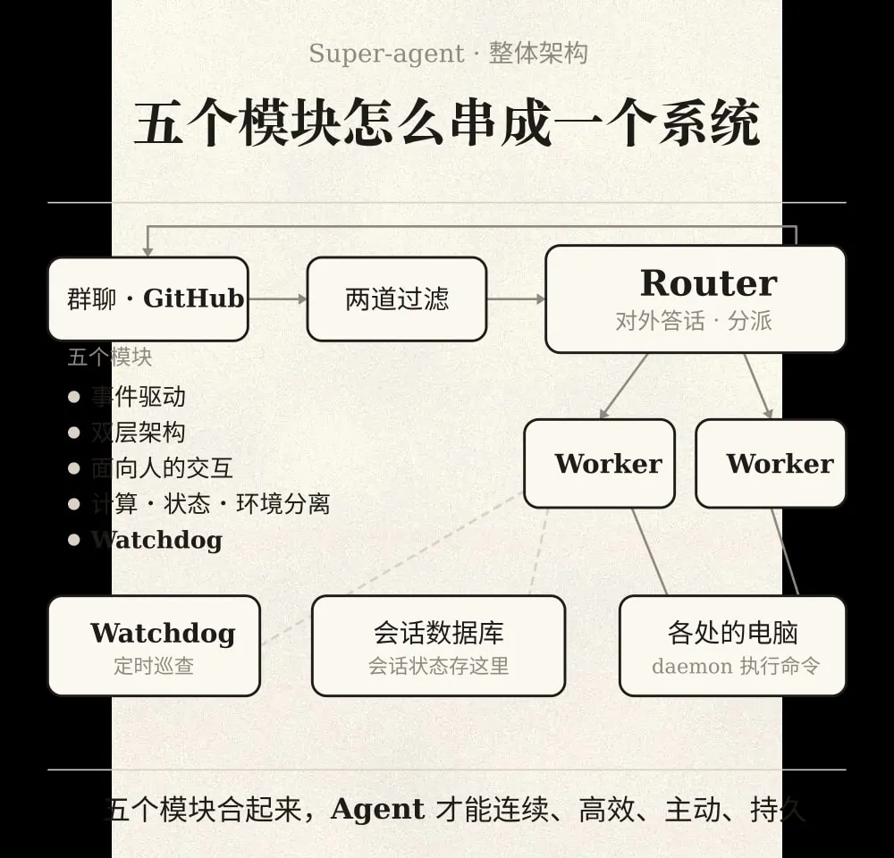

## 双层架构

要让交互跨信道连续、多任务又能高效并发，底层怎么组织会话，绕不开一个根本的权衡：连续性和吞吐量

一种极端，是所有事件都交给同一个 Session。上下文最连续，但单个 ReAct Loop 只能串行地一步步干，速度有上限，任务完成得慢、吞吐低；好几个任务的中间细节混在一起，还会拖累完成质量

另一种极端，是每来一条事件就新开一个 Session。并发吞吐最高，可任务之间往往不完全独立，缺了全局上下文，各个 Session 的结果彼此割裂；好几个 Session 还各自给用户回话，交互一团乱

两种极端各自卡在哪：
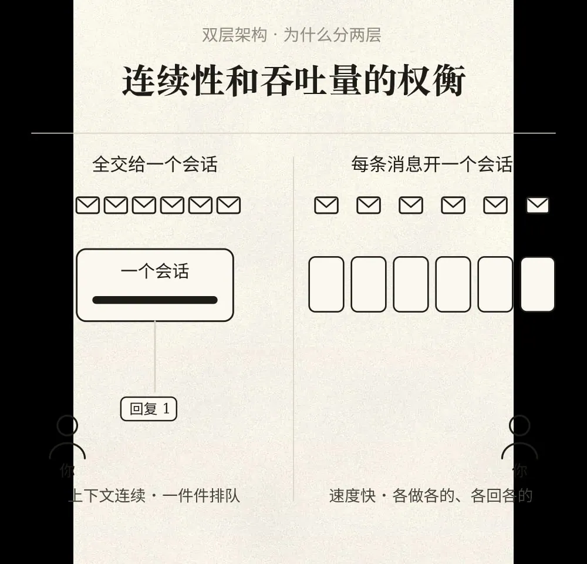

DeepSeek 的解法，是把「维护全局连续性」和「高并发执行」拆到两层：
- 上层是常驻的 Router 层，统一接住人的交互，负责全局协调
- 下层是 Worker 层，每个 Worker 上下文互相隔离，并发执行具体任务

拆成两层以后，人只跟 Router 说话，活由 Worker 去做：
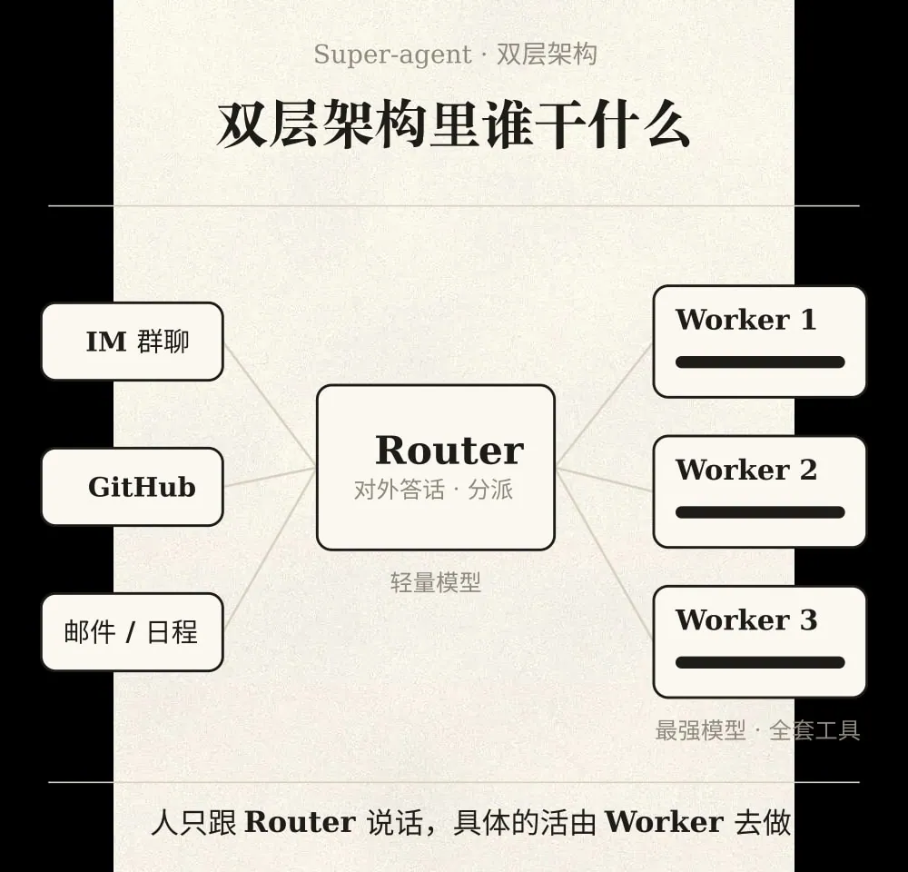

这样一来，上下文管理和并发执行都被系统在底层接走了，用户那一侧几乎感觉不到 Session 的存在，面对的始终是同一个 Super-agent

从这个角度看，让用户手动管理 Session，很大程度上是从底层 LLM API 一路延续下来的设计惯性。**Session 应该是系统内部的实现细节**

还有一层意思：现在的 Session 身兼两职，技术上管上下文，产品上管项目。把产品形态和底层 Session 解耦以后，项目管理就能脱开 Session 单独设计，「给用户什么样的交互和任务管理方式」就成了一个独立的产品问题（文章最后的开放问题里还会聊）

另外，「双层」说的是逻辑上的分工。每一层在实现上都可以有自己的内部结构，由好几个 Session 组成

### **一、Router 层**

Router 层常驻，承接所有入口进来的人类交互。所有跨任务的信息和决策都在这里汇总，它同时是全局的序点（Sequence Point，所有事情在这里排出先后）、协调点和记忆

为了让这个全局节点保持轻快，Router 只管跟人交互和分派任务，具体的活都交出去，甚至可以连 Bash 工具都省掉

一个中心节点分派多个执行节点，乍一看和常见的 Agent Team 很像。两者的区别在于，中心节点要管到多细：
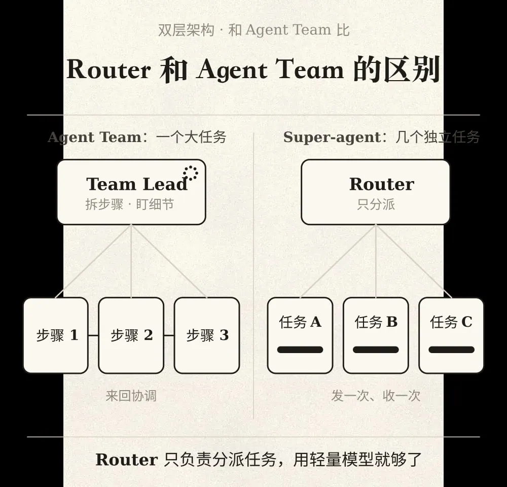

Agent Team 主要拿来拆解单个复杂任务、让不同角色协作。子步骤之间通常耦合很紧，Team Lead 得深入理解任务细节、规划子任务、高频协调各个成员，自己背着很重的推理负担

Router 只处理任务和任务之间的高层关联和分派，单个任务内部怎么拆，交给 Worker

反过来，如果你用提示词约束一个 Agent Team 的主会话：只负责对外交互，把不同的任务分给各个成员独立推进，那它也可以算作这种双层架构

DeepSeek 的实践经验是，Router 的活常常没想象中复杂，用一个比较轻量的模型，往往就能兼顾速度和效果

Router 层内部同样可以由好几个 Session 组成，有些逻辑甚至用普通代码就能写。DeepSeek 选了最直接的做法：一个常驻的 LLM Session 当 Router 的核心

那一个会话，扛得住整个团队的消息吗？

比看上去扛得住。原因是批处理（Batching）：上一轮推理期间到达的环境事件（也就是后面要讲的 Trigger）会先攒着，下一轮一起处理，合并处理的额外开销很小

Router 就是这样扛住消息高峰的，看一看：
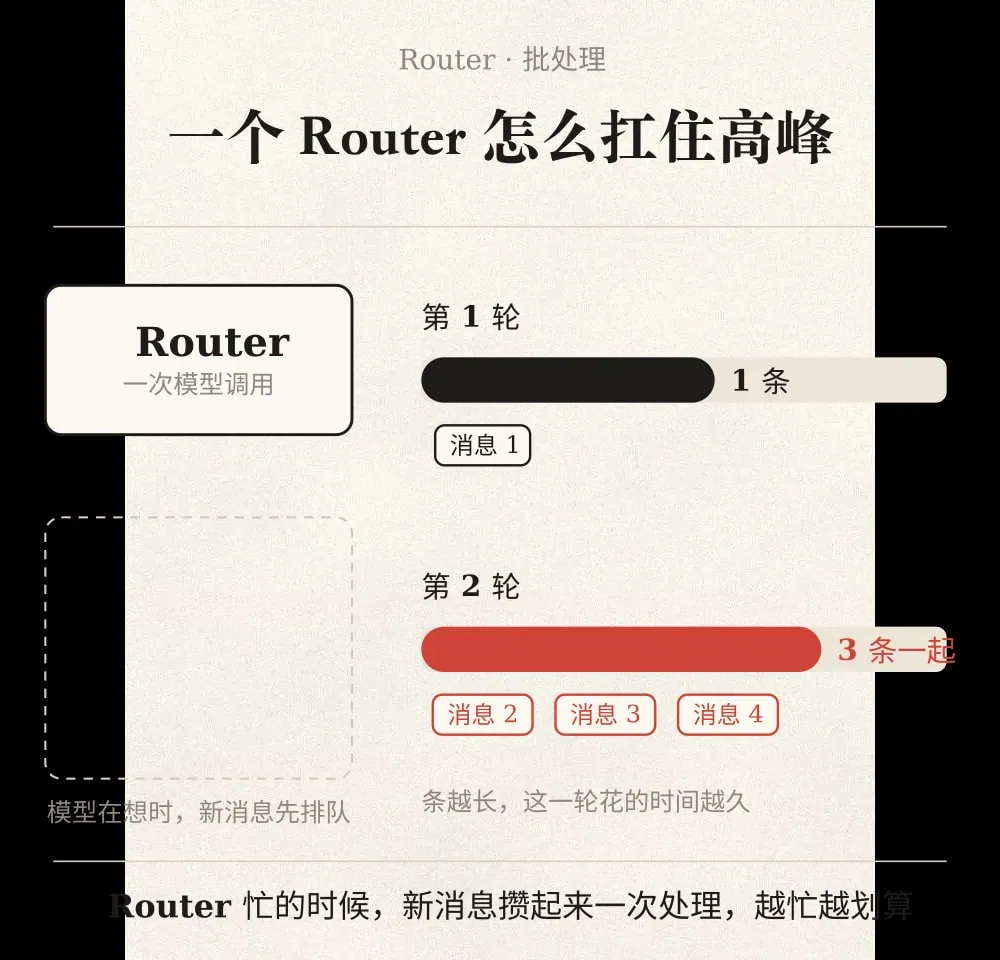

- 外部事件流平稳的时候，Trigger 一条条进 Router，单次响应的延迟很低
- 事件密集涌进来、Router 开始排队的时候，上一轮推理期间积压的几条 Trigger 自动合并，在下一次调用 LLM 时一起注入

为什么合并很划算？Router 只做轻量的交互和分派，每一步通常是长输入、短输出。把积压的几条 Trigger 合进一次 LLM API 调用，它们在 Prefill 阶段（模型读输入的阶段）是并行计算的，单次请求的耗时，涨得远比批的大小慢

所以在一定范围内，积压得越多，摊到每个决定上的推理时间反而越短。上限有两个：上下文长度，以及模型在一轮里能准确处理多少条 Trigger

文章第 7 节用实验定量验证了这一点，后面会讲。再加上订阅直通和链式召回这两个机制（也在后面），一个常驻的 Router Session 既保住了上下文连续，在他们目前的团队规模下也已经够用

如果规模再往上走、一个会话真的扛不住了，Router 层内部可以做成多层过滤，或者水平切分（Sharding）成几个会话

这时候 Router 层的内部设计，本质上又回到了连续性和吞吐量的权衡：切得越细，并发吞吐越高，分片之间的记忆和上下文就越不连续。**全局记忆的问题解决之前，这个权衡会一直存在**

### **二、Worker 层**

Worker 层由真正干活的会话组成。每个 Worker 上下文互相隔离，挂着完整的执行工具，在独立的上下文里专心做一件事

Worker 直接决定任务结果和代码质量，所以通常要配能力最强的模型

Worker 只向 Router 汇报状态，推理过程和工具调用都留在自己里面，由 Router 统一回复用户。这样既保住了并发度和交付质量，也避免了好几个会话各说各话

多个任务并发时，各个 Worker 各推各的

它们真正会撞车的地方，往往是同一个 Pull Request 这类共享的工作环境。只要它们都订阅了对应的 Thread（同一个话题、同一个 PR 下的一串消息，第 3 节细讲），就会收到同样的事件通知，有机会自己发现、自己解决冲突；少数需要跨任务协同的，由 Router 中转

和 Router 一样，单个 Worker 内部也可以有好几个会话：碰到复杂的单任务，Worker 里面可以再开 Subagent，它本身也可以就是一个 Agent Team，这些对上面的 Router 都是透明的

这个结构在写代码的场景里好用：同时推进几个互不相干的问题复现、Pull Request 评审和新功能开发，谁也不堵谁

放到个人助手里也一样。个人助手在界面上通常只有一个聊天页，但你在同一个对话框里同时聊好几件事时，前端这一个聊天页负责交互的连续，底下可以给每个话题各派一个 Worker，并行推进、起草回复

一个聊天框里同时办几件事，是这样的：
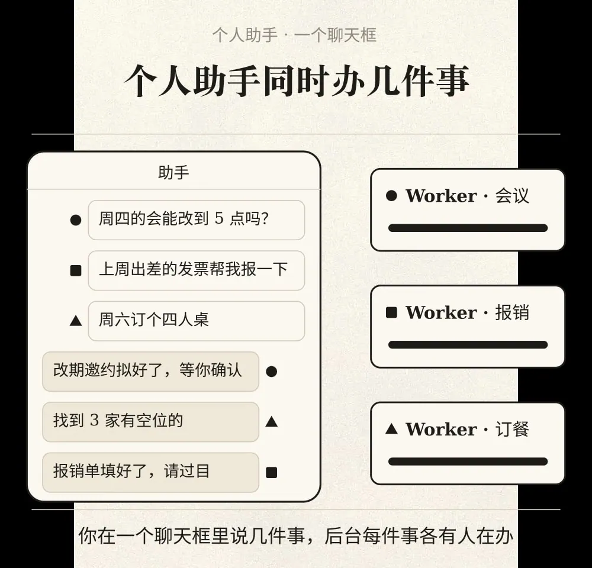

## 事件驱动

要让 Super-agent 主动起来，先得换掉驱动它的方式

驱动 Agent 的主要输入，从人在 Session 里一条条敲的提示词，换成了环境里的半结构化事件：群聊消息、邮件和日程提醒、代码审查评论、CI 运行结果……在 Super-agent 里，这些统称 Trigger

监听并响应 Trigger，Agent 就能根据环境里发生的事，自己动起来

围绕一条事件从进来到被处理的一生，原文依次回答了四个问题：怎么过滤噪音，怎么路由给 Worker，往模型的上下文里塞多少，以及能不能提前行动

### **一、过滤**

接进真实的群聊和代码平台之后，事件流的特征很鲜明：噪音高、真正需要触发的少，绝大多数日常消息用不着 Agent 介入

如果每条事件都让大模型从头判断一遍，延迟和算力成本都扛不住

这里借的是计算机系统里的 Fast Path / Slow Path 思想：大模型推理灵活但贵，是 Slow Path；把已经明确、稳定的高频判断写死成确定性的代码，就是又快又便宜的 Fast Path

所以事件进系统的第一步是过滤：在调大模型之前，先用确定性的规则筛掉噪音，只把需要理解语义的候选事件交给模型。具体是两级：
- **程序层（Fast Path）**：按事件来源、群组范围、用户或机器人白名单这些确定的条件，直接用代码做准入检查。比如给不同来源分别设成「只响应明确请求」「作为候选事件」或者「直接忽略」，在调模型之前就筛掉大部分无关消息
- **语义层（Slow Path）**：过了程序层的候选事件，交给 LLM，按提示词里写好的策略和上下文，判断要不要行动。语义层同时是给人用的自然语言扩展点，想开关某条策略、加一条新策略，改提示词就行

一条消息要过两道筛子，才会有人处理：
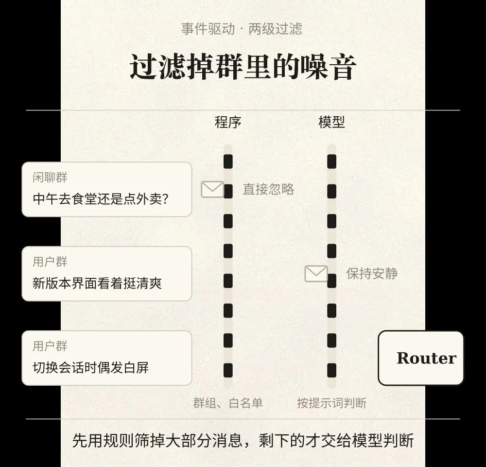

### **二、路由**

Router 层负责跨信道的连续性，但如果一个任务分出去以后，它的每条后续事件还得经 Router 转一手，这个全局节点照样要背大量负载，响应延迟也会被拉高

所以 Fast / Slow Path 这招，在过滤之后的路由上再用一次：Router 只负责新任务的冷启动和跨任务协调；已经确定归属的后续事件，由程序直接发给对应的 Worker

这里要先认识 Thread。实际工作里，同一个 GitHub Pull Request、同一个群聊话题、同一串往来邮件下的连续事件，构成一条事件流，就叫 Thread

消息按事情归成一串一串，后面的路由都靠它：
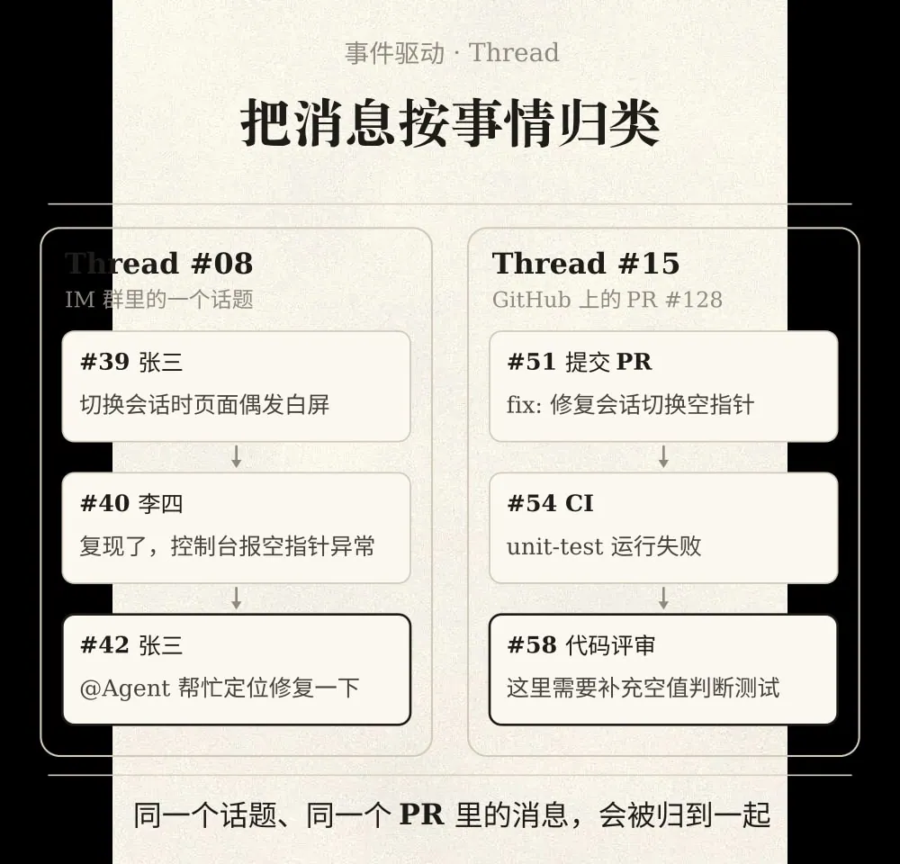

Router 根据某个 Thread 的第一条事件开出一个 Worker 之后，这个 Worker 会直接订阅这条 Thread。事件路由于是分成两条路：
- **已订阅（Fast Path）**：同一个 Thread 里的后续事件，由程序直接送到订阅它的 Worker。如果新事件超出了当前任务的范围，Worker 也可以退订，或者交回 Router 重新分派
- **未订阅（Slow Path）**：Router 仍然能看到所有事件，掌握全局状态，但只负责判断、分派还没人订阅的新事件

后续消息绕开 Router、直接送到 Worker，过程是这样的：
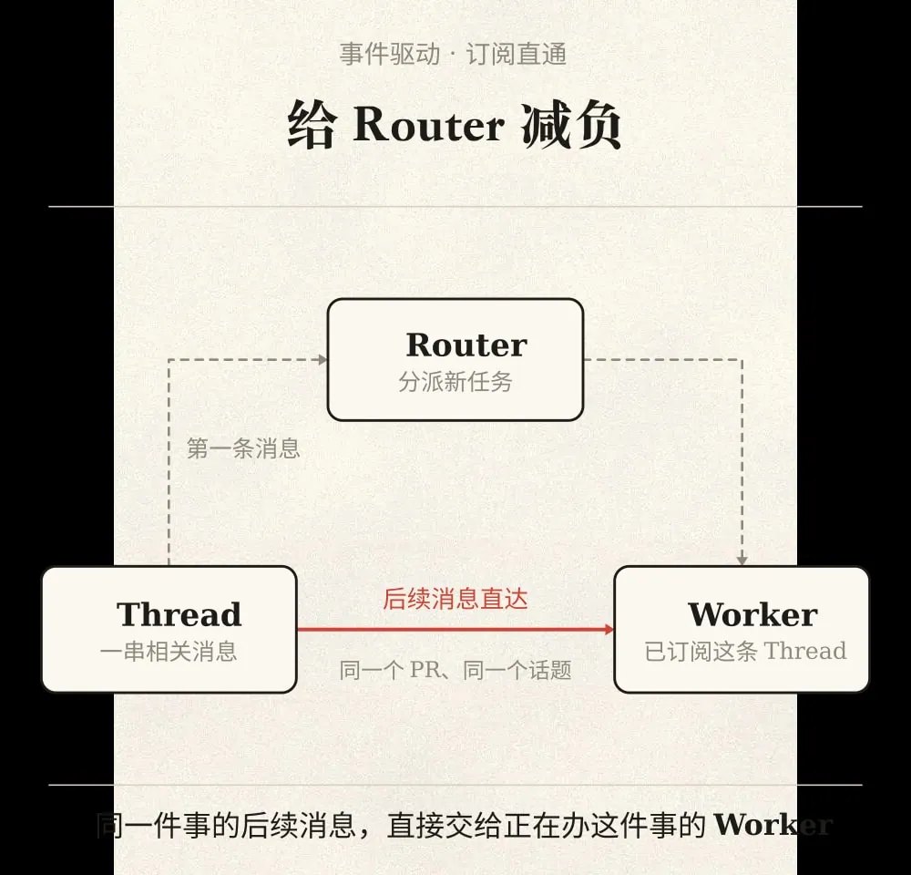

另外，Thread 和 Worker 之间的订阅是多对多的：一个 Worker 可以同时订好几条相关的 Thread，一条 Thread 也可以被好几个 Worker 订阅

几个 Worker 在同一个工作环境、同一场讨论里碰上时，这条 Thread 的新事件会同时送到所有订阅者手里。它们各自就能知道彼此做了什么，自己把冲突解决掉

两个 Worker 改到同一个 PR 时，冲突就是这样被发现的，看一看：
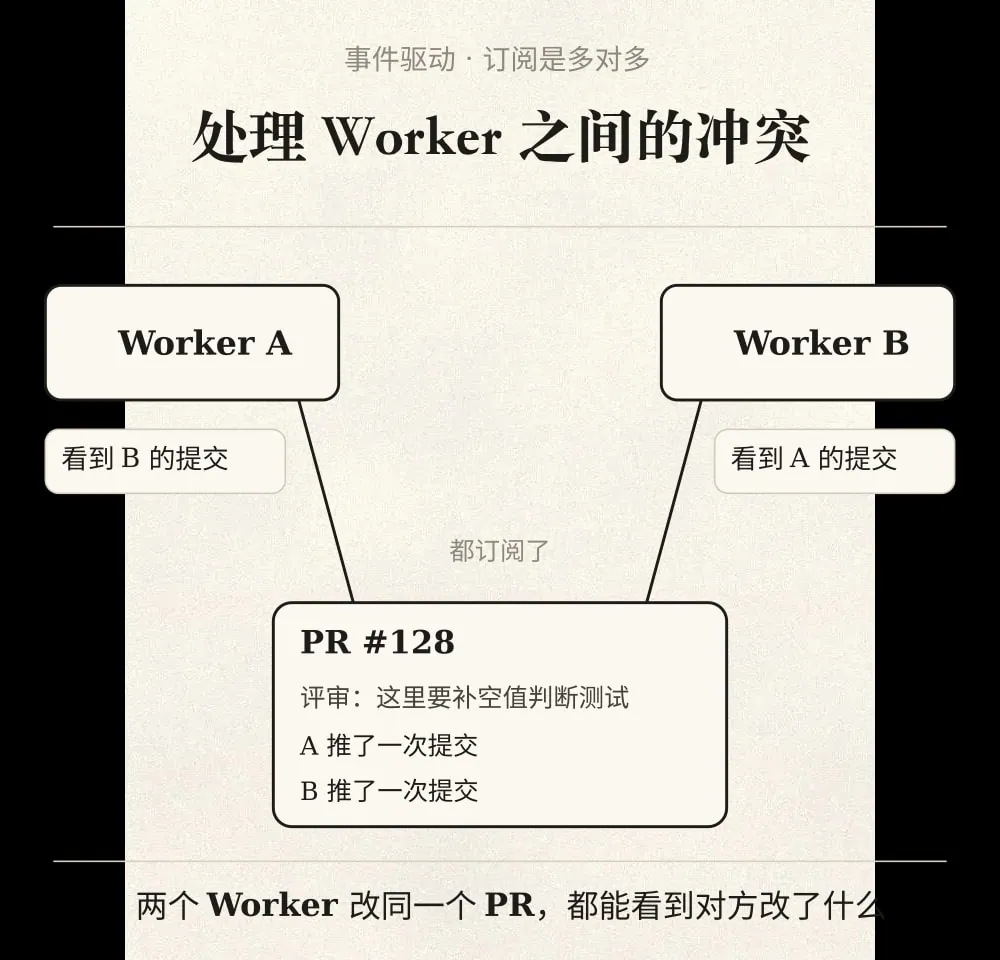

输出那一侧照旧：Worker 把关键结论汇报给 Router，由 Router 统一回复用户、同步全局记忆

### **三、上下文放多少**

事件过滤完、路由到了目标 Session，下一个问题是：往模型的上下文窗口里塞多少信息？

系统的输入，从有限的人类提示词，变成了环境源源不断产生的半结构化事件，于是工具调用和事件注入的结构设计变得格外重要

塞多了，挤占窗口、稀释模型的注意力；塞少了，模型得反复调工具去读，执行步数变多。**浪费上下文窗口，就是浪费模型的智能**

DeepSeek 的做法是把有限的上下文窗口当成 Cache 来管。借编译优化和计算机系统里的说法，注入上下文可以归成两个基本操作：
- **Inline（内联）**：把近期很可能用到的信息直接放进当前上下文窗口，省掉一次工具调用的往返
- **Spill（溢出）**：超出窗口预算、或者不常用的完整信息留在窗口外面，窗口里只留引用或摘要，模型需要时自己去读

再结合系统设计里经典的局部性（Locality）原则，事件注入和工具调用可以一步步优化：
- 从最少的信息开始：一开始只给当前对象的 ID 和内容摘要
- 按局部性逐步 Inline 关联信息：先附上紧密关联对象的 ID，再附带时间、位置上相邻的内容。比如内容的前 50 个字，群聊消息的前后几条和它回复的那条，代码评论所在评审讨论里的相邻评论
- 超出上限就 Spill：长内容设一个比较小的长度上限，超出的部分放到窗口外。最简单直接的做法，是截断，同时留一个「续读」入口，模型要看全文时再调工具读

上下文窗口里该放多少、放什么，看一看：
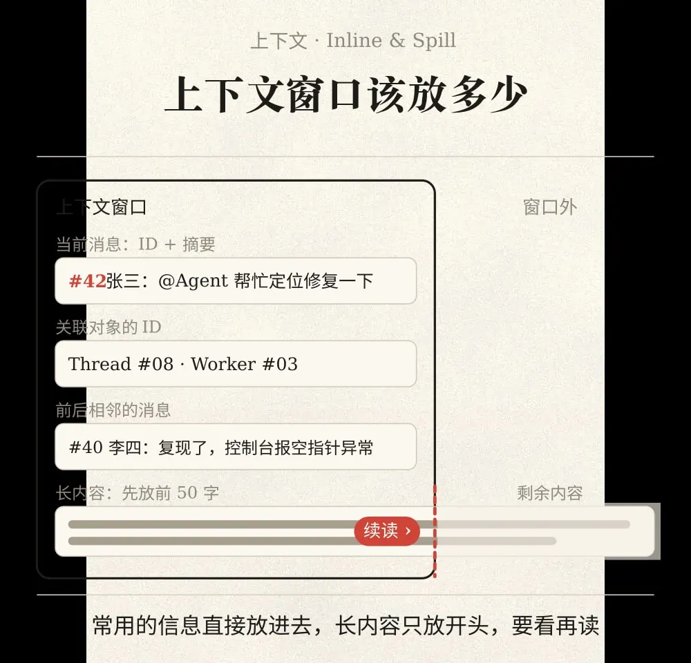

这套规则还解决了 Router 的一个老大难

大量后续事件直通 Worker、系统又长期运行攒下了很多历史任务以后，Router 不可能把所有任务的完整历史都放进自己的窗口；可用户在另一个信道里突然提起某个旧任务，它又得把上下文找回来

把 Inline & Spill 一致地用到系统里的各类对象上，就得到一种按需展开的多跳检索，DeepSeek 叫它链式召回（Chain of Recall）

做法是：系统给 Trigger、Thread、Worker Session 这些对象都分配唯一 ID，注入时内联紧密关联对象的 ID，这些对象在底层就连成了一张引用图

每次调工具召回的对象，本身也遵守 Inline & Spill，返回结果里又内联着下一跳对象的摘要和 ID。模型就能从眼前这条事件出发，顺着引用一跳一跳地按需取回上下文

很久以前的任务，就是这样被找回来的，看一看：
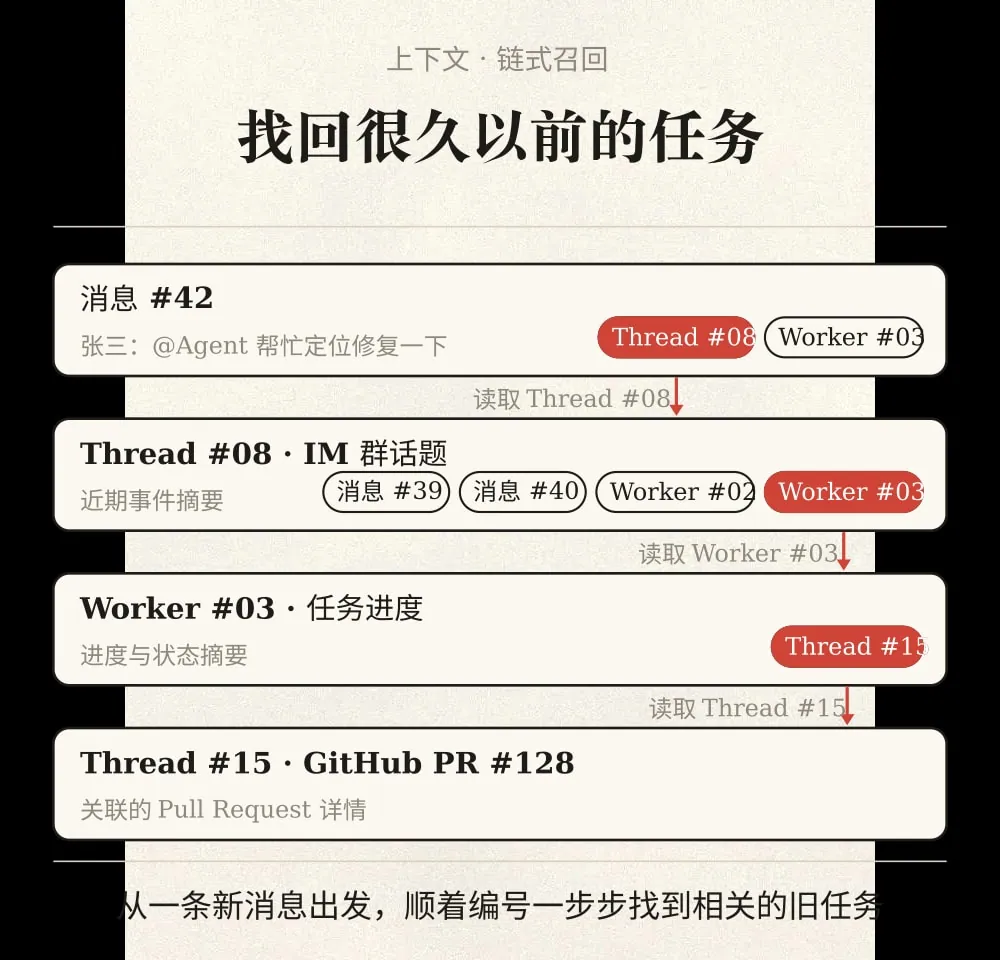

比如从当前这条消息读出它所在的 Thread，从 Thread 里内联的 ID 找到相关的 Worker Session，再从这个 Worker 找到它关联的另一个代码评审 Thread。Router 在长期运行里「忘了前面的事」，靠这条链缓解了不少

### **四、提前行动**

这一招借的是计算机系统里的投机执行（Speculative Execution）：结果会不会被采用还不确定，Agent 就根据环境信号，先在后台试着做

多花一些后台算力，换人少等一会儿、少插一次手。做出来有价值就交付，没价值就扔掉

个人助手里，收到一封会议邀约或者一条待办，Agent 可以先在后台核对日程有没有冲突、搜集相关背景、备好回复草稿，你过目一眼，确认就能直接发出

研发协作里也一样。DeepSeek 在公司的 DeepSeek Harness 内部用户群里配了一条「静默复现并修复」的策略：群里有人反馈问题、或者在讨论改动方案时，Agent 先在后台试着复现、找修复方案；只有确认了问题、也找到了简单的修复，才把结果交给用户，否则全程安静

群里还在讨论，修复已经备好了：
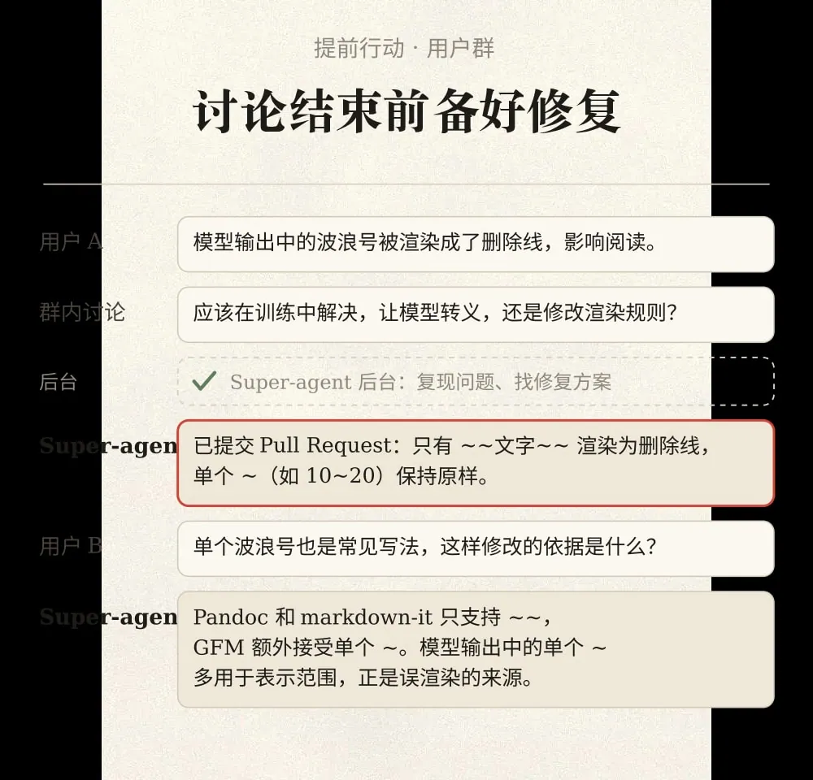

## 怎么跟人说话

双层架构在上下文层面保证了跨信道的连续。但真到了人机交互的体验里，要同时做到连续和高效，还得在交互方式和交互渠道上各解决一个问题

### **一、全双工**

经典的 ReAct Loop 里，模型发起一次同步的 run() 工具调用，循环就卡住了，一直等到工具跑完、返回最终结果。这期间，会话接不了任何新消息

要消掉这段阻塞，得把对话从一问一答的半双工，改成全双工。改完以后，等工具的时候也能接着聊，看一看：
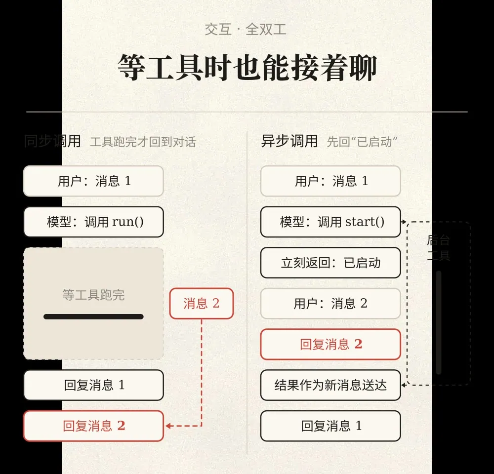

具体做法是，把耗时的命令和子任务工具调用，改成异步的 start() 和 stop()，构成异步 ReAct Loop：
- 模型调 start() 之后，马上收到「已启动（Started）」的返回，循环接着往下走
- 后台工具跑完，系统把最终结果当成一条新的事件消息，投进会话
- 模型也可以根据上下文调 stop()，主动终止跑得太久的后台命令

前台对话和后台任务就此解耦：Agent 在后台跑耗时任务的同时，还能回人的消息。新消息在当前这一步推理结束后就会被处理

这套异步任务机制，DeepSeek Harness 里已经实现了，只是还没默认开启

### **二、多信道**

不同的工作信道，信息密度和交互习惯都不一样，系统的输出要跟它们对上

把给单人终端设计的交互方式原样搬进群聊，冗长的推理过程、密集的工具调用一股脑往外倒，多人协作的群里很快就信息过载了

双层架构已经解决了一部分：具体任务里冗长的推理和密集的工具调用，都关在 Worker 里面，由 Router 统一对外

在这个基础上，系统还要接进用户日常用的各种工作环境，并用提示词给不同信道定制交互规范：
- **群聊这类即时通讯信道**：少打扰、轻量沟通。像人类同事一样，只在需要你决策或验收时才发通知，只问直接的问题，只给简短的结论。DeepSeek 验证过一条简单有效的硬规定：单次回复不超过 `100 词`
- **GitHub、邮件和文档这类异步信道**：结构化、信息密度高的异步交付。比如创建或更新 Pull Request 时，按项目规范写清问题背景、改动说明和验证结果；个人助手场景里，直接起草结构化的邮件和文档摘要

同一个结果，在群里和在 PR 里的回法差在哪：
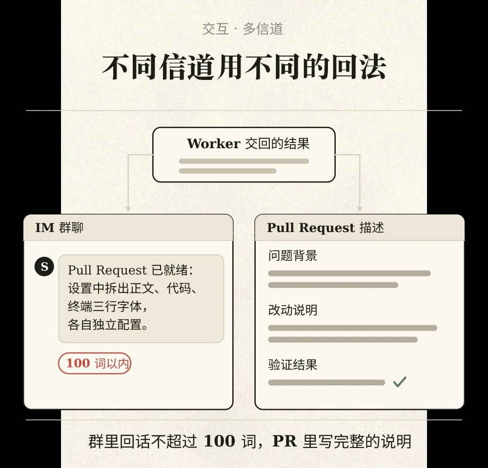

## 一直在线

现在的本地 Agent，默认把三样东西绑在同一台设备上：
- 推进 Agent Loop 的计算
- 需要持久保存的会话状态
- 代码仓库、本地工具链这些执行环境

设备一休眠，这三样就一起停了：
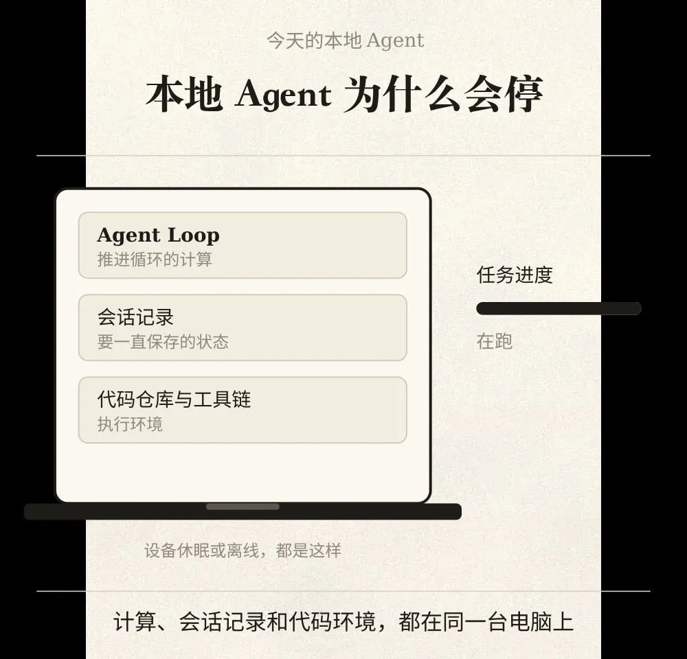

设备一休眠、一离线，Agent 就停了；它也碰不到其他设备上的环境

要让 Super-agent 一直在线、还能灵活接进各种真实的工作环境，DeepSeek 借了计算机系统里存算分离（Compute-Storage Separation）的思路，分两步解开这三样的绑定

第一步，把计算和状态分开。推进 Agent Loop 的计算可以做成无状态的，真正要持久保存的是会话状态

所以计算放进云端无状态的弹性计算容器里，Session 这些持久化状态存进数据库。容器可以水平扩展、随时重启或替换，会话和任务的连续性由持久化存储兜着，Agent 就摆脱了单台本地设备的生命周期，在云端一直在线

跑 Agent 的机器坏了，换一台就能接着跑，看一看：
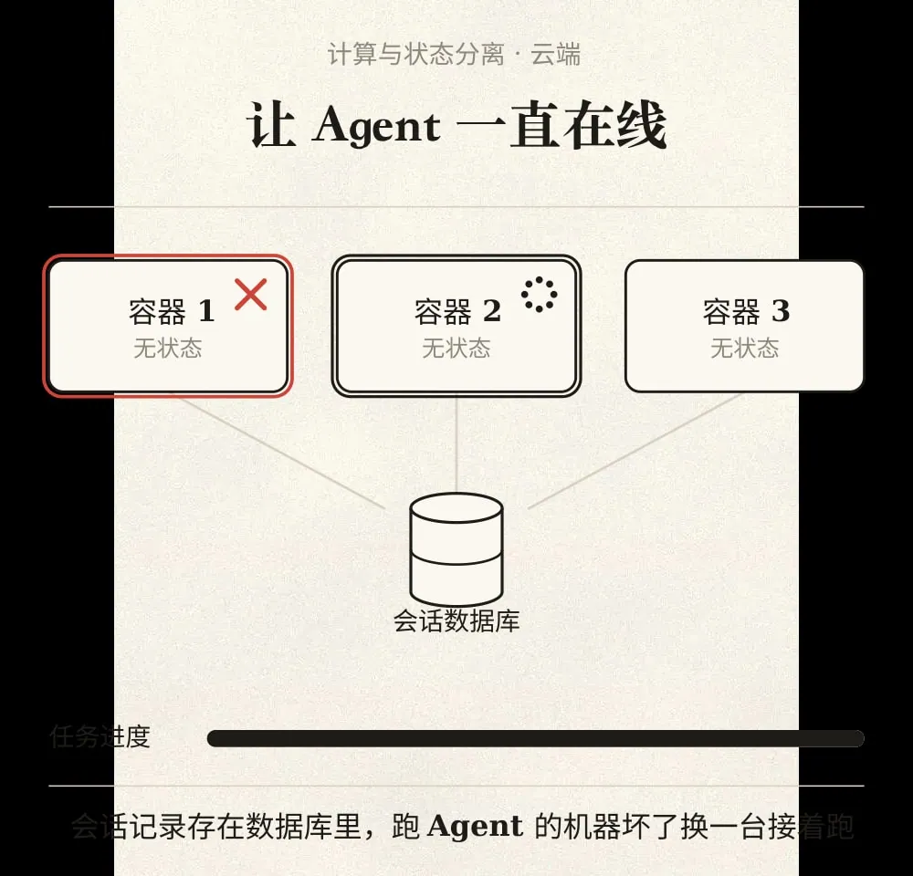

第二步，把计算和执行环境分开

Agent Loop 和会话状态都常驻云端了，接下来的问题是：怎么够到任务需要的执行环境？

模型干活需要的上下文，很大一部分要靠工具调用，从代码仓库、本地文件、依赖服务这些执行环境里取。从这个意义上说，广义的上下文也包括执行环境本身

常见的思路有两种：
- 在云端起一个沙箱，拉代码，试着重建、同步环境。可真实的工作环境里，往往有没提交的本地修改、私有凭据、内网服务依赖，还有特定的硬件或工具链，同步这样的环境，成本很高，还容易漏东西
- 直接让用户放弃本地环境，搬到云上干活。对很多人来说，迁移成本太高了

既然难复制、难同步的是环境本身，那就让执行环境留在原地

Agent Loop 在云端跑，端侧只部署一个轻量的 daemon（会话状态都在云端）：它只负责执行命令、返回结果。执行环境留在云外，Agent 按需去读里面的上下文

Agent 在云上，靠端侧一个轻量 daemon 够到你电脑里的环境：
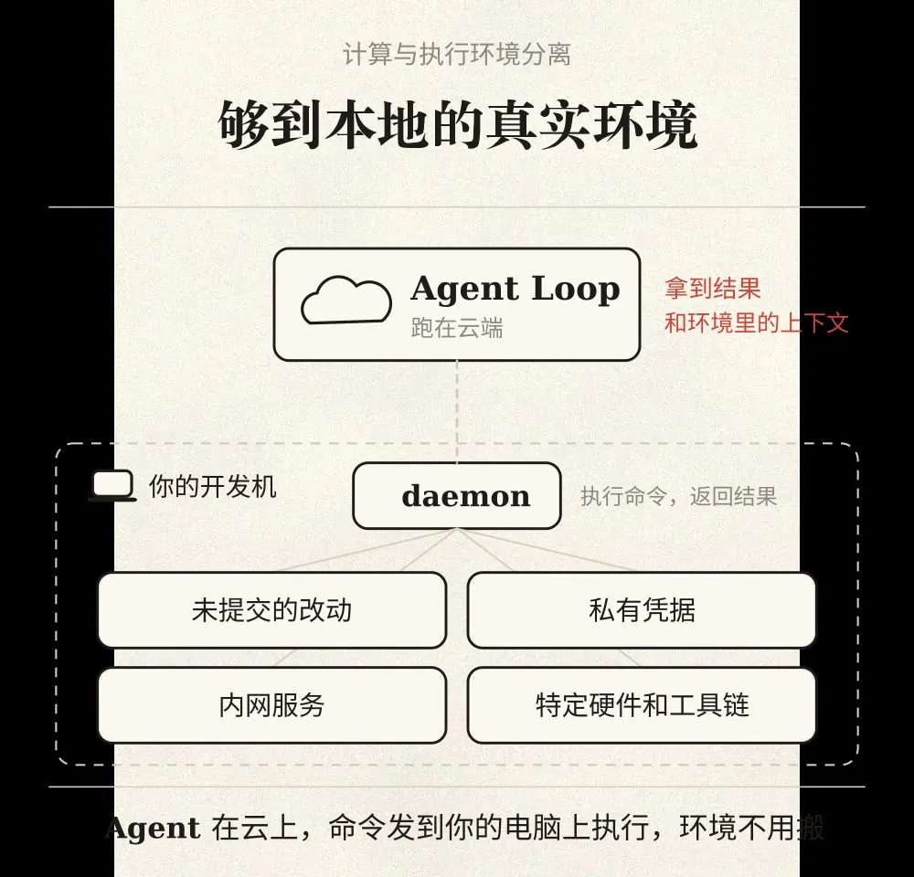

这个思路，和 Anthropic 提出的「脑手分离」（Decoupling the brain from the hands）是一致的：同样让 harness 保持无状态，会话日志存在 harness 之外，通过统一接口按需接入执行环境

区别在场景。Anthropic 那篇讲的是托管服务，主要讨论按需创建的沙箱和客户 VPC 里的资源；DeepSeek 这里首先要接的，是用户日常在用、可能时在线时离线的个人电脑，上面有没提交的修改和本地凭据

所以这套设计既支持 BYOM（Bring Your Own Machine，把你日常用的开发机、个人电脑接给云端 Agent），也支持接云端托管的机器、按需创建的计算环境

这样一来，一个 Agent 可以在不同的执行设备之间切换，按任务需要挑一个环境去跑命令、取上下文

它甚至能照顾到时在线时离线的设备：你的某台个人电脑重新上线以后，云端 Agent 会自动触发，把需要在这台设备上做的任务做完

时在线时离线的电脑，一上线就能接到活：
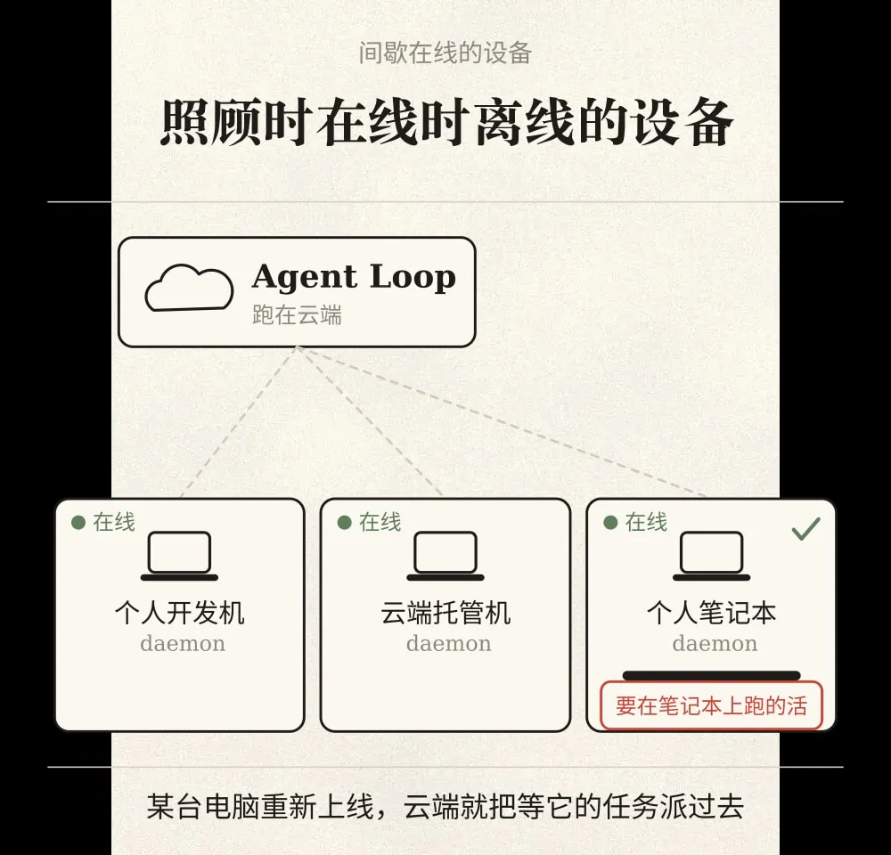

## 出了事，谁来管

要一直在线，除了存算分离，系统还得在长期运行里自己从异常中恢复

一个长期在线的分布式系统，很难只靠主系统内部的逻辑保证长期可靠，需要在主系统之外，再加一个独立的外部控制回路（Control Loop）

而且对 Agent 系统来说，很多异常出在模型身上：进程好好活着，模型却在执行中陷进了无效循环，或者跑偏了目标，进程存活探测和监控脚本看到的一切正常。所以长期运行的 Agent 系统，既要盯基础设施是不是活着，也要盯任务本身有没有进展

DeepSeek 的做法，是在主系统外面配一个独立的 Watchdog Session，用定时消息驱动它，构成外部的 Control Loop

它要揪出来的，正是跑偏和原地打转的 Worker：
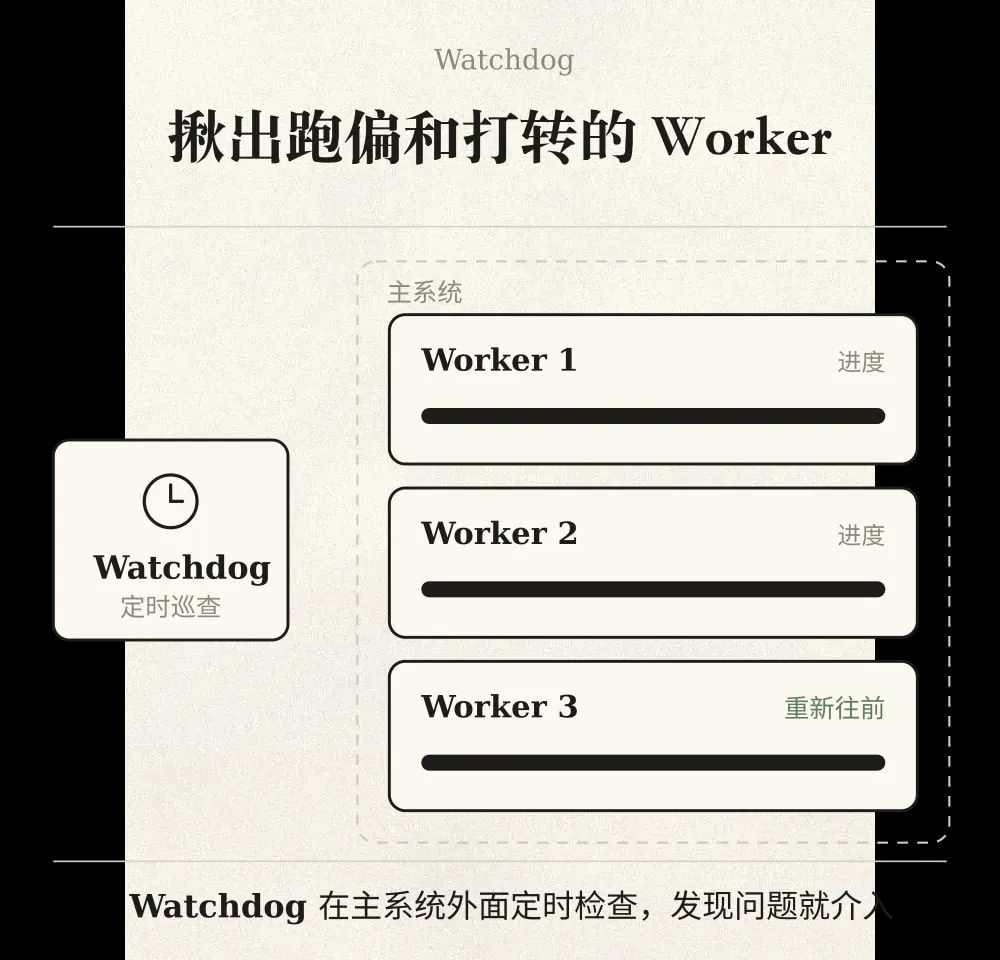

Watchdog 一边处理接口报错、状态恢复失败这类基础设施故障，一边由模型判断各个 Worker 有没有实质进展、方向有没有偏离整体目标。发现异常就及时介入修复；碰到外部偶发的故障，就持续复查，直到恢复正常

Watchdog 自己也是一个带全套工具的 Agent Session，所以维护者可以直接用自然语言问它故障原因，也可以让它在线改主系统的行为，比如增删提示词、调整触发规则

## 实验：真的更快吗

为了评估核心的调度和路由设计，DeepSeek 做了两组初步实验：一组端到端，对比双层架构、订阅直通和单 Session 方案；一组单独测 Router 层的批处理

需要先说明：实验基于合成负载和简化环境，部分设置还可以更严谨，结果只作为初步参考

### **一、消融实验**

实验用群聊和 GitHub CI 两路消息流，同时驱动四种端到端方案。单次实验约 `300 条`消息，其中约 `20 条`是工作请求，剩下的是闲聊、跟进、叫停和 CI 消息

写代码的活，用一个只消耗时间的工具代替。所以这个实验量的是系统的调度和协作能力。每种方案重复跑 5 次

参赛的四种方案：
- Super-agent
- 去掉直通的 Super-agent
- 单 Session + Subagent 工具，中性提示：「Use a subagent for a piece of work when appropriate...」
- 单 Session + Subagent 工具，提示优先委派：「Every message of the chat reaches you, so work you run yourself keeps stopping for new messages. Prefer handing each piece of work to a subagent of its own, and do only small things yourself...」

谁先把 20 个活做完：
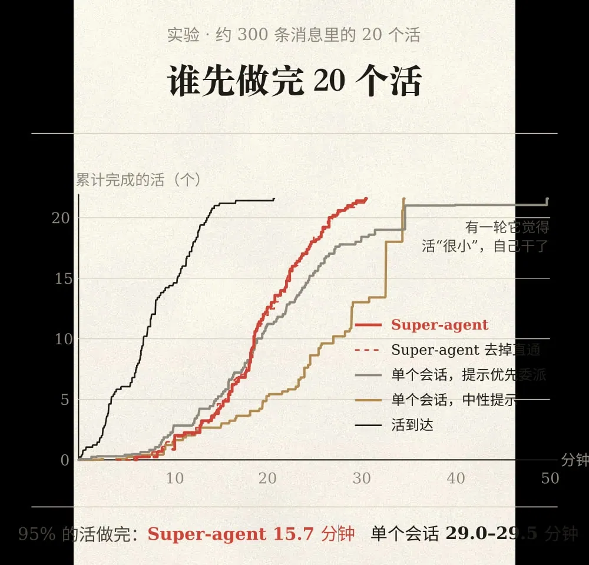

（曲线是 5 次运行的均值；消息间隔和工作时长按 1/4 缩放，模型调用的耗时是真实值。任务完成时间，指从工作请求发出，到结果消息回来）
| 方案 | 完成时间 P50 / P95（分钟） | 单次实验读缓存 token（全部 Session） |
|---|---|---|
| Super-agent | 12.4 / 15.7 | 2323 万 |
| Super-agent，去掉直通 | 12.6 / 15.5 | 3177 万 |
| 单 Session + Subagent，中性提示 | 20.4 / 29.5 | 605 万 |
| 单 Session + Subagent，提示优先委派 | 13.8 / 29.0 | 1082 万 |

先看完成时间。Super-agent 的 P50 是 `12.4 分钟`，P95 是 `15.7 分钟`，明显好过带 Subagent 工具的单 Session

单 Session 这边，结果被提示词左右得很厉害，主会话常常决定自己动手：
- 中性提示下，5 次运行里模型一次 Subagent 都没调，所有活都在主 Session 里干，还不停被新消息打断，P95 到了 `29.5 分钟`
- 换成优先委派的提示后，5 次里有 4 次委派了，完成时间短了一些，但整体仍然慢于 Super-agent；剩下那 1 次，它判断这活「很小」，自己干了，就是图里那条紫色的长尾

**在单 Session 里，分不分工要看提示词和模型的临场判断；双层架构在系统层面把分工定了下来**：Router 不碰具体的活，Worker 只收自己订阅的 Thread

再看开销。Super-agent 维护着好几个独立会话，单次实验的读缓存 token 比单 Session 多，是拿更多的 token，换更短、更稳的完成时间

至于直通机制，在 Super-agent 内部把它去掉，任务完成时间和完整版基本一样，但 Router 要做的决定多了约 30%，总读缓存 token 从 2323 万涨到 3177 万，多了约 `37%`

直通到底省了多少：
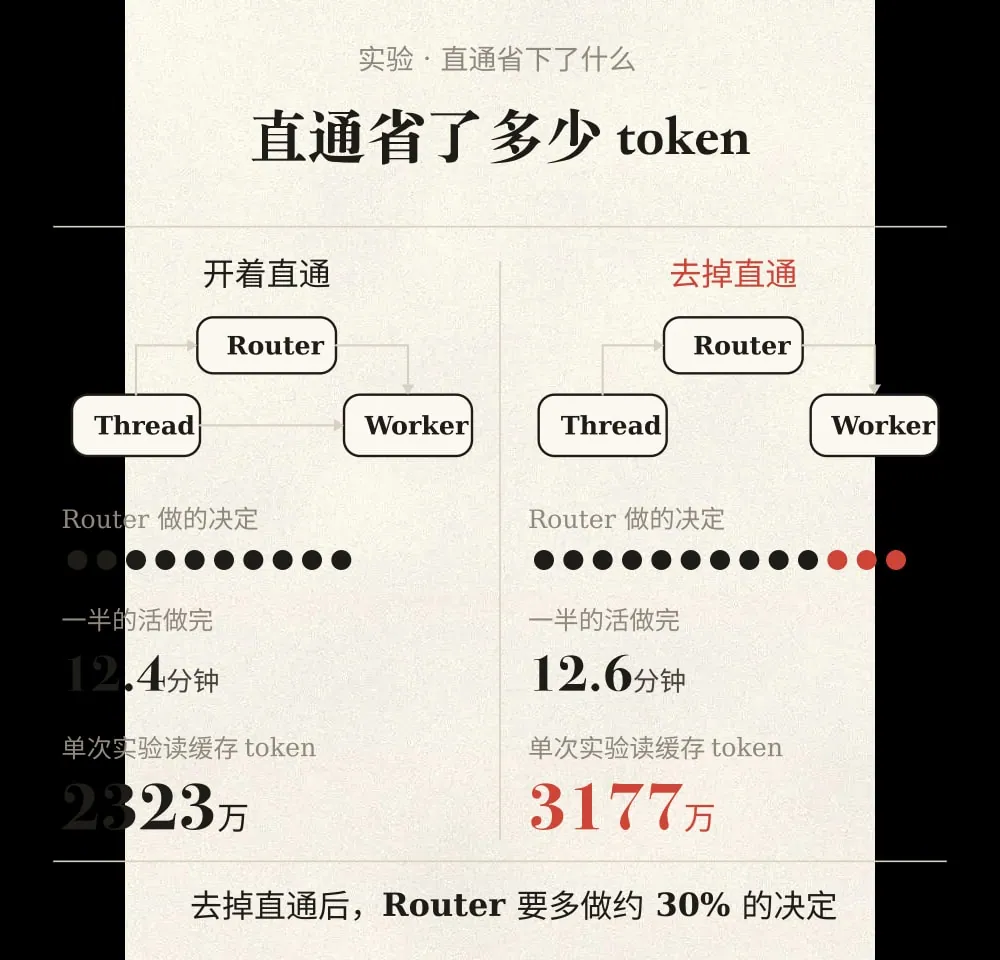

换句话说，在这个实验负载下，直通的作用是给 Router Session 省下相当可观的 token 和推理开销

### **二、Router 的批处理**

为了验证前面说的「一个常驻 Router 扛得住」，DeepSeek 单独给 Router 层做了压力测试：Router 调真实模型，Worker 用 Mock 模型，把需要决定的 Trigger 到达速率，从每分钟约 1 条一路加到约 40 条，看平均一批几条、单次请求多久、每个决定摊到多少推理时间

一个 Router 到底扛不扛得住，看一看：
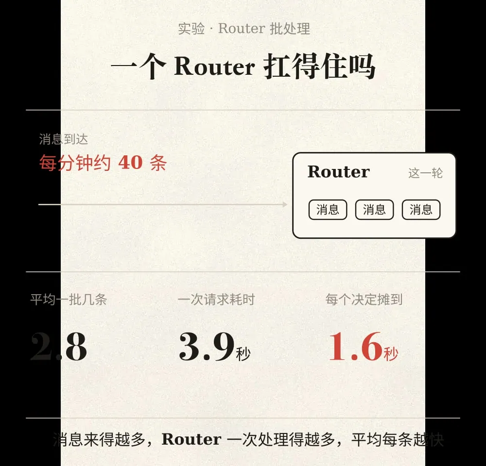

到达速率从每分钟约 1 条升到约 40 条，平均每批从 1.0 条涨到 2.8 条，单次请求耗时只从 2.5 秒涨到 3.9 秒，涨得比批的大小慢。于是每个决定摊到的推理时间，从 `6.4 秒`降到了 `1.6 秒`

也就是说，外部事件突然扎堆的时候，Router 能靠自动合并积压的事件，把有效吞吐提上去

这也解释了消融实验里的一个现象：去掉直通以后，Router 的峰值负载变大了，单个 Router 依然扛得住。所以在他们目前的团队规模下，一个 Router 就够用，全局上下文也能保持连续

## 还没解决的问题

这套系统能用比较低的复杂度跑起来，很大程度上是因为在现阶段做了一系列工程和场景上的简化。出了这些简化的适用范围，还有四类问题要解决

### **一、双层架构怎么扩展**

前面这套组合：一个常驻的 Router Session，加订阅直通，加 Worker 之间各干各的，用很小的工程代价，覆盖了他们目前绝大多数的日常任务

但任务规模变大、耦合变紧，超出一个 Router Session 能承载的范围时，层内具体怎么搭，还没有定论：Router 什么时候该水平切分、按什么粒度切，同层 Worker 什么时候需要直接通信、用什么样的协作拓扑，都还要在更多场景里检验

Router 要不要拆成几份，难处在这里：
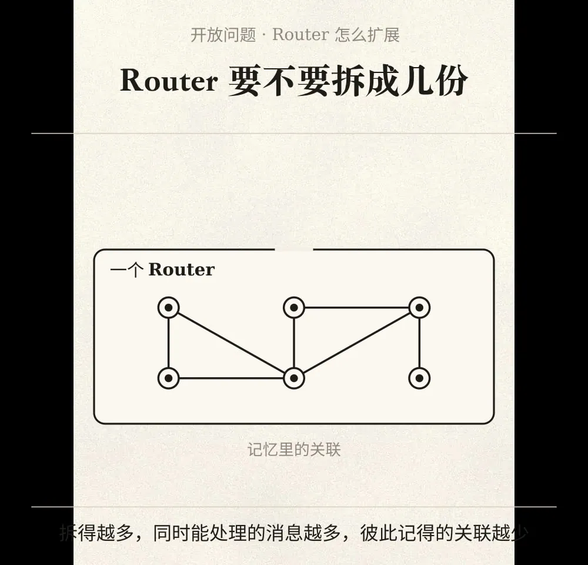

系统和模型的协同设计（Co-design）也值得探索：专门针对 Router 的事件判别、批量分派、上下文召回这些任务训练模型，有可能把 Router 的吞吐和决策再往上提一截

还有记忆。常驻 Router 配上基于引用图的链式召回，解决的主要是近期任务和会话历史的按需检索。运行周期拉长到跨月、甚至更久，长程记忆就成了制约扩展的主要瓶颈

### **二、没了 Session，人怎么和 Agent 协作**

双层架构把底层的多会话管理藏了起来，Session 退到了产品设计的幕后。底层的执行会话和界面上的会话分开以后，怎么把任务呈现给用户、提供自然的交互和项目管理方式，成了新问题

DeepSeek 的判断是，以聊天窗口为中心的交互，一定程度上是路径依赖的结果。交互可以更多地发生在各个领域专属的界面里，比如像文中的实例那样，让 Super-agent 直接在 GitHub 的 Issue 和 Pull Request 里干活

Session 也可以照顾用户习惯，在界面上留着，只是你看到的一个会话，底层未必只对应一个 Session

另外，前面讲的主要是人在「发起任务」和「验收结果」两头的交互。但在模型能力快速演进的过渡期，很多任务还需要人在中途参与：让你在后台执行过程中随时插手、接管，或者和 Agent 实时协同。怎么在产品里同时照顾逐步干预关键细节的需要，和后台自主推进的效率，同样值得探索

用户要的项目管理和交互方式，跟具体的工作领域、个人风格密切相关，最终形态很可能是高度定制化的。DeepSeek Harness 的架构是开放的，也更容易支持这种定制

### **三、上下文边界和 A2A**

前面讨论的，都是单个 Super-agent 实例的内部设计，默认它服务范围里的信息都汇进同一个全局上下文

可一旦使用范围从个人、小团队扩到更大的组织，组织决定怎么配 Super-agent，其实就是在划定上下文共享和隔离的边界：需要共享上下文的范围共用一个实例，需要隔离的范围各配各的

实例和实例之间，这样协作：
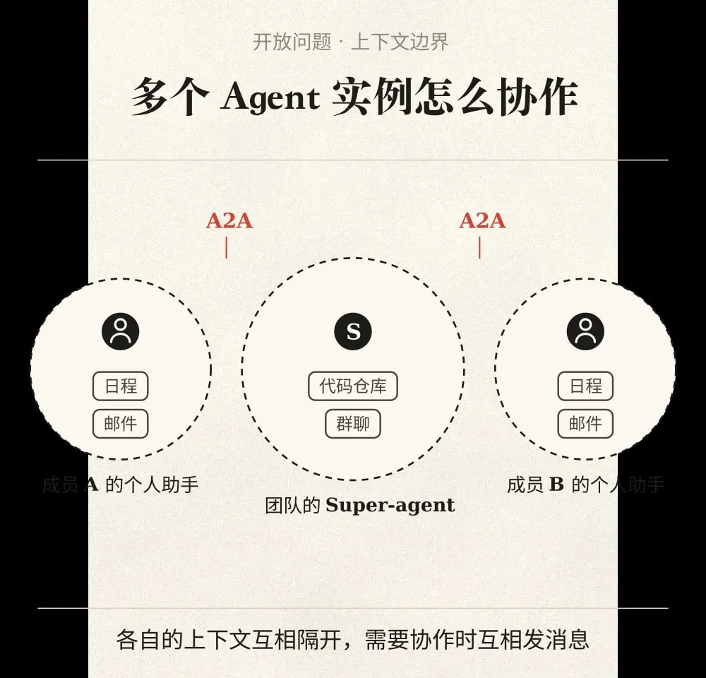

再往前一步，组织内部、组织之间一旦有了好几个彼此隔离的实例，比如每个成员各自的个人助手，和团队共用的 Super-agent，它们跨边界的协同就是 Agent 之间的通信（A2A，这里不特指哪个协议）

底层上下文各自隔开、各自代表不同权限边界的前提下，怎么做到安全、可靠的 A2A 通信和协作，还要继续探索

### **四、安全与隐私**

事件驱动让 Agent 能被更广泛的环境驱动，也让它更多地接触到不可信的输入。安全和隐私的问题解决不好，Super-agent 就只能在一个很小、很可信的范围里工作

比如前面把 Agent Loop 放在云端、在各台执行设备上装轻量 daemon，这个设计默认云端和端侧互相信任

可云端的 Agent Loop 一直在接外部的环境事件，端侧设备上又放着私有代码、敏感数据和本地凭据，这种跨设备连接带来了明显的安全和隐私隐患：云端 Agent Loop 一旦因为服务端入侵、提示词注入被攻破，连着的所有端侧设备都有被控制的风险

云端一旦失守，风险会传到哪，看一看：
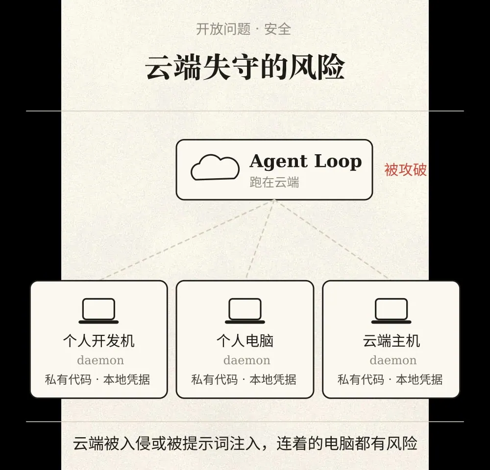

就算云端没被攻破，只要端侧的凭据能进到模型的上下文里，正常执行的过程中也有泄露的风险。所以还得设计相应的机制，让 Agent 在完全碰不到凭据本身的情况下使用凭据

这套架构要走向更广的应用，就得在能从各种环境里召回上下文的同时，把这些安全和隐私问题解决掉

## 最后

回头看整套设计，DeepSeek 做的，是把计算机系统里经典的工程思想，用到了 Agent 系统的构建上。具体实现会随着技术发展而变，背后的系统设计思路，参考价值更长久

目前，他们基于这套思路和 DeepSeek Harness 搭的内部 Super-agent 实例，一直在跑，日常参与问题复现和修复、回应代码审查，还参与 DeepSeek Harness 自己的迭代

大模型做单个任务越来越少需要人插手，限制生产力继续往上走的瓶颈，就转到了人的注意力上。双层架构、事件驱动、异步多信道交互、存算分离和外部 Watchdog，把繁琐的会话管理和上下文同步接到了系统底层，人就能从具体的执行细节里再往上走一步，去做决策和验收

到了这一步，Agent 就从一个等指令的对话窗口，变成了数字环境里一直在线、自己推进事情的协作者：对个人，它是跨设备帮你处理日常事务的助手；对团队，它长在研发流程里，接活、推进

文中的部分设计，已经在一个叫 dsh-superagent-prototype 的插件里实现了。它是为了验证技术路线做的原型

PS：系统实现和全文写作是 Yujia Qiao，亦有 DeepSeek Harness 团队的十多位同事进行审阅
