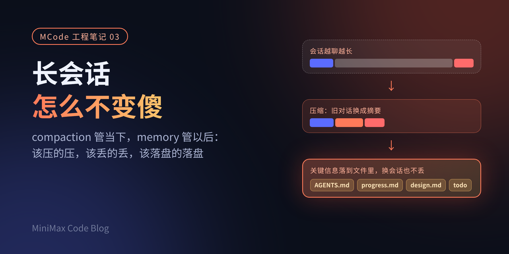
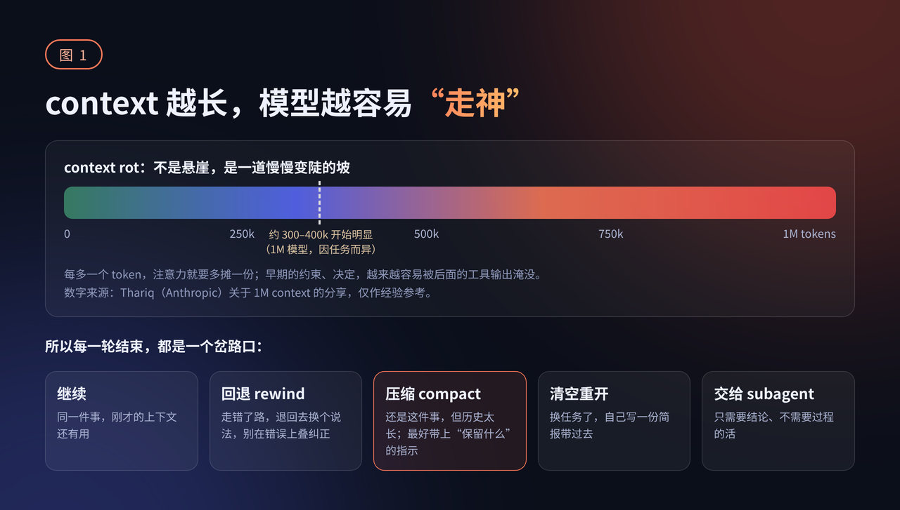
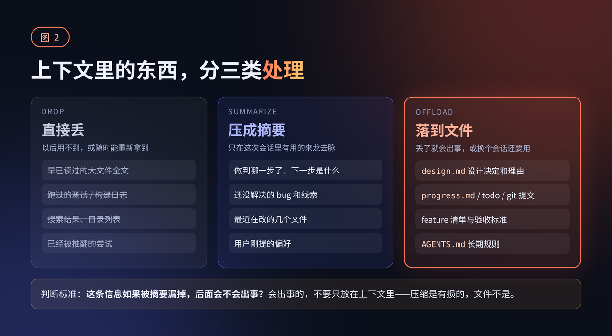
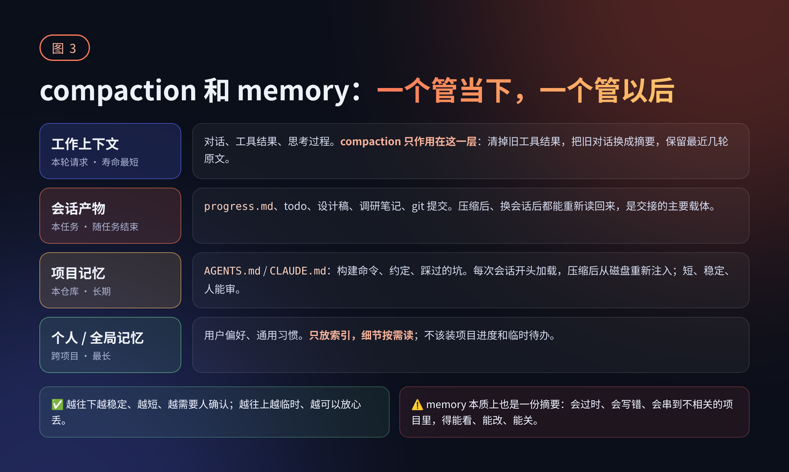

# MCode 工程笔记 03｜长会话怎么不变傻：compaction 和 memory 的取舍

> **摘要**：从时间维度讲 context 管理。**context rot**——context 里 token 越多，模型准确回忆的能力越差，因为注意力是预算，n 个 token 就是 n² 对关系；这是**一道坡不是悬崖**，1M 模型上大约 300k~400k 开始明显。关键判断：**每一轮结束都是岔路口**（继续 / 回退 rewind / 清空 / 压缩 / 交给 subagent），一路"继续"到被动压缩最亏。**compaction 的四类问题**：丢决定丢约束、细节被概括掉（模型压缩时正是状态最差的时候）、反复压缩导致漂移（"记忆也是个摘要"）、压缩本身会失败且有缓存成本。**memory 的四层**：工作上下文 → 会话产物 → 项目记忆 → 个人/全局记忆。核心原则：**别让要紧的东西只活在 context 里**——按"漏掉会不会出事"分三类（直接丢 / 压成摘要 / 落到文件）。Anthropic 内部评测：memory + context editing 比基线提升 39%，100 轮网页搜索评测 token 消耗降 84%。

```markmap height=460
# 长会话怎么不变傻
## 一、context rot
- token 越多回忆越差
- 注意力是预算，n² 对关系
- 是坡不是悬崖
- 1M 模型 300k~400k 起明显
- 每轮结束都是岔路口
  - 继续/回退/清空/压缩/subagent
  - 走错了该回退不是追加纠正
## 二、compaction 是什么
- 快满时摘要替换历史
- 有损
### 各家做法
- Claude Code
  - auto-compact / /compact 带指示
  - 1M 默认 ~967K 才压
  - /autocompact 400k 提前
  - 空闲压缩（缓存过期前）
- Claude API
  - 按需/阈值/自定义 prompt
  - context editing 更轻量
- OpenAI
  - 压缩产物加密不透明
  - 保留所有用户消息
- Cursor
  - 长输出写文件
  - 摘要留原文引用
### 趋势
- 能不摘要就不摘要
- 非摘要不可时尽量可控
- 摘要丢了还能找回来
## 三、compaction 的四类问题
- 丢决定丢约束
  - CLAUDE.md 会重新注入
- 细节被概括掉
  - 压缩时模型状态最差
- 反复压缩导致漂移
  - 记忆也是个摘要
- 压缩本身会失败且有成本
  - 缓存命中与前缀失效
- 工程小坑
  - 工具调用与结果必须成对
  - 只改 context 不改用户历史
## 四、该丢该压该落盘
- 三类分法
  - 直接丢：随时能重拿
  - 压成摘要：本次会话的来龙去脉
  - 落到文件：丢了会出事
- Anthropic 范例
  - 启动脚本+进度文件+JSON 功能清单
  - 每会话只做一个功能
  - 进度和决定落在文件与 git
## 五、何时开新会话
- 换任务了
- 压缩多次开始漂移
- 方向错了（该回退）
- 收手信号比数字可靠
## 六、compaction 与 memory 分工
### 四层
- 工作上下文
- 会话产物
- 项目记忆 AGENTS.md
- 个人/全局记忆
### 规则
- memory 只做索引
- 热规则单独留预算
- 记忆要分作用域
- memory 是提示不是强制
### 数据
- memory+editing 提升 39%
- 100 轮 token 降 84%
## 七、MCode 怎么做
- 压缩时机交给用户
  - compactionTriggerAt
- 压缩是 harness 内部动作
- 让模型知道会有压缩
- 用户要的是交接不是压缩
## 八、手段对照
- 清理工具结果
- compaction
- 会话产物
- 项目记忆
- 个人全局记忆
- 开新会话+交接文档
```

---

前两篇一篇讲 subagent，一篇讲工具多了以后怎么控制 context，说到底都在回答同一个问题：怎么让 context 里少放没用的东西。

> 这一篇换个角度，聊时间维度上的 context：会话越来越长以后怎么办。



现在 1M 的 context window 已经不稀罕了，一个会话从早上开到晚上、来回几百轮也很常见。窗口变大是好事，但很多人都有类似的体会：聊到后面，agent 会忘掉一开始说好的约定，把已经否掉的方案又捡回来，或者在一个早就修好的问题上反复打转。窗口没满，人却像是“变傻”了。

常见的应对有两种。一种是 compaction（压缩），把旧对话换成摘要，腾出空间接着干；一种是 memory（记忆），把要紧的信息写进文件，下次会话再读回来。这篇想把两者各管什么、各自会在哪儿出问题、怎么配合讲清楚，也说说我们在 MiniMax Code（下文简称 MCode）里的一些体会。

## 为什么会话越长，agent 越笨



Anthropic 在[《Effective context engineering for AI agents》](https://www.anthropic.com/engineering/effective-context-engineering-for-ai-agents)里把这个现象叫 context rot：context 里的 token 越多，模型准确回忆其中信息的能力越差。原因是模型的注意力有“预算”。每个 token 都要和其他所有 token 建立关系，n 个 token 就是 n² 对关系，context 越长，注意力摊得越薄。文章特别强调，这是一道坡，而不是悬崖：模型不会在某个长度突然失灵，只是越往后越容易漏掉东西。

那坡从哪里开始变陡？Anthropic 的 Thariq 在 X 上写过一篇[关于会话管理和 1M context 的长文](https://x.com/trq212/status/2044548257058328723)，给了一个经验值：在 1M 的模型上，大约 300k 到 400k token 开始能看到一定程度的 context rot，但他也说得很清楚，这和任务关系很大，不是硬性规定。

这篇文章里更有用的是另一个观点：**每一轮结束，都是一个岔路口。**你可以继续，也可以回退（rewind）到之前某一轮换个说法，可以清空重开，可以压缩，也可以把下一段活交给 subagent。很多人只用“继续”，一路聊到窗口满了被动压缩，其实错过了不少更好的选择。比如 agent 走错了路，与其在后面不断追加纠正，不如直接回退到岔路口重新给指令，这样错误的尝试根本不会留在 context 里。

## compaction 是什么，各家怎么做

compaction 说白了，就是在 context 快满时，让模型把到目前为止的对话总结一遍，然后用这份摘要替换原来的历史，接着往下干。它是有损的：摘要再好，也不可能保留原文的所有细节。

几家公开的做法大同小异，差别在细节上：

- **Claude Code**：快满时自动压缩（auto-compact），也可以手动 `/compact`，并且能带指示，比如 `/compact focus on the auth refactor, drop the test debugging`。按 Anthropic 的说法，压缩时会保留架构决定、未解决的 bug 和实现细节，丢掉重复的工具输出，压完之后带着摘要和最近访问的 5 个文件继续。Claude Code 团队的 Lydia Hallie 在 X 上[补充过](https://x.com/lydiahallie/status/2108624109538291901)：1M 模型默认要到约 967K 才自动压缩，这意味着之前的每条消息都很大；可以用 `/autocompact 400k` 让它早点压。她还介绍了[空闲压缩](https://x.com/lydiahallie/status/2110484840256819380)：会话闲置、prompt cache 快过期（约 1 小时）之前先压一次，用户回来时只需要重新处理那份摘要。

- **Claude API**：[服务端 compaction](https://platform.claude.com/docs/en/build-with-claude/compaction) 支持按需触发、到 token 阈值自动触发，或者换成你自己的摘要逻辑；可以保留最近几轮原文，也可以自定义摘要 prompt，文档原话是“当默认摘要漏掉了后面某一轮需要的东西时”用。另外还有更轻的 [context editing](https://www.anthropic.com/news/context-management)：不做摘要，只按规则清掉旧的工具调用和结果。Anthropic 把清理工具结果称为最安全、最轻量的一种压缩。

- **OpenAI**：Responses API 的 [compaction](https://developers.openai.com/api/docs/guides/compaction) 可以设阈值自动触发，也有单独的 compact 接口。一个明显的区别是，压缩产物是加密的、不透明的，“不是给人读的”，里面带着之前的状态和推理；压缩后的窗口会保留所有用户消息，后面跟一个压缩条目。

- **Cursor**：在[《Dynamic context discovery》](https://cursor.com/blog/dynamic-context-discovery)里提了两个思路。一是长工具输出直接写到文件里，agent 需要时再去读，这样被迫摘要的次数少了；二是摘要时给 agent 留一个完整聊天记录文件的引用，摘要漏掉的细节可以回去搜。

放在一起看，趋势挺清楚：

- **能不摘要就不摘要**（先清工具结果、长输出落文件）

- **非摘要不可时尽量可控**（带指示、自定义 prompt、保留最近原文）

- **摘要丢了还能找回来**（原始记录留在磁盘上）

## compaction 会在哪儿出问题

压缩用得多了，问题也就看得清楚了。大致有这么几类：

**一是丢决定、丢约束。**会话开头说的“不要动公共 API”“测试必须用真实数据库”，在几十轮之后的摘要里很可能只剩一句话，甚至没了。Claude Code 的[文档](https://code.claude.com/docs/en/memory)说得很直接：只在对话里给过的指令，压缩后可能就丢了；写进项目根目录 CLAUDE.md 的规则，压缩后会从磁盘重新读一遍再注入。

**二是细节被概括掉。**Thariq 举过一个例子：一段很长的调试之后触发自动压缩，摘要概括了调试过程；接着你说“现在去修一下 bar.ts 里那个 warning”，可那个 warning 恰恰在摘要里被省掉了。根本原因是模型压缩时猜不到你下一步要干什么。他还提到一个容易被忽略的点：因为 context rot，**模型压缩的那一刻，恰恰是它状态最差的时候**。

> 建议是，有了 1M 窗口，就别等自动压缩，主动压，并且说清楚接下来要做什么。

**三是反复压缩带来的漂移。**一个长任务压上十几二十次，摘要的摘要的摘要，离原始意图会越来越远。每次压缩看起来都合理，攒在一起就跑偏了。这时候回头查摘要也没用，因为摘要本身已经不准了。

> 我们内部讨论这个问题时有一句话印象很深：“记忆也是个摘要。”换句话说，指望靠写一份更好的摘要去纠正上一份摘要，往往行不通。

**四是压缩本身也会失败，而且有成本。**压缩要调一次模型：要读进几乎整个 context，还要留出空间写摘要。所以触发点不能卡在窗口边上，得给输出和摘要留足余量；额度用完、或者切到一个窗口更小的模型时，压缩可能根本跑不起来。还有缓存：压缩请求如果和前面的请求共享前缀，大部分 token 都能命中缓存，否则一次压缩就很贵。反过来，压得太勤也不行，每压一次，后面请求的前缀就变了，缓存跟着失效。早压还是晚压，本身就是一个取舍，目前也没有放之四海皆准的提前压缩算法。

另外还有两个工程上的小坑：**清理工具结果时只能动结果本身，工具调用和结果必须成对保留，否则很多模型接口会直接报错**；

> 模型看到的 context 和用户在界面上看到的对话记录是两回事，压缩只该改前者，不该让用户的历史凭空消失。

## 该压的压，该丢的丢，该落盘的落盘



既然压缩一定有损，关键就不是“怎么写一份完美摘要”，而是**别让要紧的东西只活在 context 里**。

HumanLayer 的 Dex Horthy 在 X 上[说得更直白](https://x.com/dexhorthy/status/2107211004132368843)：所有上下文和决定都写进产物文档（设计稿、调研笔记），这样恢复和交接都很容易，“真正重要的东西，永远不该只存在于 context window 里”。

顺着这个思路，可以把 context 里的东西粗分成三类：

- **直接丢**：用不上或者随时能重新拿到的。读过的大文件、跑过的测试日志、搜索结果、已经推翻的尝试。这些优先清，用 context editing 或者清理工具结果就够了，用不着劳驾摘要。Thariq 判断要不要交给 subagent 的标准也适用于这里：这段工具输出我以后还要看，还是只要结论？

- **压成摘要**：只在这次会话里有用的来龙去脉。做到哪了、下一步是什么、还有哪些没解决的 bug 和线索、最近在改哪几个文件。这正是压缩擅长处理的部分。

- **落到文件**：丢了会出事，或者换个会话还要用的。设计决定和理由、进度、待办、验收标准、长期规则。

Anthropic 在[《Effective harnesses for long-running agents》](https://www.anthropic.com/engineering/effective-harnesses-for-long-running-agents)里给了一个很具体的范例。他们发现光靠 compaction 不够，摘要“不总能把清楚的指令传给下一个 agent”，于是让第一个 agent 先把环境搭好：一个启动脚本、一个进度文件、一份 JSON 格式的功能清单（全部初始标为未通过），再做一次初始 git 提交。之后每个会话都按固定流程开工：看当前目录、读进度文件和 git log、读功能清单、跑一遍基础测试，然后一次只做一个功能，做完提交、更新进度。功能清单之所以用 JSON 而不是 Markdown，是因为模型不太会随手改写 JSON。

这套做法的核心是：**进度和决定落在文件和 git 里，context 只是干活时的工作台。**工作台被清掉也没关系，从文件里恢复就行。

## 什么时候该开新会话，而不是压缩

压缩适合“还是这件事，只是历史太长”的情况。下面几种情况，开新会话往往更好：

- **换任务了。**Thariq 的经验法则是“新任务开新会话”。上一个任务的调试过程、工具输出，对下一个任务基本是噪音。有灰色地带，比如刚实现完一个功能，接着写它的文档，这时候保留上下文可能更省事。

- **压缩过好几次，开始漂移了。**与其在漂移的摘要上继续叠，不如让 agent 先写一份交接文档：目标、已经做出的决定、当前进度、下一步、要注意的坑，然后清空，带着这份文档开新会话。Thariq 管这叫自己写简报：比压缩多花点功夫，但带过去的正是你认为重要的东西。

- **方向错了。**这时候该回退，而不是压缩。压缩会把错误的尝试也概括进摘要里。

至于“多长该收手”，没有标准答案。Dex 说过他[在 1M 的模型上会尽量在 200k 到 300k 之间收尾](https://x.com/dexhorthy/status/2104267063846195209)，他自己也承认这全凭感觉。比数字更可靠的信号是：agent 开始重复问已经回答过的问题、开始违反早先的约定，就该考虑换会话了。

## compaction 和 memory 怎么分工



可以把两者理解成工作记忆和长期记忆：compaction 管当下这个会话还装不装得下，memory 管下一个会话还记不记得。具体可以分成四层：

1. **工作上下文**：当前请求里的对话、工具结果、思考过程。compaction 和 context editing 只作用在这一层。

2. **会话产物**：进度文件、todo、设计稿、调研笔记、git 提交。跟着任务走，任务结束就可以归档，是交接的主要载体。

3. **项目记忆**：`AGENTS.md` / `CLAUDE.md` 这类文件，写构建命令、代码约定、踩过的坑。每次会话开头加载，压缩后也会重新注入。Claude Code 建议这个文件控制在 200 行以内，并且只在同一个错误犯了两次之类的情况下才往里加。

4. **个人 / 全局记忆**：跨项目的偏好和习惯。Claude Code 的 auto memory 是一个思路：`MEMORY.md` 只当索引，会话开始只加载前 200 行或 25KB，具体内容放在各个主题文件里按需读；能从代码里推出来的东西不记。

这几层之间有几条值得记住的规则，有些是看公开资料学到的，有些是我们自己吃过的亏：

**memory 只做索引，别往 context 里硬塞。**记忆文件会越写越长，全量注入早晚撑爆预算。更好的方式是常驻一份短索引，细节按需去读。

**最要紧的规则，放在一个不会被截断的地方。**我们收到过这样的反馈：记忆文件写得太长，超出了注入预算，截断后恰好丢掉了写在最前面的几条重要规则，而模型和用户都没有注意到。教训有三条：一是“热规则”要和其他记忆分开，单独留预算；二是截断要显眼，让模型和人都知道少了什么；三是别指望用户自己去读文档，才知道该怎么组织记忆。

**记忆要分作用域。**这次会话里达成的共识，不一定是整个项目的共识；项目的共识，也不一定适用于所有项目。如果所有项目、所有窗口共用一份记忆，一个窗口里的进度和待办就会串到另一个毫不相干的窗口里，agent 一开口就去处理别处的“遗留问题”。进度、待办、某次故障这类临时状态，应该留在会话产物里，不该进长期记忆；项目相关的写进项目自己的 `AGENTS.md`。

**memory 也是摘要，会错，所以要能看、能改、能关。**Claude Code 文档有一句提醒：CLAUDE.md 是 context，不是强制执行；必须执行的规则应该交给 hook。记忆同理，它是给模型的提示，不是真相，最好是人能直接打开的纯文本文件。

Anthropic 在[发布 context editing 和 memory tool 时](https://www.anthropic.com/news/context-management)给过一组他们自己的内部评测数据：在一个 agentic 搜索评测上，memory 加 context editing 比基线提升 39%，只用 context editing 提升 29%；在一个 100 轮的网页搜索评测里，token 消耗降了 84%。具体数字和场景强相关，但方向很清楚：**两者配合，比单靠一个强。**

## 我们在 MCode 里怎么做，踩过哪些坑

说几点我们自己的体会，主要是原则层面的：

- **把压缩时机交给用户。**默认的自动压缩触发点会给模型输出和摘要留出余量，但很多用户希望更早压，让每次请求小一点、快一点。所以我们加了一个配置项 `contextManagement.compactionTriggerAt`（[PR #493](https://github.com/MiniMax-AI/minimax-code/pull/493)），可以按窗口比例或者绝对 token 数设置。这个值只能让压缩提前，不能推后，避免请求越过模型的输入上限。

- **压缩是 harness 的内部动作，不该占用户的预算。**比如设了最大步数的场景，压缩过程不应该算作一步；压缩改的是模型看到的 context，不该改用户看到的对话记录。

- **让模型知道会有压缩。**我们见过 agent 在长任务做到一半时说“上下文快用完了，下一轮再继续”，仿佛不知道系统会帮它压缩。harness 应该在提示里讲清楚：context 会被自动管理，进度要落到文件里，然后放心继续干。

- **用户真正想要的，常常是交接而不是压缩。**不少用户的习惯是让 agent 写一份交接文档再开新会话。这说明可控、可读的交接，比一份看不见的摘要更让人放心。

## 几种手段放在一起看

| 手段 | 解决什么 | 代价 / 风险 | 适合场景 |
|---|---|---|---|
| 清理工具结果 / context editing | 旧工具输出占地方 | 丢掉的结果要重新获取；要保证调用和结果成对 | 工具调用密集的长任务，最先用 |
| compaction（自动 / 手动） | 同一任务历史太长 | 有损；可能丢约束、丢细节；多次压缩会漂移；本身要调模型 | 来回很多、但仍是同一件事 |
| 会话产物（进度、设计稿、todo、git） | 决定和进度跨压缩、跨会话保留 | 需要纪律，要求 agent 按时更新 | 有里程碑的长任务、需要交接 |
| 项目记忆（AGENTS.md / CLAUDE.md） | 长期规则每次都在 | 写太长会稀释注意力；只是提示，不是强制 | 构建命令、约定、反复犯的错 |
| 个人 / 全局记忆 | 跨项目的偏好 | 会过时、会串项目、会被截断 | 只放索引和稳定偏好 |
| 开新会话 + 交接文档 | 换任务、漂移、方向错 | 要花点功夫写简报 | 新任务，或压缩多次之后 |

## 自查清单

- [ ] 旧工具结果有没有先清掉，而不是一上来就整段摘要？

- [ ] 会话里定下的关键决定和约束，有没有写进文件，而不是只活在对话里？

- [ ] 手动压缩时，有没有告诉模型接下来要做什么、哪些要保留？

- [ ] 自动压缩的触发点有没有给输出和摘要留足余量？压缩失败时会话还能不能继续？

- [ ] 压缩请求能不能命中缓存？压缩频率会不会让缓存频繁失效？

- [ ] 换任务时有没有开新会话？压缩多次之后，有没有改用交接文档？

- [ ] AGENTS.md / CLAUDE.md 是否足够短，只放长期稳定的规则？

- [ ] 记忆有没有按作用域分开？临时进度和待办有没有挡在长期记忆之外？

- [ ] 记忆超出预算时，截断是否显眼，最重要的规则是否一定会被加载？

## 写在最后

回头看，前两篇讲的是空间上怎么省 context，这一篇讲的是时间上怎么管 context，道理是相通的：

> context window 是工作台，不是仓库。工作台再大，堆久了也会乱，而且用得越满，模型越难从里面找到要用的东西。
> compaction 解决的是“现在放不下”，memory 解决的是“下次还记得”。两者都不完美：摘要会丢东西，记忆会过时。比较稳的做法是，要紧的东西尽早落到人能看、能改的文件里，把压缩当成清理工作台，而不是唯一的保险。

欢迎试试 [MiniMax Code](https://github.com/MiniMax-AI/minimax-code)，也欢迎在 GitHub 上聊聊你们是怎么管长会话、怎么用压缩和记忆的。我们很想听听不同团队的做法。

---

## 参考资料

- Anthropic，[Effective context engineering for AI agents](https://www.anthropic.com/engineering/effective-context-engineering-for-ai-agents)

- Anthropic，[Effective harnesses for long-running agents](https://www.anthropic.com/engineering/effective-harnesses-for-long-running-agents)

- Anthropic，[Managing context on the Claude Developer Platform](https://www.anthropic.com/news/context-management)

- Claude API 文档，[Compaction](https://platform.claude.com/docs/en/build-with-claude/compaction)

- Claude Code 文档，[How Claude remembers your project](https://code.claude.com/docs/en/memory)

- OpenAI 文档，[Compaction](https://developers.openai.com/api/docs/guides/compaction)

- Cursor，[Dynamic context discovery](https://cursor.com/blog/dynamic-context-discovery)

- Thariq（@trq212），[Using Claude Code: Session Management & 1M Context](https://x.com/trq212/status/2044548257058328723)

- Lydia Hallie（@lydiahallie），[auto-compact 的触发点与 /autocompact](https://x.com/lydiahallie/status/2108624109538291901)、[空闲压缩](https://x.com/lydiahallie/status/2110484840256819380)

- Dex Horthy（@dexhorthy），[把上下文都落到产物文档里](https://x.com/dexhorthy/status/2107211004132368843)、[长会话在哪儿收尾](https://x.com/dexhorthy/status/2104267063846195209)

- MiniMax Code，[PR #493：contextManagement.compactionTriggerAt](https://github.com/MiniMax-AI/minimax-code/pull/493)
