# 出海的决心、耐心、细心和平常心

> **核心结论**：出海赚美元这条路，真正需要的是四样东西——**决心、耐心、细心、平常心**。
> 决心决定你会不会开始，耐心决定你能不能熬过冷启动，细心决定你能不能做对细节，平常心决定你能不能扛住算法波动。
>
> **关键洞察**：
> - **时间要重新定价**：只算 8h×22 天的时薪是自欺欺人，真正的时薪是全时间轴
> - **决心不是能力问题**：缺什么技能就去学，缺的是决心——问"我这样可以吗"的人缺的不是路径
> - **耐心是长期主义**：初期几个站没效果是常态，细水长流才是常态
> - **细心的落点在点击率**：海量页面路线 CTR 0.6%，精品页面路线 CTR 6.7%~54%，差 10~90 倍
> - **平常心要归因到算法**：谷歌更新算法导致流量下滑是常态，要从谷歌视角找解法而不是找情绪出口

<!-- more -->

## 导言：一篇"如何靠网站月入 5 万美金"的文章

先放一张图镇楼，放这张图的目的是告诉大家，哥飞有这个经验来写这篇文章，来跟大家聊这个话题。

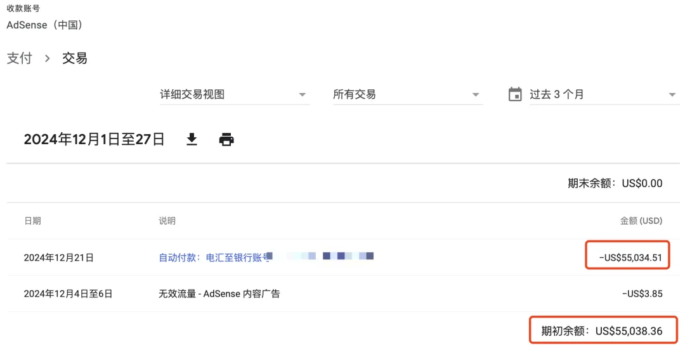

*图 1：哥飞的 AdSense 收款记录，12 月单笔付款 US$55,034.51*

所以本文又名"如何靠网站月入 5 万美金"。

前几天一直忙于公司里的事情，周五下班后躲进小会议室，打开腾讯视频，把《出走的决心》这部电影看完了。看完之后，哥飞把标题从《出海的决心》改成了《出海的决心、耐心、细心和平常心》。

我不准备给大家复述电影情节，而是推荐大家都去看看这部电影——看完电影，我想起了自己的父母。

---

## 一、决心：从家里的生意基因说起

我妈跟电影主人公李红的理念一样：**要自己有钱，有钱才有底气。**

我妈特有生意头脑，会分析需求，找到需求，做出产品，卖出去，解决他人的需求，从而赚钱。

| 阶段 | 做的事 | 关键点 |
| :--- | :--- | :--- |
| 我没上小学时 | 用外婆家带来的圆椒种子育苗，去街上卖辣椒种苗 | 当地没有圆椒，供不应求 |
| 我读五年级时 | 去学做蛋糕，开了镇上的第一家蛋糕店 | 第一次吃到奶油 |
| 后来 | 蛋糕店传给我二弟，再传给三弟，最后转让他人 | 家传手艺的迁移 |
| 父亲 | 不愿一辈子种地，去学木工，走村串乡做木工活时认识我妈 | 技能换机会 |
| 婚后 | 在外婆那个乡镇开小店 | 资金第一次流动 |
| 回乡后 | 父亲去广东学做广式月饼、沙琪玛、中秋月糕 | 跨地域学技术 |
| 再后来 | 在深圳开糕饼作坊，又为不让孩子当留守儿童而回老家 | 前店后厂模式 |
| 之后 | 我妈继续做糕点店，父亲接手姑父的文化用品商店；三弟开更大的文化用品超市；二弟在安徽承包中学小食堂 | 全家在做生意 |

所以我们一家子，**都不安分**，为了赚钱过更好的生活，都一直在找需求、做生意。

> **只有做生意，才会有流动的资金。**
> **只有流动的资金过自己的手了，才有利润。**

有个词叫"揩油"——说你手里得摸过了肥肉，才有可能有油水留下。

即使后来我在深圳安家、有娃了，我妈来带娃，每次寒暑假回家，我妈也要去做豆花来卖。一是不想闲着，二也是同样为了手里能够有钱。

拿哥飞自己来说，因为大学交了女朋友（现妻子），于是就去想怎么能够多赚钱，才会去做网站，才会去学 SEO。

后来大学毕业就开始跟人一起创业，中间一度也是靠着哥飞做网站赚钱来改善大家生活的。后来做 H5 外包，赚到了深圳买房的首付钱；后来外包项目没了，先去一个朋友公司上班，后又去了另一个朋友公司上班，**补齐了付费获取流量的技能**。

再后来去年出来创业，组建了团队，靠着十几年前学习到的 SEO 技能，居然成功让公司活下来了，团队还从最初的 2 个人变成了现在的 10 个人。

前面扯了那么多，其实只有一个目的：**树挪死人挪活。穷则思变，缺钱才会想活路，富则要居安思危。**

**怎么变？从小生意做起，从副业做起。**

---

## 二、给自己的时间重新定价

哥飞现在最想告诉大家的一句话是：**请从现在开始，对自己的时间重新定价。**

哥飞做 H5 外包时，觉得一周做完一个项目赚 1 万人民币就已经很多了。巅峰时期一个月四五个外包不断，能赚五六万，觉得好多呀。

后来去上班，一开始是降薪去的，但入职两周就靠表现让老板愿意升职加薪，后面带技术团队，拿到更多薪水。那时觉得一天能赚一千多人民币，好多啊。

但是当哥飞开始创业，**一心做出海项目之后，就发现，一天赚一千多美元，也不算多了**。

如果你现在还在公司上着班，拿着两三万块钱一个月的薪资，你有没有计算过你的时薪是多少？

可能很多人都计算过，然后觉得自己的时间好值钱啊。但是注意，你计算时薪时，是否按照 8 小时乘以 22 天来计算的？

那么，你真的实际花在工作里的时间，只有 8×22 吗？

以及工作之外剩下的 **30×20 − 8×22**，这些时间也有等价于时薪的钱吗？

我相信大多数人是没有的。

| 收入来源 | 可用时间 | 特点 |
| :--- | :--- | :--- |
| **工资收入** | 8h × 22 天 ≈ 176 小时/月 | 只有上班时的时间才值钱 |
| **第二收入（副业/出海）** | 30 × 20 − 8 × 22 ≈ 424 小时/月 | 休息、娱乐时间也能持续产生收入 |

因为除了工资收入之外，大部分人是没有第二收入的。仅仅靠工资，可以活下去，可以还房贷车贷；但是想要发家致富，就比较困难——**因为你没有把每一分每一秒的时间都利用起来**。

副业的路有很多条，每一条都有人能做出一些成绩。经过哥飞社群里两千多个人的实践，**程序员出海赚美元是一条不错的路，而且是前途光明的路**。

---

## 三、决心：问"我这样可以吗"的人，缺的不是路径

回到主题，为什么出海需要决心？

因为哥飞遇到很多很多人问：我 XXX 情况，可以做吗？我 YYY 情况，可以做吗？

其实这些朋友是**缺少决心**的。

如果他们真的想要出海，那就**缺什么技能就去学习补全这个技能**就好了。很多人不是没有决心——或者更准确地说，对于出海这条路依然抱有怀疑、不坚定，所以没有决心。他们不知道这到底是不是一条能赚钱的路，也不知道这到底是不是哥飞想要割韭菜编造出来的路。

关于方向：确实能赚钱。而且你**完全不一定需要加入任何付费社群、不需要给任何人付钱**，自己就可以不花钱去探索这条路了。

聪明人，一定是已经在行动了。

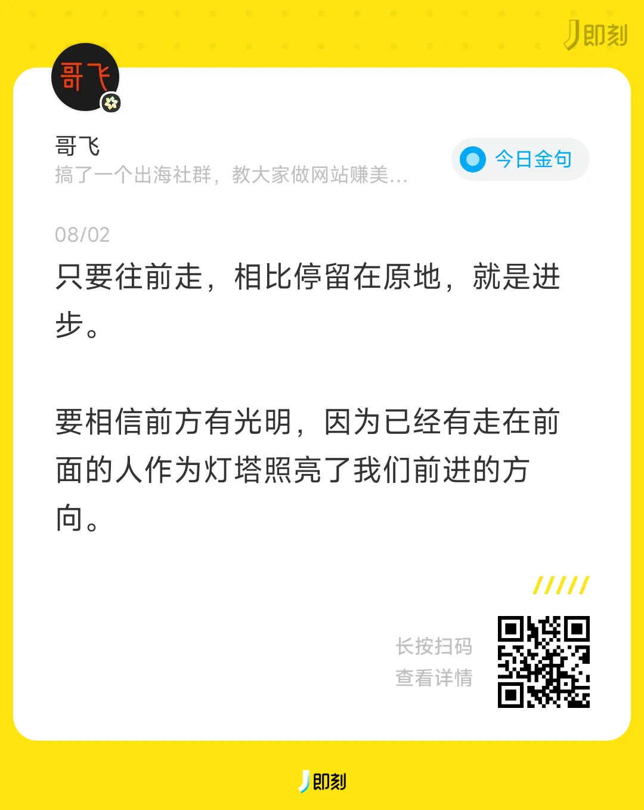

*图 2：哥飞即刻金句——只要往前走，相比停留在原地，就是进步。要相信前方有光明，因为已经有走在前面的人作为灯塔*

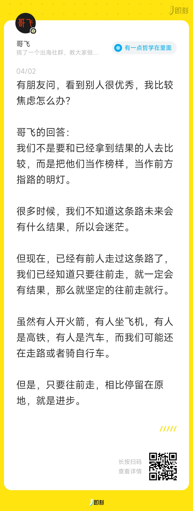

*图 3：哥飞即刻——我们不是要和已经拿到结果的人去比较，而是把他们当作榜样，当作前方指路的明灯。虽然有人开火箭，有人坐飞机，有人是高铁，有人是汽车，而我们可能还在走路或者骑自行车。但是，只要往前走，相比停留在原地，就是进步*

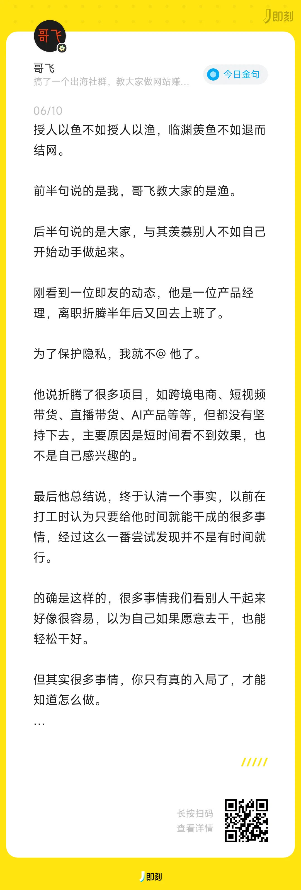

*图 4：哥飞即刻金句——前半句说的是我，哥飞教大家的是渔。后半句说的是大家，与其羡慕别人不如自己开始动手做起来*

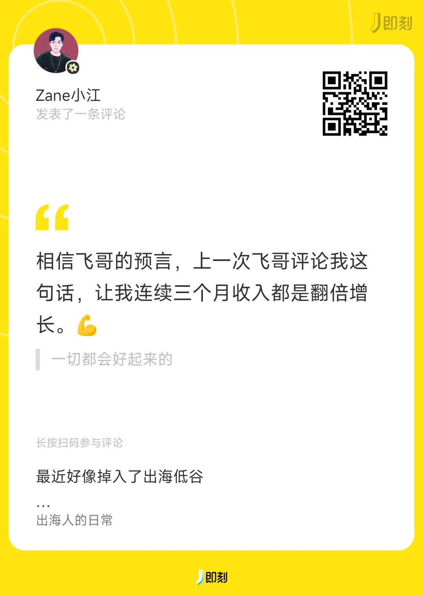

*图 5：群友 Zane 小江的评论——相信飞哥的预言，上一次飞哥评论我这句话，让我连续三个月收入都是翻倍增长。一切都会好起来的*

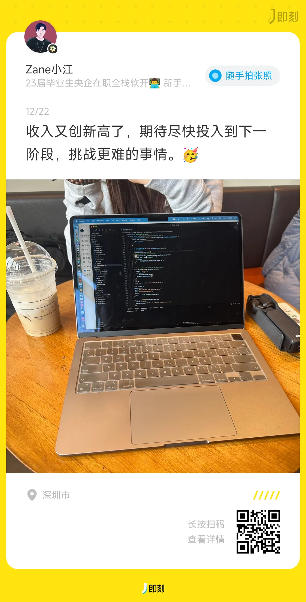

*图 6：群友 Zane 小江——收入又创新高了，期待尽快投入到下一阶段，挑战更难的事情*

关于"能不能赚到钱"这件事，哥飞社群里两千多个人也在做，也有很多人拿到了成果。下面是 2024 年 3 月 15 日哥飞盘点的社群朋友们拿到的部分成绩（2024 年 12 月已更新至更近的时段）：

- 群友做了个网站，上线 21 天拿到 10 万日 PV，又花了 13 天变成 20 万日 PV
- Threads 上线后火速做了个网站，1 小时就被谷歌收录
- 群友新站上线 9 天拿到 11030 个独立访客
- 新网站上线最快多久能从谷歌获取搜索流量？答案是 48 小时内
- 社群朋友 9 月新上的网站从谷歌获得了 1 万个点击
- 入群 100 天，手握百万流量，支付订单滚滚来
- AI 工具站日收入破千美元
- 上线 5 天的新网站，今日 UV 3000 多
- 上线 4 天获得 4700 个外链
- 花半天开发的网站上线一周，今日 3000 人访问
- 上线第一个月 58 万访问，第二个月 170 万访问的网站
- 1200UV 的 AI 工具站每天 200 美元收入
- 两个日 UV 过 10K 的新网站：一个靠 SEO，一个靠自发传播
- 因为开源了一个 GPTs 导航程序，出海第一周就有收入
- 如何花 1 个月从谷歌拿到 100K 点击
- 出海 4 个月他靠网站月入 3W+ 美金
- 养网站防老的典型例子，一个多月养到每天两千多访问
- 一周快闪 SEO 比赛，冠军拿到现金奖励

从 3 月份到现在，9 个月过去了，有更多的朋友们拿到了更好的成绩。甚至有朋友给哥飞发封口费，不允许哥飞拿他的例子来当案例——因为赚钱了，就要低调一些。哥飞觉得很合理。

---

## 四、耐心：细水长流才是常态

刚才我们说了，要让时间更值钱，要让我们休息、娱乐的时间，也能够源源不断地产生收入。那么出海赚美元，就是这么一条路。

**通过 SEO 获取的流量，大多数时候是能够稳定给你的网站带来流量的。**

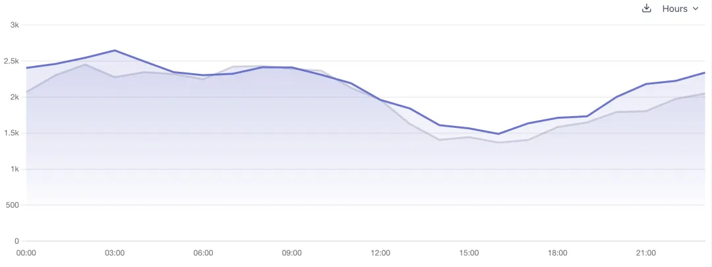

*图 7：SEO 流量的日间分布——凌晨 3 点到下午 3 点虽有波峰波谷，但整体全天在线，不是只有某个时段有人来*

一天 24 小时，每小时都有人访问你的网站。而只要有流量了，就能够变现，不管是广告变现还是订阅变现，都能够源源不断地给你赚钱。

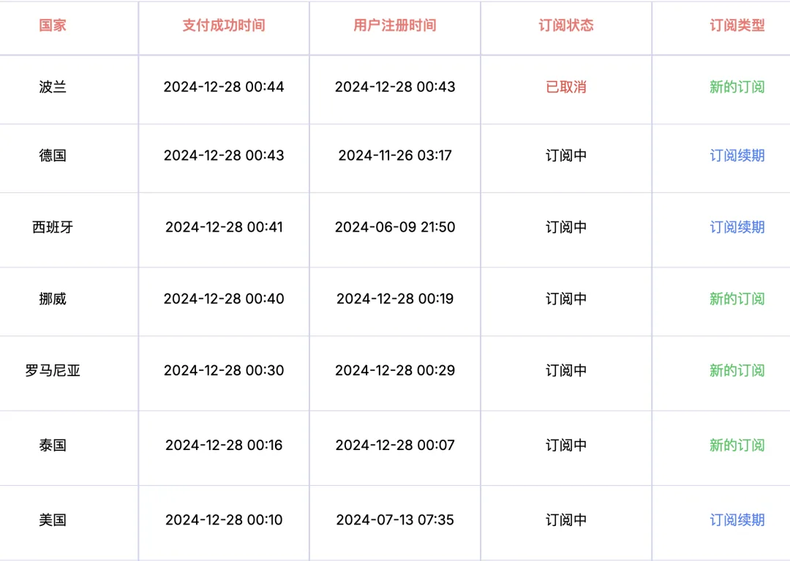

*图 8：订阅数据——全球时区都能出单，12 月 28 日凌晨 0:10~0:44 连续完成波兰、德国、西班牙、挪威、罗马尼亚、泰国、美国等 7 笔订阅*

但是，是不是你只要出海了，就能够开始捡钱呢？

**也不是这样的。你需要有耐心，需要有长期主义的耐心，而不是想着一夜暴富。**

**细水长流才是常态。** 甚至初期，有可能你做了几个网站，都没有啥效果，也是有可能的。

这时候，你就要吸取教训了——是挖掘需求选择关键词没选好？是网站的 SEO 细节没做好？是网站无法满足用户需求？是没有足够多的外链？

这些，都需要你有足够的耐心，以及**细心，深入到细节，找出问题、解决问题，在细节处见真章**，做得比竞争对手更好，从而拿到更靠前的排名，获取更多点击，拿到更多访问量。

---

## 五、细心：点击率才是细节的照妖镜

有时候，我们还会不可避免地遇到一些打击，如最近哥飞的有些朋友们的网站流量下滑了。

原因是**谷歌正在更新算法**，影响了他们的网站。

为什么会影响呢？因为有些网站的内容是 AI 生成的，内容质量不高，谷歌识别到了之后，就会降低这些网站在某些关键词的排名，于是拿到的访问量就变小了。

下面这个图是一个老外的 GSC 截图，他在推特控诉谷歌，毁了他的生意。

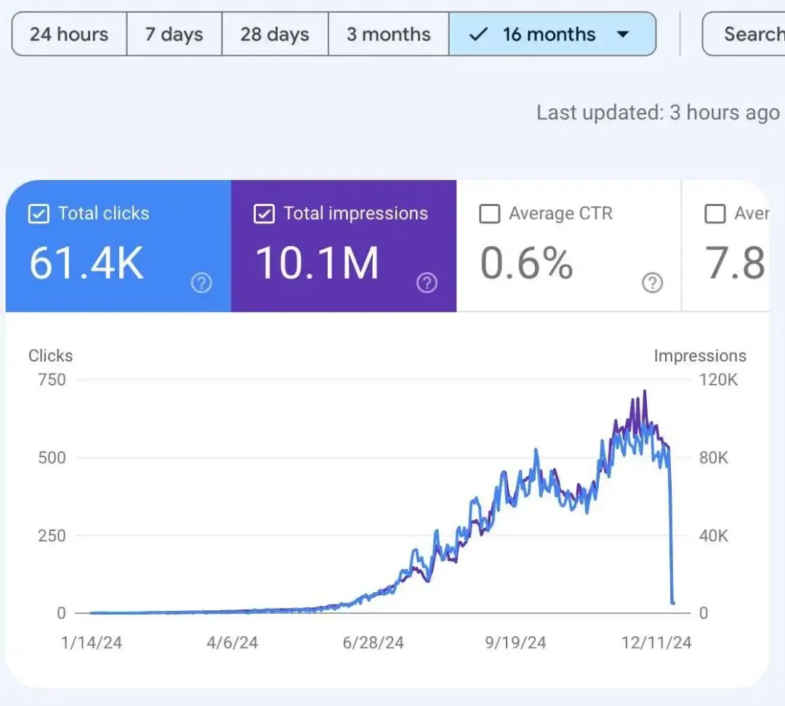

*图 9：老外站点的 GSC——16 个月累计 61.4K 点击、10.1M 曝光，平均点击率仅 0.6%*

但是哥飞想说，活该。

为什么呢？大家看看那 **0.6% 的超低点击率**就知道，这就是一个**海量垃圾内容页面网站**。只有海量内容页面，才有可能这么高的曝光率、这么低的点击率。

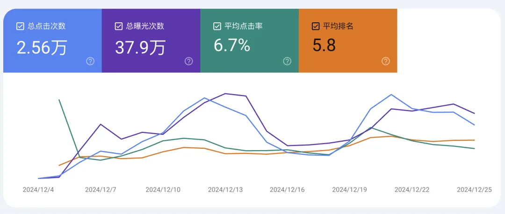

*图 10：哥飞的其中一个网站——经受住了谷歌算法更新，点击率是老外网站的 10 倍*

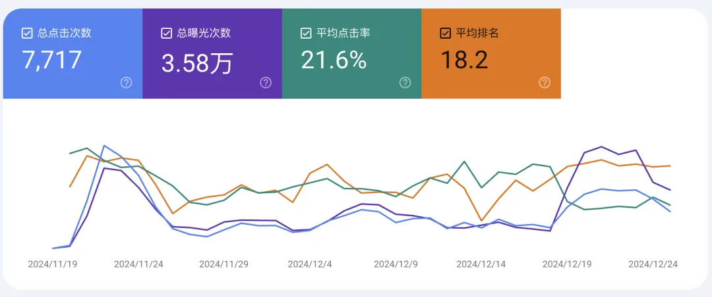

*图 11：哥飞的另一个站——一样经受住了算法的考验，点击率更高*

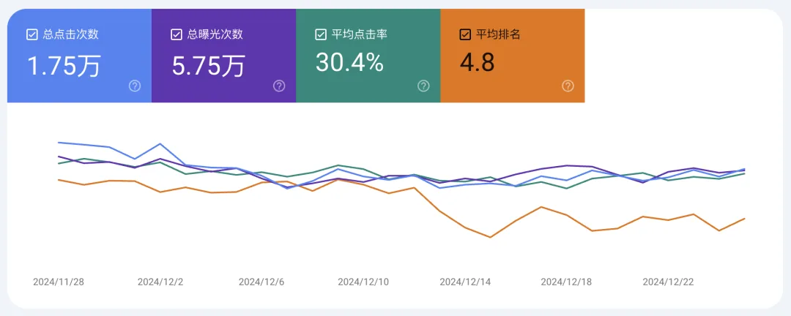

*图 12：更高点击率的站之一——平均点击率 30.4%，平均排名 4.8*

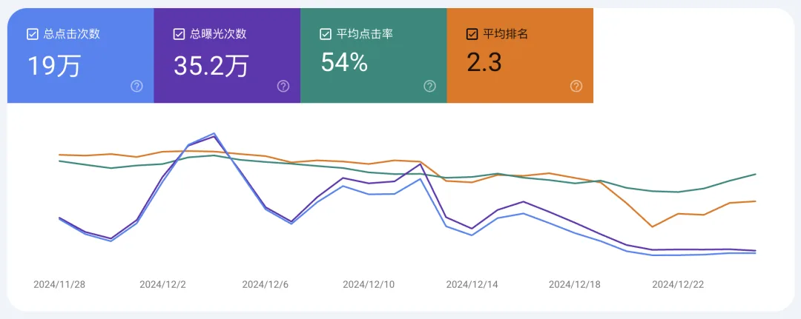

*图 13：更高点击率的站——平均点击率 54%，平均排名 2.3*

**为什么哥飞的网站，都有这么高的点击率呢？因为哥飞没有走海量页面路线，而是走的精品页面路线。**

可以说，哥飞的 SEO 理念，就跟国内很多 SEOer 不一样。

把几张 GSC 截图放在一起对比，结论非常直白：

| 路线 | 曝光量 | 点击率 | 抗算法能力 |
| :--- | :--- | :--- | :--- |
| **海量垃圾内容页面** | 10.1M（曝光极高） | **0.6%** | 谷歌一更新就被降权 |
| **精品页面** | 3.58 万 ~ 35.2 万 | **6.7% / 21.6% / 30.4% / 54%** | 经受住算法更新考验 |

**曝光量不是护城河，点击率才是。** 老外的站有 10.1M 曝光，哥飞的站有 3.58 万曝光，曝光差 280 倍；但点击率差 10~90 倍，实际点击反而更多——这才是"在细节处见真章"的量化体现。

---

## 六、平常心：算法波动是常态，要从谷歌的视角找解法

遇到这个事情，你就需要有**平常心**了，要从谷歌的角度考虑问题。

谷歌希望自己的搜索用户看到的是高质量的内容，所以会去调整算法。那么我们要做的，是**拥护谷歌的决定，做更高质量的内容来给用户**。

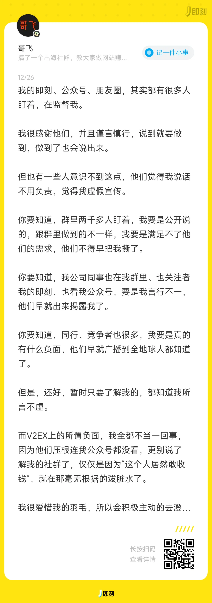

*图 14：哥飞即刻——很多人盯着、盯着你，就要说到做到*

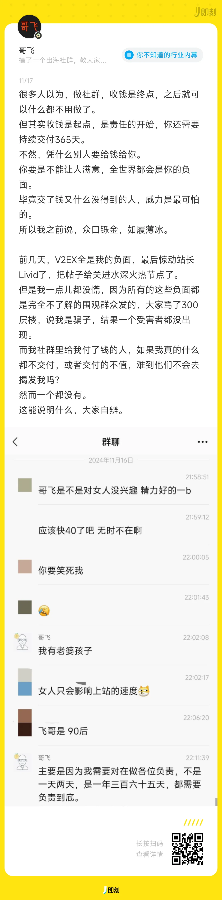

*图 15：哥飞即刻——很多人以为做社群收钱是终点，其实收钱是起点、是责任的开始，你还需要持续交付 365 天*

---

## 七、结尾：决心的定义

如果你有决心，不需要你花钱，把哥飞公众号里一共三百多篇原创文章看完，你就对出海赚美元这条路有一个清晰的认知了，并且能够跟着哥飞的教程从零到一搞起来。

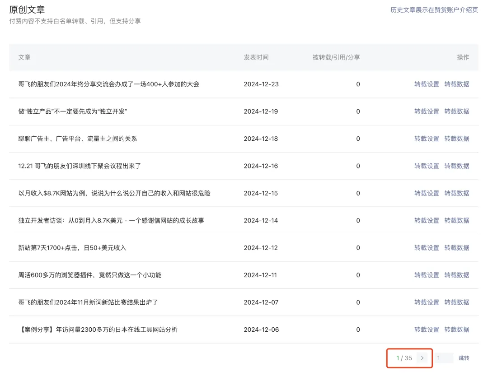

*图 16：哥飞公众号原创文章列表（1/35），涵盖独立开发、SEO、上站、流量等主题*

**所以，出海的决心是什么？**

> **是知道自己想要什么，然后就去做，而不是给自己找借口。**

---

## 关联参考资料

- 来源原文：<https://mp.weixin.qq.com/s/EcbwPzNmaSfX4bRX3ypMww>
- 同作者同系列：
  - [放弃一站发思维，先从练手站做起](./L9BOyFrisy-xsw-NPWlPJQ.md) — 哥飞：不要一开始就想着数据大爆发
  - [独立开发两年，咔叽哇讲怎么低成本启动项目](./bxmWFKTYdga5bdf4AOvaNg.md) — 哥飞：给 AI 找一份工作
- 同主题参考：
  - [人，一定要走进能托举和滋养你的圈子](./outsea-tool-station/mindset/enter-a-circle-that-lifts-you.md) — 出海心态篇
  - [Google SEO 7 大排名信号](./seo/strategy/seo-7-google-signals.md) — 信号层拆解
  - [Google 算法更新与 SEO 应对](./seo/webcafe-beginner/google-algorithm-ranking-factors-2024.md)
  - [首次出海建站指南](./seo/webcafe-advanced/first-abroad-website.md)
