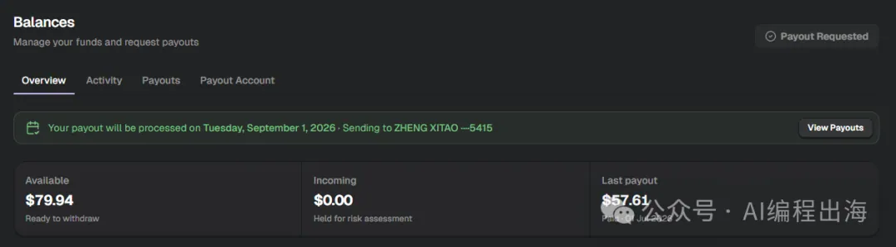
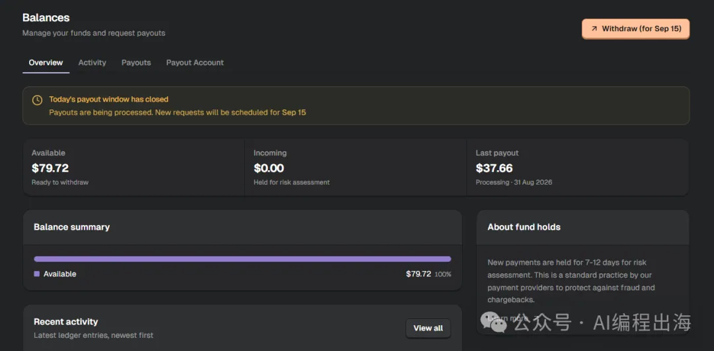
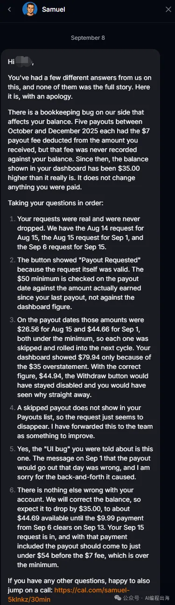
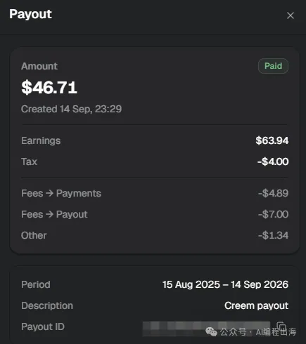
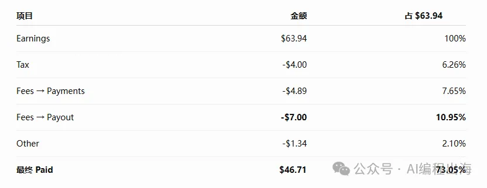

# 出海网站收入 63.94 美元，Creem 提现折腾一个月，到手只剩 46.71 美元

最近遇到一个让我很恼火的事情，Creem 提现连续两次没有给我打款；折腾了一个月，63.94 美元最终到账 46.71 美元。

事情的缘由是这样，我有一个订阅站，还有两个订阅用户，每个月很佛系地给我带来可怜的一点零花钱。

8 月 15 日提现窗口前，我看到 Creem 后台显示可以提现，于是点击 Withdraw 按钮提交提现申请，Balances 页面也显示：8 月 15 日将会提现。

结果到了 8 月 15 日，Payouts 中没有任何提现记录，原来等待提现的状态消失，Withdraw 按钮再次高亮，提示可以于 9 月 1 日提现。

这让我感觉十分莫名其妙！明明前一天还提示等待提现并且显示 8 月 15 日打款，结果到了 8 月 15 日，就变成让我重新申请、再等半个月？而且没有任何原因说明。

我只好再次点击 Withdraw 按钮。这次我留了一个心眼，截了个图作为证据，万一再出相同问题，好拿截图找 Creem 客服。

结果，到了 9 月 1 日那天，Creem“故技重演”，等待提现的状态再次消失，Withdraw 按钮再次高亮，提示可以于 9 月 15 日提现...

这次，我有了截图的证据，于是直接联系 Creem 客服。结果经过几个来回的沟通，总算弄明白其中原因。

原来，不是我的提现申请失效，而是 Creem 的账务系统出了一个余额显示 Bug。

客服解释，2025 年 10 月到 12 月，我有 5 次提现，每次实际到账时都已经扣了 7 美元手续费，但后台却没有把这笔费用从账户余额里同步扣掉。5 次累计下来，导致后台一直多显示了 35 美元。

所以，当时我看到后台有 79.94 美元，以为已经超过 50 美元提现门槛，实际上，真正可提现的只有 44.94 美元。8 月 15 日和 9 月 1 日提现时，真实可提现金额分别只有 26.56 美元和 44.66 美元，都没有达到 50 美元最低提现要求，因此系统自动跳过了提现。

钱没有凭空少 35 美元，而是后台一直多显示了 35 美元。

客服还说，他们随后会把余额修正，并表示 9 月 15 日这次提现应该可以正常执行。

弄清楚原因后，我于是再次提交提现申请。果然，就在昨天 9 月 15 日，我终于收到这笔一波三折的零花钱。

Earnings $63.94，最终到账 $46.71，一共扣了 $17.23，约占这笔收入的 26.95%。

血亏！

这个提现记录中，Tax 对应每个订单的税务扣款，Fees → Payments 是每个订单的交易手续费，Other 对应 Moderation API 的费用，用于 NSFW 的检测和过滤。这些费用都无法免除，唯一值得关注的是：

Fees → Payout -$7.00

> Creem 目前公开的银行提现规则是：7 美元／欧元，或提现金额的 1%，取较高者。

Creem 目前公开的银行提现规则是：7 美元／欧元，或提现金额的 1%，取较高者。

我这次提现扣了 7 美元，折合人民币将近 50 元，这也意味着小额提现很不划算。

出海赚钱真不容易！

原本以为买个域名，就可以做全世界的生意，但实际情况下，真正运营起来才发现，有许多比域名费用高得多的成本，账没算清楚，有可能一不小心就亏进去了。

你的出海网站也有使用 Creem 支付吗？是否也遇到我遇到的这些尴尬问题。欢迎交流。
