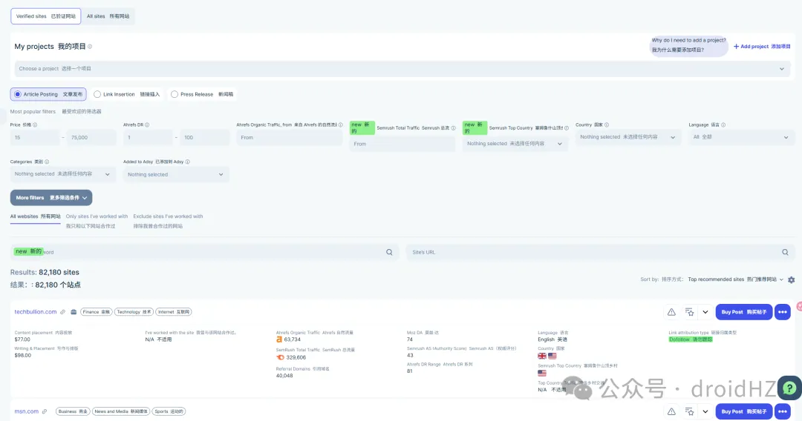
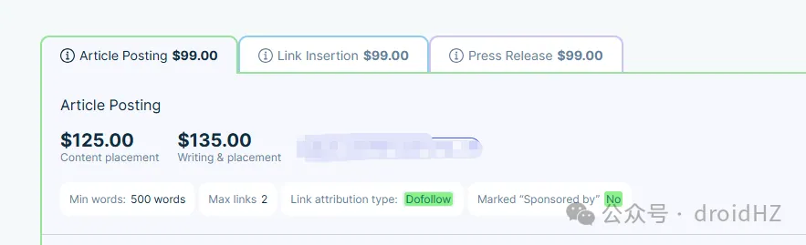

# 网站出海分享：新页面自动 IndexNow

早上好，朋友们！上次听了蓝星空大佬的分享，知道了 bing 有个东西叫做 indexNow，是一个协议，Bing、Yandex 支持这个协议，是用来主动告诉搜索引擎页面的新增、更新、删除。我之前 bing 一直用的 summit url，他们的区别大致是：Submit URL = 手动告诉 Bing：这个页面你来看看 IndexNow = 网站主动实时推送：这些页面发生变化了，请更新索引 indexNow 自动触发我把这个流程也放到我的部署流程，每次提交代码会被比较 sitemap 自动触发新增页面的 indexnow，请求更新索引。indexnow 的 API 可以参考官方文档：bing.com/indexnow/getstarted 整体流程就是生成密钥，调用 API。然后我就是把这个官方文档丢给 codex，告诉他：新增一个命令，这个命令是获取网站之前的 sitemap，找出新增的 url ，把这些新增的 url 调用 indexNow 的 API 通知到搜索引擎，在提交 github 自动触发部署时调用。 提交之后就可以在 bing 的站长后台看到 indexnow 的 urlcloudflare 设置除了自己调用 api 外，如果用的 cloudflare 也支持 indexNow，就是之前分享过的的 Crawler Hints 的能力。官方文档说明：blog.cloudflare.com/cloudflare-now-supports-indexnow/入口在 选择某个域名-> 缓存 -> 配置 -> Crawler Hints  打开。启用此功能后，cloudflare 就会开始向搜索引擎发送提示，告知它们何时应该抓取网站的特定部分。

早上好，朋友们！

上次听了蓝星空大佬的分享，知道了 bing 有个东西叫做 indexNow，是一个协议，Bing、Yandex 支持这个协议，是用来主动告诉搜索引擎页面的新增、更新、删除。我之前 bing 一直用的 summit url，他们的区别大致是：

Submit URL = 手动告诉 Bing：这个页面你来看看

IndexNow = 网站主动实时推送：这些页面发生变化了，请更新索引

## indexNow 自动触发

我把这个流程也放到我的部署流程，每次提交代码会被比较 sitemap 自动触发新增页面的 indexnow，请求更新索引。

indexnow 的 API 可以参考官方文档：bing.com/indexnow/getstarted

整体流程就是生成密钥，调用 API。然后我就是把这个官方文档丢给 codex，告诉他：新增一个命令，这个命令是获取网站之前的 sitemap，找出新增的 url ，把这些新增的 url 调用 indexNow 的 API 通知到搜索引擎，在提交 github 自动触发部署时调用。 提交之后就可以在 bing 的站长后台看到 indexnow 的 url

## cloudflare 设置

除了自己调用 api 外，如果用的 cloudflare 也支持 indexNow，就是之前分享过的的 Crawler Hints 的能力。

官方文档说明：blog.cloudflare.com/cloudflare-now-supports-indexnow/

入口在 选择某个域名-> 缓存 -> 配置 -> Crawler Hints  打开。启用此功能后，cloudflare 就会开始向搜索引擎发送提示，告知它们何时应该抓取网站的特定部分。

我是赫兹，专注网站出海第 426 天，持续分享网站出海内容。新朋友可以看看之前的文章合集；想系统学习，也推荐关注哥飞老师，我很多方法是向他学习的，微信搜索 361079 就可以找到他。网站出海每日分享网站出海深度总结

我是赫兹，专注网站出海第 426 天，持续分享网站出海内容。新朋友可以看看之前的文章合集；想系统学习，也推荐关注哥飞老师，我很多方法是向他学习的，微信搜索 361079 就可以找到他。

网站出海每日分享

网站出海深度总结
