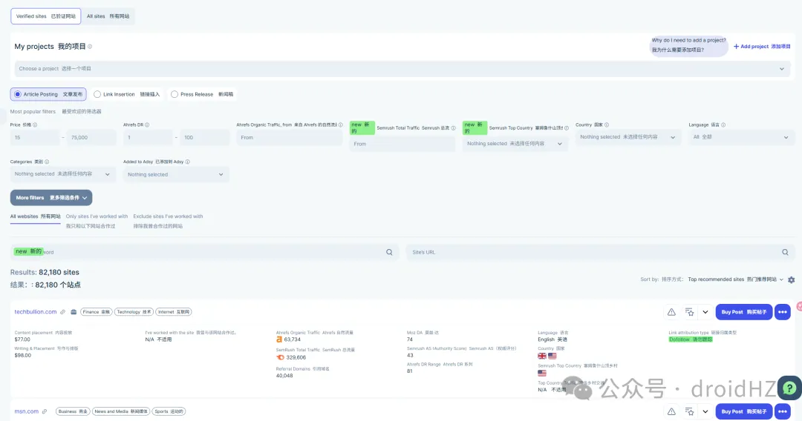
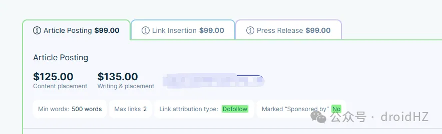
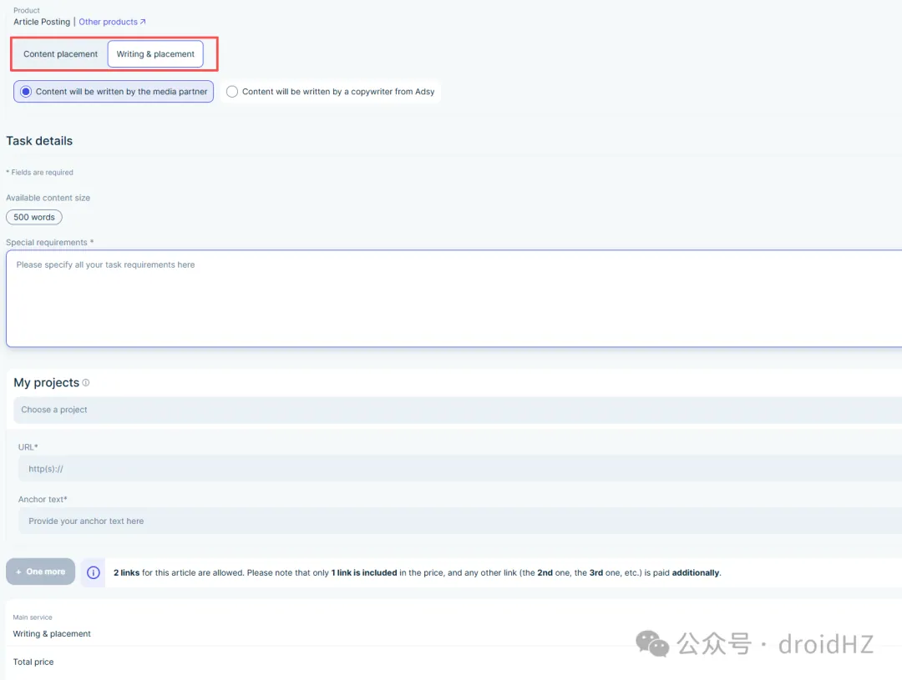
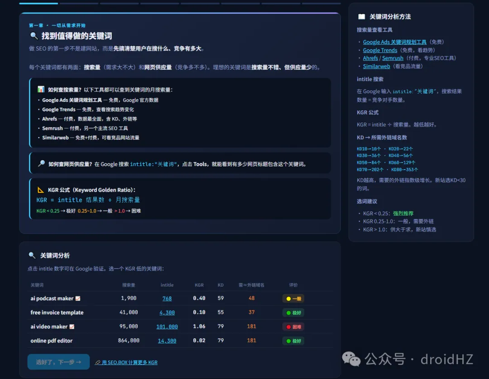

# 网站出海每日分享：哥飞老师的 SEO 神器

早上好，朋友们！ 今天去听哥飞老师的年中线下分享会了，今天就来分享下哥飞老师的 SEO 工具箱，有部分功能暂时可以非社群用户免费使用的，这些工具都是网站开发神器，我也是会经常用。 地址：seo.web.cafeimage.png 关键词难度计算这个现在已经是我找需求，判断词做不做的一个必备神器了，不只是 KD，哥飞老师的工具综合了前 10 名网站的 KD，流量，体验，年龄综合打分。评估更加的全面，更有参考性。网站起名不知道大家有没有这样的经历，和 AI 讨论一大堆之后，找到一个心仪的域名，但是一购买发现已经被注册了，哥飞老师的这个工具除了综合 AI 建议外，还会真实的去去查询域名是否注册，节约时间。关键词分析这个就是用来计算我们之前说的 KGR 的，除了 KGR 还可以看到 EKGR 和 KDROI 的数据，通过这个指标帮你评估关键词的 ROIStripe 引荐流量排行这个就是我们之前说的 Stripe 收入排行榜的数据，这里不用自己去 similarweb 看入站流量，而是直接帮你总结好了，而且有历史的数据可以查看，通过这个榜单去寻找一些需求方向。SEO 模拟经营 SEO 大家都知道很慢，所以我们实践学习 SEO 是一个很长的过程，很难进行理解。哥飞老师的这个 SEO 模拟经营，可以让体会到 SEO 是怎么样的一个流程，了解到怎么布局关键词内容，购买外链。当然玩到最后大家还会体会到日入万刀的快感。非常 nice~当然社群还有其他很多的付费内容，我感觉都是不错，有需要的朋友也可以找我推荐获取优惠。我是赫兹，专注网站出海第 408 天，持续分享网站出海内容。新朋友可以看看之前的文章合集；想系统学习，也推荐关注哥飞老师，我很多方法是向他学习的，微信搜索 361079 就可以找到他。网站出海每日分享网站出海深度总结

早上好，朋友们！ 今天去听哥飞老师的年中线下分享会了，今天就来分享下哥飞老师的 SEO 工具箱，有部分功能暂时可以非社群用户免费使用的，这些工具都是网站开发神器，我也是会经常用。 地址：seo.web.cafe

## 关键词难度计算

这个现在已经是我找需求，判断词做不做的一个必备神器了，不只是 KD，哥飞老师的工具综合了前 10 名网站的 KD，流量，体验，年龄综合打分。评估更加的全面，更有参考性。

## 网站起名

不知道大家有没有这样的经历，和 AI 讨论一大堆之后，找到一个心仪的域名，但是一购买发现已经被注册了，哥飞老师的这个工具除了综合 AI 建议外，还会真实的去去查询域名是否注册，节约时间。

## 关键词分析

这个就是用来计算我们之前说的 KGR 的，除了 KGR 还可以看到 EKGR 和 KDROI 的数据，通过这个指标帮你评估关键词的 ROI

## Stripe 引荐流量排行

这个就是我们之前说的 Stripe 收入排行榜的数据，这里不用自己去 similarweb 看入站流量，而是直接帮你总结好了，而且有历史的数据可以查看，通过这个榜单去寻找一些需求方向。

## SEO 模拟经营

SEO 大家都知道很慢，所以我们实践学习 SEO 是一个很长的过程，很难进行理解。哥飞老师的这个 SEO 模拟经营，可以让体会到 SEO 是怎么样的一个流程，了解到怎么布局关键词内容，购买外链。当然玩到最后大家还会体会到日入万刀的快感。非常 nice~

当然社群还有其他很多的付费内容，我感觉都是不错，有需要的朋友也可以找我推荐获取优惠。

我是赫兹，专注网站出海第 408 天，持续分享网站出海内容。新朋友可以看看之前的文章合集；想系统学习，也推荐关注哥飞老师，我很多方法是向他学习的，微信搜索 361079 就可以找到他。

网站出海每日分享

网站出海深度总结
