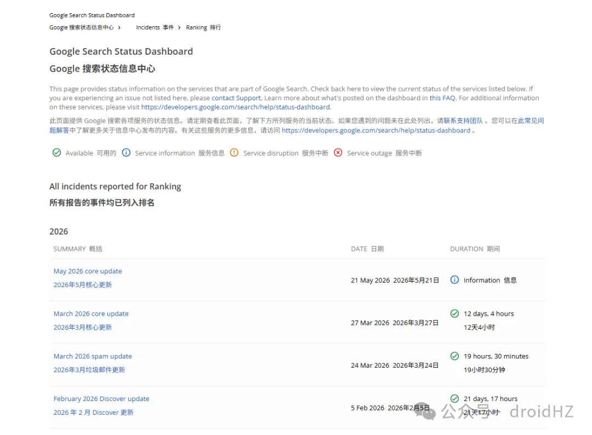

# 网站出海每日分享：通过 dataforseo API 获取常见的 SEO 数据

早上好，朋友们！今天分享一个 SEO 常见数据都能获取的 API 平台，比如之前说的的 Google trends 监控，可以用免费的 pytrends，但不稳定，也可以用 dataforseo 的 Google trends 的 api ，比较稳定。我们来看看有哪些常见的 API。API 文档：docs.dataforseo.com抓搜索结果支持 Google、Bing、YouTube、Yahoo、Baidu、Naver 等搜索引擎，可以指定关键词、地区、语言、设备，返回每个排名结果的标题、URL、描述，以及精选摘要、People Also Ask、Knowledge Panel 等 SERP 特征。想要做排名监控工具、竞品分析可以试试。关键词数据之前分享的一些常见的关键词数据，他也是都有的，可以用来做关键词的分享，新词的监控等。Google Ads API—— 搜索量、CPC、竞争度 Google Trends API—— 关键词热度趋势 Bing Ads API—— Bing 的关键词数据外链数据实时返回任意域名或页面的外链数据，支持查反链列表、引用域名、锚文本分布、外链历史等，但是这个比较坑，有 $100/月 的最低要求，这个就是适合用来做外链分析工具、竞品外链研究等 SEO 检测爬取指定网站或页面，检测 SEO 技术问题，（不需要 API 的话，ahrefs 免费版本也有这些功能）死链、重复内容、缺失 meta 标签页面速度结构化数据检测内链分析 GEO 这个好像是今年才出的，专门针对 AI 搜索场景，可以用来做 AI 流量监控、GEO 优化、检测自己的产品有没有被 AI 推荐。LLM Mentions—— 检测品牌在 ChatGPT、Perplexity、Gemini 等 LLM 中被提及的情况 AI Keyword Search Volume—— 关键词在 AI 平台的搜索量 LLM Responses—— 获取 LLM 对特定问题的回答内容 LLM Scraper—— 爬取 AI 平台的输出数据还有一些 API 没列举出来，大家有通过获取 API 数据的需求，可以先去看看文档有你需要的 API 不。这个平台的 API 是付费的，初始会赠送 1 美金，但中国的手机号验证不了，还是得充钱，个人场景感觉价格还行（不想去折腾），我充了 50 美金也可以用很久。但是用来做服务可能去找找其他更便宜的方式。

早上好，朋友们！

今天分享一个 SEO 常见数据都能获取的 API 平台，比如之前说的的 Google trends 监控，可以用免费的 pytrends，但不稳定，也可以用 dataforseo 的 Google trends 的 api ，比较稳定。我们来看看有哪些常见的 API。

API 文档：docs.dataforseo.com

## 抓搜索结果

支持 Google、Bing、YouTube、Yahoo、Baidu、Naver 等搜索引擎，可以指定关键词、地区、语言、设备，返回每个排名结果的标题、URL、描述，以及精选摘要、People Also Ask、Knowledge Panel 等 SERP 特征。想要做排名监控工具、竞品分析可以试试。

## 关键词数据

之前分享的一些常见的关键词数据，他也是都有的，可以用来做关键词的分享，新词的监控等。

Google Ads API—— 搜索量、CPC、竞争度

Google Trends API—— 关键词热度趋势

Bing Ads API—— Bing 的关键词数据

## 外链数据

实时返回任意域名或页面的外链数据，支持查反链列表、引用域名、锚文本分布、外链历史等，但是这个比较坑，有 $100/月 的最低要求，这个就是适合用来做外链分析工具、竞品外链研究等

## SEO 检测

爬取指定网站或页面，检测 SEO 技术问题，（不需要 API 的话，ahrefs 免费版本也有这些功能）

死链、重复内容、缺失 meta 标签

页面速度

结构化数据检测

内链分析

## GEO

这个好像是今年才出的，专门针对 AI 搜索场景，可以用来做 AI 流量监控、GEO 优化、检测自己的产品有没有被 AI 推荐。

LLM Mentions—— 检测品牌在 ChatGPT、Perplexity、Gemini 等 LLM 中被提及的情况

AI Keyword Search Volume—— 关键词在 AI 平台的搜索量

LLM Responses—— 获取 LLM 对特定问题的回答内容

LLM Scraper—— 爬取 AI 平台的输出数据

还有一些 API 没列举出来，大家有通过获取 API 数据的需求，可以先去看看文档有你需要的 API 不。这个平台的 API 是付费的，初始会赠送 1 美金，但中国的手机号验证不了，还是得充钱，个人场景感觉价格还行（不想去折腾），我充了 50 美金也可以用很久。但是用来做服务可能去找找其他更便宜的方式。

我是赫兹，专注网站出海第 385 天，持续分享网站出海内容。新朋友可以看看之前的文章合集；想系统学习，也推荐关注哥飞老师，我很多方法是向他学习的，微信搜索 361079 就可以找到他。

网站出海每日分享

网站出海深度总结
