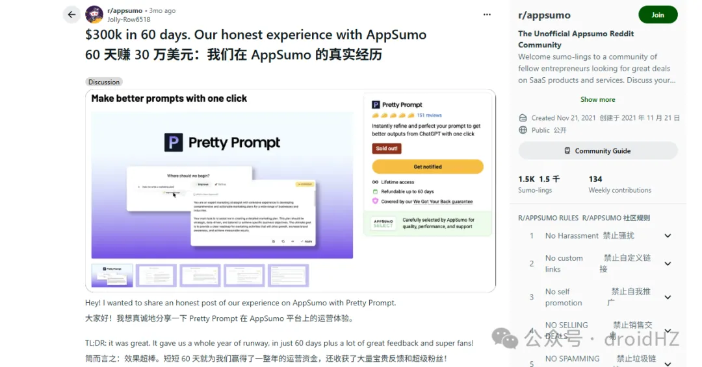

# 网站出海每日分享：cloudflare 自动化部署

早上好，朋友们！昨天分享了有些重复性高的固定流程，可以考虑用 skill 去提效，提到了我用到的 cloudflare 自动部署，创建数据库和 R2，配置环境变量，有一些朋友问我怎么弄的，今天就来分享一下这个流程。核心点就是 cloudflare 的 CLI，只需要你配置上对应的密钥就可以实现这些能力 D1 数据库 wrangler d1 create my-db# 创建数据库 R2 存储桶 wrangler r2 bucket create my-bucket# 创建存储桶环境变量 wrangler secret bulk .env.production# 批量推送密钥到 Worker 部署 wrangler deploy# 部署 WorkerCDN 子域名那一步是调 Cloudflare 的 REST API 绑定的，wrangler 暂时没有直接的命令，但 API 文档里有现成的 curl 示例，AI 直接拿来用了。如果你不是 cloudflare 的全家桶，其实 vercel 、supabase 这些也是有 CLI 的，也可以放到你的工作流程里面进行提效。创建 skill 创建这种 skill 其实也很简单，因为 TanStarter 文档写的比较全面（需要 TanStarter 的朋友可以用 droidHZ，可以优惠 20 美金），我是大白话告诉 AI 即可，然后测试调整一下细节：我在用 TanStarter 模板，每次上线新站都要重复创建 D1 数据库、创建 R2 存储桶、 环境变量配置。帮我写一个 skill，以后只要告诉它域名，自动配置上线。使用 xcrawl 获取参考文档：https://docs.tanstarter.dev/docs/deploymenthttps://docs.tanstarter.dev/docs/databasehttps://docs.tanstarter.dev/docs/storage不过这里需要注意下，一个skill 不要做得很大，这样的效果很不好，反而可能浪费 token 和时间。一个 skill 就是专注一件事情。不要一上来就想要把自动化做好（不然可能很花时间，效果也不一定好），一点点的把自己日常工作流程简化为 skill，部分流程提效，然后组装起来。我是赫兹，专注网站出海第 374 天，持续分享网站出海内容。新朋友可以看看之前的文章合集；想系统学习，也推荐关注哥飞老师，我很多方法是向他学习的，微信搜索 361079 就可以找到他。网站出海每日分享网站出海深度总结

早上好，朋友们！

昨天分享了有些重复性高的固定流程，可以考虑用 skill 去提效，提到了我用到的 cloudflare 自动部署，创建数据库和 R2，配置环境变量，有一些朋友问我怎么弄的，今天就来分享一下这个流程。

核心点就是 cloudflare 的 CLI，只需要你配置上对应的密钥就可以实现这些能力

D1 数据库

R2 存储桶

环境变量

部署

CDN 子域名那一步是调 Cloudflare 的 REST API 绑定的，wrangler 暂时没有直接的命令，但 API 文档里有现成的 curl 示例，AI 直接拿来用了。

如果你不是 cloudflare 的全家桶，其实 vercel 、supabase 这些也是有 CLI 的，也可以放到你的工作流程里面进行提效。

## 创建 skill

创建这种 skill 其实也很简单，因为 TanStarter 文档写的比较全面（需要 TanStarter 的朋友可以用 droidHZ，可以优惠 20 美金），我是大白话告诉 AI 即可，然后测试调整一下细节：

不过这里需要注意下，一个 skill 不要做得很大，这样的效果很不好，反而可能浪费 token 和时间。一个 skill 就是专注一件事情。不要一上来就想要把自动化做好（不然可能很花时间，效果也不一定好），一点点的把自己日常工作流程简化为 skill，部分流程提效，然后组装起来。

我是赫兹，专注网站出海第 374 天，持续分享网站出海内容。新朋友可以看看之前的文章合集；想系统学习，也推荐关注哥飞老师，我很多方法是向他学习的，微信搜索 361079 就可以找到他。

网站出海每日分享

网站出海深度总结
