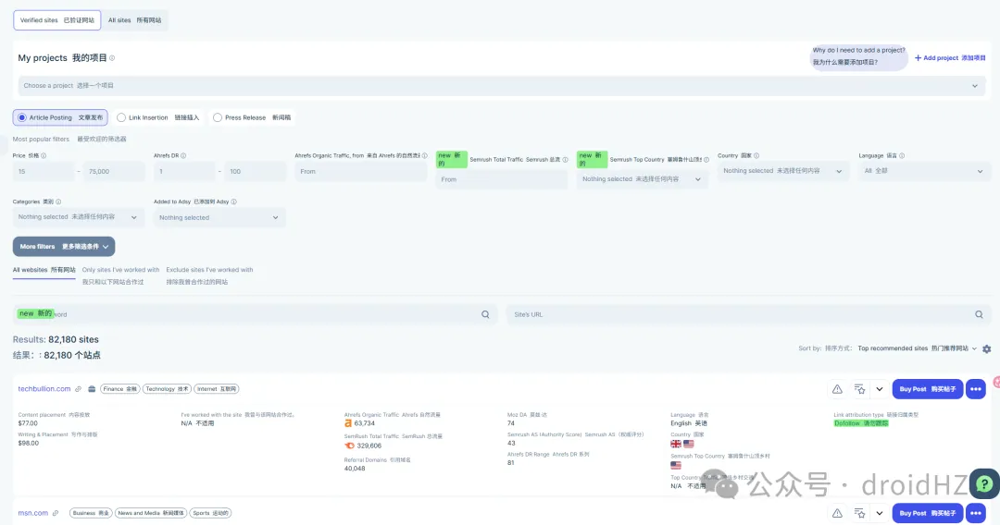
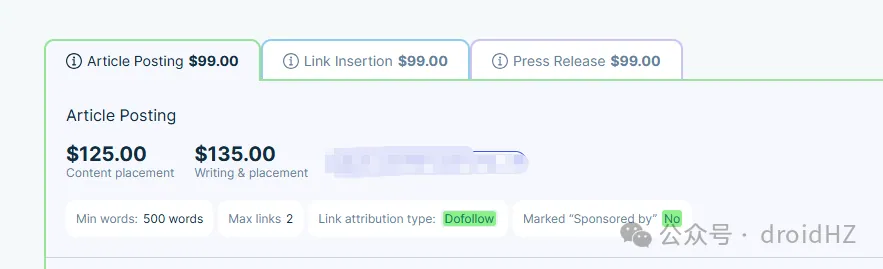
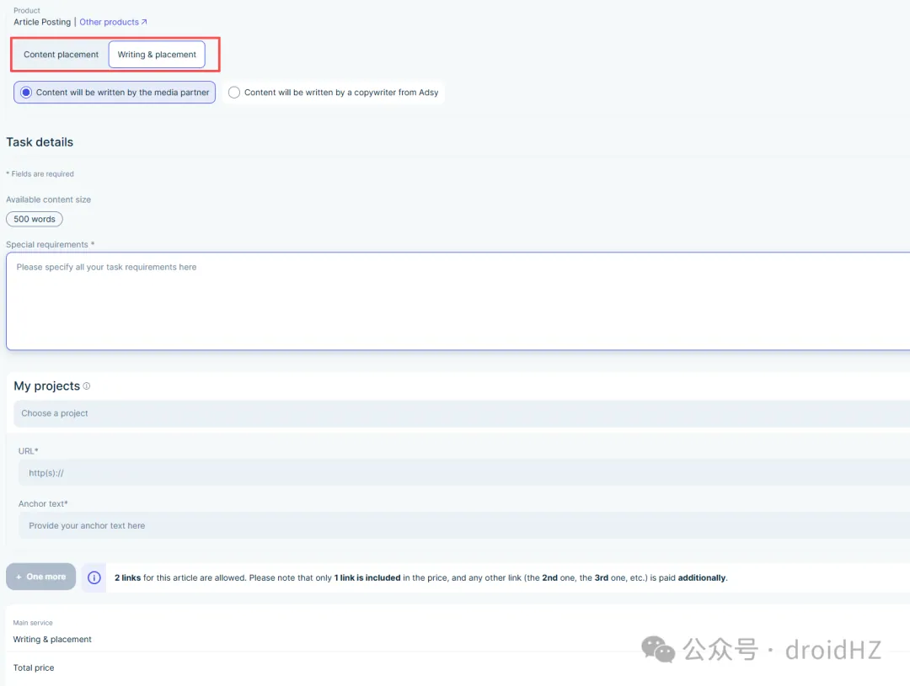
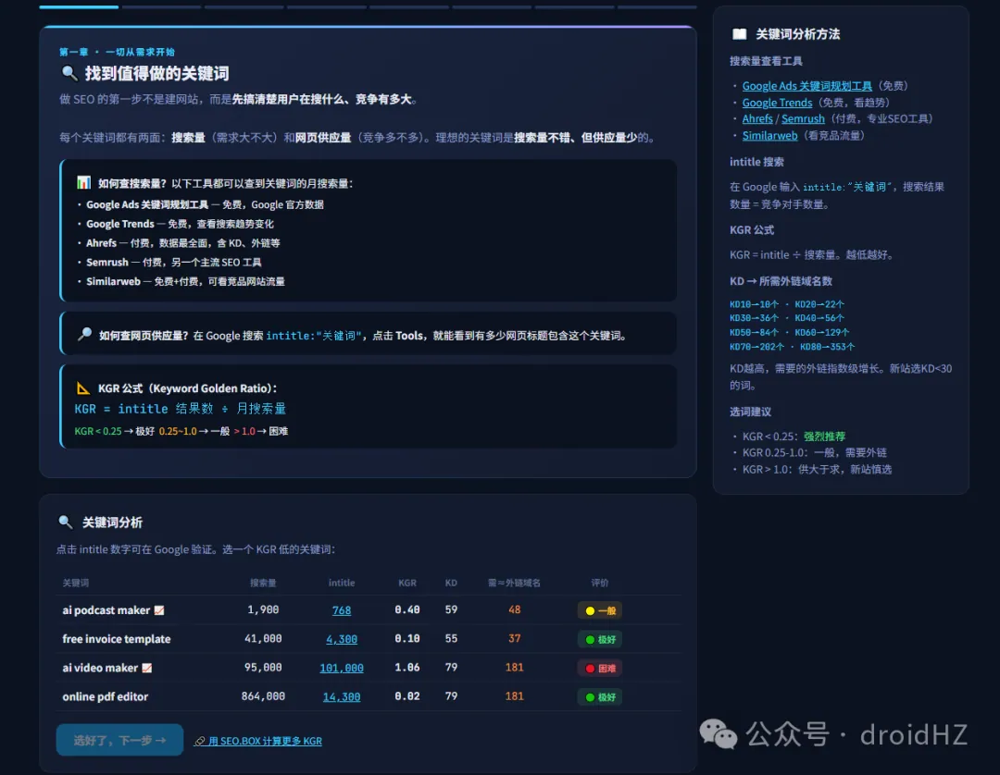

# 网站出海每日分享：clarity 看 AI 访问引用情况

早上好，朋友们！ 今天分享一个 Clarity 的新功能，AI Visibility，这个可以看到 AI 的引用和 AI 爬虫的的访问具体入口在左上角新增的 AI Visibility ，点击你可以看到：Citation 看 AI 引用你没有 Bot Activity 看 AI 爬虫访问的情况！[image](images/001.webp)查看 AI 引用使用 Citation 需要先认证一下的你域名，可以直接选择 GSC，然后 Google 登录认证。认证成功后，就可以看到 Grounding queries 是 AI 引用是用到的相关关键词，My cited pages 是对应的页面。右上角有个 View analysis，点击后可以直接看到这些 AI 来源的用户的一些基本数据和录屏！[image](images/002.webp)查看机器人访问选择 Bot Activity ，刚进入时也是需要连接 cloudflare ，点击上面的 cloudflare 的 API Token 跳转链接去创建对应的密钥。在 cloudflare 上，添加全选里面，按照 Clarity 的要求配置对应的权限，我的是中文版，英文版配置看 Clarity 上面的截图。然后同意创建对应的密钥。把创建好的密钥粘贴带 Clarity 上，让选择对应的域名，就链接上了，等待一小时左右就可以看到爬虫的访问数据了。通过分析这些 AI 的引用和访问数据，大家可以挖掘哪些词哪些页面容易被引用，从而去做相应的词和页面。也可以看看这些 AI 来的用户实际体验是什么样的（录屏），会不会过度消耗你的服务器 等等。

早上好，朋友们！ 今天分享一个 Clarity 的新功能，AI Visibility，这个可以看到 AI 的引用和 AI 爬虫的的访问

具体入口在左上角新增的 AI Visibility ，点击你可以看到：Citation 看 AI 引用你没有 Bot Activity 看 AI 爬虫访问的情况

## 查看 AI 引用

使用 Citation 需要先认证一下的你域名，可以直接选择 GSC，然后 Google 登录认证。

认证成功后，就可以看到 Grounding queries 是 AI 引用是用到的相关关键词，My cited pages 是对应的页面。右上角有个 View analysis，点击后可以直接看到这些 AI 来源的用户的一些基本数据和录屏

## 查看机器人访问

选择 Bot Activity ，刚进入时也是需要连接 cloudflare ，点击上面的 cloudflare 的 API Token 跳转链接去创建对应的密钥。

在 cloudflare 上，添加全选里面，按照 Clarity 的要求配置对应的权限，我的是中文版，英文版配置看 Clarity 上面的截图。然后同意创建对应的密钥。把创建好的密钥粘贴带 Clarity 上，让选择对应的域名，就链接上了，等待一小时左右就可以看到爬虫的访问数据了。

通过分析这些 AI 的引用和访问数据，大家可以挖掘哪些词哪些页面容易被引用，从而去做相应的词和页面。也可以看看这些 AI 来的用户实际体验是什么样的（录屏），会不会过度消耗你的服务器 等等。

我是赫兹，专注网站出海第 372 天，持续分享网站出海内容。新朋友可以看看之前的文章合集；想系统学习，也推荐关注哥飞老师，我很多方法是向他学习的，微信搜索 361079 就可以找到他。

网站出海每日分享

网站出海深度总结
