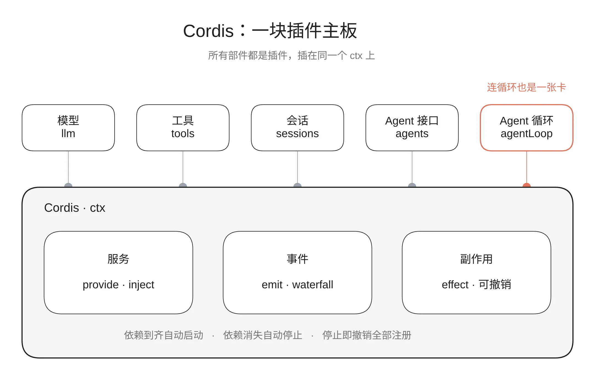

---

title: "主板 Cordis：为什么连 Agent 循环都能换"

date: "2026-11-09"

source: "纳米AI（nano-ai.tech）"

url: "https://namiai.tech/teardown/deepseek-harness/cordis/"

description: "手写一块 150 行的迷你主板，故意找出三个 bug，再拿真实的 Cordis 跑同样的实验，看工业级框架怎么填坑。"

---

# 主板 Cordis：为什么连 Agent 循环都能换

[拆机 DeepSeek Harness · 02](/teardown/deepseek-harness/)

The Mainboard · Cordis

> 
[上一篇](/teardown/deepseek-harness/overview/)
看了整机图：DSH 一百多万行代码，骨架只有几千行，最底下是一块叫 Cordis 的主板。模型、工具、会话、沙箱，连 Agent 循环本身，都是插在这块主板上的卡。

>

> 这一篇把主板拆开。先手写一块 150 行的迷你主板，跑起来；再故意给它找茬，找出三个 bug；最后拿真实的 Cordis 跑同样的实验，看工业级的版本是怎么把这三个坑填上的。

本篇基于 DSH 仓库 2026 年 10 月 30 日的提交（
`ce7073d`
）。项目还在开发者预览阶段，后续版本可能和文中不同。文中的代码都实际跑过，输出是真实结果。

* * *

## 01没有主板会怎样

回想「从零手写 Agent」里的 nami-agent。一个 
`agent.py`
 写死了循环，工具模块往注册表里登记自己。几百行的时候，这样写完全没问题。

但如果要把它做成一个很多人一起扩展的框架，会依次撞上四堵墙：

**1\. 启动顺序越来越难管。** Agent 循环需要模型和工具先准备好，沙箱需要配置先加载，子 Agent 又需要循环先就绪。模块一多，谁先谁后就成了一张手工维护的清单，改一处牵动一片。

**2\. 模块互相 import，耦合死了。** 循环里写着 
`from llm import DeepSeekClient`
，想换一家模型，就得改循环的代码。

**3\. 想改行为，只能改核心。** 想在工具执行前加一道审批，只能打开 
`agent.py`
 往循环里加判断。第三方开发者不可能都去改你的核心文件。

**4\. 卸载留垃圾。** 一个插件注册了工具、监听了事件、开了定时器，卸载时漏清一样，就留下一个幽灵：工具还在列表里，调用时却报错。

Cordis 要解决的就是这四件事。

## 02手写一块迷你主板

完整代码 150 行，文末可以下载。Cordis 的设计可以归纳成五个概念，DSH 自己的《Cordis 入门》（
`docs/cordis-primer.zh.md`
）也是这么总结的。

### 概念 1：一切都是插件

插件就是一个带 
`apply(ctx)`
 的对象。框架挂载它时调用 
`apply`
，把上下文 
`ctx`
 交给它：

    const Logger = {

      name: 'logger',

      apply(ctx) {

        ctx.on('agent/step', (n) => console.log(
`第 ${n} 步`
))

      },

    }

    ctx.plugin(Logger)   // 挂载

### 概念 2：ctx 是服务的容器

插件之间不互相 import。一个插件把能力"提供"到 ctx 上，别的插件按名字取用：

    // 模型插件：提供 ctx.llm

    ctx.provide('llm', { chat(messages) { /* ... */ } })

    // Agent 循环：只认 ctx.llm 这个名字，不关心是哪家模型

    const reply = ctx.llm.chat(messages)

这解决了第二堵墙：换模型，就是换一个提供 
`llm`
 的插件，循环的代码一行不动。

### 概念 3：inject 声明依赖

插件写明自己需要哪些服务。服务没到齐，它就等着（PENDING）；到齐了，框架自动启动它：

    const AgentLoop = {

      name: 'agent-loop',

      inject: ['llm', 'tools'],   // 没有模型和工具，就不启动

      apply(ctx) { /* ... */ },

    }

框架内部做的事很简单：服务表一有变化，就把所有插件检查一遍。

    const ready = fiber.inject.every((name) => services.has(name))

    if (fiber.state === 'PENDING' && ready) fiber.start()

    else if (fiber.state === 'ACTIVE' && !ready) fiber.stop('依赖的服务消失了')

这解决了第一堵墙：没有启动清单，顺序由依赖关系自己决定。注意第三行：依赖消失时，插件会被自动停掉。

### 概念 4：事件，尤其是 waterfall

插件之间通过事件通信。最简单的是 
`emit`
：广播一下，谁感兴趣谁听。

真正关键的是 
`waterfall`
（瀑布式事件）。它像一个洋葱：每一层监听器拿到请求和一个 
`next`
，可以改写请求再调 
`next()`
 往里传，也可以**不调
`next()`
，直接返回**，把请求拦下来：

    async waterfall(event, payload, last) {

      const list = listeners.get(event) || []

      const dispatch = (i, p) =>

        i < list.length ? list
[i](p, (q = p)
 => dispatch(i + 1, q)) : last(p)

      return dispatch(0, payload)

    }

一个审批插件就这么写：

    ctx.on('tools/execute', (call, next) => {

      if (blocked.includes(call.name)) return 
`已拦截：不允许调用 ${call.name}`
  // 不调 next，短路

      return next()                                                              // 放行

    })

这解决了第三堵墙：想在工具执行前加审批，不用改核心，挂一个监听器就行。

### 概念 5：注册都是可逆的副作用

这是 Cordis 最精巧的一点。插件做的**每一个** 注册，提供服务、监听事件、登记工具，都附带一个"撤销函数"，记在这个插件名下：

    effect(fn) {

      const undo = fn()          // fn 执行注册，并返回撤销函数

      fiber.disposers.push(undo) // 记在当前插件名下

      return undo

    }

`provide`
 和 
`on`
 内部都是用 
`effect`
 实现的。插件停止时，框架把它名下的撤销函数倒序全部执行一遍：

    stop() {

      while (this.disposers.length) this.disposers.pop()()

      this.state = 'PENDING'

    }

这解决了第四堵墙：插件不需要自己记得清理，框架替它清理，不会漏。

## 03插上卡，跑起来

用这块迷你主板拼一个最小 Agent，六个插件：工具注册表、假模型、Agent 循环、天气工具、审批、日志。

**第一幕：故意乱序挂载。** 先挂 Agent 循环，它缺模型和工具，停在等待状态。等工具表和模型挂上，它自动启动：

    === 1. 故意乱序挂载：先挂 Agent 循环，它缺依赖，进入等待 ===

      agent-loop 状态： PENDING

    === 2. 挂上工具表和模型，依赖到齐，Agent 循环自动启动 ===

      [cordis] 服务 ctx.tools 上线（来自 tools）

      [cordis] 服务 ctx.llm 上线（来自 fake-llm）

      [cordis] agent-loop 启动

**第二幕：审批插件热插拔。** 挂上审批插件，天气工具被拦截；卸载它，监听器自动撤销，立刻恢复：

    === 4. 挂上审批插件，禁止 weather 工具 ===

      模型回答：已拦截：不允许调用 weather

    === 5. 卸载审批插件，监听自动撤销，恢复正常 ===

      [cordis] guard 停止（被卸载），撤销 1 项注册

      模型回答：杭州晴，22 度

**第三幕：拔掉模型，再换一个。** 模型插件卸载，
`ctx.llm`
 下线，依赖它的 Agent 循环自动停止，它提供的 
`ctx.agentLoop`
 也跟着下线。换一个模型插件挂上，循环自动重启：

    === 7. 拔掉模型：依赖它的 Agent 循环自动停止 ===

      [cordis] 服务 ctx.llm 下线

      [cordis] agent-loop 停止（依赖的服务消失了），撤销 1 项注册

      [cordis] 服务 ctx.agentLoop 下线

    === 8. 换一个模型插件：Agent 循环自动重新启动，代码一行没改 ===

      [cordis] 服务 ctx.llm 上线（来自 another-llm）

      [cordis] agent-loop 启动

      模型回答：杭州晴，22 度

没有任何代码写着"模型换了，请重启循环"。这个连锁反应完全来自两条规则的组合：**依赖消失就停止，停止就撤销全部注册。**

到这里，原理就讲完了。但如果你在想"就这？两千八百行在干什么"，下面这部分才是重点。

## 04给迷你版找茬：三个 bug

迷你版在"正常操作"下表现很好。现在故意做三件不太正常、但在真实系统里一定会发生的事。

我们给 Agent 循环加一个小要求：**停止时，要最后调一次模型** ，比如给这次会话写一句总结再退出。这在真实 Agent 里很常见，收尾工作往往还要用到别的服务。

    ctx.plugin({ name: 'loop', inject: ['llm'], apply(c) {

      console.log('  loop 启动，用', c.llm.model)

      c.effect(() => () => console.log('  loop 清理：最后再调一次模型 →', c.llm.chat()))

    }})

然后依次：挂一个 flash 模型；**再挂一个同名的 pro 模型** ；卸载 flash；最后挂一个启动就报错的插件。运行结果：

      loop 启动，用 flash

    --- 再挂一个 llm 提供方

      [cordis] 服务 ctx.llm 上线（来自 llm-pro）

      现在 ctx.llm 是 pro

    --- 卸载 flash

      [cordis] 服务 ctx.llm 下线

      [cordis] loop 停止（依赖的服务消失了），撤销 1 项注册

      loop 清理：出错了 → Cannot read properties of undefined (reading 'chat')

      现在 ctx.llm 是 undefined

    --- 挂一个会崩的插件

      异常冒到了调用方： 插件崩了

三个 bug 一目了然：

**Bug 1：同名服务被悄悄覆盖。** 第二个模型插件挂上来，直接把 
`ctx.llm`
 换成了 pro。但 Agent 循环手里拿的还是 flash，它根本不知道换人了。系统里出现了两个"真相"：ctx 上是 pro，循环里是 flash。更糟的是，卸载 flash 时，它按名字把 
`llm`
 删掉了，连 pro 也一起没了。

**Bug 2：拔卡顺序反了。** 卸载模型时，迷你版先把 
`ctx.llm`
 删掉，再去通知 Agent 循环停止。等循环执行收尾时，模型已经不在了，直接报错。这就像先拔电源，再让电脑保存文件。

**Bug 3：一张卡烧了，整机跟着出问题。** 插件在 
`apply`
 里抛异常，异常一路冒到挂载它的地方。如果这发生在启动过程中，后面的插件全都挂不上。

这三个问题，正好是"能跑的 demo"和"能用的框架"之间的距离。

## 05真实 Cordis 怎么填这三个坑

我们把同样的实验原样搬到 DSH 仓库里的真实 Cordis（
`vendor/cordis/src`
）上跑。插件写法几乎一样，只是换成了真实的 API：

    // Agent 循环：依赖 ctx.llm；清理时还要再调一次模型

    const AgentLoop = {

      name: 'agent-loop',

      inject: ['llm'],

      apply(ctx) {

        const llm = ctx.llm

        console.log(
`  [agent-loop] 启动，拿到的模型 = ${llm.model}`
)

        ctx.effect(() => () => console.log(
`  [agent-loop] 清理：最后调一次模型 → ${llm.chat()}`
))

      },

    }

### 坑 1：一个名字只能插一张卡

    === 实验 1：同一个名字，再插一张卡 ===

      [llm-b] 启动，模型 = pro

      llm-b 报错：service "llm" has been registered at `<llm-a>`

      llm-b 状态：FAILED；agent-loop 用的还是：flash

真实 Cordis 的选择是：**同名冲突直接报错，后来的插件进入 FAILED，原来的不受影响。** 对应源码在 
`reflect.ts`
 的 
`provide()`
：

    if (this.store[key]) {

      throw new Error(
`service "${name}" has been registered at <${this.store[key].ctx.fiber.name}>`
)

    }

这是一个"宁可报错，不要猜"的设计。DSH 的开发规范里也有一条对应的原则：配置错误要大声失败（Misconfiguration fails loud），不能悄悄跳过。

那想换模型怎么办？正确的做法是先拔旧卡、再插新卡，或者直接改旧卡的配置。这就引出了第二个实验。

### 坑 1 续：依赖的不是"有没有"，而是"是哪一个"

    === 实验 2：卡还在，只是换了配置 ===

      [agent-loop] 清理：最后调一次模型 → flash 的回答

      [llm-a] 清理

      [llm-a] 启动，模型 = pro

      [agent-loop] 启动，拿到的模型 = pro

模型插件没卸载，只是把配置从 flash 改成 pro。插件用新配置重启，提供了一个新的 
`ctx.llm`
。注意 Agent 循环：它也跟着重启了，拿到的是 pro。

迷你版做不到这一点。迷你版判断依赖只看"服务在不在"（
`services.has(name)`
），服务一直在，它就不会重启。

真实 Cordis 判断的是"服务是不是同一个"。每次提供服务，都会生成一个递增的编号（
`uid`
）。每个插件把自己依赖的所有服务编号拼成一个字符串，叫 **epoch** （见 
`fiber.ts`
 的 
`_refresh`
）：

    _refresh() {

      let epoch = 
`${this._revision}`

      for (const name of Object.keys(this.inject)) {

        const impl = this._store[name]

        if (!impl) { epoch = INACTIVE; break }   // 缺一个依赖：不激活

        epoch += ':' + impl.uid                  // 记下依赖的是"哪一个"

      }

      this._setEpoch(epoch)

    }

epoch 一变，就说明依赖换人了，插件重新加载。这样，"手里拿的服务"和"ctx 上的服务"永远是同一个，不会出现两个真相。

### 坑 2：拔卡先拔下游

    === 实验 3：拔卡的顺序 ===

      [agent-loop] 清理：最后调一次模型 → pro 的回答

      [llm-a] 清理

      agent-loop 状态：PENDING

卸载模型插件时，顺序反过来了：**先让 Agent 循环清理完，模型插件才清理自己。** 循环的收尾工作顺利调到了模型。

实现方式是让服务提供方"等下游"。每个服务都记着谁依赖它（
`dependents`
），提供方卸载时，先通知下游停止，然后原地等待，直到所有下游都清理完，才执行自己的撤销函数。
`fiber.ts`
 的 
`_unload`
 开头就是这段：

    // Dependents are notified when this fiber leaves ACTIVE, but may still

    // access its services during their own teardown, so the effects of this

    // fiber are only disposed after every dependent has unloaded.

    while ([...this.provisions].some(impl => impl.dependents.size)) {

      await new Promise`<void>`((resolve) => this._release = resolve)

    }

注释说得很清楚：下游在清理过程中可能还要用上游的服务，所以上游必须最后走。这就是拆机的正确顺序：先关程序，再拔电源。

这里也能看出，为什么真实版的生命周期必须是异步的：下游的清理可能要花时间（比如等一个进行中的请求结束），上游就得 
`await`
。迷你版全是同步代码，天然做不到"等"。

### 坑 3：一张卡烧了，隔离它

    === 实验 4：一张卡烧了 ===

      [llm-c] 启动，模型 = flash

      [agent-loop] 启动，拿到的模型 = flash

      bad 报错：插件崩了

      bad 状态：FAILED；agent-loop 状态：ACTIVE

崩掉的插件进入 FAILED 状态，异常被框架接住，交给日志服务记录，不会冒到挂载它的地方。其他插件照常工作：新挂上的模型插件正常启动，Agent 循环也恢复了。

对应源码在 
`fiber.ts`
 的 
`_reload`
：
`apply`
 外面包了一层 
`try/catch`
，出错就记下 
`_error`
，状态变成 FAILED。源码里还有一行注释：

    // a failed fiber only recovers through update(), which clears _error

FAILED 的插件不会因为依赖变化而自动重试，只有改了配置（
`update()`
）才会再试一次。这也合理：代码本身有问题，反复重启没有意义。

有一点要注意：我跑这个实验时只用了裸的 Cordis，没有接任何日志输出，所以框架接住的异常在终端里什么都没打印，是我用 
`fiber.await()`
 手动取出来的。隔离和"看得见"是两回事，出错的插件不会拖垮整机，但也可能安静地躺在 FAILED 里没人发现。

### 完整的状态机

把这几个实验放在一起，就是真实 Cordis 里每个插件实例（叫 fiber）的状态机，DSH 的 Cordis 教程第 2 章里有这张图：

    PENDING → LOADING → ACTIVE → UNLOADING → DISPOSED

                     ↘ FAILED

迷你版只有 PENDING 和 ACTIVE 两个状态。多出来的四个，每一个都对应一个上面踩过的坑：LOADING 和 UNLOADING 是为了"等"，FAILED 是为了"隔离"，DISPOSED 是为了"拔掉的卡不能再插回去"。

### 其他差异

除了这三个坑，真实版多出来的还有：

迷你版 | 真实 Cordis

---|---

只有 
`emit`
 和 
`waterfall`
 | 五种分发模式：
`emit`
、
`waterfall`
、
`parallel`
、
`serial`
、
`bail`
（见 
`docs/cordis-primer.zh.md`
）

`ctx.provide()`
 直接注册 | 标准写法是继承 
`Service`
 类，
`super(ctx, 'llm')`
 注册名字

一个全局服务表 | 
`isolate`
：同一个服务名可以在不同分组里有各自的实现，互不干扰

代码里手动挂载 | 从 YAML 配置加载插件树，按 
`id`
 比较，配置变化时只重载受影响的部分

无 | 热重载：保存文件，旧实例卸载、新代码加载

纯 JavaScript | TypeScript 声明合并，
`ctx.llm`
、
`ctx.tools`
 在编辑器里有完整类型

这些加起来，就是从 150 行到 2800 行的距离。但骨架没有变：**插件、服务、依赖、事件、可逆副作用。**

## 06Agent 循环为什么能换：接口和驱动分开

"连 Agent 循环都是插件"，这句话还得再往下追一层：插件能拔，不等于能换。如果别的插件都直接调用循环的内部方法，换一个循环，它们全都会坏。

DSH 的做法是把"Agent"拆成两个包（见 
`docs/architecture.zh.md`
 和 
`docs/subsystems/core.zh.md`
）：

包 | 是什么 | ctx 名字

---|---|---

`core/agent`
 | 
`Agent`
 接口、活跃 Agent 的注册表、
`agent/*`
 事件 | 
`ctx.agents`

`core/agent-loop`
 | 实现这个接口的默认驱动器 | 
`ctx.agentLoop`

`core/agent`
 只定义"一个 Agent 应该能做什么"：发消息、取消、查状态。它自己不会创建 Agent，而是留了一个口子 
`ctx.agents.setFactory()`
，谁实现了 Agent 的创建，谁就来注册。
`agent-loop`
 启动时调用它，把自己注册成工厂。

其他插件，比如子 Agent、定时任务、目标追踪，需要发起一个 Agent 时，都去找 
`ctx.agents`
，不碰 
`agent-loop`
。文档的原话是："扩展插件依赖 
`agent`
……而绝不直接依赖 
`agent-loop`
，因此循环保持可替换。"

这句话我去仓库里核对了一下。在所有 
`package.json`
 里，把 
`dsh-agent-loop`
 列为运行时依赖的，只有三个装机清单：
`bundle/base`
、
`bundle/headless`
、
`bundle/sdk-minimal`
。其余五十多个包只在开发依赖里引用它，也就是测试时用。约定是真的执行了的。

这其实就是第一部分概念 2 的升级版：不光服务按名字找，连"Agent 是什么"也抽象成了接口。换一个循环，只要它实现同样的接口、注册同样的工厂，上面的插件都不用改。

但也要说清楚边界。架构文档里写得很直白：
`agent-loop`
 是"唯一的具体循环插件"。到目前这个版本，仓库里还没有第二个循环实现。所以"循环可替换"现在是**设计上留好的口子** ，还没有被第二个实现真正验证过。

而且 DSH 自己也不鼓励你去换循环。仓库的开发规范里有一条："Plugins, not loop changes"，新行为应该挂在文档化的扩展点上，改循环必须同步更新架构文档。循环在一轮里暴露了一串扩展点：
`agent/pre-step`
、
`agent/request`
、
`llm/stream`
、
`tools/pre-execute`
、
`tools/execute`
、
`tools/post-execute`
 都是 waterfall，可以改写、可以拦截；
`agent/turn-stopping`
 是 serial，可以在一轮结束前要求"再跑一步"。绝大多数需求，挂监听器就够了。

所以更准确的理解是：**能换循环是兜底，挂事件才是日常。**

## 07主板上插着什么

懂了 Cordis，再看 DSH 的装机清单就顺了。默认组合 
`packages/bundle/base/cordis.patch.yml`
 里，每一行就是一张卡：

    - insert:

        - id: llm

          name: '@deepseek-ai/dsh-llm'

        - id: session

          name: '@deepseek-ai/dsh-session'

        - id: agent

          name: '@deepseek-ai/dsh-agent'

        - id: agent-loop

          name: '@deepseek-ai/dsh-agent-loop'

          config:

            agents: []

文件开头有一句注释："Row order carries no load semantics (activation is service-availability driven)"，行的顺序没有加载含义，谁先启动由服务依赖决定。这就是我们第三节第一幕看到的"乱序挂载"。

清单里还有一个有意思的例子：
`llm-pi-ai`
，一个支持多家模型的适配器。它默认就装上了，但处于休眠状态，不注册任何模型；等用户在设置里填了其他家的模型，路由才实时注册上来，删掉配置又自动撤下。装哪些卡由清单决定，卡怎么工作由用户设置决定。

想看自己机器上的完整清单，可以运行：

    dsh --profile web --dump-config

它打印出当前组合的整棵插件树。官方文档的原话是："它打印出的任何条目，都可以由你自己的 patch 替换。"

## 08这套设计先进吗

要诚实地说：**Cordis 的每个概念都不是新发明。**

  * 服务容器加依赖注入，Spring、Angular 用了十几年

  * waterfall 和 Koa 的洋葱中间件几乎一样

  * 可逆副作用和 React 的 
`useEffect`
 返回清理函数是同一个思路

  * 服务动态上下线、依赖方自动停启，Java 的 OSGi 早就做过，Eclipse 的插件体系就建在它上面

它的价值在于组合：把这些成熟的思想拧成一条统一规则，**任何注册都是副作用，都挂在某个插件名下，依赖一变就自动撤销或重建** ，然后把这条规则贯彻到底，连 Agent 循环都不例外。第五节那三个坑说明，把这条规则做"对"并不简单，要处理冲突、顺序、异步和失败，真正的工作量都在这些细节里。

对比主流 Agent：Claude Code、Codex 也有钩子、插件和 MCP，但核心循环是固定的，扩展只能挂在预留的位置上。DSH 选择让核心本身也可替换，第三方插件和官方插件地位平等。这是一个平台化的选择：它要做的不只是一个好用的 Agent，而是一块别人能在上面组装的主板。

代价同样明显：

  * **门槛高。** 看懂任何一个功能之前，都得先懂 Cordis。

  * **调试难。** 行为分散在一堆监听器里，"到底是谁拦截了这次调用"不容易追。插件缺依赖时停在 PENDING，什么都不打印，教程第 6 章专门有一节讲怎么诊断这种"静默"。

  * **对单个产品偏重。** 如果只是做一个自用的命令行 Agent，这套设计属于过度工程。

  * **平台化还在早期。** 循环可替换的口子留好了，但还没有第二个实现；生态的价值，要等第三方插件真正起来才能兑现。

所以更准确的说法是：**不是新发明，而是用成熟的思想解决 Agent 的扩展问题；押注的是生态，代价是复杂度。**

## 09本篇小结

  * Cordis 解决四个问题：启动顺序、模块耦合、扩展要改核心、卸载留垃圾

  * 五个核心概念：插件、ctx 服务容器、inject 依赖、事件（尤其是 waterfall）、可逆副作用

  * 迷你版 150 行能跑通原理，但有三个坑：同名覆盖、拔卡顺序反了、一个插件崩了影响全局

  * 真实 Cordis 的解法：同名冲突直接报错；用 epoch 追踪"依赖的是哪一个"；上游等下游清理完才走；出错的插件进入 FAILED 被隔离

  * 循环能换，靠的是接口（
`core/agent`
）和驱动（
`core/agent-loop`
）分开；但目前只有一个实现，日常扩展靠挂事件

  * 思想不新，组合得好；平台化的设计，代价是复杂度

## 下期预告：一句话的旅程

主板看懂了，下一篇跟着一句话走一遍：从你按下回车，到模型给出回答，中间经过了哪些插件、触发了哪些事件、哪些东西被写进了会话日志。也就是那 2100 行的 Agent 循环到底在做什么。

* * *

本篇代码：

  * [
`mini-cordis.js`
](/downloads/dsh-teardown-02/mini-cordis.js)：迷你主板，150 行

  * [
`demo.js`
](/downloads/dsh-teardown-02/demo.js)：六个插件拼成的最小 Agent，
`node demo.js`
 直接运行

  * [
`mini-bugs.js`
](/downloads/dsh-teardown-02/mini-bugs.js)：第四节的找茬实验，
`node mini-bugs.js`

  * [
`real-cordis-demo.mts`
](/downloads/dsh-teardown-02/real-cordis-demo.mts)：第五节的四个实验，基于真实 Cordis，需要在 DSH 仓库里装好依赖后用 tsx 运行

参考：

  * 
[DeepSeek Harness 仓库](https://github.com/deepseek-ai/deepseek-harness)
，本文基于提交 
`ce7073d`

  * 架构文档：
`docs/architecture.zh.md`

  * Cordis 入门：
`docs/cordis-primer.zh.md`

  * Cordis 教程（7 篇）：
`docs/cordis-tutorial/`

  * Agent 接口与循环：
`docs/subsystems/core.zh.md`

  * Cordis 源码：
`vendor/cordis/src/`
（
`fiber.ts`
、
`reflect.ts`
）

  * 默认装机清单：
`packages/bundle/base/cordis.patch.yml`

  * 
[Cordis 上游仓库](https://github.com/cordiverse/cordis)

  * 设计论文：
[A Programming Paradigm for Spatiotemporal Composability](https://arxiv.org/abs/2608.25512)

