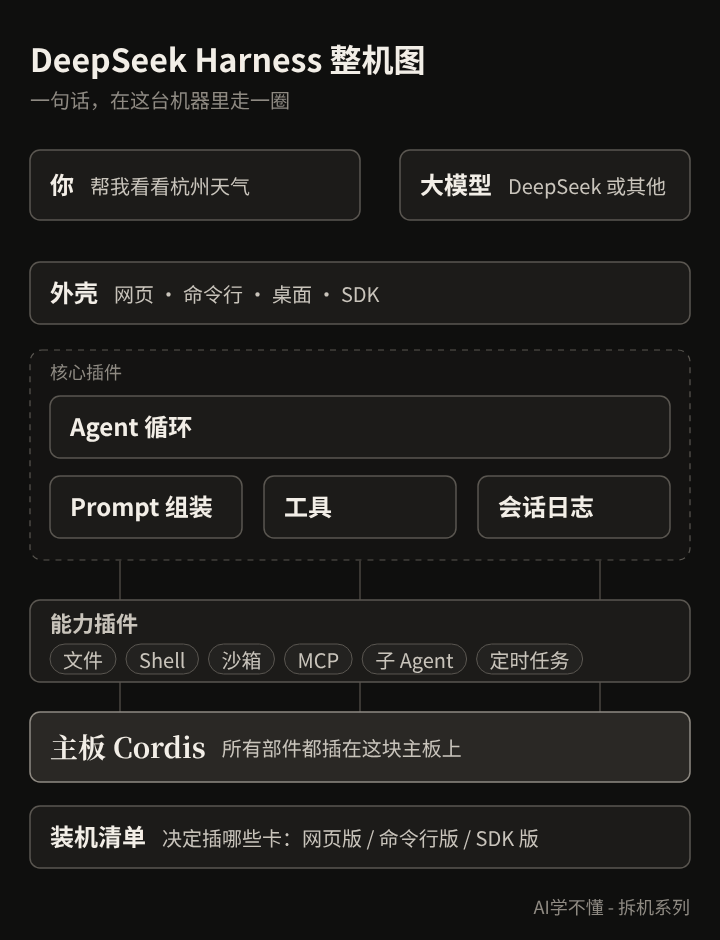

---

title: "整机图：百万行代码的 Agent，长什么样"

date: "2026-11-09"

source: "纳米AI（nano-ai.tech）"

url: "https://namiai.tech/teardown/deepseek-harness/overview/"

description: "一句话在 DSH 里走一圈；整机五层；一切皆插件；一百多万行代码里，骨架只有几千行。"

---

# 整机图：百万行代码的 Agent，长什么样

[拆机 DeepSeek Harness · 01](/teardown/deepseek-harness/)

The Whole Machine

> 今年 8 月，DeepSeek 开源了自己的 Agent 框架 DeepSeek Harness，简称 DSH。关注的人很多，但真正把它拆开看的内容很少：仓库有一百多万行代码，打开目录，大部分人看一眼就关了。

>

> 这个系列就做一件事：把这台机器拆开，一个部件一个部件地讲清楚。第一篇先不碰代码，看整机图。

* * *

## 01DSH 是什么

先说一个词：**Harness** ，直译是"马具""挽具"。

大模型本身只会做一件事：你给它一段文字，它接着往下写。它不能读你的文件，不能上网，不能执行命令，也记不住上一次聊了什么。

要让它真正干活，外面得套一层东西：帮它组织提示词、给它工具、替它执行操作、记录每一步、在需要的时候请你确认。这层东西就叫 **Agent Harness** 。Claude Code、Codex 都属于这一类。

DeepSeek Harness 就是 DeepSeek 自己做的这一层，8 月开源，MIT 许可证，目前还是开发者预览版。它有网页版、命令行、桌面端，也能当成 SDK 嵌进别的程序里；模型也不限于 DeepSeek，其他家的模型都能接。

## 02看图：一句话在机器里走一圈

开头那张动图，演示的是你说一句"帮我看看杭州天气"之后，DSH 内部发生了什么：

  1. **你在网页或命令行里说一句话。** 这是外壳，负责和你打交道。

  2. **Agent 循环接手。** 它是整台机器的调度员，决定下一步做什么。

  3. **组装提示词。** 把系统规则、可用工具的说明、之前的对话历史，拼成一份完整的输入。

  4. **发给大模型思考。**

  5. **模型决定先调用天气工具。** 模型不会自己去查，它只是说"我要用这个工具，参数是杭州"。

  6. **工具交给能力插件执行。** 真正的操作在这里发生，并且被限制在沙箱里，不能乱动你的电脑。

  7. **每一步都记进会话日志。** 输入、输出、工具调用、结果，全部按顺序记下来。

  8. **拿到结果，模型给出最终回答。** 如果还需要更多信息，就回到第 3 步再走一圈。

第 3 步到第 7 步这个圈，就是所有 Agent 的核心："想一步，做一步，看结果，再想下一步"。

## 03整机五层

把这台机器按电脑来类比，可以分成五层：

层 | 类比 | 是什么

---|---|---

主板 | 主板 | Cordis 插件框架，所有部件都插在上面

核心插件 | CPU、内存 | Agent 循环、提示词组装、工具、会话日志、模型接口

能力插件 | 外设 | 文件、Shell、沙箱、MCP、子 Agent、定时任务……

装机清单 | 配置单 | 决定这台机器插哪些卡

外壳 | 机箱和显示器 | 网页、命令行、桌面端、SDK

这里面最特别的是最底下那块主板。

## 04最大的特点：一切皆插件

大多数 Agent 产品像品牌整机：核心是写死的，你只能在厂家预留的接口上加东西。比如 Claude Code 可以加钩子、加插件，但它的主循环本身你改不了。

DSH 更像一台 DIY 主机。它的官方说法是"一切皆插件"：模型接口是插件，工具系统是插件，会话存储是插件，**连 Agent 循环本身也是插件** 。觉得哪个部件不好，拔下来换一个，其他部件不用动。

同一套部件，换一张装机清单，就能装成网页版、命令行版或者 SDK 版。第三方写的插件，和官方插件的地位完全一样。

这背后是 DeepSeek 的一个选择：它想做的不只是一个好用的 Agent，而是一块别人可以在上面自己组装的底座。

代价也很直接：灵活意味着复杂。想看懂任何一个功能，都得先搞懂这块主板是怎么工作的。这也是这个系列要从主板拆起的原因。

## 05一百多万行，真正要看的只有几千行

几个数字（基于 2026 年 10 月 30 日的仓库版本）：

  * 核心代码约 **125 万行** TypeScript（含测试），两万多个文件

  * 其中网页界面约 17 万行，实验功能约 10 万行，理解骨架时都可以先跳过

  * 真正驱动 Agent 运转的循环，约 **2100 行**

  * 最底层的主板 Cordis，约 **2800 行**

所以"一百多万行"听着吓人，但它的骨架其实只有几千行。剩下的是界面、测试和一个个具体的插件。

## 06这个系列怎么拆

逐行读一百多万行代码，对绝大多数人不现实，对我也不现实。所以这个系列的方法是：

  1. **先问它解决什么问题。** 不懂问题，机制就是一堆名词。

  2. **手写一个能跑的迷你版。** 只保留核心原理，一两百行，跑起来，看得懂。

  3. **对照真实的实现，只看差异。** 工业级版本多做了什么，为什么要多做。

  4. **结论都有出处。** 讲到真实实现，就标明在仓库的哪个位置。

接下来的路线：

  * 
[02 主板 Cordis：为什么连 Agent 循环都是插件](/teardown/deepseek-harness/cordis/)

  * 03 Agent 循环：一句话的完整旅程

  * 04 会话日志：为什么每一步都要记下来

  * 05 工具与沙箱：模型怎么安全地动手

  * 06 上下文管理：对话太长了怎么办

  * 07 子 Agent：一个 Agent 怎么指挥一群 Agent

  * 08 装机清单：同一个内核，怎么变成不同产品

  * 09 横向对比：DSH 和 Claude Code 等主流 Agent 的设计差异

项目还在快速迭代，后续版本可能和文中描述不同。有理解不对的地方，欢迎指出。

## 下期预告：主板 Cordis

下一篇拆最底下那块主板。我们会手写一个 150 行的迷你版，跑起来看它怎么做到：插件乱序挂载也能正常启动，拔掉模型时 Agent 循环自动停下，换上新模型又自动恢复，全程不用改一行代码。

* * *

参考：

  * DeepSeek Harness 仓库：https://github.com/deepseek-ai/deepseek-harness

  * 架构文档：仓库内 docs/architecture.zh.md

