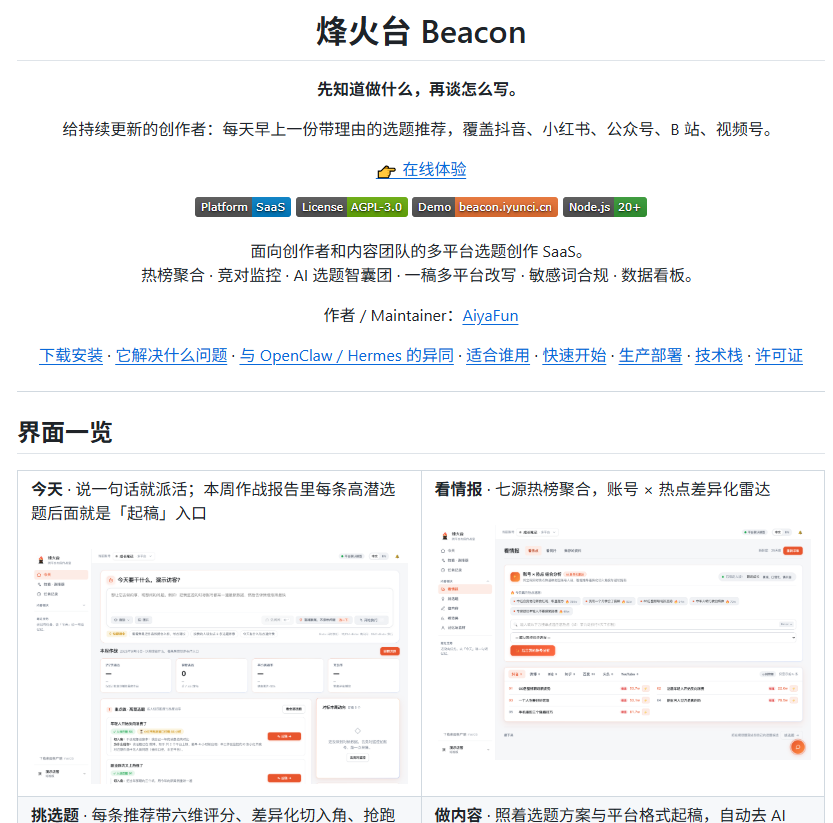

# 自媒体创作者必备 Skill 清单与多平台自动化工具集

> 自媒体创作者必备的 Skill 与开源工具清单：内容生产 Skills、多平台发布、剪辑与视频生产、工具合集四大类，共 16 个 GitHub 项目。

<!-- more -->

前几天有个刚上 X 的新人私信来问，自媒体到底该从哪儿起步。索性把这份创作者必备 Skill 清单整理出来，给他，也给大家。

## 内容生产 Skills

- [yanhua1010/self-media-content-workflow](https://github.com/yanhua1010/self-media-content-workflow) — 通用、模块化的自媒体内容生产与经营 Skills：选题、账号策略、平台文案、短视频方案、发布、复盘
- [JimLiu/baoyu-skills](https://github.com/JimLiu/baoyu-skills) — 宝玉的内容创作 Skills：小红书信息图、封面、公众号发布、X 发布等
- [LDJ-creat/media-skills](https://github.com/LDJ-creat/media-skills) — 选题、写作、配图、微信/CSDN/掘金发布与数据
- [LDJ-creat/MediaManager](https://github.com/LDJ-creat/MediaManager) — 上面那套的升级版：加了小红书发布与运营数据分析
- [momozi1996/awesome-ai-persona-skills](https://github.com/momozi1996/awesome-ai-persona-skills) — 把多位 AI 自媒体大 V 的写法蒸馏成可调用的 Skill
- [sansan0/TrendRadar](https://github.com/sansan0/TrendRadar) — 选题、热点、合规：多平台热点聚合
- [AiyaFun/beacon](https://github.com/AiyaFun/beacon) — 烽火台：热榜、竞品、选题、一稿多平台改写、敏感词检测
- [DIYgod/RSSHub](https://github.com/DIYgod/RSSHub) — 把各平台内容转成 RSS，用来盯竞品和资讯

## 多平台发布

- [rehatRobot/omnipost](https://github.com/rehatRobot/omnipost) — 抖音、B 站、小红书、快手、视频号、头条等发布
- [spider-ios/autox-release](https://github.com/spider-ios/autox-release) — 网页自动化：多平台发布、视频搬家、监控

## 剪辑与视频生产

- [FernandoAbishai/ScriptCut](https://github.com/FernandoAbishai/ScriptCut) — 按文稿剪口播，导出短视频切片
- [WyattBlue/auto-editor](https://github.com/WyattBlue/auto-editor) — 自动去掉口播里的静音
- [remotion-dev/remotion](https://github.com/remotion-dev/remotion) — 用代码批量生成视频
- [mifi/lossless-cut](https://github.com/mifi/lossless-cut) — 无损剪切

## 工具清单

- [lucky-verma/awesome-creator-tools](https://github.com/lucky-verma/awesome-creator-tools) — 创作者工具合集（剪辑、字幕、发布等）
- [JuneYaooo/awesome-ai-media](https://github.com/JuneYaooo/awesome-ai-media) — AI 视频与社媒自动化工具列表

