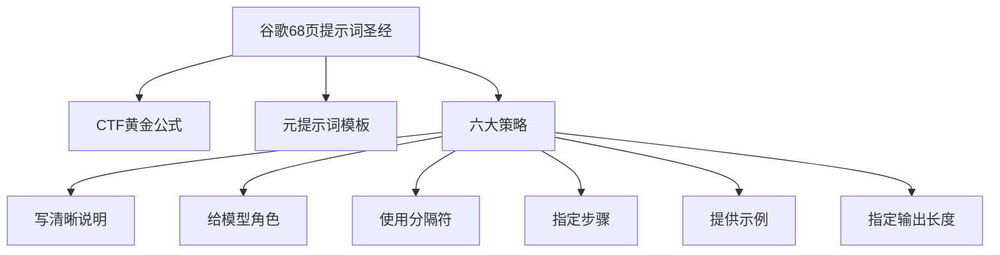

> **摘要** — 谷歌 68 页提示词白皮书由 Gemini 团队 AI 工程师 Lee Boonstra 撰写（谷歌 8 年经验）。核心内容是 CTF（Clear Thinking Framework）黄金公式 + 元提示词模板。元提示词即“写提示词的提示词”，是一份检查清单指导如何写出好的提示词。



```markmap height=280
# 谷歌 68 页提示词圣经
## 作者
- Lee Boonstra
- Gemini 团队 AI 工程师
- 谷歌 8 年经验
## 核心内容
- CTF 黄金公式
- 元提示词模板
## 元提示词
- "写提示词的提示词"
- 检查清单式指导
## 六大策略
- 写清晰说明
- 要求模型采用角色
- 使用分隔符
- 指定所需步骤
- 提供示例
- 指定输出长度
```

---

周五凌晨刷论坛，看到谷歌放出了一份 68 页的提示词工程白皮书。


作者是 Lee Boonstra，Gemini 团队的 AI 工程师，在谷歌待了 8 年。


我花了两天扒完，结合自己用 AI 3 年的经验，整理成了一份**可直接复制使用的元提示词**。


啥是元提示词？

简单说，就是“写提示词的提示词”。


普通提示词是让 AI 帮你干活的指令。

元提示词是一份检查清单，教你怎么写出好的提示词。


就像写作文有“总分总”的套路，写提示词也有套路。

我把这套路整理成了 5 个任务，照着做就行。

先讲原理，后面放完整版元提示词，拿走就能用。


有个比喻特别准：AI 就像一个博学但刚入职、还有点健忘的超级实习生。

它啥都知道一点，但不了解你的背景，没有记忆，需要你手把手教。


大多数人的提示词长这样：

```plain text
帮我写一篇文章
```

```plain text
总结一下这个内容
```

```plain text
给我一些建议
```

然后抱怨 AI 回答得一塌糊涂。


说实话，这能怪 AI 吗？

你连需求都说不清楚，AI 又不是你肚子里的蛔虫。

***

## 任务一：搭地基

99%的烂回答，都是因为提示词写得像谜语。


谷歌给了个公式，我把它优化成**CTF 黄金公式**。


**C 是 Context，背景。**


指定身份，要具体。

```plain text
差：你是一个助手
好：你是一个有10年经验的SaaS产品经理
```

告诉 AI 你在干嘛、为什么要干、给谁看。

```plain text
我在准备给投资人的产品Demo，需要突出增长数据
```


**T 是 Task，任务。**

用强动词：分析、拆解、重写、对比。

量化要求：3 个点、150 字、表格形式。


**F 是 Format，格式。**

明确告诉 AI 你要什么格式。

```plain text
返回格式：Markdown表格
返回格式：JSON
返回格式：分点列表
```


不指定格式，AI 就会自由发挥，发挥得你头疼。

举个完整例子。


烂提示词：

```plain text
帮我写一篇关于AI的文章
```


好提示词：

```plain text
你是一个资深科技自媒体作者，文风接地气。

我在运营一个AI工具评测的公众号，读者是不懂技术的普通用户。

请写一篇介绍ChatGPT的文章：
- 1500字左右
- 分3个部分：是什么、能干嘛、怎么用
- 用比喻解释技术概念
- 结尾给出3个实用建议
```

差距就这么大。

还有一点很重要：**区分 System 和 User 提示词**。


System Prompt 是 AI 的“宪法”，定义它是谁，保持不变。

User Prompt 是具体“指令”，告诉它做什么，动态变化。

***

## 任务二：选策略

不同任务，用不同套路。


谷歌白皮书给了个策略决策树：

简单问答，用**Zero-Shot**，直接问，不给例子。

特定格式，用**Few-Shot**，给 1 到 3 个范例让 AI 照猫画虎。

逻辑推理，用**CoT（思维链）**，让 AI 一步步思考。

复杂决策，用**ToT（思维树）**，让 AI 模拟多个专家辩论。

抽象难题，用**Step-Back**，先问原理再解决问题。


最厉害的是 CoT，思维链。

一句话就能激活：

```plain text
Let's think step by step
```

或者中文版：

```plain text
请一步步分析这个问题
```

我昨晚测了个数学题。

不用 CoT 的时候，问商品原价 100 元打 8 折再用满 80 减 10 的券最终多少钱。

AI 可能直接蒙一个答案。


用 CoT 的时候，AI 会这样推理：

```plain text
1. 原价100元
2. 打8折：100 × 0.8 = 80元
3. 满80减10：80 - 10 = 70元
最终价格：70元
```

过程清清楚楚，你能检查每一步对不对。

遇到更复杂的问题，这个差距会被放大 10 倍。

***

## 任务三：让 AI 听话

AI 最烦人的就是回答不稳定。

同样的提示词，问 10 次能给你 10 种不同的回答。


谷歌的解法是参数调教加格式锁定。

先说**Temperature 参数**，这个最重要。

```plain text
0.0 - 0.3：稳定、事实性、可重复（写代码、做分析用这个）
0.5 - 0.7：平衡、适度创意（日常写作用这个）
0.9 - 1.0：放飞自我、可能跑偏（头脑风暴用这个）
```

谷歌推荐的默认配置：

```plain text
temperature: 0.2top_p: 0.95top_k: 30
```

再说格式锁定，有三个实用技巧。

给 Schema，告诉 AI 你要 JSON 格式回复：

```json
{
  "title": "标题",
  "summary": "摘要（50字以内）",
  "key_points": ["要点1", "要点2", "要点3"]
}
```

预填充开头，在 API 调用时，assistant 消息预填一个左大括号，AI 就会自动补全 JSON。

还有**肯定式指令**。

说“请用专业语气”，别说“不要用口语”。


为啥？

这叫**粉色大象效应**。


你跟 AI 说“不要做 X"，它反而会去关注 X。

就像有人说”别想粉色大象“，你脑子里立马就是粉色大象。

```plain text
差：不要写没有注释的代码
好：请编写包含详细注释的代码

差：不要太正式
好：请使用亲切自然的语气
```

处理长文档还有个技巧，叫**指令后置**。

AI 有个毛病叫”迷失中间“，就是长文档的中间部分容易被忽略。

解决方法是把核心指令放在最后面，让 AI 先看完所有材料，最后再看你要它干嘛。

***

## 任务四：玩高级

前面 3 个任务是基础。

这个任务是进阶，让 AI 像个 Agent 一样工作。


先说**ReAct 模式**，推理加行动。

让 AI 先想，再做，再观察结果，再继续想。


谷歌白皮书里有个例子。

问 Metallica 乐队成员一共有多少个孩子。

普通 AI 可能瞎编一个数字。


ReAct 模式的 AI 会这样：

```plain text
思考：我需要知道Metallica有几个成员
行动：搜索Metallica乐队成员
观察：4个成员——James、Lars、Kirk、Robert
思考：我需要查每个人有几个孩子
行动：分别搜索每个人的孩子数量
观察：James 3个、Lars 2个、Kirk 0个、Robert 3个
最终答案：8个
```

这就是 Agent 的雏形。

再说**Self-Consistency**，自洽性检验。


同一个问题，让 AI 用高 Temperature 回答 5 次。

然后数哪个答案出现最多。

多数投票机制，能大幅降低幻觉。


最后说**Tree of Thoughts**，思维树。

不是一条线往下推理，而是让 AI 同时探索多个分支。

适合那种有多个解法的复杂问题。

```plain text
请从3个不同角度分析这个问题：
1. 用户体验优先的方案
2. 成本控制优先的方案
3. 快速上线优先的方案
然后评估每个方案的优缺点，给出最终推荐。
```

还有个**提示词链**的玩法。

复杂任务不要试图用一个超级长的提示词搞定，那样会让 AI 认知过载。


正确的做法是拆成流水线：

```plain text
搜集者AI（搜集信息）
    ↓
分析师AI（处理数据）
    ↓
作家AI（生成报告）
```

每个环节只做一件事，上一个环节的结果喂给下一个环节。

***

## 任务五：迭代优化

一个提示词写完不是结束，是开始。

**强制自我修正**这招特别好用。

在提示词里植入 Review 环节：

```plain text
请先生成草稿。
然后列出这个草稿的3个问题。
最后根据问题生成修正版。
```

AI 自己给自己找茬，效果出奇的好。

**版本管理**也很重要。

好的提示词要像代码一样管理：

```plain text
# Prompt v1.0
- 初版# Prompt v1.1
- 修复XX问题# Prompt v2.0
- 重构结构
```

我现在写提示词都会在开头加版本号。

还有**A/B 测试**。


同样的任务，写 2 到 3 个不同的提示词，跑 10 次，看哪个回复质量更稳定。

这才是科学玩 AI 的方式。

***

## 老金原创：5 任务元提示词（可直接复制）

前面讲了那么多原理，现在给你整理好的工具。

下面是我基于谷歌白皮书+3 年实战经验整理的**元提示词**。

直接复制到你的提示词库里，以后写提示词照着这个清单检查就行。

```markdown
# 老金的5任务元提示词 v1.0

这是一份实战行动清单，剔除了所有理论废话，直接告诉你怎么干。

## 任务一：构建提示词地基
目标：消除歧义，确保AI听懂人话。

[ ] 遵循CTF黄金公式
    - C (Context)：指定身份（如"资深CFO"而非"财务助手"）、受众、目标
    - T (Task)：使用强动词（分析、拆解、重写），量化要求（3个点、150字）
    - F (Format)：明确返回结构（Markdown表格、JSON、列表）

[ ] 区分System与User
    - System Prompt：写"宪法"（核心人设、底层规则、语言风格），保持不变
    - User Prompt：写"指令"（具体任务、输入数据），动态变化

[ ] 结构化输入
    - 使用分隔符（###, ---）或XML标签（<context>, <data>）隔离不同类型的信息
    - 防止AI混淆指令与内容

[ ] 采用肯定性指令
    - Do："请使用专业、客观的语气"
    - Don't："不要使用口语"（避免粉色大象效应）

## 任务二：激活深度推理
目标：让AI处理复杂逻辑，减少胡言乱语。

[ ] 策略选择决策树
    - 简单任务 → Zero-Shot（直接问）
    - 特定格式/风格 → Few-Shot（给1-3个完美范例）
    - 逻辑/数学题 → CoT（加一句"让我们一步步思考"）
    - 复杂决策 → ToT（让AI模拟三个专家辩论）
    - 抽象难题 → Step-Back（先问核心原理，再解决具体问题）

[ ] 强制自我修正
    - 在提示词中植入Review环节
    - "先生成草稿，再列出3个缺点，最后根据缺点生成修正版"

## 任务三：掌控回答与行为
目标：让AI的回答可控、机器可读、风格稳定。

[ ] 强制结构化回答
    - 提供Schema（如JSON键值对示例）
    - 使用Prefilling技巧：在API的assistant回复开头预填 { 或特定前缀

[ ] 调节参数
    - 0.0-0.2：清洗数据、提取事实、代码生成（严谨）
    - 0.7-1.0：创意写作、头脑风暴（发散）

[ ] 处理长文档
    - 指令后置：把核心指令放在Prompt的最后面（对抗"迷失中间"现象）
    - 主动检索：先让AI"提取所有相关原文引用"，再基于引用回答

## 任务四：架构自动化工作流
目标：解决单次Prompt搞不定的复杂项目。

[ ] 拒绝"超级提示词"
    - 不要试图用一段话搞定一切
    - 将任务拆解为流水线

[ ] 搭建提示词链
    - 搜集者AI（搜集信息）→ 分析师AI（处理数据）→ 作家AI（生成报告）
    - 每个环节只做一件事，上下文互不污染

[ ] 多智能体协作
    - 角色分解：PM、架构师、测试、开发
    - 上下文隔离：每个智能体在独立的对话窗口中运行

## 任务五：持续优化与维护
目标：把好用的提示词变成可复用的资产。

[ ] 版本管理
    - 记录：版本号、模型型号、参数、黄金回复样本
    - 像管理代码一样用Git管理提示词文件

[ ] A/B测试
    - 同样的任务，写2-3个不同的提示词
    - 跑10次，看哪个回复质量更稳定

[ ] 建立提示词库
    - 按场景分类：写作、分析、代码、翻译
    - 定期更新迭代
```

***

## 老金总结

谷歌这 68 页白皮书，核心就 5 件事：

```plain text
1. 搭地基：CTF黄金公式（背景+任务+格式）
2. 选策略：Zero-Shot、Few-Shot、CoT、ToT按需选
3. 让AI听话：Temperature调低、格式锁死、用肯定句
4. 玩高级：ReAct、Self-Consistency、提示词链
5. 迭代优化：自我修正、版本管理、A/B测试
```

别把提示词当玄学。

它就是一门沟通技巧。


你越会说人话，AI 就越会说人话。

反过来，你自己都说不清楚想要什么，AI 怎么可能给你好答案？


上面那份元提示词，收藏起来，下次写提示词之前拿出来对照一下。
