# 如何建立自己的思想和知识体系：从散件到可自转的知识网络

> **核心结论**：知识体系不是收藏夹，而是**有组件（知识点）、有依赖（知识图谱）、可学习（学习路线）、可演进**的闭环结构。
> 任何知识，如果最终不能帮助你解决问题、创造价值，那么就谈不上知识。

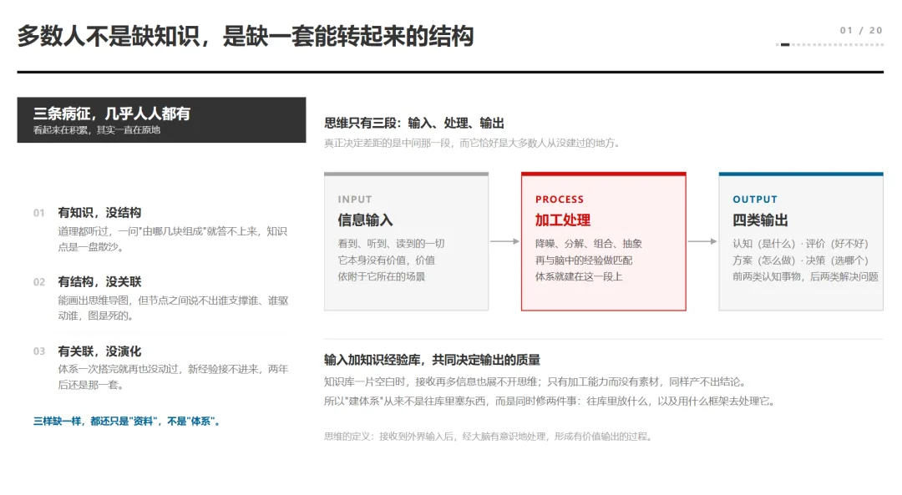

*图 1：多数人不是缺知识，是缺一套能转起来的结构*

## 一、知识与体系的差别

先说经常遇见的一个场景。比如有些人在开会的时候能够把行业趋势讲得头头是道，可一旦让他们判断"我们这个项目现在该不该启动"，他就开始绕圈子。不是他不懂，是他懂的那些东西彼此之间没有真正的链接起来形成一个整体，导致真要用的时候调不出来。

这就是"知识"和"体系"的差别。**知识是点，体系是点与点之间那些说得清的关系。** 你脑子里有一百个点、彼此不相连，那叫资料；有二十个点、每个点都知道它支撑谁、被谁驱动，那才叫结构。

真正的核心竞争力，从来不是你知道多少，而是你把自己的认知，织成了一张怎样的网。网密不密、结不结实，决定了你在陌生问题面前，是慌还是稳。它不在你收藏了多少篇文章里，而在你能不能自己搭出一条路来。

## 二、构建知识体系的三大误区

那么我们在个人知识体系构建上常遇到哪些误区？实际上这里包括了三个最常见的误区。

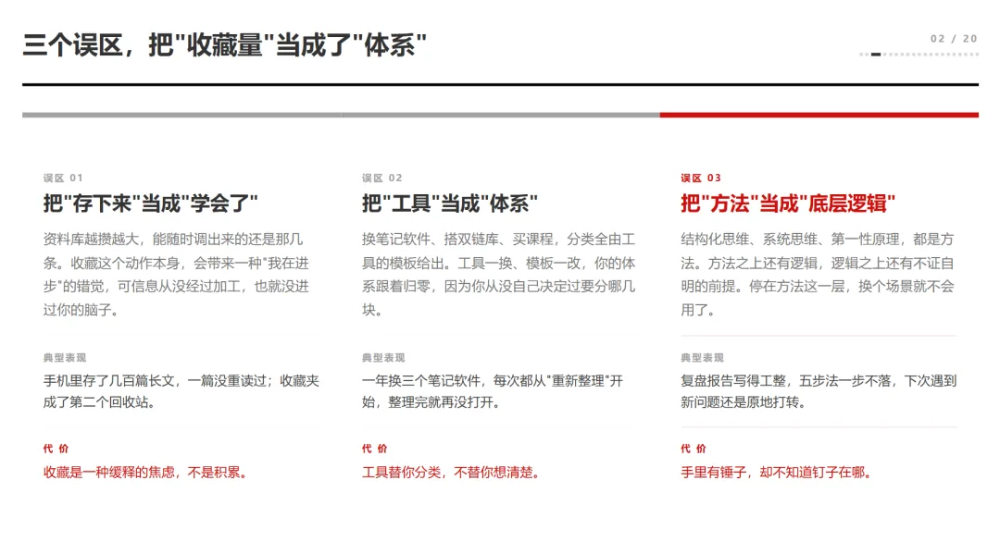

*图 2：三个误区，把"收藏量"当成了"体系"*

| 误区 | 具体表现 | 为什么错 |
| :--- | :--- | :--- |
| **把"存下来"当成"学会了"** | 资料库越攒越大，能随时调出来的还是那几条 | 收藏这个动作本身会带来一种"我在进步"的错觉，可信息从没经过加工，也就没进过你的脑子。攒得越多，越不敢相信自己真的会 |
| **把"工具"当成"体系"** | 换笔记软件、搭双链库、买课程，分类全由工具的模板给出 | 工具一换、模板一改，你的体系跟着归零，因为你从来没自己决定过要分哪几块 |
| **把"方法"当成"底层逻辑"** | 结构化思维、系统思维、第一性原理，说到底都是方法 | 方法之上还有逻辑，逻辑之上还有不证自明的前提。停在方法这一层，换个场景就不会用了。手里有锤子，却不知道钉子在哪 |

而实际要要构建真正的知识体系必须具备如下特征。

如果简单来总结的话就是**有组件（知识点），有依赖（形成知识图谱），可学习（学习路线），可演进**。这个才是我们需要的知识体系。知识点必须串联起来形成知识图谱，知识点形成前导、依赖、从属、推理等各种场景的关系，这个是知识点能够形成知识网络和学习路线的基础。有了这个，我们就可以基于目标构建学习路线，基于学习路线构建学习、实践、复盘的最小闭环。

## 三、知识体系的整体架构：六域、一引擎、一基座

我把自己这些年搭的东西拆开看，最上面一层是八件：**六个知识域、一个引擎、一座基座**。六个域分别是认知域、思维域、学习域、问题域、知识域、进化域，各管一段，边界清楚。

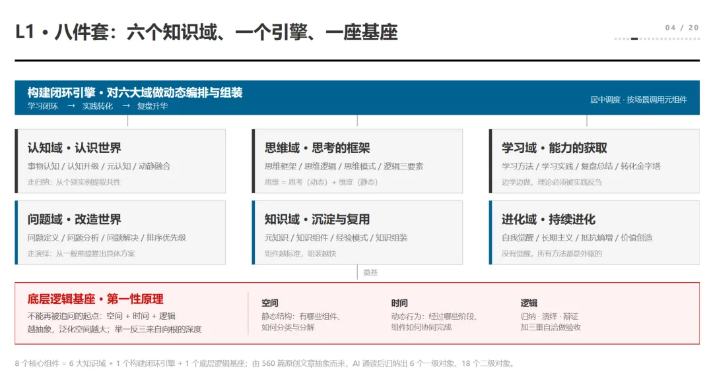

*图 3：L1 · 八件套——六个知识域、一个引擎、一座基座*

中间那个引擎是构建闭环，负责对六个域做动态编排。它不生产知识，只负责调度：什么时候该学、什么时候该练、什么时候该停下来复盘，按场景调用对应的元组件。没有这个引擎，六个域就是六间互不相通的仓库。

最下面是基座，也就是底层逻辑。很多人搭体系只搭上面六层，基座是空的，于是看着很整齐，一用力就塌。基座不牢，上面全是空中楼阁——看一个体系靠不靠谱，先看它有没有一条真跑通过的闭环。

### 3.1 两条主线：认知（归纳）与问题（演绎）

体系能转起来，靠的是两条主线。

- **认知这条线走归纳**：从一个个具体的事里，抽出共性，归到类上。
- **问题这条线走演绎**：从一个已经成立的原理出发，一步步推到具体场景。

一收一放，缺一条，体系就偏。

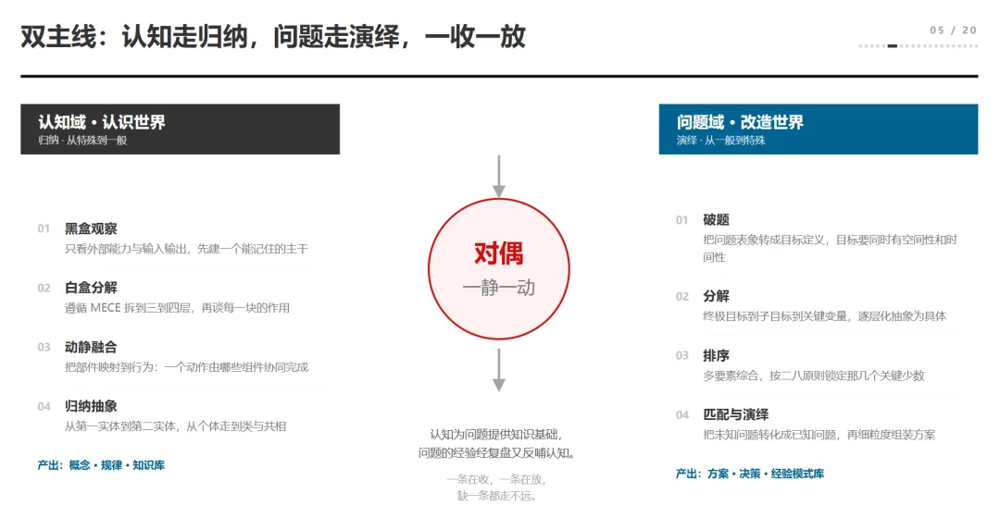

*图 4：双主线——认知走归纳，问题走演绎*

### 3.2 两个循环：内循环造血、外循环供血

光有主线还不够，得有循环。

- **内循环是造血**：学习、实践、复盘，跑一遍，你多一块自己的东西。
- **外循环是供血**：把外面新出现的经验、别人的教训、行业的变局接进来，校验你原来的结论还成不成立。

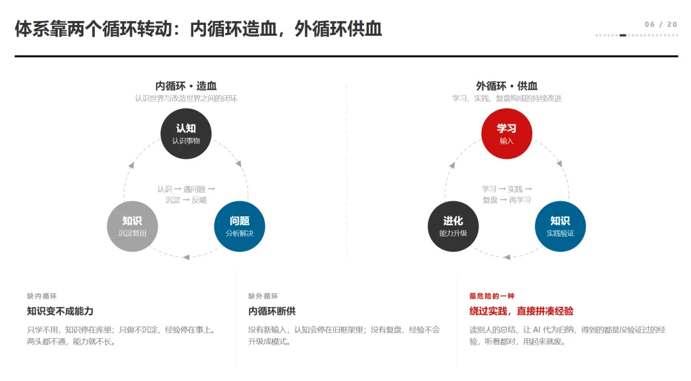

*图 5：内循环造血、外循环供血*

内循环让你变厚，外循环让你不变旧。只跑内循环，人会越来越自洽，也越来越封闭；只跑外循环，人会一直在追新，却始终没有自己的东西。两个循环同时转，体系才既稳又活。

### 3.3 基座三样：空间、时间、逻辑

底层逻辑的基座，简单来说就三样：

| 维度 | 含义 | 观察对象 |
| :--- | :--- | :--- |
| **空间** | 结构：一个东西由哪几部分组成、彼此怎么咬合 | 看组织 → 部门结构、业务流程、决策链条 |
| **时间** | 过程：它从哪来、经过哪几步、到哪去 | 看方案 → 组成部分、落地节奏、成立的因果条件 |
| **逻辑** | 因果：为什么是这样而不是那样 | 判断成立条件 |

任何一件事，你用这三把尺子量一遍，基本就能看透七八成。三样缺一样，你的判断就会漏。

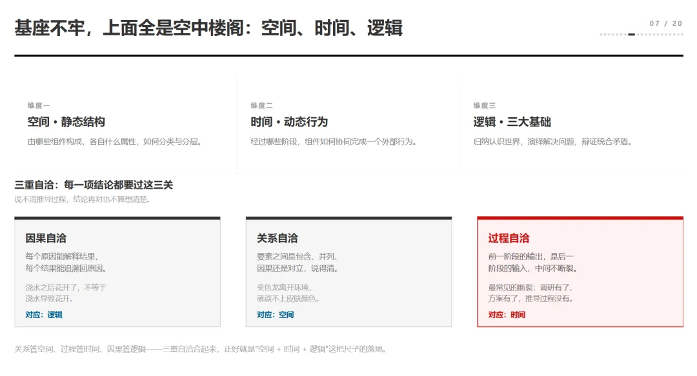

*图 6：基座三维度与三重自洽*

还有一个词叫"逻辑自洽"，我把它拆成三重：**因果自洽、关系自洽、过程自洽**。因果说的是为什么会这样，关系说的是它和谁相关，过程说的是它怎么一步步变成现在这样。三重都通，结论才站得住。

## 四、事物认知的四步

接着我们聊下思维两个核心主线里面的事物认知，即如何更好的认识和分析事物。认知一个东西，要走完四步。

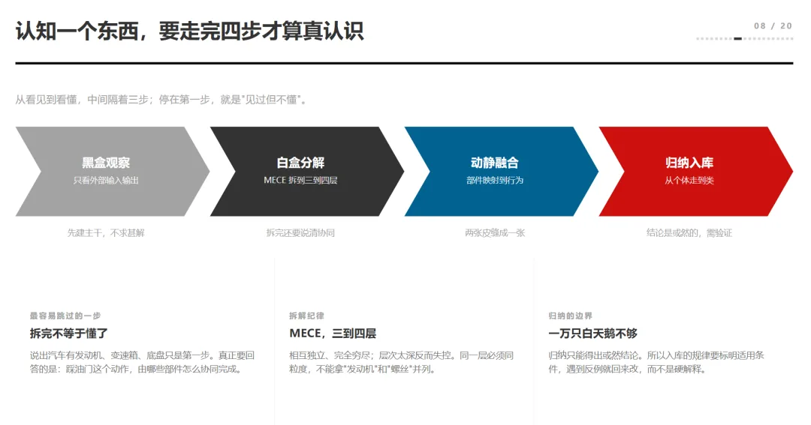

*图 7：事物认知四步*

1. **黑盒观察** —— 你只看到外部输入和输出，看不到里面，那就先建主干、不求甚解。看到一辆车能跑，不知道发动机怎么工作，没关系，先知道它能跑、跑多快、费多少油。这是认知最省力的起步方式。
2. **白盒分解** —— 把它拆开，用 MECE 拆到三到四层，相互独立、完全穷尽。这里最容易犯的错是层次太深反而失控，或者同一层混用不同粒度，把"发动机"和"螺丝"并列在一起。
3. **动静融合** —— 把部件映射到行为上。拆完不等于懂了，真正要回答的是：踩油门这个动作，由哪些部件、按什么顺序协同完成。
4. **归纳入库** —— 从个体走到类，把这一辆车的规律，变成所有车都能用的规律。

## 五、思维 = 思考（动态）+ 维度（静态）

不少人把思维当成灵感，觉得是想得多、想得快。

我的理解是，**思维 = 思考（动态）+ 维度（静态）**。思考是动作，是有顺序的：先破题、再拆解、最后决策；维度是坐标，决定你站在哪个位置看。

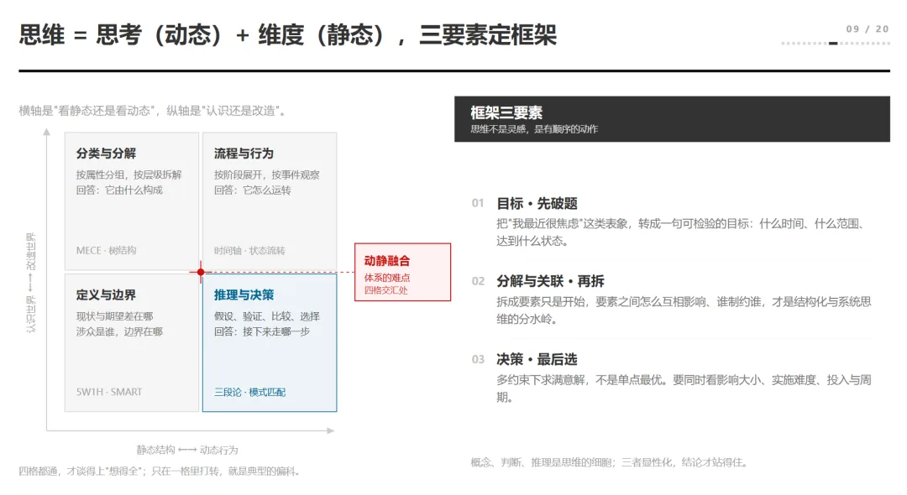

*图 8：思维四象限与框架三要素*

维度这条，我常用一个四象限：横轴是"看静态还是看动态"，纵轴是"认识世界还是改造世界"。落到四格就是分类与分解、流程与行为、定义与边界、推理与决策。四格都通，才谈得上"想得全"；只在一格打转，就是典型的偏科。

思考这条，三个要素定框架：**目标、分解与关联、决策**。先把"我最近很焦虑"转成一句可检验的目标，再拆要素、找要素之间的制约关系，最后在多约束下求满意解。顺序反了，前面全是白做。

## 六、问题分析与解决的五步

问题分析和解决是思维里面的另外一条关键主线。

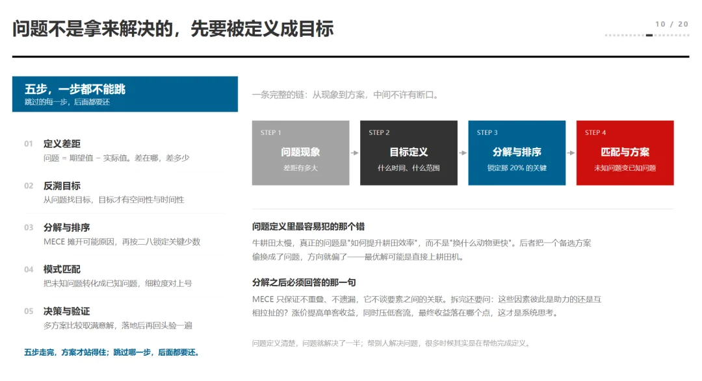

*图 9：问题分析五步*

1. **定义差距** —— 问题等于期望值减实际值，差在哪、差多少，这两句说不清，后面全是猜。定义差距是第一步；这个问题没定义对，方案越漂亮，错得越远。
2. **反溯目标** —— 从"问题"倒推"目标"，目标必须有空间性和时间性：到什么范围、到什么时间点、达到什么状态。
3. **分解与排序** —— 用 MECE 摊开所有成因，再用二八法锁定那 20% 的关键少数。
4. **模式匹配** —— 把未知问题转化成已知问题，看它像你处理过的哪一类。
5. **决策验证** —— 多方案比较、取满意解，落地之后再回头验一遍。

五步走完，方案才站得住；跳过哪一步，后面都要还。

## 七、学习与实践：五层能力与三步推动

接着谈下思维里面的学习和实践方法论。通过学习完成从资料到知识的转化，通过实践完成从知识到经验和方法论模式的转化。

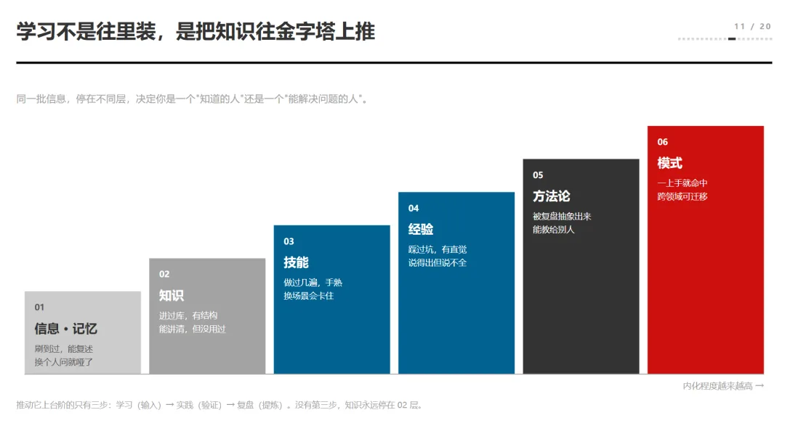

*图 10：能力金字塔——信息 / 知识 / 技能 / 经验 / 方法论 / 模式*

同一批信息，停在不同层，决定你是一个"知道的人"还是一个"能解决问题的人"。

| 层级 | 特征 | 判定标准 |
| :--- | :--- | :--- |
| **信息与记忆** | 刷到过、能复述 | 换个人问就哑了 |
| **知识** | 进过库、有结构 | 能讲清但没用过 |
| **技能** | 做过几遍、手熟 | 换场景会卡住 |
| **经验** | 踩过坑、有直觉 | 说得出来但说不全 |
| **方法论** | 被复盘抽象出来 | 能教给别人 |
| **模式** | 一上手就命中 | 跨领域可迁移 |

推动它上台阶的只有三步：**学习、实践、复盘**。没有这三步，知识永远停在第二层。很多人卡在这里，不是不努力，是把"输入"当成了"内化"，把"读过"当成了"会用"。**输入只是原料，内化才是加工**，这两件事完全不是一回事。

### 7.1 元知识 → 知识组件 → 经验模式

散落的知识点，读过、听过、记过，彼此不相连，用时找不到。把它们收成**元知识**，就是最小可复用的价值单元，粒度跟着专业深度走。再往上，才是**知识组件**：概念、结构、逻辑，三层齐了才叫组件。

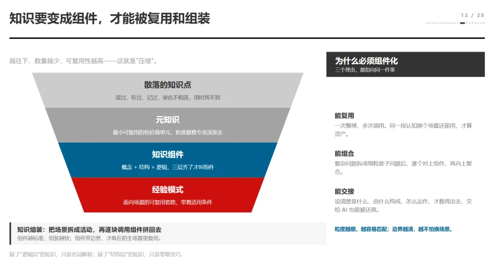

*图 11：散落知识点 → 元知识 → 知识组件 → 经验模式*

我判断一个东西是不是组件，只看两条：

- 能不能**一次整理、多次调用**；
- 能不能**在换场景之后还认得出来**。

做不到这两条，它就还是"一段话"，不是"一个件"。组件化的价值，全在"复用"这两个字上。

组件之上是**经验模式**：面向场景的可复用套路，还带着适用条件。到这一步，知识才真正能被组装——把场景拆成活动，再逐块调用组件拼回去。粒度越细，越容易匹配；边界越清，越不怕换场景。

## 八、进化不是靠意志力，是靠设计

很多人把成长寄托在意志力上，觉得坚持不下来是自己不够狠。我的看法正相反：**进化不是靠意志力，是靠设计**。开关摆对了，它自己会往前走；开关没摆对，再狠也撑不过三个月。

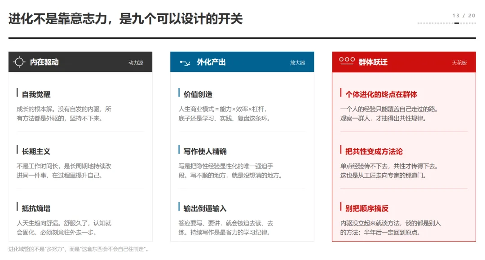

*图 12：进化的九个开关——动力源 / 放大器 / 天花板*

| 作用层 | 组成 | 说明 |
| :--- | :--- | :--- |
| **动力源** | 自我觉醒、长期主义、抵抗熵增 | 没有自发的内驱，所有方法都是外驱的；不是工作时间长，是长周期地持续改进同一件事；人天生趋向舒适，舒服久了认知就会固化，必须刻意往外走一步 |
| **放大器** | 价值创造、写作使人精确、输出倒逼输入 | 把隐性认知转为显性输出，倒逼输入质量提升 |
| **天花板** | 个体进化的终点在群体 | 一个人的经验只能覆盖自己走过的路，观察一群人才抽得出共性 |

顺序别搞反——内驱没立起来就谈方法，谈的都是别人的方法。

## 九、知识体系的四层分层与构建顺序

知识体系要分层建，不要从细节开始堆。我常用四层：

1. **基础理论层** —— 概念、原理、公理，它决定你能走多远，不决定你走多快。
2. **核心业务能力层** —— 领域里真正能复用的大块，比如定价、风控、内控。
3. **扩展应用层** —— 把能力用到具体场景：一次评估、一份方案、一个诊断。
4. **治理管控层** —— 管标准、边界、评审和演进规则。少了这一层，体系三年就废——不是内容不够，是没人管它该往哪长。

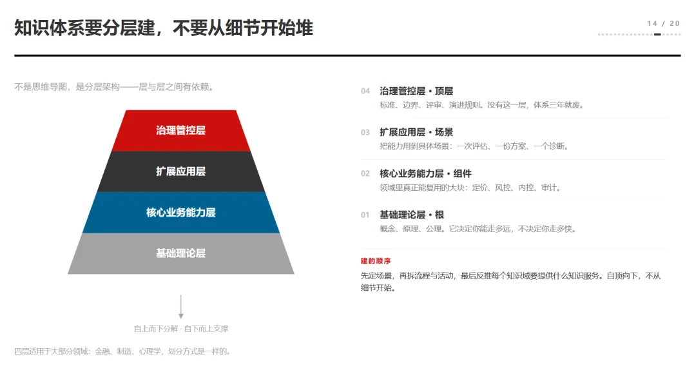

*图 13：知识体系四层与构建顺序*

建的顺序也有讲究：**先定场景，再拆流程与活动，最后反推每个知识域要提供什么知识服务。自上而下定框架，自下而上填内容。** 反过来做，就是从细节开始堆，堆到一半发现方向错了，只能推倒重来。

### 9.1 四步压缩：资料库 → 知识库 → 经验库 → 方法模式库

我把这个过程分成四步，每一步都是一次压缩。

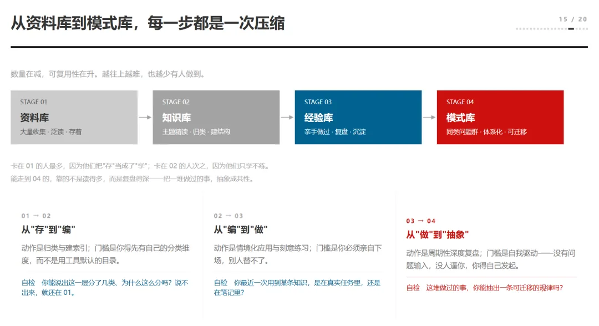

*图 14：四步压缩——资料库 / 知识库 / 经验库 / 模式库*

| 步骤 | 动作 | 门槛 | 可复用性 |
| :--- | :--- | :--- | :--- |
| **第一步：资料库** | 大量收集、泛读、存着 | 数量最多，卡在这里的人最多——因为把"存"当成了"学"，收藏这个动作太容易，容易到让人误以为已经拥有 | 最低 |
| **第二步：知识库** | 主题精读、归类、建结构 | 你得先有自己的分类维度，而不是用工具默认的目录。能说出这一层分了几类、为什么这么分，才算真的进了这一步 | 中 |
| **第三步：经验库** | 亲手做过、复盘、沉淀 | 你必须亲自下场，别人替不了 | 高 |
| **第四步：方法模式库** | 同类问题群、体系化、可迁移 | 靠的不是读得多，而是复盘得深——把一堆做过的事，抽象成共性 | 最高 |

### 9.2 知识不是树：七类横向关系与关联密度

我见过不少团队特别喜欢用思维导图，一级一级往下分，看着很整齐。但**知识不是树**，树只有父子关系；真实的知识之间，关系远不止父子：**驱动、支撑、转化、包含、闭环、对偶、奠基**，这七类多数是横向的。

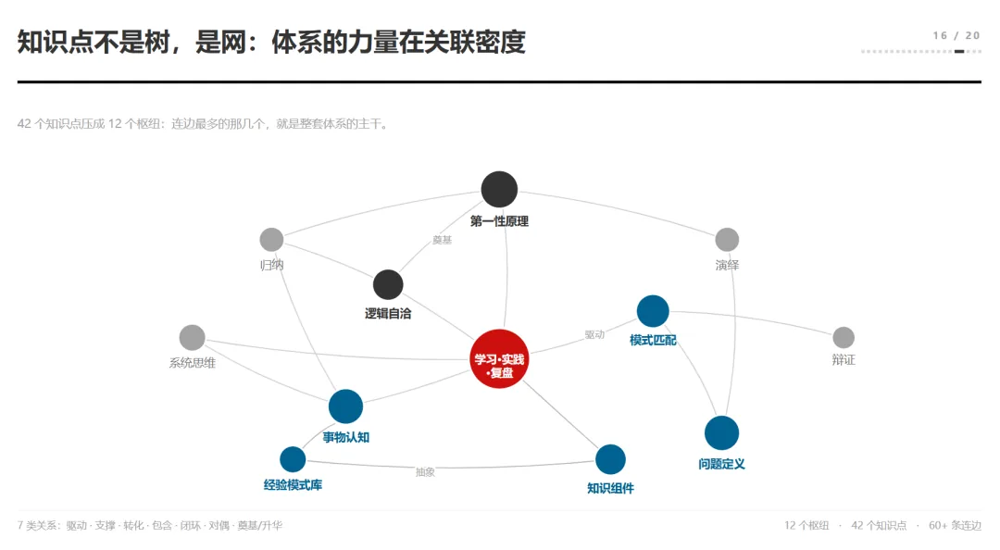

*图 15：42 个知识点压成 12 个枢纽——第一性原理、逻辑自洽、事物认知、模式匹配、问题定义、学习—实践—复盘*

一旦这些横向关系被画出来，你会发现原来散在各处的点，慢慢聚成了几个枢纽。我自己的那张图，42 个知识点最后压成了 12 个枢纽：第一性原理、逻辑自洽、事物认知、模式匹配、问题定义，还有一个核心的"学习—实践—复盘"。

**体系的力量，就在关联密度上。** 同样 42 个点，一个人只有 40 条边，另一个人有 60 多条边，思考的质量完全不是一个量级。前者是在查表，后者是在推理。你不妨把自己的知识图谱画出来看一眼，差距会很明显。

## 十、如何真正把体系搭起来：先窄后宽、先深后广

如果一开始就想搭一套完整框架，框架画得越大往往越无法完成，导致后面自己主动放弃。真正应该的做法是按迭代思路，找一个细分场景快速搭建和验证。

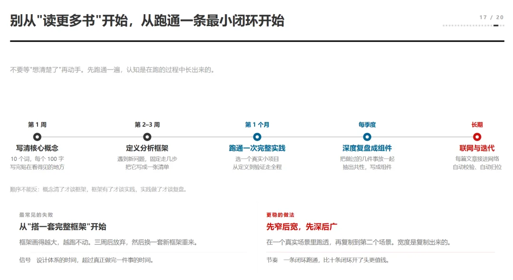

*图 16：先窄后宽、先深后广的五阶段推进节奏*

更稳的做法是**先窄后宽、先深后广**：

- **第一周**：只做一件事——写清十个核心概念，每个一百字，写完贴在看得见的地方。
- **第二到三周**：给新问题定一套固定走法，写成一张清单。
- **第一个月**：找一个真实小项目，从头跑到尾。
- **每季度**：做一次深度复盘，把做过的几件事放在一起抽共性，写成组件。
- **长期**：每篇文章接进网络里，自动校验、自动归位。

**一条闭环跑通，比十条闭环开了头更值钱。**

## 十一、AI 是放大器，不是替代者

这两年很多人问我，AI 这么强了，还用得着建体系吗。我的回答是：**AI 是放大器，不是替代者**。它放大你已有的认知，扩展你的能力边界，加快你的思维过程——但它放大的内容，必须来自你。

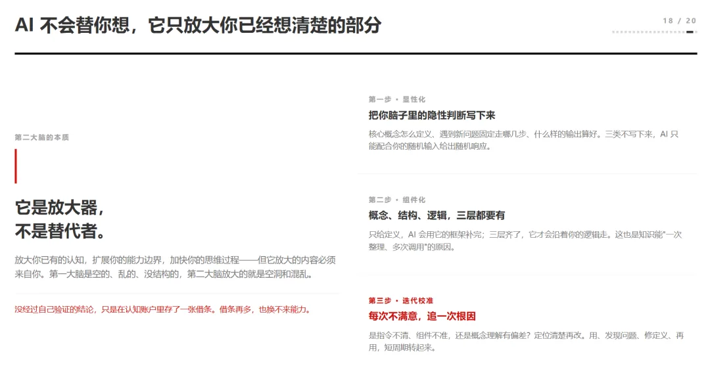

*图 17：第二大脑三步——显性化、组件化、迭代校准*

第一大脑是空的、乱的、没结构的，第二大脑放大的就是空洞和混乱。没经过自己验证的结论，只是在认知账户里存了一张借条。借条再多，也换不来能力。这话听着刺，但我是认真的。

想把 AI 训练成第二大脑，三步：**显性化、组件化、迭代校准**。

1. 把脑子里的隐性判断写下来（显性化）。
2. 把概念、结构、逻辑三层补齐（组件化）。
3. 每次不满意就追一次根因——是指令不清、组件不准，还是概念有偏差（迭代校准）。

用、发现问题、修定义、再用。

## 写在最后

AI 时代，构建自己的思维和知识体系仍然重要。但是我们要的不是最终的知识体系结果这个输出，而是思考和构建整个知识体系，通过实践完成整个知识的完整过程。如果所有知识体系构建都完全依赖 AI，那么我们并未得到应有的思维锻炼。

任何知识体系搭建都是持续演进的过程，没有终点。类似我前面讲过的 LLM-Wiki 的大模型知识库，本身就应该是一个可以自我进化、持续改进的个人知识库。

**知识体系搭建得再漂亮也不是你的核心竞争力，而是你搭建这个知识体系过程中形成的认知能力提升。** 是将你脑子里面离散的知识点搭建成一个完整的知识网络的思考过程。如果能够将你的这套思考过程显性化出来，再结合 AI 工具辅助，才是真正的放大你的核心竞争力。

## 关联参考资料

- 来源原文：<https://mp.weixin.qq.com/s/oG7ze-QMVVmtJvbhdCIZIg>
- 同主题参考：
  - [knowledge-structure-organizing](./knowledge-structure-organizing) — 知识结构整理（自顶向下 vs 自底向上）
  - [efficient-info-gathering](./efficient-info-gathering) — 高效的信息搜集与整理术
  - [problem-driven-learning-wheel](./problem-driven-learning-wheel) — 驱动问题的学习车轮
- 相关方法论：
  - 《卡片笔记写作法》（Sönke Ahrens）—— Zettelkasten 系统化方法
  - Building a Second Brain（Tiago Forte）—— PARA 方法论
  - 《金字塔原理》（Barbara Minto）—— 结论先行、上下层次归类分组
