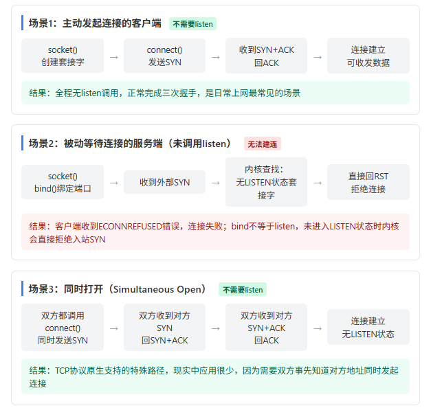

# TCP 套接字状态机：listen 的真实语义

> 「不调用 listen 能否建立 TCP 连接」不能简单回答「不能」。listen 不参与握手报文收发，它做的是把套接字切换进内核的被动监听状态；能不能建连，取决于本次建连中**谁是发起方**。

## 一句话定义

`listen` 把套接字从 CLOSED 切换为 LISTEN，并建立内核侧的连接队列，同时指示协议栈对该端口收到的 SYN 走正常三次握手而非直接回 RST。它是**被动方的本地状态准备动作**，不是握手的一部分。

## listen 实际做的三件事

1. **状态迁移**：套接字状态由 CLOSED 改为 LISTEN。
2. **初始化两个内核队列**：
   - 半连接队列：已收到 SYN、尚未完成三次握手的连接
   - 全连接队列：已完成握手、等待被 `accept` 取走的连接
3. **改变协议栈对该端口的行为**：收到的 SYN 包不再回 RST 拒绝，而是走正常三次握手流程。

**listen 自身从不阻塞。** 真正阻塞等待连接的是后续的 `accept` 调用。这一点是常见误解的根源——很多人把 listen 理解成「开启阻塞等待他人连接」。

## 内核的 SYN 分发逻辑

内核每收到一个发往本机某端口的 SYN 包，会遍历所有 TCP 套接字，寻找**同时满足两个条件**的套接字：

- 绑定了该端口
- 处于 LISTEN 状态

找不到匹配项时，内核**直接回 RST**，告知发起方「这个端口没人接」。客户端 `connect` 随即返回 `ECONNREFUSED`，三次握手从第一步就失败。

注意：这个判断依据的是「LISTEN 状态」，不是「是否 bind 过该端口」。绑定不等于监听。

## bind 不 listen 会发生什么

一个只调用 `socket` + `bind` 的服务端：

```c
int listen_fd = socket(AF_INET, SOCK_STREAM, 0);
struct sockaddr_in addr = {0};
addr.sin_family = AF_INET;
addr.sin_port = htons(8888);
addr.sin_addr.s_addr = htonl(INADDR_ANY);
bind(listen_fd, (struct sockaddr*)&addr, sizeof(addr));
// 注意：这里完全没有调用 listen()
```

`ss` 命令能看到 8888 端口确实被该进程绑定，但从本机 `nc 127.0.0.1 8888` 连接会立刻收到 `Connection refused`——与连接一个根本没有进程的端口表现完全一样。

原因是套接字仍停留在 CLOSED 状态，内核收到 SYN 时找不到 LISTEN 状态的套接字，直接回了 RST。

补上一行即可正常服务：

```c
listen(listen_fd, 128);  // 关键的一步：把套接字转为 LISTEN 状态
```

第二个参数是全连接队列的 backlog 长度。

## 三种建连场景



| 场景 | 是否需要 listen | 内核行为 | 结果 |
|------|----------------|----------|------|
| 主动发起连接的客户端 | 不需要 | 发出 SYN，正常完成三次握手 | 连接建立，可收发数据 |
| 被动等待连接的服务端（未调用 listen） | 需要 | 找不到 LISTEN 套接字，直接回 RST | 客户端 `ECONNREFUSED`，握手第一步即失败 |
| 同时打开（Simultaneous Open） | 不需要 | 双方各自发 SYN、收 SYN+ACK、再回 ACK | 连接建立，全程无一方进入 LISTEN |

### 客户端为什么不需要 listen

主动连接方从 `socket` 到 `connect` 发起 SYN，再到完成三次握手，全程不调用 `listen`。因为它不需要等待别人来连自己，天然不进入 LISTEN 状态。

日常使用的浏览器看网页、微信传文件，本机客户端进程从未调用过 `listen`，照样能与远端服务器建立 TCP 连接。

### 同时打开：协议本身支持的合法路径

RFC 793 定义了一种特殊建连路径：两端都事先知道对方的 IP 和端口，同时调用 `connect` 发起 SYN，之后各自收到对方的 SYN 并回 SYN+ACK，最后再回 ACK 完成握手。

整个过程中**没有任何一方的套接字进入 LISTEN 状态**，双方都没调用 `listen`，也能成功建立连接。

这是协议规范支持的合法路径，但现实工程中几乎不会用到——毕竟很少有两个进程事先知道对方地址、还要同时主动发起连接。

## 判断框架

遇到「某个系统调用到底要不要调用」这类问题，先问清**本次交互中谁是被动方**：

- 被动方（提供服务、等待别人连入）→ 必须进入 LISTEN 状态
- 主动方（主动连出去）→ 不需要 LISTEN 状态

这个框架也解释了为什么 `bind` 不能替代 `listen`：两者服务于不同目的。`bind` 解决「这个套接字认领哪个本地端口」，`listen` 解决「这个端口收到连接请求时，内核要不要受理」。

## 常见误区

- **「listen 是阻塞调用」**：错。阻塞的是 `accept`。
- **「bind 了端口就等于能连」**：错。内核按 LISTEN 状态查找，不按绑定状态。
- **「没有 listen 就完全无法建立任何 TCP 连接」**：错。客户端和同时打开都不需要。
- **「同时打开是理论玩具」**：协议上完全合法，只是缺乏落地场景。

## 相关页面

- [[sources/tcp-listen-connection-setup]] — 原始文章归档。
- [[concepts/linux-context-switch]] — Linux 内核进程上下文切换全解。
- [[concepts/mutex-evolution]] — 互斥锁演化史。
- [[concepts/sdio-bus]] — SDIO 总线硬件原理。
- [[concepts/virtual-memory-invention]] — 虚拟内存发明历程。
