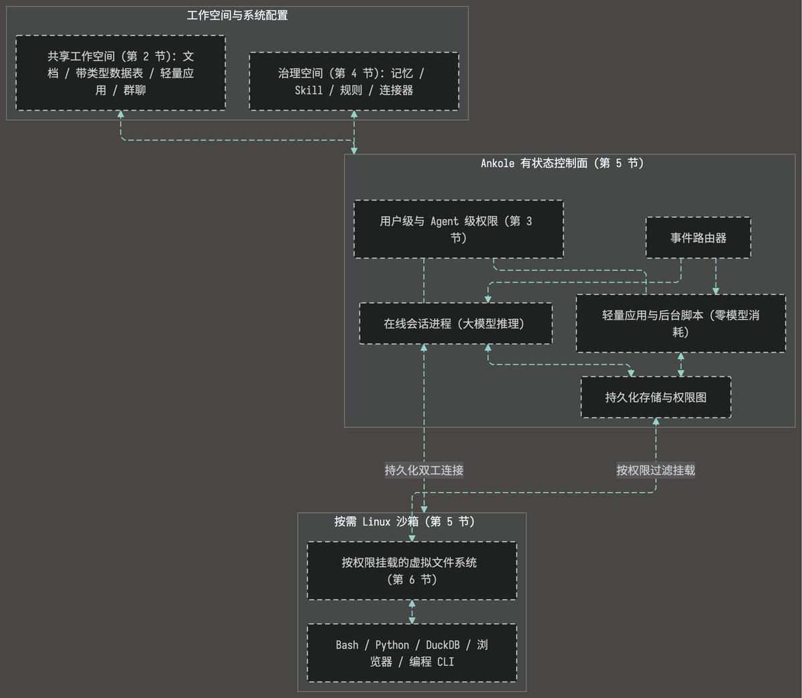
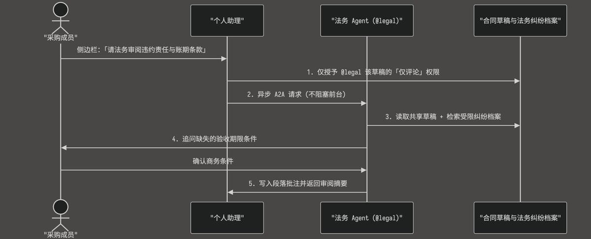
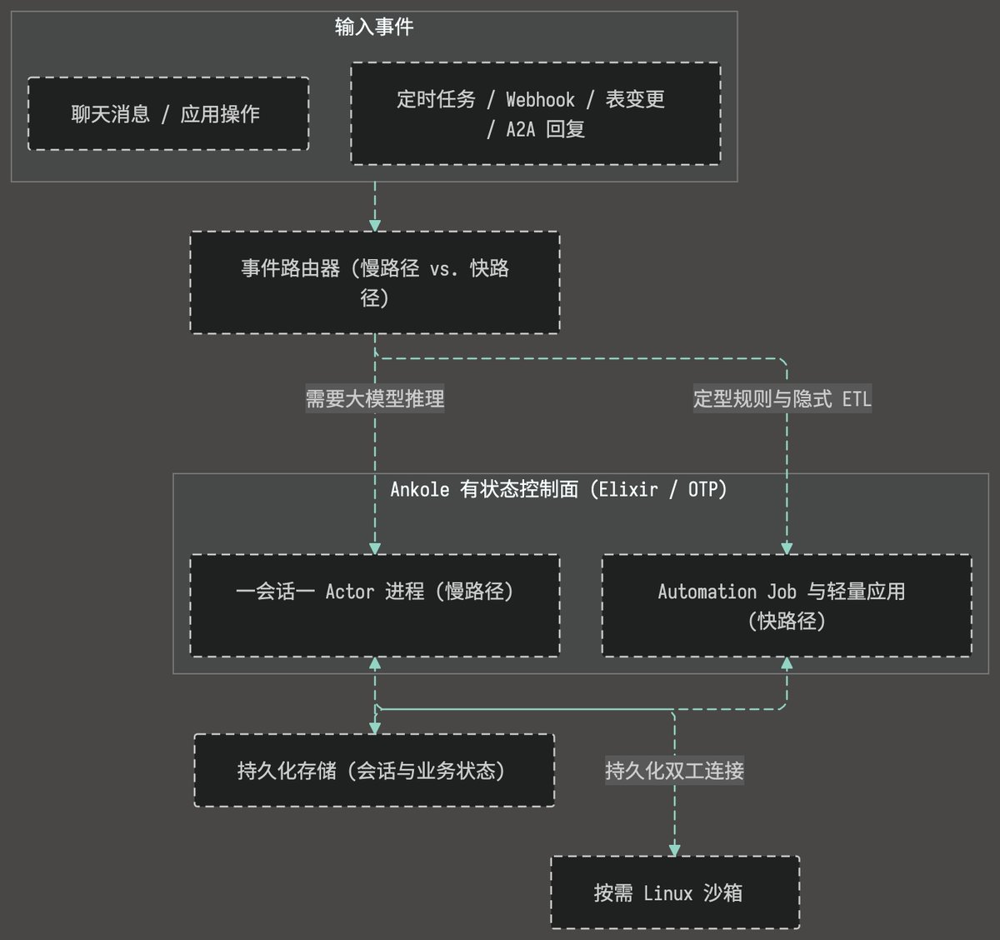
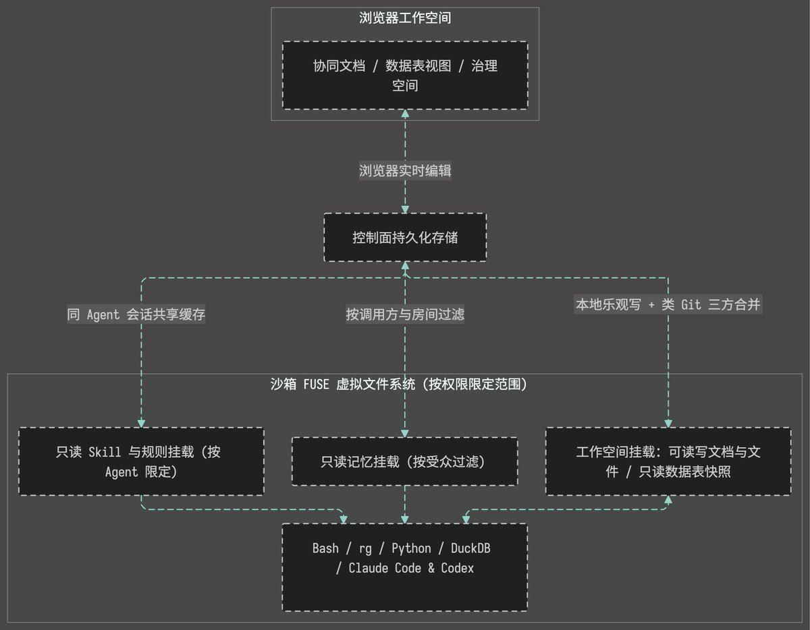

# Li (Boris) Ding（@0xDing）：为团队构建真正的 Agent OS——来自 Ankole 的工程实践

> 单用户 Harness 套网页壳或群聊外挂 MCP 机器人撑不住三十人真业务；Ankole 以共享工作空间 + 多主体权限图 + 有状态控制面 + 按需沙箱，把隐性知识变成可分支合并的组织能力。

<!-- more -->

此为《[Building a Real Agent OS for Teams: Lessons from Ankole](https://x.com/AgentBullLab/status/2117682224896397529)》的中文翻译版，倘有歧义请以英文原版为准。

## 1. 从单用户 Harness 到集体认知

在独立开发者的笔记本电脑上，Claude Code、Codex 与 OpenClaw 这类工具已经能自主连续工作数小时。可一旦把同一套单用户架构搬进横跨销售、客服、运营、采购、财务与法务的三十人公司，不出几周就会全线崩盘。

瓶颈早已不再是模型本身的智商，也不是单用户 Harness，即服务于「一个人配一把键盘」的提示词组装、工具调用与上下文管理循环。那套循环已经跑通了。在企业内部真正断裂的，是鲜活的业务语境与隐性知识。人类可以分工协作，却无法直接合并大脑。我们靠开会、写交接文档和对周报去弥合这道鸿沟，但低带宽的摘要总会漏掉真正支撑业务运转的成文外判断。它们记不下老采购为什么一眼觉得某份超低报价有猫腻，毛利表某一列背后藏着什么测算假设，或者法务吃过哪场官司的亏才坚决拒掉 60 天账期条款。单用户 Agent 把这整笔「上下文打包税」原封不动留给了人。员工依然得手工搜集散落在各处的内部经验，压缩塞进提示词，跑完再手动搬回共享表格。

过去一年里，各家厂商试过两条把 Agent 带进团队的捷径。一类给单用户 Harness 套上「左会话、中聊天、右目录树」的三栏网页壳子，直接挂牌 Agent OS；另一类往公司群聊里放进一个共享机器人，再接上一排 MCP 连接器。这两套方案在五分钟演示或十人全透明小团队里看着都很美。可一旦部署进三十人的公司，无论哪一套都会撞上三堵高墙：

1. 聊天是推进工作的过程，不是存放业务状态的地方。 订单台账、供应商比价表和内部小工具的生命周期，远长于催生它们的那段对话。把一切都留在聊天流和散装 CSV 文件夹里，几个并行会话跑下来，台账很快就会分叉成互相冲突的副本。与此同时，同事在群里的异步回复会不断打碎提示词缓存，常规核对每次都要重跑前沿大模型，月账单轻而易举冲上数万美元。
2. 系统提示词当不了企业级访问控制。 在共享群聊机器人的提示词里写一句「严禁泄露机密」，顶多能做到 99% 生效。面对财务、采购与法务，剩下那 1% 就足以让系统无法上线，也没有哪家真实公司会为了迁就一个全局机器人而废除私密频道。共用同一把 API 令牌的机器人，同样算不出提问者、Agent 与当前房间三方的权限交集，更做不到在管理员撤回源文档的瞬间隐藏由此派生的记忆。
3. 远端 API 孤岛既抽干了业务语境，又废掉了原生文件工具链。 当 Agent 从外部接口拉回裸数字，却不知道是谁录入、按什么口径定义时，它就会在错误假设上以机器速度狂奔。把文档和五万行台账锁在分页 JSON 接口后面，还会让沙箱里的 ripgrep、DuckDB、Python 与 Claude Code 形同虚设。Agent 无法扫描本地文件，只能把数兆原始 JSON 硬塞进提示词。

过去一年里，我们团队一直在构建 Ankole，一套面向多角色组织的开源、模型中立 Agent OS。我们不再逼着员工把公司上下文手动打包喂给外部机器人，而是让人与 Agent 共处同一套环境。它的上层是 Agent-first 工作空间，内置页面、类 Airtable 带类型数据表、内部应用与群聊；底层则是一套多用户操作系统内核。Shopify、ERP 与 Jira 这类外部记录系统依然保持权威地位，我们通过封存凭据的连接器同步其状态并管控回写，而不是强行取代它们。

为什么一套 Agent OS 要内置页面、数据表和应用？Notion、Airtable 这类传统办公工具的起点，是让人手工搭建文件夹、页面与表格，再在边缘钉上一条 AI 侧边栏。我们把这个工作流彻底倒了过来。在这里，人负责设定目标、从客户电话或看厂现场带回一手新事实，并在关键取舍上拍板；Agent 负责调研、同步数据，把工作成果直接沉淀为持久的页面、带类型的数据表与可塑应用。如果采购已经知道某款单价降到了 12 美元，点进单元格改个数字只需两秒钟、零 Token 消耗。正因为人与 Agent 操作同一批实时业务对象，人的每一次修改、批注与判断都锚定在具体语境之中，把个人品味持续转化为团队共享的能力。

在这层工作空间之下，每位员工和每个 Agent 都作为独立身份（Principal）接入同一张内核权限图。我们在底层拆开了两层：有状态控制面掌管持久存储、权限、封存凭据与会话路由；按需 Linux 沙箱专门运行 Bash、Python、DuckDB、无头浏览器及编程 CLI。通过 FUSE，每个沙箱只把当前会话获准访问的文档、数据表快照与记忆挂载为本地目录。这层操作系统与单用户 Harness 互补而非替代。每个 Agent 依然在 Harness 上运行推理循环，遇到仓库级代码改动时，则在沙箱内直接拉起 Claude Code 或 Codex。

只有文件夹的套壳产品跑得了 grep，却过不了任何并发与权限考验。群聊外挂 MCP 的机器人一路烧着前沿模型 Token，却建不出持久业务状态、零 Token 应用，也给不了 DuckDB 和 Claude Code 所需的本地文件访问。第 2 至第 6 节将逐层拆解这套五层架构：

## 2. 共享状态与可塑快路径

Agent OS 必须有地方让结构化业务状态与可复用工具超越单次聊天会话长期存活。拿散装 CSV 当数据库、把每项日常核对都塞进群聊，既会破坏数据完整性，也会烧穿 Token 预算。

### 2.1 共享数据表与隐式 ETL

设想一家多店铺电商公司的日常运转。同事很少会整理好一份干净的需求说明再交给 Agent。真实工作总是以碎片形态涌入：客服频道里的退换货申请、邮件附件里的供应商最新报价、广告转化 CSV 报表，以及各家店铺实时推送的订单 Webhook。

在这些渠道之间，Agent 大部分时间都在做隐式 ETL：从杂乱消息和附件中提取字段、转换为带类型的列、按订单号关联对齐，再更新共享记录。如果只给团队提供聊天窗口和共享文件夹，每次会话都会另存一份新的 CSV 或 JSON 文件，直到所谓「最新订单总表」分裂成好几份互相冲突的副本。

我们在工作空间里直接内置了类似 Airtable、带有类型列的结构化数据表。这些表不是聊完天留下的静态导出文件，而是人与 Agent 共同维护的实时业务状态。采购可以直接在浏览器表格里修正已知数字，无需消耗任何模型调用；后台 Agent 则随着事件到达持续提取、关联并更新记录。三条存储规则保证并发写入方互不踩踏：

- 组合业务唯一键。 定义类似 (平台， 店铺， 外部订单号) 的业务唯一键后，超时的导入重试会自动转化为幂等更新插入，而不会产生重复行。
- 按字段更新与版本校验。 写入操作只修改目标列而非整行覆盖，客服刚补上的订单备注，不会被一秒后更新物流状态的 Agent 冲掉。每个单元格还独立维护版本计数器。一旦两个写入方同时修改同一个单元格，表引擎会拒绝过期写入，让调用方重读最新行再处理，绝不静默覆盖此前的修改。
- 仅在数值真正变化时触发事件。 只有单元格的值确实发生改变，表引擎才会发出变更事件。当双向 ERP 库存同步把表里已有的相同数字再次写回时，不会重复触发 Webhook，从根源上切断无限同步死循环。

### 2.2 把工作流编译为可塑应用，以及 UNIX setuid

纯聊天形态的团队 Agent 之所以动辄月烧数万美元，原因很简单：它们把早已定型的工作流困在了对话线程里。同事乱序回复会打碎提示词缓存，规则几个月都没变过的常规核对，依然每次都要唤醒前沿大模型重跑一遍。

多步大模型推理属于 Slow Path，适合用来处理模糊目标、排查异常根因与构建新工具。一旦同事们把同一类测算或数据核对按相同方式跑顺几次，我们就用这条慢路径把代码编写测试一次，随后编译为两条零 Token 消耗的 Fast Path。面向人交互时，Agent 直接发布连接工作空间数据表与连接器的可塑内部应用。资深采购与 Agent 一起推敲出到岸成本公式并发布后，后续每次点击都直接运行测通的代码，零模型调用，把一位老采购的经验转化为团队共用工具。面向周期性后台任务时，定时计划、Webhook 与数据表变更会直接触发测通的脚本作为无头 `Automation Job` 运行，全程无需唤醒模型。

一旦同事和 Agent 开始发布内部应用与 Automation Job，一个经典的系统难题随之浮现：这段代码究竟以谁的权限去读写共享数据表？

如果给应用开放全局管理员权限，任何能改动应用代码的人都能读遍全公司的敏感底表。反过来，如果把所有应用死锁在点击者本人的权限上，连最基础的信息提报表单都跑不通。一线客服必须把赔付申请提交进售后总表，但绝不能浏览或修改这张总表里其他客户的赔付记录。

UNIX 在五十年前就用 setuid 解开了这道题。普通用户运行 passwd 命令修改自己的密码条目时，程序临时借用系统所有者权限完成写入，同时绝不让普通用户读取他人的密码哈希。我们在三种执行模式上采用了完全一致的切分：

- 交互式应用（`caller` 模式）。 默认情况下，应用严格按照点击用户本人的权限执行读写。
- 无人值守 `Automation Job`（`owner` 模式）。 后台任务按任务所有者的权限运行，个人任务归人类创建者本人，公司级任务归管理员授权的 Agent 身份。
- 所有者委托应用（`setuid` 模式）。 当运营主管在那张赔付表单上开启所有者委托后，运行时会先把经过核验的客服身份传给校验代码，再以运营主管的权限写入审批通过的记录。客服能顺畅提交申请，同时始终拿不到售后总表的直接访问权。

和 setuid 一样，所有者委托天然构成高价值的提权目标：谁要是悄悄篡改了委托应用的代码，就能盗用所有者的表权限。因此，开启委托或向委托应用发布任何代码变更，都必须经过该所有者本人明确签字批准；一旦所有者账号停用，委托关系立即吊销。

## 3. 多主体权限隔离与跨 Agent 协同

在多用户操作系统里，每位用户和每个后台守护进程都作为独立主体运行，各自持有隔离的权限。Agent OS 必须在每位员工和每个 Agent 之间强制执行同样的边界，因为一家三十人的公司里就有几十个保密规则每天彼此碰撞的岗位。

### 3.1 个人助理、专职 Agent 与隔离的 A2A 会话

市面上大多数「团队 AI」方案都会倒向两个极端。把全公司放到同一个共享机器人上，采购底价、法务案卷与日常闲聊就会混进同一个上下文；按部门拆成彼此孤立的机器人，任务一跨部门，员工就沦为在不同窗口间来回复制粘贴的人肉路由器。

参照 UNIX 将个人登录 Shell 与看管受限文件的后台服务守护进程配对的做法，我们把每位员工和每个 Agent 都作为独立身份（Principal）放进同一张内核权限图，划分为两类互补角色：

- 个人助理。 每位员工配有一对一专属助理，读写权限与本人严格一致。在数月共同改文档、审草稿、追待办的过程中，它会逐渐摸透主人的优先级排序与取舍尺度。
- 专职 Agent。 法务（@legal）、财务（@finance）与数据运营等职能各自作为独立 Agent 身份运行，拥有专属的受限档案库、领域规则与服务账号。即便个别员工离职，沉淀下来的专业经验依然完整留存。@legal 可以调阅普通员工无权打开的往年合同纠纷档案，任何人都能在群聊或文档评论区呼叫 @legal。

当员工直接与任何 Agent 对话时，控制面强制执行双方的权限交集（提问者 ∩ Agent）。如果无权查看法务纠纷档案的采购直接找 @legal 聊天，双方在该档案库上的交集为空。低权限员工绝不可能靠话术诱导高权限 Agent 在聊天中读出受限文件。

但设想一下，当这位采购需要请 @legal 审阅一份供应商合同时会发生什么。请法务出面的全部意义，恰恰在于获取基于过往纠纷案例的专业建议，而采购本人并没有阅读这些原始案卷的权限。如果机械死守 提问者 ∩ Agent 交集，@legal 就会对自家的判例库失明；如果撤掉这道边界，保密档案又会外泄。

我们通过异步 Agent 间通信（`A2A`）解开了这个两难困局。在同一请求内直接调用子 Agent 工具，子 Agent 依然运行在调用方的进程与权限范围内；而 A2A 调用会跨越真实的身份边界，进入 @legal 自身隔离的会话。采购在文档侧边栏让个人助理请法务核查违约责任与账期条款；个人助理仅向 @legal 授予这份草稿的「仅评论」权限，随即发出异步 A2A 请求，采购自己的聊天窗口完全不受阻塞。@legal 在独立的对等会话中以 @legal 自身的权限唤醒，对照法务纠纷档案审阅共享草稿，看不到采购名下任何其他私人文件。如果缺少验收期限之类的商务条件，@legal 会发出一张简短的追问卡，确认后将段落批注直接写回草稿：

为防止合同草稿里暗藏恶意提示词诱导 @legal 吐出原始案卷，控制面在每个 A2A 会话外围加上了四道代码级硬护栏。传入的 A2A 载荷与共享草稿一律包裹在不可信数据标签内，无法覆盖 @legal 的系统规则。控制面在检索记忆时照常核验房间受众，仅挂载法务自身的档案库，并全量记录每一次 A2A 请求与回复。在这四道护栏之内，@legal 依靠岗位指令而非脆弱的字节过滤，将判例经验转化为合同修改意见。这与真人法务顾问的做法如出一辙：翻完内部诉讼卷宗后建议把账期压到 15 天，但绝不会把原始案卷交出去。

此后采购无论在私聊、评论区还是项目频道继续找 @legal 追问，控制面在召回过往记录前都会先执行一条严格校验。当前房间内的每一个人，都必须属于原对话的受众集合（当前在场成员 ⊆ 原对话受众）。私聊追问会无缝接续刚才的审阅进度；一旦切进拉有外部供应商的对接群，内部法务审阅记录就会自动隐藏。在上百人的全员大群里，这一子集条件几乎不会满足，@legal 便只凭公开知识作答。在大群里多交代两句背景，永远好过泄露法务底牌。

### 3.2 封存凭据与只读镜像列

连接外部 SaaS 工具需要与保护内部文件同等级别的纪律。如果把 API 密钥塞进 .env 文件、放任 Agent 工具直接改写线上 SaaS 接口，很快就会酿成事故。散落复制的密钥在员工离职后依然有效，一次模型幻觉工具调用就可能改乱线上店铺标价或打错款项。

我们将外部店铺后台、ERP、聊天平台与代码托管平台统一锁进控制面，严格执行两条规则：

1. 长期密钥绝不离开控制面。 管理员只需对公司公共账号授权一次；员工绑定的个人账号会在离职时自动冻结或清除密文。事件监听器、内部应用、Automation Job 与命令行工具直接复用这些受管连接，全程接触不到刷新令牌或静态 API 密钥。沙箱代码要么通过控制面代理转发请求并由代理附加密钥，要么只拿到控制面专为当次任务签发的窄权限短期令牌。
2. 上游系统保持权威地位，外部写入必须经人工签字确认。 从 Shopify 或 ERP 同步下来的订单与库存一律落入只读镜像列，与可编辑的内部备注列并排隔离，本地改备注绝不会覆盖同步数值。每当 Agent 提议修改线上店铺售价或发起打款时，控制面都会暂停执行，向获授权的负责人发出一张列明目标账号、SKU 与精确金额的确认卡。只有人工点击批准并收到上游接口确认回执后，本地镜像列才会更新。

## 4. 组织记忆与 Skill 治理

一旦团队把 Agent 投入日常业务连续运转数月，决定上限的核心资产就在于两样：从真实工作中提炼出的组织记忆，以及定义 Agent 作业方式的 Skill 与规则文件（AGENTS.md）。在多用户权限环境下，扁平 Markdown 文件、向量 RAG 与共享文件夹会把这两样资产双双毁掉。

### 4.1 记忆即推理：本体论骨架与演化的认知血肉

不妨在业务运转半年后，向公司 Agent 追问某家问题供应商的来龙去脉。如果团队靠单个 MEMORY.md 文件记事，模型每次更新都得重读并重写一整面臃肿不堪、前后矛盾的文字墙。标准向量 RAG 败得更彻底：按块切分把记忆当成了磁带回放，一刀切断了实体关联、数据口径假设、时间线与权限边界。

一旦把表格里的某个数字剥离了「属于哪个 SKU」和「按什么口径录入」的前提，Agent 就会充满自信地把两套互不兼容的指标拼成荒谬结论。由于向量相似度没有时间观念，两年前废止的返点旧政会和上月新规排在一起，连续三次周会被人随口提起的猜测也会被当作既定事实召回。更危险的是，一旦后台任务把高管专阅报告里的现金流预警合进了全员可见的供应商百科页，任何员工搜索该供应商时都能倒推出高管层的保密判断。

认知科学早在几十年前就已阐明：人类记忆从来不是原始录像回放，记忆是围绕鲜活世界模型持续进行的推理与重构。如果只搭建类似 Palantir 那样严格受模式约束的本体论图谱，得到的是一具精确却毫无生气的骨架。它知道供应商 A 供应商品 B，却无法从三个月的拉锯议价中学到分毫谈判经验。反过来，只从聊天记录里抽取印象，得到的则是没有骨架的血肉：一堆既挂不住业务实体、又对聊天框之外发生的业务变动一无所知的松散碎片。

我们在同一条事件溯源流水线上，将本体论骨架与持续演化的记忆血肉融为一体。底层只追加日志平等监听两条输入流：一条是人与 Agent 之间的对话流，另一条是订单异动、ERP 更新及直接改表等外部业务事件流，哪怕没人在聊天里提起也会纳入感知：

- 受类型约束的实体骨架。 围绕供应商、SKU、店铺、订单与项目等类型化实体建立受模式校验的关联边，既为跨表查询提供精确路径，也在写入时直接拦截模型幻觉编造的关系。
- 类睡眠的后台整合。 随着事件流入及周期性后台扫描，整合器会像人类睡眠一样剪除寒暄噪音、压缩日常经验。它将原始日志提炼为带日期的事实、带时间边界的阶段摘要、从资深同事处理边界案例中习得的隐性规律，以及在新证据推翻旧认知时归档旧判断的矛盾记录。未经证实的说法始终绑定发言人归属，保留诸如「Alice 在周会上推测」这类自然语言限定词，而非捏造 0.73 这类虚假浮点数，因此同一个猜测在三次会议上重复出现也绝不会晋升为事实。

由于模型仍可能误读微妙语境，不同部门对同一件事也常有分歧，每条提炼出的记忆都保留指向其背后确切源消息、页面或事件的硬链接。在对搜索结果排序或渲染共享供应商页面之前，控制面会逐一核验 提问者 ∩ Agent ∩ 房间受众 是否有权读取候选记忆引用的每一份原始出处。为避免一份受限报告导致整页供应商摘要在混合频道中不可见，后台整合会先基于共享数据源构建公共摘要，再将受限结论单独存为独立条目。普通员工打开供应商主页时能看全所有公开事实与共享经验，而高管现金流预警及一切引用过它的摘要则完全隐形。一旦撤回那份报告，所有派生记忆在下一次读取时即刻消失。

### 4.2 为什么 Skill 和 AGENTS.md 不能放进共享文件夹

在 Claude Code 这类本地单人工具中，Skill 是存放操作指令与辅助脚本的目录，与 AGENTS.md 规则文件一样作为普通项目文件存放，因为整台机器归一位开发者独占。迁移到共享云端工作空间后，各团队通常会走向两个极端：要么把 Skill 打包焊死进 Docker 镜像，要么把 Skill 目录和 AGENTS.md 当成普通文档扔进共享文件夹。焊死进镜像，会让法务或运营主管改一条业务规则也得排队等研发发版；扔进共享文件夹，则等于把 /usr/bin 和 /etc 直接倒进了人人可改的网络共享盘。

把 Skill 和 AGENTS.md 放进共享目录树、像普通文档一样按 提问者 ∩ Agent 过滤，会在两个结构层面上直接失效。

第一，将能力挂载与调用方文档权限混为一谈，会在多人会话中击穿 Agent 能力边界。设想在某个大促频道里，运营主管先让专职 Agent 跑一次归因核查，十秒钟后文件夹权限更窄的实习生顺着同一话题追问了一句。如果 Skill 按 提问者 ∩ Agent 过滤，权限交集就会当场缩水，专职 Agent 一半 Skill 会在对话中途凭空消失。单用户套壳产品永远不会暴露这一缺陷，因为房间里根本没有第二个用户进来收窄交集。Skill 和 AGENTS.md 定义的是某个 Agent 角色自身掌握的能力，归属于 Agent 本身的身份，绝不取决于调用方的文件夹访问权。

第二，自由的文件夹编辑操作与确定性的运行时路径正面冲突。共享文件夹的设计初衷，就是让人自由重命名、拖拽和归档页面；然而一次常规的文件夹改名，就会直接搞坏 Agent 的 Skill 加载器。每个 Skill 包都需要固定的 SKILL.md 清单，以便 Agent 启动时只读取精简索引、按需加载附带脚本，避免几十个 Skill 撑爆提示词。AGENTS.md 同样依赖从公司全局默认规则到单 Agent 覆盖配置的固定继承链。把它们留在用户文件夹里，意味着要么容忍脆弱易断的路径，要么在文件夹界面上打满别扭的禁止改名锁。

在 Ankole 中，我们将用户态协作空间与专门的系统治理空间彻底分离，为记忆、Skill、AGENTS.md 及连接器设立独立的治理表。沙箱内不挂载任何改写线上 Skill 或 AGENTS.md 的写入工具；Agent 可以在工作空间起草候选 Skill 或提交规则变更对比，经获授权的人类审批通过后方可生效。

## 5. 控制面与执行沙箱分离

第 2 至第 4 节的所有保障都建立在一个前提之上：生成的代码绝不能直接触碰底层数据库或长期密钥。眼下大多数 Agent 运行时都倒向了两个极端。要么把动态生成的 Bash 脚本和无头浏览器跟 API 密钥、数据库凭据混跑在同一个后端进程里；要么为每一条聊天会话都启动一台完整 Linux 虚拟机。前一种架构只要出一个解析器漏洞，攻击者就能直接拿走整家公司的钥匙；后一种架构为了回答一个两秒钟的简单提问，也要白白付出数秒冷启动延迟和数 GB 空闲内存。

### 5.1 把状态管理与按需算力拆开

正如操作系统严格隔离内核态与非特权用户态进程，我们将有状态控制面与按需 Linux 沙箱拆分开来：

1. 不可信输入周围零密钥、零数据库直写权限。 Agent 全天都在运行生成脚本、解析外部邮件附件、用无头浏览器打开第三方网页。把数据库提交权、模型主密钥与权限图锁在控制面内部，即便沙箱遭遇解析器漏洞攻破，攻击者也无法染指全公司的全局状态。
2. 常规轻量回合在控制面内毫秒级无容器直出。 绝大多数对话回合只是回答问题、查询记忆、更新几个表格单元或发出一条 A2A 请求。这些操作完全不需要编译器或浏览器，控制面直接以毫秒级延迟跑完对话循环，零容器开销。
3. 重型算力的故障隔离与发版解耦。 只有当 Agent 运行长达半小时的归因脚本，或在代码仓库上拉起 Claude Code、Codex 时，控制面才会按需唤醒沙箱。沙箱内存溢出崩溃不会波及控制面；工程师对控制面执行滚动发版升级时，沙箱内正在运行的长耗时命令也不会中断。

沙箱只提供零长期凭据的纯净用户态算力，沙箱代码发起的每一笔持久化业务写入都必须先通过控制面鉴权才能提交。

### 5.2 用 Elixir / OTP 有状态进程取代无状态 Web 胶水

重型算力剥离进沙箱后，成千上万条断续到达的聊天消息、应用点击、定时任务与 Webhook 全在控制面交汇。

往无状态 HTTP 服务器上硬拼分布式锁与任务队列，从模型上就不适合多轮 Agent。如果同事在群里回复的同一毫秒恰好有订单 Webhook 抵达，锁竞争就会骤增；如果滚动发版在回合中途启动，正在执行的后台工作就会沦为孤儿任务。无状态 Web 技术栈与负载本身的形态背道而驰：Agent 会话不是二十毫秒算完即止的 HTTP 请求，而是跨天存活、被异步事件反复唤醒的有状态进程。

我们基于 Elixir / OTP 构建控制面。它底层的 Erlang 虚拟机从诞生第一天起，就能同时运行数百万个微秒级拉起、内存彼此隔离的有状态进程（Actor）：

当会话安静下来时，其状态直接落盘存入 Postgres，内存占用归零。一旦聊天消息、A2A 回复或 Shopify Webhook 抵达，控制面立即为该会话唤醒专属 Actor 进程，逐条串行处理事件而无锁竞争，空闲后再次休眠落盘。控制面节点与活跃沙箱保持持久化双工连接以流式传输命令输出。遇到滚动发版时，新拉起的会话 Actor 会从 Postgres 重新加载已保存的任务句柄，直接在线接管沙箱内仍在运行的命令。

## 6. 沙箱内的虚拟文件系统

把公司数据留在控制面内、把代码关进沙箱里，立刻引出一个核心问题：沙箱内部的 `ripgrep`、`DuckDB` 与 Claude Code，如何读写控制面里的业务记录？

### 6.1 为什么迷信 MCP JSON 工具会撞墙

在内部数据外封装定制 MCP JSON 工具，用来查单行记录或改个状态标记完全够用。可一旦把 JSON 工具当成主力数据接口，就等于把模型的上下文窗口当成内存条使，还会废掉标准软件工具链。

跨三十份供应商规格书核对参数，或对五万笔订单分析退货原因时，走 JSON 接口拉取会把数兆乃至数十兆原始文本直接灌进提示词，烧光 Token 不说，还会冲垮模型注意力。反过来，把同样这批记录挂载为沙箱内的本地文件，Agent 只需写十行 DuckDB、Python 或跑一条 ripgrep。过滤与聚合全部在上下文窗口之外完成，最终只有十行统计结果进入提示词。同样关键的是，pandas、DuckDB、UNIX 命令行工具、Skill 脚本，以及 Claude Code 和 Codex 这类编程 Agent，全都默认读写标准 POSIX 文件路径，而非各自定义一套的 JSON 分页格式。

### 6.2 按权限挂载的 FUSE 虚拟文件系统与类 Git 三方合并

每个沙箱配有一块用于 git 检出和 node_modules 构建的高速本地临时盘，同时基于 Linux FUSE 挂载一套虚拟文件系统（VFS）。控制面里的记录在沙箱内部呈现为普通本地目录，并内置写入背压机制，防止海量碎文件风暴冲垮共享存储：

在沙箱内部，FUSE 守护进程挂载三个按权限限定范围的目录。在工作空间挂载目录中，协同文档呈现为可编辑的 Markdown 文件，附件呈现为普通文件，结构化数据表则挂载为只读快照，供 DuckDB 与 pandas 以本地磁盘速度扫描。向表内写回数据统一走带校验的导入或补丁命令，强制执行第 2.1 节所述的组合唯一键、列类型与字段版本校验。与此同时，记忆目录与 Skill 及规则目录一律只读挂载，确保沙箱脚本绝不可能绕过出处核验或篡改线上规则。FUSE 层按 提问者 ∩ Agent ∩ 房间受众 动态过滤记忆挂载，而同一 Agent 的并发会话则共享同一份本地常热的 Skill 与 AGENTS.md 磁盘缓存。

当几十名同事与多个沙箱同时工作时，两项并发机制保证这套网络 VFS 既安全又不卡顿：

- 按权限作用域隔离文件系统视图与 `/tmp`。 由于同一个专职 Agent 经常同时服务不同权限的同事，沙箱运行时按 提问者 ∩ Agent ∩ 房间受众 作用域逐一隔离 Linux 挂载命名空间、工作目录、恢复目录与 /tmp 目录。低权限会话绝无可能误触高权限会话遗留的临时文件或被拒收的写入副本。
- 本地乐观写配合类 Git 三方合并。 如果在沙箱慢脚本写文档期间持有跨网络锁，同事在浏览器里点保存就会被硬生生卡住。相反，沙箱会先在本地完成写入，再由服务端对照共同祖先版本执行类 Git 的三方合并。针对不同段落的修改会自动干净合入；只有当双方恰好修改了同一个段落块时，服务端才会把沙箱副本存入该作用域专属的恢复目录，保持浏览器保存瞬时完成，再交由 Agent 比对调解。

## 7. 开源主权、信任边界与什么才算真正的 Agent OS

前沿模型权重的绝对领先优势往往只能维持几个月，随后竞争对手与开源权重就会迅速追平。基础推理能力正在加速商品化；真正能够跨年复利沉淀的核心资产，全生长在企业自身内部：持续更新的业务数据表、实体本体图谱、长周期运转的工作流，以及提炼沉淀的隐性知识。这也正是闭源模型厂商纷纷下场争抢企业级托管 AI 同事的原因。一旦上百条在途工作流、审批规则与组织记忆全都长在某一家模型厂商的私有云里，切换模型就如同当场解雇半个运营团队。把这一层交出去，等于把整家公司拱手送给模型厂商，再按 Token 把自己的公司租回来。我们将 Ankole 构建为开源、模型中立的系统：前沿模型只是可随时替换的计算引擎，企业始终完整持有自身的状态、本体、权限与记忆所有权。

在安全边界上，我们围绕单一控制面与同一张权限图下的单家组织划定清晰的信任周界。让一个读取外部邮件的 Agent 直接在员工个人笔记本电脑上拿到原生 Shell 权限，紧挨着 SSH 私钥与已登录的浏览器 Cookie 执行命令，在企业环境里极其鲁莽。独立开发者可以在专用机器上自担这份风险，企业绝不能赌。我们同样不假装一张权限图能横跨互不信任的多家公司；跨企业 A2A 属于联邦协议的范畴，绝不应共享内核状态。

每当我们带工程师推演这套架构时，总会遇到两种典型质疑：

- 「这不就是给 Notion 或 Airtable 加了个聊天机器人吗？」 传统办公工具的起点是让人手工维护文件夹和表格。而在 Ankole 中，页面、带类型的数据表与可塑应用，是 Agent 与人类共同构建并维护的可见工作现场。在电子表格边上钉一条聊天侧边栏，既给不了应用级的 setuid 权限委托，也建不出与 @legal 隔离的 A2A 会话，更做不到支持即时撤权的本体记忆，或是供 DuckDB 与 Claude Code 直读的 FUSE 权限挂载。
- 「等下一代模型更聪明了，这套基础设施不就全过时了吗？」 信奉 Rich Sutton「苦涩的教训（Bitter Lesson）」的人，常常押注更强的模型权重终将吞噬每一层 Agent 脚手架。这种观点混淆了「个体推理智商」与「多用户组织系统」。更强的模型确实会让每个季度的慢路径规划与后台记忆归纳更加敏锐。即便如此，模型权重再聪明，也没法凭空对齐两份已经分叉的 CSV，不能靠提示词祈祷来替代法务档案上的内核访问控制，更不该在解析不可信附件的 Bash 进程里裸持原始 ERP 令牌。

给单用户 Harness 套上一层三栏网页壳子，或者往群聊里丢进一个共享机器人，花一个周末就能做出惊艳的首日演示；可一旦让六个部门、三十个人在上面跑上半年真实业务，一切就会分崩离析。这正是我们在 Ankole 工作空间之下构建真正操作系统原语的原因：组合唯一键、setuid 委托、隔离的 A2A 会话、本体驱动的记忆、有状态 Actor 进程，以及支持三方合并的 FUSE 挂载。它们只服务于一个目标：让组织的隐性知识与集体判断，能够像代码一样可靠地分支、合并与复利生长。任何自称 Agent OS 却没有这些原语的产品，跳过的恰恰就是「操作系统」本身。

## 相关页面

- [[concepts/harness-engineering]]
- [[sources/agentscope-2.0-harnessagent-os-architecture]]
