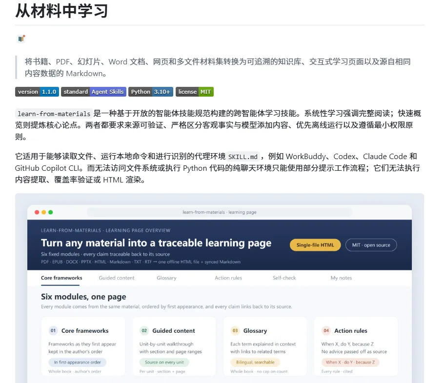

# Gk（@0xGky）：learn-from-materials——把几百页 PDF/EPUB 资料整成带精确页码出处交互式学习网站的 Agent Skill

> 支持 Claude Code、Codex、Copilot CLI 的开源 Agent 学习技能 learn-from-materials：可处理 PDF、EPUB、Word、PPT 与网页材料，通读构建知识库后生成交互式 Web 学习页面；核心特性是所有解释均附带精确到页码、幻灯片或章节的原始出处引用，彻底根除大模型幻觉焦虑。

<!-- more -->

看 PDF 特别过瘾的 Agent Skill：learn-from-materials，干脆把几百页资料整成可交互的学习网站。

PDF、EPUB、Word、PPT、网页都能丢给它，它会先把材料通读一遍、搭起知识库，再产出学习页面。

最要紧的是：AI 讲的每一句都能回头查出出处。PDF 精确到页码、PPT 精确到第几张、EPUB 精确到章节，不必再纠结“这话究竟是书里写的，还是 AI 编的”。

Claude Code、Codex、Copilot CLI 都能装上。

地址：https://github.com/dmoshehun-prog/learn-from-materials

## 相关页面

- [[sources/morry-course2md-video-to-markdown-notes]]
- [[concepts/agent-skill]]
- [[concepts/claude-skills]]
- [[concepts/problem-driven-learning-wheel]]
