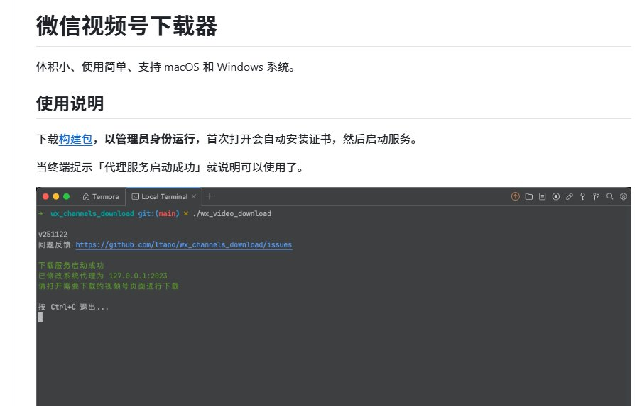

# Gk：微信视频号下载工具 wx_channels_download（GitHub 10.5K Star）

> 开源工具 wx_channels_download：PC 微信视频底部自动出现下载按钮，支持不同画质，覆盖公众号视频/视频号原始视频/B 站/快手/YouTube/直播，可接入 MCP 让 AI Agent 创建下载任务，支持 Windows/Linux/macOS。https://github.com/ltaoo/wx_channels_download

<!-- more -->

微信视频号下载的神器：wx_channels_download，在 GitHub 上揽下 10.5K 颗星了。

把它跑起来之后直接打开 PC 端的微信，视频底下自己就会多出个下载按钮来，压根不用复制链接来回折腾解析，还能自己挑不同的画质。

不光能搞定公众号文章视频、视频号原始视频、B 站、快手还有 YouTube，甚至连直播都能处理，甚至还接入了 MCP，直接就能让 AI Agent 帮你建好下载任务。

Windows、Linux 还有 macOS 都能用

平时拿来备份那些自己有权保存的视频特别方便。

🔗⁠https://github.com/ltaoo/wx_channels_download

