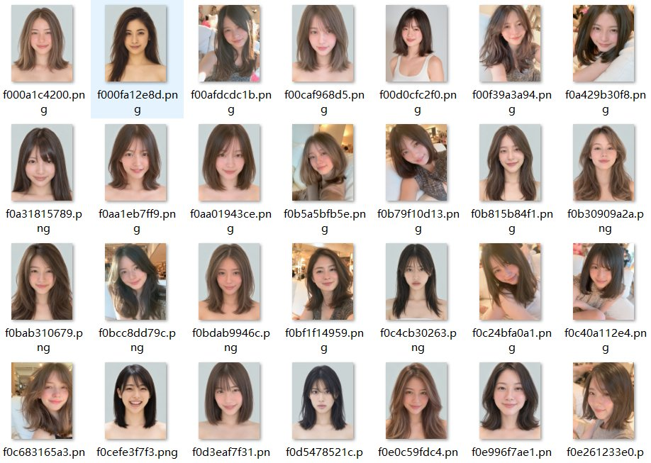
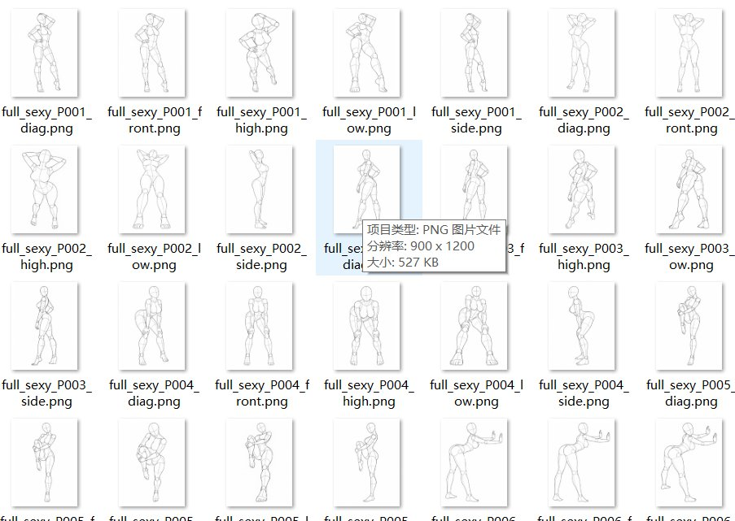
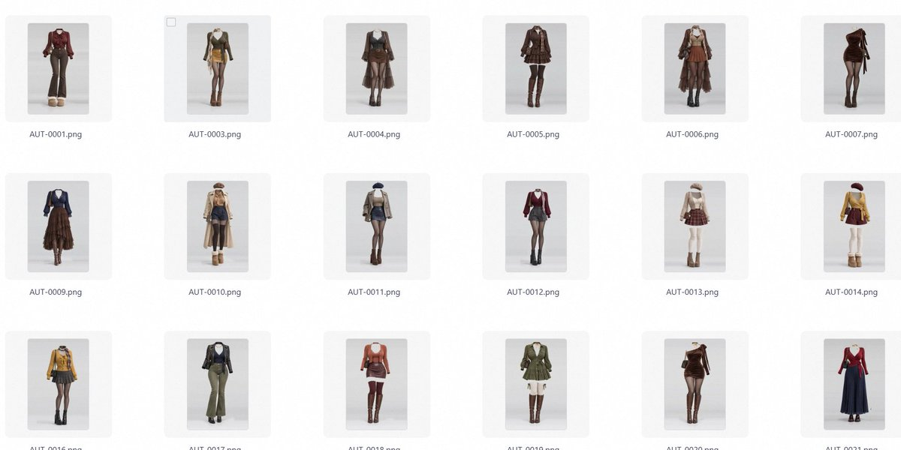

# 94 Playforge：1499 张 MJ 脸模+1439 张多视角姿势+1407 套服装参考图

> AIGC 素材库从囤提示词到囤参照图的演进。分享 4000+张实用参照图（脸库 CC0 协议、多视角姿势线稿、纯服装参考）。原作者 giaaibus 的参考库直接“捏人”变成拼积木。6G+网盘资源（quark）+ 使用建议。

<!-- more -->

素材库越来越大，作品却越来越像

看着如今满屏的脸库、姿势库、服装库，总觉得这一幕似曾相识。

前 2 年大家囤的是提示词，把人物、风格、场景分门别类，用时复制粘贴、微调词缀；如今囤的是一张脸、一套衣服、一个动作，能拆解的都拆解，能复用的全存下。以前靠文字反复拉扯的细节，现在直接指给模型看。

更适合中文社区 AIGC 玩家的内容就是需要有参照。

比如最近原作者

@ giaaibus あぎ／ギア 的参考库直接把“捏人”变成了拼积木：（6G 多容量的素材网盘综合整理好了，在文章末尾）https://ai-portrait-gallery.pages.dev/

- 脸库（CC0 协议）：1,499 张纯色背景头部参考（含 893 张特写、606 张造型），MJ 的脸库（近 4.5GB 内容，个人建议自己捏）

- 姿势库：288 种姿势共 1,439 张多视角无脸线稿。

- 服装库：8 大分类共 1,407 套纯服装参考

对于需要连续出图、维持角色一致性的创作者来说，这种库确实救命。把已经解决的长相和穿搭固定下来，省去每次重新抽卡的力气，腾出精力处理新内容，完全合情合理。

但工具越顺手，选择就越容易沦为默认。文生图远不及图生图实用！

打开脸库挑最讨喜的五官，打开服装库找最显身材的款式，再配一个验证过、绝不出错的姿势。每一步都无比正确，合在一起却成了流水线产物。库里明明有一千多张脸，真正被高频调用的往往只有最符合大众审美的那一小撮。

这就是为什么很多图单看材质、光影、细节都挑不出毛病，连刷十几张却让人彻底脸盲。哪怕换了发色、挪了背景，人物身上那股劲儿始终如出一辙，最好的方式就是 P 图了。

如今的“AI 味”，早就不是多一根手指或皮肤假滑，而是画面里的每一个选择都太像“标准答案”。

模型自带一层默认审美，素材库按“精致、流行”筛掉一层，使用者再往“最稳妥、最出片”的方向挑一层。三层过滤下来，那些不够标准却鲜活有趣的可能性被彻底抹平。更要命的是审美闭环：某种搭配火了，被大量模仿，随后又被打包进下一代“精选库”。硬盘越来越满，审美的边界却越缩越窄。

这和当年囤几千条提示词的错觉一模一样：以为拥有了庞大的储备，真到动笔时，最难的问题依然在原地，画的图想表达什么，有什么用？

真正的解法，是把公共库退回“起点”的位置，并改变积累素材的习惯。收藏一张图时，别只记“好看”，记下被打动的具体瞬间：是转身时的一点犹豫，袖口堆叠的褶皱，还是恰好切过半张脸的窗光。同时把视线移开热门 AI 图，去旧杂志、街角招牌、日常废片甚至自家楼道的灯光里找灵感。

工具的意义是省下重复劳动。希望省出来的时间，能让我们在打开素材库之前，先想清楚需要生图的内容是干嘛的。

🔗链接：https://pan.quark.cn/s/00a81ae4b136?pwd=WHnw

提取码：WHnw

## 相关页面

- [[sources/anhao-1439-ai-beauty-poses-database]]
- [[sources/songguoxiansen-24000-prompts-migration-guide]]
