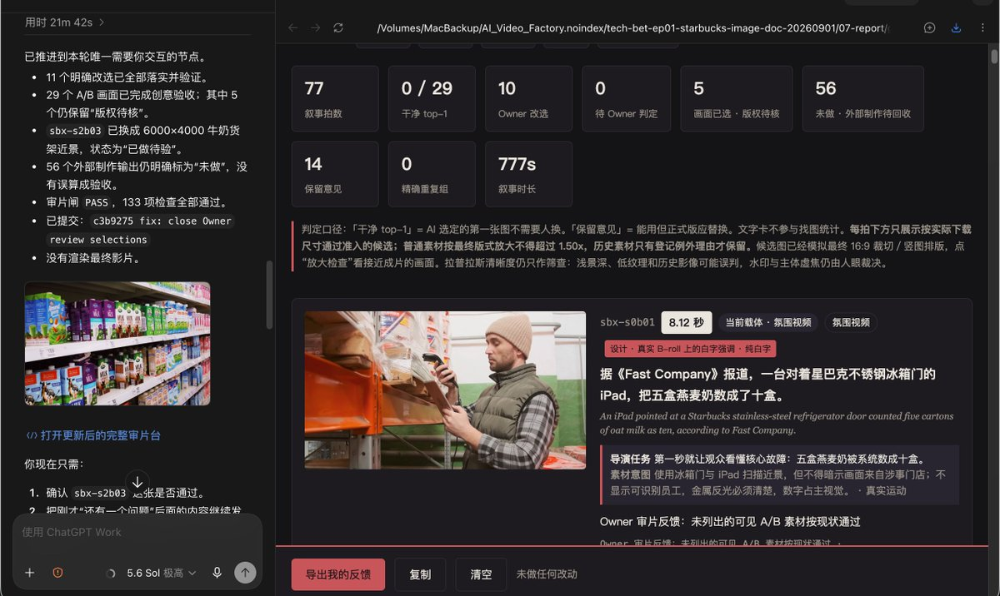
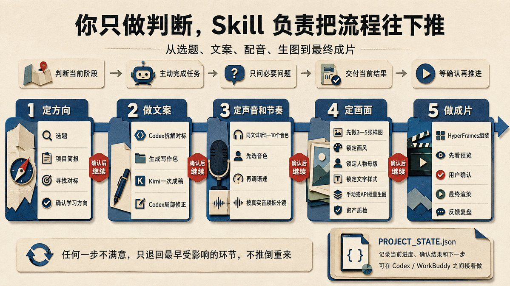
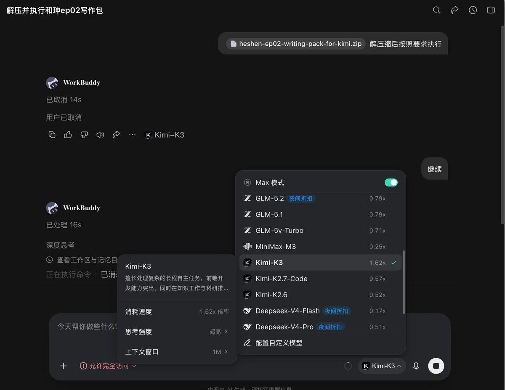

# 大雷：图文播客视频自动化流水线——image-story-video-wizard Skill 全流程

> 讲书类/历史故事类播客视频 AI 全流程流水线。一天涨粉 4000+ 的复盘：文案学对标做成压缩写作包交给 Kimi K3，豆包 Seed-TTS 2.0 选音色并取字级时间戳，按配音拆分镜生图，全流程低成本（10 分钟视频约 60 张图、单期花费 <10 元），核心在于效率和日更。

<!-- more -->

肝了半天的视频制作教程来啦，我还做成了 Skill 引导大家跑通工作流~

我前天看到一个抖音博主，叫「原点档案」。他做的是讲书类视频，就是通过音频播客加配图的方式来讲内容。光抖音就有九百多个付费订阅，一个月差不多有三万块钱的订阅费。最近起号的「枕上听书」「尘封档案」，也都是这一类。

我看了一下，发现整个工作流通过 AI 都可以实现，于是花了半天时间做了一期出来。晚上发到小红书和抖音以后，反馈都很好，我随手发了一条推，结果爆了。很多人都在问这是怎么做的，今天我就把整个制作流程整理成 Skill 和教程，分享给大家。

大家需要准备 Codex 或者 WorkBuddy，再开通豆包语音 API。申请地址：[https://console.volcengine.com/speech/app](https://console.volcengine.com/speech/app)

把 Skill 的安装指令发给 Codex，它会按照流程带着你确认选题、研究对标文案、生成写作包、完成文案，再继续做配音、分镜、生图和剪辑。需要你判断的地方，它会停下来跟你确认。

SKILL 安装指令：
请从 [https://github.com/aaronyi97/image-story-video-wizard](https://github.com/aaronyi97/image-story-video-wizard) 安装 Skill。Skill 位于仓库根目录，安装名使用 image-story-video-wizard。安装完成后告诉我下一轮可以直接启动，并严格按照流程设计主动引导我推进视频的制作

这套 Skill 是我这次赶着整理出来的，制作比较匆忙，大家使用时如果遇到问题，可以给我反馈。

## 写在前面

1.这种视频形式成本低、制作快，很适合快速测试不同的内容赛道，比如讲书、历史故事、故事汇和同人。手动生图几乎没有成本，想走自动化 API 生图，一张大约一到两毛。十分钟的视频大概需要六十张图，一期不到十块钱，音频模型的花费更少，几乎可以忽略。做这个过程，也可以锻炼自己的选题和文案写作能力。

2.这种项目的核心是效率和日更，可以学习抖音「枕上听书」「老张说史」这种，应该是矩阵号，全 AI 生产线制作，一天能做到 1-2 更流量也很好。反面案例是「画案司」做得过于精细，投产品太低，他自己说三个月才挣了几百块。

3.流量跑起来以后，可以大胆开订阅，同时要选一个适合长期付费的方向和赛道。有人订阅就接着做，没有人订阅就继续调整或者换赛道，别指望纯靠平台流量变现。我个人觉得同人广播剧这种订阅变现潜力更大。

4.这类内容最难的还是选题和文案，尤其是前面三到五期，会比较麻烦。我这次在 Skill 里用的是学习对标文案、生成写作包的方式，大家可以先试一下。如果自己有更好的文案写作方法，也可以直接用自己的。文案质量和制作流程稳定以后会轻松很多。

5.如果连续做了七天到半个月，流量和收益还是不好，就果断换赛道，或者重新复盘问题到底出在哪里。一般主要还是选题和文案的问题，不要在一个没有反馈的方向上一直耗。AI 能做的项目现在遍地都是，没必要死磕。

6.我自己从没想到这个帖子能给我带来这么大的流量，一天时间涨粉了 4000 多可能比孙哥都多了。我同事做多个 AI 创业项目，没有刻意做自媒体，就是把我在做的项目过程和心得分享出来，所以不管后续这个频道是否继续，对于我来说都是成功的，发帖就像刮彩票。只要持续分享就有收获。

7.我觉得它这个工作流属于视频工作流里面流程全，但是逻辑简单的那种，不必要有畏难情绪，根据我设计的 Skill 是可以带大家很快跑通的。我自己也在做 YouTube，可以实现精剪视频流程的高度自动化。这里先给大家看一下我的剪辑台，我后面也会跟大家去做分享

> 具体流程我都已经设计在了 Skill 里面，以下内容主要是帮助大家去理解整个流程，有做的不周到的地方，还请大家包涵

## 一、先确定选题和对标

安装 Skill 以后，它会先问你想做什么类型、准备发到什么平台、视频大概多长。这个阶段先把产品方向说清楚，然后再确定要学习哪些对标账号。

我现在主要参考四个账号。整体形式和商业模式看「原点档案」，图片质量看「尘封档案」，文案和配音学「老张说史」和「枕上听书」。

「老张说史」和「枕上听书」的文案都比较格式化，开头有钩子，语言接地气，听起来有爽感，很适合新号学习。

反面案例是「画案司」。它的文案、配音和画面都做得非常精致，图片甚至比很多 AI 视频还漂亮，但是这种做法太重，更新效率和商业效率未必划算。

对 AI 讲书视频来说，观众主要还是在听，图片负责辅助表达和营造氛围。画面做得好当然没问题，但没有必要把大部分时间都花在画面上。

这里说的「抄」，也不是复制别人的句子，更不是把一篇现成文案换几个词，而是学习它的选题、结构、节奏、钩子、配音和制作流程。

> 先把别人已经跑通的东西拆明白，再做出自己的第一期。

## 二、文案先学对标，再让 Codex 做写作包

文案是整个流程里最难、也最值得花时间的地方。

先确定自己想做什么类型，再找几篇最能代表对标账号水平的完整文案，把它们交给 Codex。Codex 会分析这些文案的选题方式、开头结构、叙事节奏、转场方法、语言特点和收尾方式，再把分析结果做成一个写作包。

> 这个写作包不是一条简单的提示词，而是一个完整的压缩包。

里面包括这次要写的任务、资料搜索结果、对标文案、从对标里提取出来的写作要求，以及模型在写作时必须遵守的规则。

这样做以后，资料、风格和任务要求一次就准备完整了，不需要在写作对话里来回补充背景。

写作包做好以后，我建议交给 Kimi。我自己试下来，Kimi 写这类中文长文，比 Opus 更适合。如果没有 Kimi 订阅，可以直接使用 WorkBuddy 里的 Kimi-K3。

在 WorkBuddy 里选择 Kimi-K3，打开 Max 模式，思考强度选择「超高」，上下文选择 1M。然后新开一个干净对话，把写作包发进去，只需要告诉它：解压缩以后，按照里面的要求执行。

> 【配图：WorkBuddy 中选择 Kimi-K3，打开 Max 模式，思考强度选择「超高」，上下文选择 1M】

这里注意，Kimi 最大的问题是容易重复啰嗦，还有如果第一次写作达不到字数要求，再填充的话，质感会差很多。这个写作的时候要注意。

如果这一轮生成的字数不够，不要让它在原稿上继续扩写。回到 Codex，检查写作包是不是材料不够、场景不够，或者字数要求本身不合理。把上游的问题改好以后，新开一个对话重新写。

Kimi 写完以后，把完整文案交回 Codex，再和 Codex 一起做一轮修正。如果大体能用，就只改有问题的地方，不要整篇重写，也不要连续改很多轮。模型越改，越容易把原来还算自然的句子磨得很工整，AI 味反而会更重。

如果第一版完全不像样，就回头检查几个地方：是不是对标选错了，是不是你和 Codex 交互的时候没有把要求说清楚，或者写作包本身还有问题。问题出在哪一层，就回到哪一层改，不要让 Kimi 围着一篇坏稿反复修。

文案工作流不会第一期就完全稳定。我觉得至少要连续做三到五期，才能慢慢知道自己的观众喜欢什么、哪些开头有效、什么节奏适合自己的频道。

等有了三到五篇质量稳定、自己也认可的稿子，再让 Codex 根据这些成稿，提取出适合自己频道的文案模板和文案 Skill。以后做新题目，就不用每次从零开始。

## 三、配音先选音色，再调语速

文案确认以后，把它交回 Codex，开始做配音。

配音用豆包的 Seed-TTS 2.0。如果还没有开通，就进入豆包语音控制台（[https://console.volcengine.com/speech/app）申请。具体怎么申请和配置，这里不展开，有不清楚的地方直接问](https://console.volcengine.com/speech/app%EF%BC%89%E7%94%B3%E8%AF%B7%E3%80%82%E5%85%B7%E4%BD%93%E6%80%8E%E4%B9%88%E7%94%B3%E8%AF%B7%E5%92%8C%E9%85%8D%E7%BD%AE%EF%BC%8C%E8%BF%99%E9%87%8C%E4%B8%8D%E5%B1%95%E5%BC%80%EF%BC%8C%E6%9C%89%E4%B8%8D%E6%B8%85%E6%A5%9A%E7%9A%84%E5%9C%B0%E6%96%B9%E7%9B%B4%E6%8E%A5%E9%97%AE) Codex，让它带着你操作。

选音色的时候，先从正式文案里截取一小段，让 Codex 根据内容推荐五到十个适合的音色，每个音色生成大约二十秒的试听。所有音色必须使用同一段内容，这样才能真正听出它们之间的差别。

> 试听时先选音色，再调语速。

音色本身不合适，怎么调速度都救不了。音色确定以后，再小幅调整语速，听一下快一点还是慢一点更舒服。

我第一期前后听了二十多个音色，最后选的是豆包 Seed-TTS 2.0 的「东方浩然 2.0」。这不代表所有频道都应该用它，历史故事、情感故事和广播剧需要的声音不一样。

第一次可以多花一点时间把音色选好。后面同一个频道就尽量不要频繁更换，不然每一期的声音都不一样。

生成完整配音时，最好同时拿到句级或者字级时间戳。后面 Codex 拆分镜、换图片、上字幕和加文字卡，都可以直接跟着配音时间走，不需要人工一段一段对齐。

完整配音生成以后，先听一遍，确认文案、音色、语速和停顿都没有问题，再进入分镜。

## 四、根据配音拆分镜

有了最终文案和配音，下一步就是让 Codex 根据文案内容、配音时长和时间戳拆分镜。

每一个分镜对应哪一段旁白，画面里要出现什么，需要几张图，有没有人物，要不要放关键信息文字，都在这一步确定下来。

图片节奏不能只定一个死数字。如果画面变化快一点，每张可以停留六到八秒，一分钟大概需要八到十张，十分钟就是七十五到一百张。

第一次做，我建议先控制在五十到六十张，工作量会更合理。具体选哪种节奏，Codex 会根据实际配音时长算出图片数量，再让你确认。

分镜表确定以后，后面的生图提示词、图片文件名、旁白片段和剪辑时间，都按照同一套编号走，不然后面图片一多，很容易对不上。

## 五、先锁定图片风格，再做人物母版

正式生成几十张图片以前，先锁定整个频道的图片风格。

找到自己喜欢的参考图，交给 Codex 提取画风元素，整理成一段固定的生图提示词。然后拿着这段提示词去 ChatGPT 网页版，用 GPT Image 2 先生成三到五张样图。

这三到五张图要尽量包含不同类型的画面，比如人物近景、多人场景、室内和室外。

> 确认效果没有问题以后，画风关键词就不要再改，后面每一张分镜都带上它。

文字风格也在这一步一起确定。标题、人物名字、时间地点、关键信息和字幕分别使用什么字体、颜色、位置和动画，先做出样子看一遍。确认以后，后面剪辑就按照这一套来。

如果故事里有需要长期保持一致的主要人物，还要先做人物母版。让 Codex 给主角生成一张正面或者半身的脸部母版，再生成一张全身图，把年龄、体型、服装和鞋子确定下来。

后面只要这个人物出场，就用人物母版加上本张分镜提示词做图生图。没有强人物连续性的画面，只使用提示词就可以。

> 人物母版没有确认以前，不要开始批量生图。

不然生成到后面才发现人物长相一直在变，前面的图片还要全部重做。

## 六、生成每一张分镜的提示词

画风、文字样式和人物母版都确定以后，再让 Codex 给每一个分镜生成对应的生图提示词。

每条提示词都要和分镜编号一一对应，写清楚画面内容、构图、景别、人物状态、统一画风、图片比例和禁止项。如果这一张有人物，还要写清楚使用哪一张人物母版。这里看起来比较啰嗦，具体的交给 Codex 就好，我们只需要用提示词去提交生图。

## 七、生图可以手动做，也可以走 API

生图是整个流程里机器等待时间最长的一步，但操作本身不复杂。

第一次做，可以直接在 ChatGPT 网页版里使用 GPT Image 2。我的方法是一个对话只发一条提示词，只生成一张图，不要在同一个对话里连续塞几十张。这样某一张出错或者卡住，不会把后面所有任务一起拖住。

如果要连续开很多对话，思考强度用中等就够了。开得太高，生成速度会更慢，图片质量也不一定明显变好。

手动生图几乎没有额外成本，只是操作比较麻烦。如果想全程自动化，就找支持 GPT Image 2 的第三方生图 API。

现在常见价格大约是一张一到两毛。十分钟的视频大概需要六十张图，一期通常不到十块钱。把全部提示词排好以后，可以交给 API 串行生成，第二天再统一检查。

不管是手动生图还是走 API，都不要一上来把几十张图片全部跑完。

> 先生成三到五张测试图，确认画风和人物没有问题以后，再开始批量生成。

## 八、配乐可以先跳过

图片确认以后，再决定要不要加 BGM。

我第一期加了配乐，用的是第三方接口里的 Suno 模型。十三分钟的配乐，按量成本只有几毛钱。BGM 和配音音色一样，第一次需要多听几段，一般试两三次就能找到能用的。

选好以后，让 Codex 按照文案情绪把音乐放进时间轴。人声出现时自动把音乐压低，不要盖住旁白。这里也是交给 skill 和 codex 就好。

不想加 BGM 也没有问题。最终工程里只保留配音、图片、字幕和必要的文字卡，一样可以完成。

> BGM 是可选项，不要因为这一环还没有定下来，让整条视频一直卡着发不出去。

## 九、最后让 Codex 用 HyperFrames 完成剪辑

图片全部准备好以后，把最终文案、配音、配音时间戳、分镜表和所有图片放进同一个项目，再让 Codex 完成剪辑。

我第一期使用的是 HyperFrames，它可以把音频、图片、字幕和文字卡，按照时间自动排进视频时间轴。

剪辑时让图片跟着配音走，一张一张串起来，再给画面加一点轻微的推近、拉远和横移。字幕全程显示，重要分镜再加上案名、人物名字、时间地点和关键信息。

哪些地方需要额外文字，在前面的分镜表里已经确定过了。剪辑阶段主要是把这些内容按照配音时间放进去，再看预览做调整。

Codex 做完以后，先在浏览器里看预览，不要直接渲染最终视频。重点检查开头、人物第一次出现、每次切换章节、文字卡和字幕同时出现的位置，还有最后的结尾。

发现问题就把具体画面和时间点告诉 Codex，让它修改。

> 预览确认没有问题以后，再渲染最终视频。

渲染完成以后，还要从最终视频里抽一些画面检查，自己再从头到尾完整看一遍。机器显示全部通过，只能说明这个项目可以正常运行。人物穿帮、文字错位、字幕叠字这些问题，最后还是要人看。

## 十、第一周先把流程跑通

整套流程里，最耗精力的还是文案。前三到五期都需要花时间调整，等文案稳定以后，再提取成适合自己频道的文案 Skill，后面就会快很多。

配音、BGM、图片风格、人物母版、文字样式和字幕规则，也都是第一期最费时间。第一次确定以后，后面就不要每一期重新选择。

但第一期也不要往死里打磨。视频最后还是要发出去看反馈，你觉得好的东西，观众不一定觉得好。

> 先把第一期做出来，尽快收到反馈，再去改第二期，比关在屋里把第一期磨一个月有用。

我给自己定的目标是，这套流程稳定以后，把人工介入压到一个小时以内，并且能够日更。

等文案、配音、画风和剪辑规则都固定以后，人主要负责选题、听配音、抽查图片、看预览和做最终判断，其他重复劳动交给 Codex 和 API。

先给自己一周时间，把文案、配音、生图和剪辑完整跑通。跑通以后，再继续压缩人工时间。快速收到反馈，快速试错，发现方向不对就尽快换。

如果连续做了七天到半个月，流量和收益还是不好，就重新检查选题和文案，或者直接换一个赛道，不要一直耗在一个没有反馈的方向上。

## 相关页面

- [[sources/aaronyi-wedding-video-custom-wizard]]
- [[patterns/story-studio-video-pipeline]]
- [[concepts/ai-content-pipeline]]
- [[sources/jedeeai-ai-video-top10-bookmarks]]
