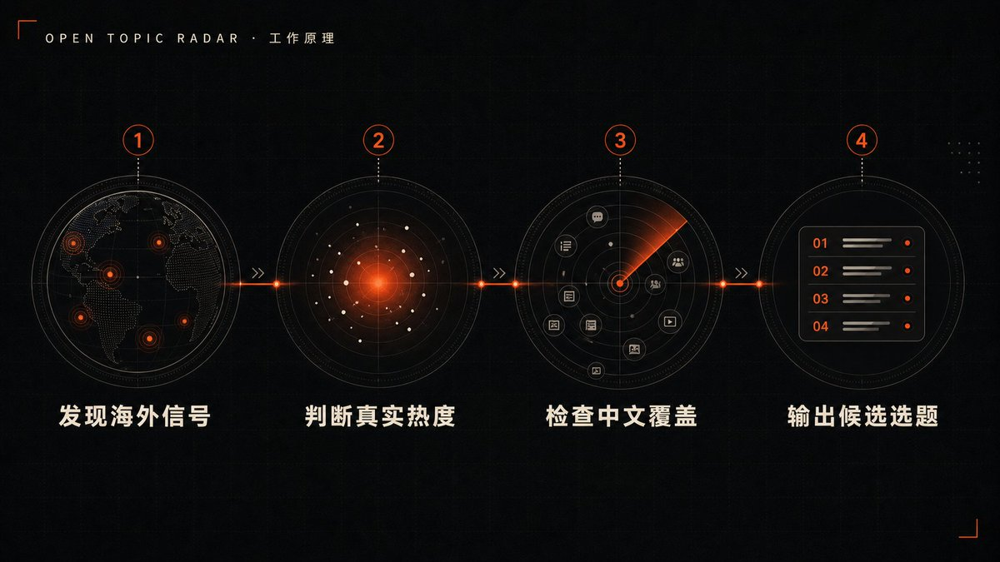
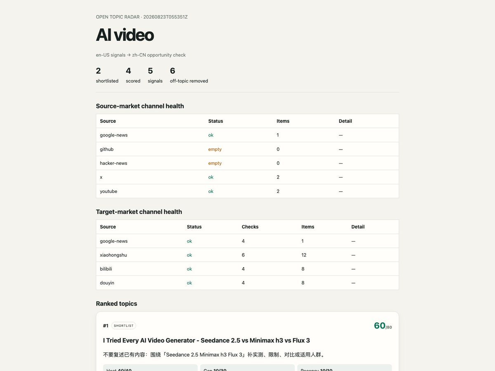
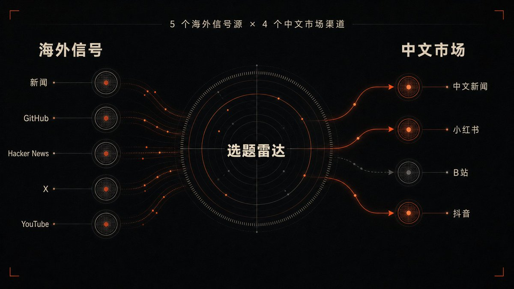
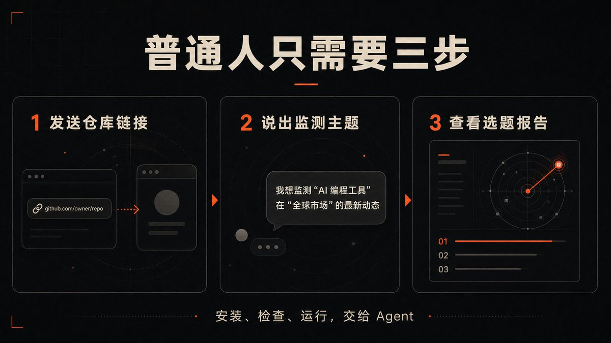
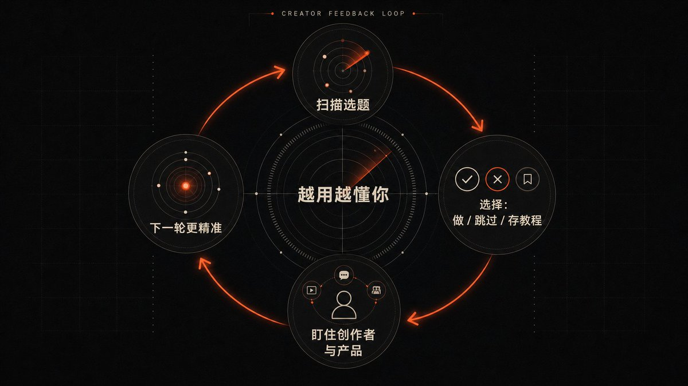

# 大雷：开源自媒体选题雷达——先人一步获取最新资讯与信息差

> 做自媒体最头疼的不是写稿，而是不知道每天做什么选题。大雷开源自媒体选题雷达 open-topic-radar：先在海外信息源（X/Product Hunt/GitHub/Reddit）中捕获升温事件，再回中文市场（小红书/B 站/抖音）检验覆盖程度，寻找「国外已现真实热度、中文市场尚未做烂」的生态位机会。

<!-- more -->

我之前想认真做自媒体的时候，最头疼的不是写稿，也不是剪视频，而是每天到底该做什么选题。

每天刷 X、YouTube、新闻、小红书、B 站，看起来到处都是信息，但真正准备做内容时，还是不知道哪一条值得追。

有些选题，等你在中文平台刷到时，已经被几十个人做过了。

有些东西在国外刚有一点苗头，中文市场还没人讲，但因为不知道它到底是真热还是噪声，也不敢花时间去做。

后来我就给自己做了一个“选题雷达”。

它会先去海外的信息源里找最近开始升温的具体事件，再回到中文市场检查：小红书、B 站、抖音上有没有人做过，已经做到了什么程度。

如果海外已经开始热，中文市场还比较空，它才会进入我的候选选题。

这套东西以前只是我自己用。这次我重新把它整理了一遍，补全信息源、评分、失败检测和反馈机制，做成了一个任何主题都能使用的开源项目：

[https://github.com/aaronyi97/open-topic-radar](https://github.com/aaronyi97/open-topic-radar)

下面是完整版。

## 一、为什么普通的热榜解决不了选题问题

大多数所谓的选题工具，解决的其实只是一个问题：

“现在什么东西很火？”

但对做内容的人来说，只知道什么火了，远远不够。

真正需要判断的是：

- 这件事是真的开始变热了，还是只有一两个人在讨论？
- 它是什么时候出现的，现在追还来不来得及？
- 中文市场是不是已经被做烂了？
- 这是一个值得做的内容空白，还是根本没人关心？
- 如果决定做，原始资料到底在哪里？

一个话题很火，不代表它适合你做。

反过来，一个中文平台暂时没人讲的话题，也不一定是机会，可能只是没有需求。

所以我做这个雷达时，目标从来不是再造一个热榜。

我想找的是：

> 国外已经出现真实热度，但中文市场还没有被大量覆盖的内容机会。

## 二、这个雷达到底是怎么工作的

它的工作流程可以简单理解成四步。

第一步，在不同信息源里寻找最近出现的新东西

它不是只搜一个关键词，而是同时搜索核心方向、相邻方向，以及需要长期盯着的产品和项目。

第二步，判断这个东西是不是真的在升温

不同平台不能用同一种标准。

X 看点赞和传播速度，YouTube 看每天新增的播放量，GitHub 看 Star 增长和最近是否有真实更新，Hacker News 看讨论热度，新闻则看是不是有多家媒体同时关注同一件事。

第三步，回到中文市场检查覆盖情况

同一个候选选题，会继续去小红书、B 站、抖音和中文新闻中搜索。

如果中文平台已经有大量高热度内容，它的优先级就会下降。

如果海外有真实信号，中文平台暂时只有少量内容，甚至完全没人做，它才更有可能成为值得抢先做的选题。

第四步，生成一份可以直接看的选题报告

报告里不只是给你一个标题，还会告诉你：

- 为什么它现在值得关注
- 海外热度来自哪里
- 中文市场已经有多少内容
- 这个选题为什么被推荐
- 原始新闻、视频和帖子在哪里
- 哪些信息源正常，哪些信息源本次检查失败

最后这一点很重要。

很多程序最危险的问题，不是搜不到东西，而是搜索渠道已经坏了，却把“搜索失败”当成“市场上没有内容”。

这个雷达会把正常、空结果、部分失败和完全失败分开显示。

> 渠道坏了就是坏了，不会拿一个假的“中文市场空白”骗你。

## 三、这次我把信息源补全了

之前自己用的时候，主要围绕 AI 视频做，所以这次开源，我保留了原来的完整信息源，同时把主题做成了可以自由替换的。

海外信号层包括：

- Google News
- GitHub
- Hacker News
- X
- YouTube

中文市场检查包括：

- Google News 中文结果
- 小红书
- B 站
- 抖音

以 AI 视频为例，默认配置里不只是搜“AI video”一个词。

它还会同时监测：

- 12 个核心方向
- 9 个相邻方向
- 12 个重点产品和模型

包括文生视频、图生视频、AI 视频工作流、自动剪辑、AI 配音、AI 动画，以及 Seedance、Veo、Kling、Runway、Sora 等具体产品。

真正有价值的新选题，经常不会直接出现在大词下面。

它可能先出现在某个新模型、某个刚更新的开源项目、某个创作者突然爆掉的视频，或者一个相邻领域的新用法里。

> 只盯一个关键词，看到的永远是别人已经总结过的信息。

## 四、它不是只能监测 AI 视频

我最开始做它，确实是为了给自己的 AI 视频找选题。

但这次开源后，主题已经可以自由替换。

例如你可以让它监测：

- AI 编程工具
- 跨境电商
- 独立开发
- 海外 SaaS
- 本地历史
- 教育科技
- 个人效率工具
- 某个具体行业的新产品

你只需要告诉它：“我想监测什么主题，从哪个市场找信息，最后准备在哪个市场做内容。”

然后它会围绕这个主题重新配置搜索方向、重点产品、目标市场叫法和判断标准。

> 我开源的不是一张固定的 AI 视频选题表，而是一套可以不断换主题的选题方法。

## 五、普通人怎么使用

这部分我尽量做得和之前开源的海外网络方案一样。

你不需要先学 Python，也不用自己研究配置文件。

直接把下面这个 GitHub 地址发给你电脑上的 Codex、Claude Code、Kimi 或 Grok：

[https://github.com/aaronyi97/open-topic-radar](https://github.com/aaronyi97/open-topic-radar)

然后对它说：

> 安装这个项目，按照仓库里的 AGENT_INSTALL.md 完成检查和第一次运行。我要监测的主题是“AI 视频”，从英文市场寻找最近开始变热的新事件，再去中文市场检查小红书、B 站和抖音是不是已经有人大量做过。完成后直接把选题报告打开给我看。

剩下的事情让 Agent 去处理。

它会帮你：

- 安装程序
- 检查每一个信息渠道是否可用
- 根据你的主题生成监测范围
- 运行第一次扫描
- 检查结果有没有明显异常
- 打开最终的选题报告

如果小红书、X 或抖音需要登录，它会停下来让你本人完成，不会复制你的 Cookie、Token 或浏览器资料。

你真正需要做的，只有两件事：

第一，告诉它你准备做什么内容。

第二，看到报告以后，判断哪个选题最符合你的能力和账号。

## 六、它还能根据你的选择继续学习

第一次扫描只是开始。

看到报告后，你可以告诉 Agent：

- 这个选题我要做
- 这个不感兴趣
- 这个先存进教程选题池

如果你选择“做”，雷达会记住这个选题背后的创作者或频道，以后单独关注它的新动态。

如果你选择“存教程”，它会进入专门的教程候选池，方便以后集中整理。

这样用得越久，它关注的方向会越来越接近你真正想做的内容，而不是每次都从一张完全陌生的热榜重新开始。

## 七、它能做到什么，不能做到什么

丑话还是说在前面。

它能做到的：

- 帮你同时盯住多个海外和中文信息源
- 从大量信息里筛掉明显无关的内容
- 找出“海外开始热、中文覆盖较少”的候选选题
- 保存原始链接和判断依据
- 区分真的零结果和渠道故障
- 根据你的反馈继续盯具体创作者和产品
- 把每天到处刷信息的工作，变成一份可以集中查看的报告

它不能做到的：

- 保证一个选题发出去一定会爆
- 代替你判断这个选题是否适合自己的账号
- 保证平台搜索结果覆盖了整个互联网
- 自动替你抄内容、洗稿或者发布
- 把一个好选题自动变成一条好视频

选题雷达解决的是“更早发现”和“减少盲目判断”。

但最后能不能做出好内容，还是取决于你的理解、表达、审美和执行。

> 它不是流量作弊器，更像是一套帮你少走弯路的情报系统。

## 八、为什么选择开源

这类工具如果做成一个固定网站，最后很容易变成另一张所有人看到都一样的热榜。

但每个人做的领域不同，关注的市场不同，能使用的信息渠道也不同。

有人做 AI 视频，有人做跨境电商，有人做独立开发，还有人只想盯住几个具体产品。

所以我更愿意把底层程序、配置方式、评分逻辑和安装流程全部开源。

你可以直接使用，也可以让 Agent 根据你的需求继续修改。

目前这个版本已经完成：

- 9 个真实信息渠道检查
- 95 项自动测试
- 一次完整的真实选题扫描
- 安装包重新构建和安装验证
- HTML、Markdown 和完整数据三种报告
- 选题反馈、创作者追踪和教程池

它不是一个只能展示的概念 Demo，而是一套已经能够实际运行的程序。

项目地址：

[https://github.com/aaronyi97/open-topic-radar](https://github.com/aaronyi97/open-topic-radar)

## 最后

做自媒体以后，我越来越觉得，选题并不是每天坐在那里“想”出来的。

它更像是长期观察信息变化以后，做出来的判断。

当所有人都开始讨论一个东西时，你再跟上，通常已经不早了。

真正值得做的，是在它刚刚出现真实信号、但大多数人还没注意到的时候，把它讲清楚。

这就是我做这个选题雷达的原因。

如果你也在做自媒体，可以先把仓库收藏下来。下次不知道做什么内容时，把链接发给你的 Agent，让它替你跑一遍。也可以顺手给 GitHub 点一个 Star。

后面我还会继续开源自己实际在用的 AI 工具和工作流，也会把它们到底有没有用、能不能跑通，如实记录下来。

## 相关页面

- [[sources/aaronyi-image-story-video-wizard]]
- [[sources/aaronyi-wedding-video-custom-wizard]]
- [[concepts/ai-content-pipeline]]
