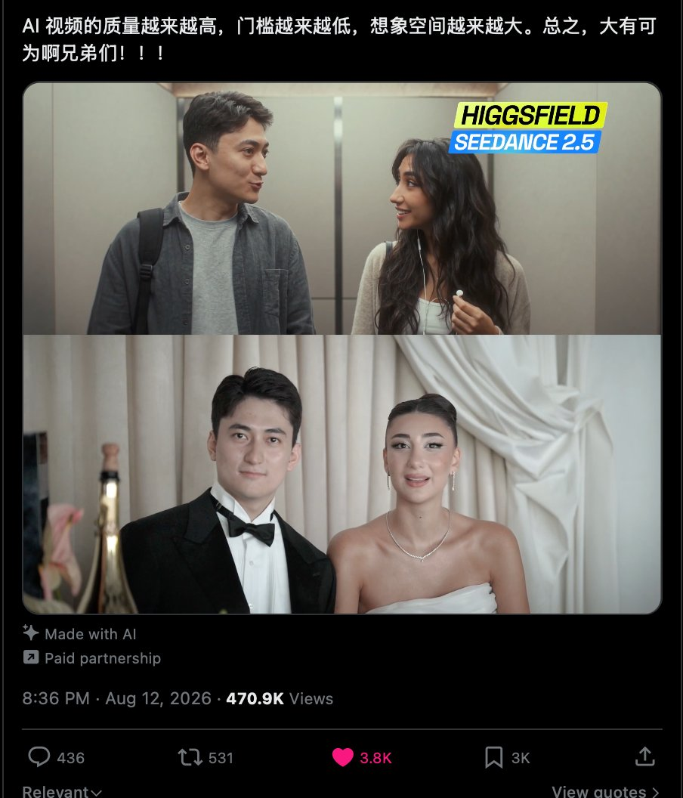
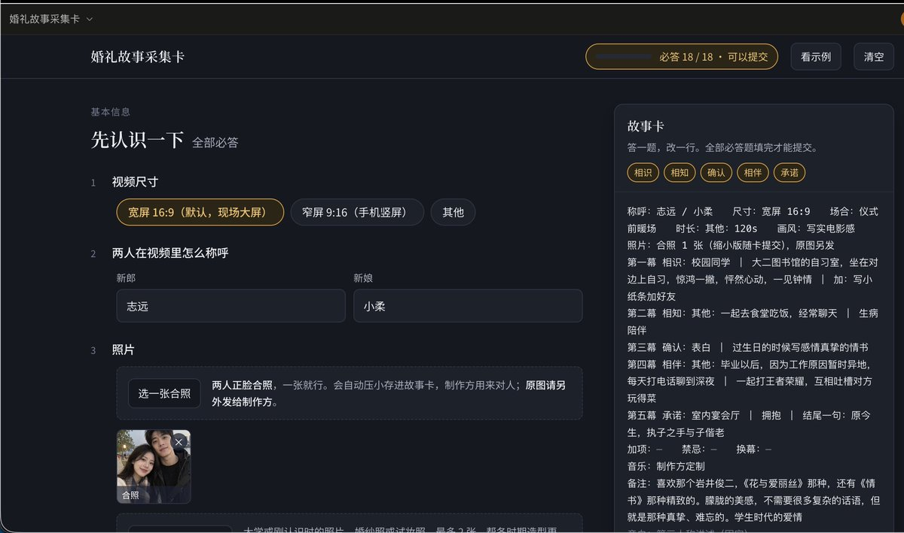
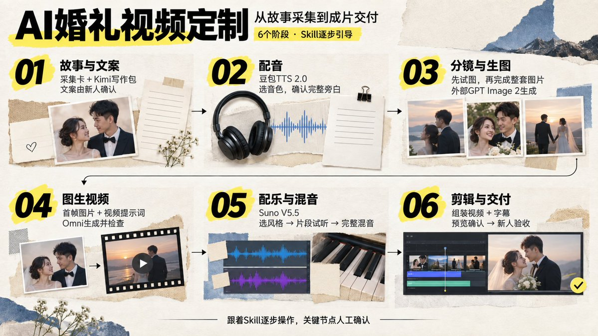
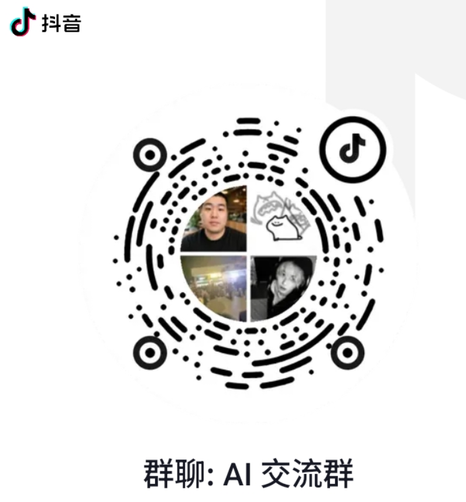

# 大雷：AI 婚礼视频定制教程——引导式 Skill 14 步跑通全流程

> 婚礼故事视频定制 14 步完整 SOP。用故事采集卡解决最重的时间交互成本；模型搭子：Codex/Claude Code 编排，Kimi K3 写文案写作包，豆包 TTS 2.0 试听选音色，GPT Image 2 跑重点分镜，Omni 图生视频，Suno V5.5 试听配 BGM，全流程人工介入控在 1 小时内。

<!-- more -->

前段时间有一个 AI 婚礼视频火爆全网，我觉得是一个很好的 AI 创业项目，正好我家里有亲戚做婚庆，我就主动联系他做这个项目，目前半个月已经做了 5 单了，反馈都很好

https://x.com/gkxspace/status/2087745161564492144?s=20（前段时间大火的视频）

国内外之前做这块的还是做的动画，比如国外这个 Custom Love Story（https://customlovestory.com），客单价 49 美元以上，成交四万多单，营收超 200 万美元

我这个 Skill 做的是真人化的，效果更好，我自己已经能把这套流程稳定跑通，并且制作成了引导式的 skill 方便大家使用。

中间最麻烦的交互过程，我也做成了故事采集卡。新人按要求填完，一键复制发回来就行。

成片质量是这样的：（https://customlovestory.com）

Skill 是引导式的。新人填完采集卡，我们把相关信息和照片交到 Skill 对话里，它就会引导我们继续做文案、配音和分镜。

需要外部生成的，它会把提示词和材料准备好。我们把图片、视频这些素材生成好，再交回来，让它继续组装。需要审稿、试听、看效果的地方，它会停下来让我们确认。

写在前面

1. 按以下模型组合使用：整个流程交互，建议用 Codex 的 GPT 6、Claude Code 的 Opus 5，或者 WorkBuddy 里 Kimi K3 的最强模式（三选一） 生图用 GPT Image 2，视频用 OmniFlash 1.1，BGM 用 Suno V5.5，配音用豆包 TTS 2.0
2. 制作成本很低，收费看自己怎么谈。成本最高的是 omni，小黄鱼有中转 API，5 毛 10s，120 秒加上抽卡的话成本也不过超过 15 元。如果已经有 Gemini Pro，走 Google Flow 几乎不花钱。
3. 时间交互成本最高，所以我做了采集卡方便一次性收集足够的信息进行制作，也把每一步的交互整理进 Skill 里。这样质量比较稳定，交互效率高，也方便持续接单、批量制作。
4. 这套思路可以用在很多本地服务里。我觉得 AI 视频是一个很好的抓手，能做一些客单价高、又有情绪价值的定制。除了婚礼，老人、宝宝，还有其他值得纪念的重要时刻，都可以沿着这个思路去做。omni 是核心出装。

整个流程一共 14 步。每次对话，它都会告诉你现在是第几步、还剩几步，以及你现在需要做什么。需要你判断的地方，它会停下来等你确认，确认好以后再继续。

我自己目前跑通一期，整体人工介入时间可以控制在一个小时以内。

下面把用到的模型和具体流程分享给大家。有问题可以在我的抖音群交流：【大雷的 AI 日记】，我后续也会发布完整的视频教程带大家跑一遍。

Skill 安装指令

把下面这段话复制给 Codex：

> 安装 Skill。Skill 位于仓库根目录，安装名使用 wedding-video-guided-wizard。安装完成后告诉我下一轮如何启动，并严格按照 Skill 的 14 步流程，主动引导我推进婚礼视频制作。请从[aaronyi97/wedding-video-guided-wizard](https://github.com/aaronyi97/wedding-video-guided-wizard)

安装完成以后，在下一轮告诉它：

> 使用 wedding-video-guided-wizard 开始一单婚礼视频。先给我能发给新人的故事采集卡，再逐步带我完成。
> 

具体交互可以在 skill 执行，以下详细步骤作为辅助理解

一、先把故事采集卡发给新人

安装 Skill 以后，它第一步会把故事采集卡给你，你拿着这张卡发给新人填写就行。建议用电脑，手机也可以。

[打开婚礼故事采集卡](https://aaronyi97.github.io/wedding-video-guided-wizard/)

填完以后，让他们点击「复制完整故事卡」，把内容通过微信发回来，人物照片另外发。你再把这些信息和照片，一起交回刚才使用 Skill 的那个对话。

如果新人不方便填，也可以通过聊天或者语音沟通，把采集卡上的信息收集完整，再交给 Skill 整理。

最麻烦的交互过程，我主要就是放在这一步解决。已经填清楚的内容，后面就不需要再重复问。有个别没说清楚、影响写文案的地方，再补充一下。

二、生成文案写作包，交给 Kimi K3

信息齐了以后，Skill 会根据这对新人的故事，生成一个文案写作包。

它会提供压缩包，里面也有可以直接复制给 Kimi K3 的完整文本。新人提供的经历、想要的风格、视频时长，还有文案怎么写，都已经整理在里面。

我还是强烈建议大家用 Kimi K3 写文案。把写作包交给它，或者打开里面的一键复制文件，把完整内容复制过去，写完再把全文发回当前 Skill 对话。

我自己这次想要的文案，是有感情、有文采，但不要太花哨，也不要太干瘪。就是白描，但是读起来有感情，能把两个人的故事讲出来。

这些写作方法我已经整理进 Skill 了。不过，每一单具体写什么，还是根据新人填写的采集卡来，不能把上一对新人的经历直接套过来。

文案回来以后，你先自己通读一遍，再和 Skill 一起修改有问题的地方。

三、把文案发给新人确认

你自己审过，觉得没有明显问题以后，再把完整文案发给新人。

这一步主要让他们确认：经历有没有写错，称呼有没有问题，有没有不想放进视频里的内容，最后的表达是不是他们想要的。

有修改意见，就带回当前对话继续改。新人确认没有问题以后，你再告诉 Skill，这版文案已经确认了，然后进入后面的制作。

这一步我专门放在前面。故事先确认清楚，后面配音、生图和视频都围着这版文案来做。

四、先生成几个配音试听，选好音色

接下来做配音，我推荐豆包 TTS 2.0。

如果之前已经配置好了 API，直接继续用。没有配置过的，Skill 会在这一步带着你申请和配置，不需要一开始就把所有东西都准备好。

[豆包语音控制台](https://console.volcengine.com/speech/app)

先从已经确认的文案里选一小段，生成三到五个不同音色的试听。几个音色用同一段内容，这样比较方便听出区别。

这一轮先选一个适合这个故事的声音，再一起确认情绪和语速。听着哪里不舒服，就直接告诉它，再调整。

五、生成完整配音，自己从头听一遍

音色选好以后，再用刚才确定的设置，生成完整旁白。

生成完自己从头听一遍。有没有读错的字，有没有漏句、重复，情绪和停顿合不合适，都在这一遍里确认。

有问题就改对应的地方，再听一下。完整配音确认没有问题以后，才进入分镜。

因为后面每个画面放多长，什么时候切换，都要根据实际配音来安排。先把声音做出来，再去拆画面。

六、根据文案和实际配音设计分镜

有了最终文案和完整配音，Skill 就会开始设计分镜。

每个镜头对应哪段旁白，出现什么人物，是什么时期，穿什么衣服，画面里要发生什么，都会在分镜表里整理出来。

画风也要结合采集卡里的要求来定。我这次做的是真人化的效果，人物参考就用新人的照片。

我自己的思路是，画面要好看，但动作不用很难。每个镜头把它要表达的事情讲清楚，人物和整体质感保持一致，就可以了。

如果一个场景比较复杂，就拆成几个容易完成的镜头。故事还是那个故事，制作上尽量做简单一些。

分镜表出来以后，你先看一遍，确认画面内容和整体风格，再继续生图。

七、先做三个重点分镜的图片

这一步先不把所有图片都做完。

Skill 会根据这一单的情况，挑出大概三个比较容易出问题、又能看出整体效果的分镜，先给你生图提示词和参考图说明。

这几个镜头不是固定的，要看这对新人的故事，以及这次的画面难点在哪里。

拿着对应的人物参考图和提示词，去外部 GPT 对话，用 GPT Image 2 生成图片。这里要用照片加提示词的方式做图生图，尤其是两个人一起出现的时候，要把人物参考对应清楚。

这套 Skill 的生图步骤，都是你在外部 GPT 对话里操作。Skill 负责把提示词和参考要求准备好，生成以后，你再把原图发回来。

先看人物像不像，画风对不对，画面有没有明显问题。这几张确认好以后，再继续做剩下的。

八、把剩余分镜图片生成完

前三张确认以后，Skill 会沿着已经确定的人物和画风，继续提供其余分镜的生图提示词。

你还是拿着对应参考图和提示词，去 GPT 对话里生成，做完按镜号把原图发回来。

图片全部回来以后，Skill 会再检查一遍整套画面。你自己也看一下，同一个人物前后有没有变化，服装、场景和画风能不能接上。

有个别图片不合适，就只改那几张。改好以后，确认这一镜最后选哪一张图，再进入视频生成。

九、拿着逐镜文件包，去生成视频

图片确认以后，Skill 会根据实际选中的图片，写对应的图生视频提示词。

这一步我专门做成了文件包。每个分镜一个文件夹，里面放好这张分镜图，还有对应的视频提示词。

你打开一个镜头的文件夹，把图片上传到视频模型的首帧位置，再把提示词复制过去，按说明设置时长和画幅，点生成就可以了。

视频我推荐 Omni。如果你已经配置了可用的视频 API，也可以在当前对话里继续执行；没有 API，就拿这个文件包去外部生成，做完再把视频发回来。

这里的视频提示词，是根据已经生成好的图片来写的。图片里人物现在是什么状态，后面的动作就从这个状态继续往下走。

生成完以后，逐条看一下。人物有没有变化，动作有没有做出来，和这一镜要表达的内容是否对应。

个别镜头有问题，就调整这一镜的提示词，或者回头修改对应图片，再重新生成。确认没有问题以后，把选中的视频按镜号发回当前对话。

十、先试听 BGM，选一个合适的风格

画面素材确认以后，再做 BGM。我这次推荐的是 Suno V5.5。

可以用已经配置好的音乐 API，也可以让 Skill 提供提示词，你去外部生成，再把音频发回来。

先生成大概三个不同风格的试听，听一下哪一种更适合这对新人的故事。

我觉得这里不能只考虑音乐单独听着好不好听，还要结合旁白里的情节。故事往下走，音乐也要有相应的起伏。

这一轮先把音乐风格选出来。

十一、先听配音和 BGM 放在一起的片段

音乐风格选好以后，再让 Skill 把音乐和已经确认的配音放在一起，做几个片段试听。

这一步主要听它们合在一起是什么效果。旁白说话的时候，音乐会不会太大，情绪起来的时候能不能跟上，停顿和转折听着是否舒服。

哪里不合适，就在这一轮调整。片段听着没有问题，你确认以后，再继续做完整混音。

我把这个试听单独留了一步，就是希望先把配音和音乐的结合效果听清楚。

十二、生成完整的配音加 BGM

片段确认以后，再按刚才选好的音乐和混音效果，完成整条声音。

这里继续使用前面已经确认的旁白，把完整 BGM 配进去。有人说话的时候音乐适当压低，旁白留白的时候，音乐可以出来一点。

做完以后，再从头到尾听一遍。

主要听整条情绪是否连贯，音乐的衔接和结尾是否自然，以及旁白能不能听清楚。完整声音确认好以后，就可以进入最后的组装。

旁白和音乐也会分别保留，后面需要修改的时候还能继续用。

十三、组装视频，加上字幕，看完整预览

视频片段、旁白和 BGM 都准备好以后，让 Skill 在当前对话里继续完成组装。

它会根据已经确认的分镜和实际配音，把视频排好，处理声音和画面的对应，再加上中文字幕，做出一条完整预览。

如果当前电脑缺少剪辑需要的工具，它会在这一步告诉你怎么补齐，然后接着做。

预览出来以后，自己完整看一遍。

人物前后有没有变化，旁白讲的内容和画面是否对应，字幕有没有错，音乐和镜头切换是否舒服，都放在整条视频里看。

发现问题，就把具体镜头或者时间点告诉 Skill，让它修改对应的部分。修改完再看，确认没有问题以后，再导出正式成片。

十四、导出成片，交给新人确认

最后一步，导出正式视频，同时整理字幕文件和后续修改要用的工程材料。

你先检查最终导出的这一版，再把成片发给新人。新人看完有意见，就带回来修改；确认没有问题以后，这一单才算完成。

整套流程就是这样。新人主要参与前面的资料填写、文案确认，还有最后的成片确认。中间的审稿、试听、看图和看视频，由我们制作方来做。

大家实际使用的时候，跟着 Skill 当前给你的步骤往下走就行。它会告诉你现在做到哪里、需要发回什么，确认好以后再带你继续。

几个常见问题

1. 为什么用旁白讲故事，不做人物直接说中文对白？

因为我这套方案用 Omni，主要看中它的成本和画面质量。但就我实际用下来的感受，它的中文对白生成还不够稳定。

如果再要求人物开口说话，整个制作的复杂度会增加很多。

旁白可以单独用豆包做好，画面负责表现故事。这种方式已经能达到我想要的效果，也更容易控制成本和成功率，没有必要一开始就把难度加上去。

2. 15 元成本是怎么算的？

我这里说的是生成费用，按我使用的 API 中转价格来算。

配音大约 1 元，BGM 大约 1 元。图片在 GPT 网页对话里生成，没有另外走生图 API。分镜不多，我觉得不值当专门用 API 生图。

主要花费是视频。我找到的中转价格大约是 10 秒五毛钱，闲鱼上也有这类服务。

两分钟视频，按总生成量是成片时长的 1.5 倍来算，视频部分大约 9 元。加上配音和 BGM，大概 11 元，整体按 15 元左右预留。

如果已经有 Gemini Pro 订阅，也可以走 Google Flow 的积分。按 Omni 720p、每段 10 秒计算，同样预留 1.5 倍生成量，两分钟视频大约需要 270 积分。订阅额度够用，就不用再单独支付这部分视频生成费用，整条视频几乎没有额外花费。

3. 如果一直抽卡怎么办？

我自己的判断是，频繁抽卡，很多时候要回头看三个地方：分镜图、图生视频提示词，还有用的视频模型。

图片里的姿态不适合后面的动作，提示词又要求一次完成太多事情，生成就容易出问题。

所以我把这些制作方法都整理进 Skill 里：先确认分镜，先试图，再根据实际图片写视频提示词。某一镜有问题，就回到对应的地方调整。

也正因为这样，我强烈建议大家先用我推荐的模型组合跑通。文案交给 Kimi K3，整个流程交互用前面推荐的模型。想复现我这次的效果，就先按这套来。

大家使用时遇到问题，可以给我反馈。

## 相关页面

- [[sources/aaronyi-image-story-video-wizard]]
- [[patterns/story-studio-video-pipeline]]
- [[concepts/ai-content-pipeline]]
- [[sources/jedeeai-ai-video-top10-bookmarks]]
