# Adrian Punk（@AdrianPunk115）：AI 视频基础（中册）——景别、机位、运镜与画面连续性

> 系统讲解电影级视听语言在 AI 视频生成中的工程化落地（中册）：深度解析远景/全景/特写等景别提示词控制、固定/推拉/摇移/跟拍等机位运镜参数指令，以及在多镜头切换中保持主体光影、空间坐标与动作连贯性的关键技巧，解决 AI 生成视频“画面好看但镜头稀碎”的通病。

<!-- more -->

今天我们通过《绿皮书》，来学 AI 视频基础的中册：景别、机位、构图、光线、运镜，以及画面连续性。通过车内吃炸鸡这段，弄清楚一个镜头拍多大、从哪里看、怎么动，前后怎样接起来。

先看这段约 67 秒的原片：从吃炸鸡、递食物，到往窗外扔骨头，再到扔纸杯后停车捡回。留意每个动作后，另一个人怎样反应。

[video](https://video.twimg.com/amplify_video/2111733738145243137/vid/avc1/1280x640/UNuQh1soY7clbgeE.mp4?tag=29)

现在把这段交给 AI，只写“两个男人在车里吃炸鸡，电影感”。它可能给你一段漂亮的汽车广告，但不会如影片中展现出的那样，有人在劝、有人在犹豫、食物怎样从前排递到后排。这一镜看哪里，从哪里看，要不要动，下一镜怎样接，都得安排。

上册讲内容、素材和分镜，中册继续讲一个镜头怎样表达。我们用《绿皮书》里“托尼请雪利吃炸鸡”的段落贯穿这篇：主要用原片截图解释景别、构图、光线与动作关系。默认你完全没学过摄影，看完能辨认常见拍法，并写出一张简单的三镜练习表。

## 一、先看同一场戏里的两种观看范围

托尼是前排开车的人，唐·雪利是坐在后排的钢琴家。托尼向他推荐炸鸡，雪利起初有顾虑，后来也拿起来吃。这段互动既需要交代两人的座位关系，也需要表现雪利的反应。

拍得宽一些，可以交代谁坐哪里、两人正在做什么；靠近一个人，则更方便表现他的表情和手上的动作。同一场事，换一种取景范围和观看位置，观众得到的信息也会变化。

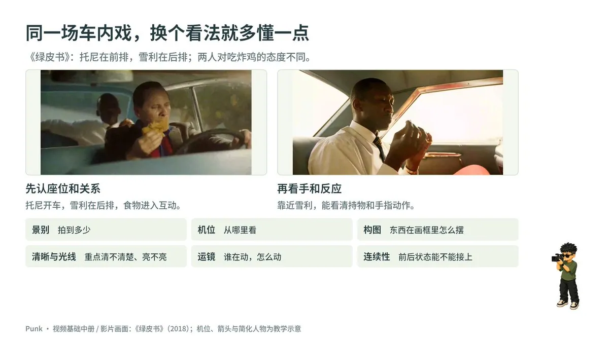

这一册拆开六个问题：拍到多大范围、摄影机在哪里、东西在画框里怎样摆、哪里清楚哪里亮、谁在动，以及前后状态能不能接上。理解这些问题，再把要求写进分镜，AI 才更容易拍出你需要的内容。

## 二、景别：画面里拍到主体的多少

景别，就是画面给主体留了多大的范围。 主体是这一镜主要让观众看的人或东西：拍整个人、拍上半身、只拍一只手，取景范围都不同。范围放宽，环境交代得多；范围收紧，细节更容易看清。

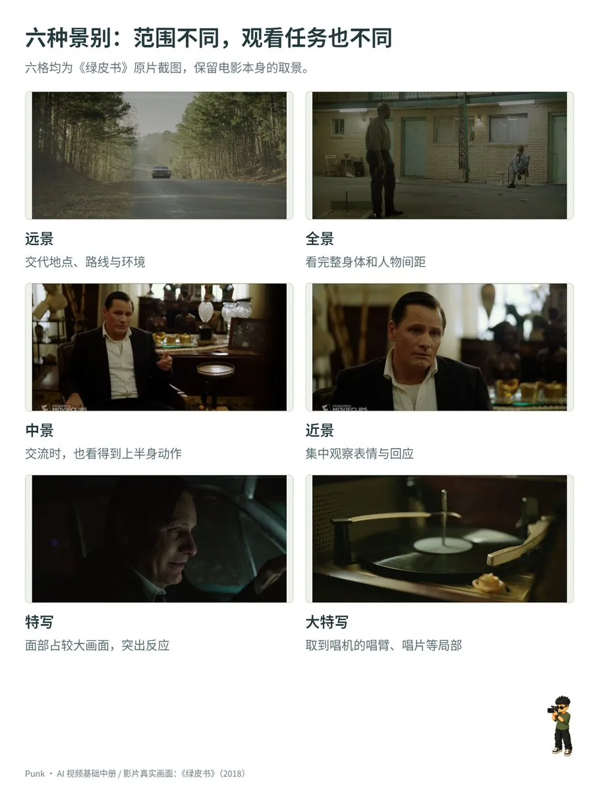

### 1. 远景：交代环境和规模

远景把较大范围的环境拍进来，人物通常比较小。取景范围再大一些，人物只是风景中的一个小点，也常叫大远景。

应用场景： 当观众需要知道“这是哪里、地方有多大、人物正往哪里去”时，可以先用远景。比如公路上的一辆车，既交代旅程，也让人感受到路途漫长；一个人站在空旷山谷里，则能突出人与环境的大小关系。大远景更适合展示城市、山川、大片人群的规模。这类画面里，人物的细微表情通常看不清。

### 2. 全景：看清完整的身体动作

全景通常把一个人的全身，以及一部分周围环境拍完整。头、身体、双脚都在画内，观众能看见完整的身体动作。

应用场景： 当重点是“他怎么走、怎么站、怎么完成一个动作”时，常用全景。走向汽车、转身离开、跳舞或展示穿搭，都需要看到较完整的身体；两个人站在一起，也能交代他们离得近不近。需要看清脚步时，就别把脚裁掉；需要看清表情时，则可能要另接一个更近的画面。

选择景别时，也要说明主体是谁。拍一个人的全景，通常要留全身；拍一辆车，则要把需要展示的车身范围交代清楚。别只写一个名称，却让 AI 猜你到底想看人还是看车。

### 3. 中景：兼顾表情与手势

中景常见范围是人物腰部以上。脸、上半身动作和一部分环境能同时保留。

应用场景： 人物说话时还会比画、拿东西、与别人互动，就可以考虑中景。口播、访谈、两人交流和简单操作讲解都常用它：既能看表情，也能看手势。拍坐姿人物时，仍要检查桌面或座椅有没有挡住关键动作。

### 4. 近景：看清人物的反应

近景常见范围是胸部或肩部以上。人物的脸更醒目，周围环境会减少。

应用场景： 当重点转到“这个人怎么想、听完有什么反应”时，可以用近景。比如听到一句意外的话后停顿、犹豫或笑起来，近一些更容易看清；讲解中需要认真强调一句话，也可以收紧范围。如果双手的动作同样重要，就要检查取景是否把它们裁掉。

### 5. 特写：突出面部、手或关键物件

特写让面部、手或某个物件占据较大画面，把注意力集中到一个对象上。

应用场景： 当一个细节会影响观众理解时，就值得专门拍清楚。例如人物突然变严肃的脸、手有没有接住递来的东西、手机上出现的关键信息。《绿皮书》里，托尼夜间坐在车内的面部特写，就把注意力集中到他的神情上，不必同时交代整辆车。拍教学视频时，按钮或接口太小，也适合靠近交代。

### 6. 大特写：看清更细小的局部变化

大特写比特写更紧，常收进眼睛、嘴角、指尖或物件上的局部。影片把唱机的唱臂与唱片局部单独拍出来，也是把观看重点收紧到一个细节。

应用场景： 只有非常细小的变化需要被看见时，再收得这么近：眼眶里含着泪、嘴角微动、指尖按下开关。它可以强调情绪或关键动作，也容易让观众暂时失去周围的空间信息。因此，前后通常要交代这个局部属于谁、与当前情节有什么关系，不必每次都拍得这么紧。

不同教材对景别会有更细的划分，新手先把实际范围写清楚。“全身入画，鞋子完整”“从腰部以上取景”“手、食物和脸都在画内”，通常比只写“高级近景”更方便执行。

选景别时先问：这一镜最需要观众看清环境、动作，还是反应？ 环境和规模需要较宽的范围，完整动作要留足身体，表情和细节则适合靠近。它们可以按故事需要组合，没有每段视频都必须从远景一路拍到特写的顺序。

## 三、机位和角度：观众站在哪里看

机位是摄影机放的位置，角度是它朝哪边看。你拿手机给朋友拍照，站到正面、侧面，或者蹲下来拍，看到的身体比例和背景都会变化。即使两张画面都拍半身，观看位置也可能差得很远。


### 1. 平视：接近眼睛的高度

平视接近被拍对象眼睛的高度，镜头朝向也较平。人物坐下时，要以他坐着时的眼睛高度判断，摄影机通常也要降低。

应用场景： 想让观众像面对面听人讲话，可以先从平视开始。口播、访谈和日常对话常用它，比较方便看清表情，也容易形成平等交流的感觉。零基础拍第一条讲解视频，先把摄影机放到接近眼睛的高度，就是一个容易执行的起点。

### 2. 俯拍：从较高位置向下看

俯拍是摄影机处在较高的位置，向下看被拍对象。《绿皮书》里从楼上望向旅馆院子的画面，就同时交代了上下空间与人物的位置关系。

应用场景： 想看清桌面、人物膝上的物件、双手正在做什么，可以用俯拍。比如展示拆装步骤、整理行李、两只手如何摆放零件，比只从正面拍脸更容易交代清楚。放在剧情里，从高处看一个人，也可能强调他在空间中显得小、孤单或处于弱势；这种感受还要靠环境、表演和情节配合。

### 3. 仰拍：从较低位置向上看

仰拍是摄影机处在较低的位置，向上看被拍对象。

应用场景： 想突出建筑的高度、人物站起来的气势，或者表现另一个人正在抬头仰望，可以考虑仰拍。比如从楼下向上看高楼，观众容易感受到它的高大；较低的位置看向人物，也可能加强力量感或压迫感。拍人物时，下巴、肩部和上方背景会更突出，要判断这种效果是否符合这场戏。

### 4. 顶拍：从接近正上方看布局

顶拍是接近正上方向下看，角度比普通俯拍更接近垂直向下。《绿皮书》圣诞餐桌那一镜从上方把菜肴与餐盘的排列拍出来，观众能直接看清桌面上的位置关系。

应用场景： 想让观众一眼看清“物件各在什么位置、双手怎样完成步骤”，顶拍很合适。手工、绘画、开箱、摆放零件等教程常用它。它也能展示人群或物件的排列关系。拍摄时要检查手臂会不会挡住操作位置，重要标记和文字在这个方向上能不能辨认。

角度先解决看清什么，再考虑带来什么感受。 俯拍不会自动等于弱小，仰拍也不会自动等于强大；同样一个角度，配上不同表情、光线和前后情节，感受可能完全不同。

### 5. 过肩镜头：把正在交流的两个人联系起来

过肩镜头从一个人的肩后拍向另一个人，前景保留一部分头部或肩部。观众既看得到对面的人，也知道正在从谁的身旁看过去。

应用场景： 两人对话、谈判、争执，或者一人给另一人讲解时，都可以考虑过肩。它能交代两人的相对位置，把说话者和倾听者放在同一个交流关系里。需要换人回应时，可以切到反方向的过肩；前景的肩膀要留得适量，别挡住对方关键的表情和动作。

《绿皮书》里，托尼到雪利住处面试的那场对话，就能看到这种拍法：摄影机从托尼肩后看向坐在对面的雪利，托尼的肩背留在近处。这样既能看清雪利说话，也能让人记得他正在和谁交流。

### 6. 主观镜头：让观众暂时借人物的眼睛看

主观镜头（也常写 POV）模拟人物看到的视野，让观众像站在人物的位置向外看。它不要求画面里一定出现手，也不要求把镜头固定在人头上。

应用场景： 当“他看到了什么”会影响下一步行动或情绪时，可以用主观镜头。比如人物发现一个异常、注意到重要物件、看清对方的反应，让观众跟着他一起发现信息。做操作演示时，也可以采用接近操作者所见的视角，让动作更容易代入。

《绿皮书》里，汽车停在路边，雪利望向田间劳作的人，随后出现他所注视的人群，再回到他举手示意后的反应。人物的视线与所见内容连在一起，我们便能理解：这是在跟随雪利这一眼，体会他与那些人隔着田地相望的感受。主观画面在这里承接了人物的注意，也为接下来的情绪提供了依据。

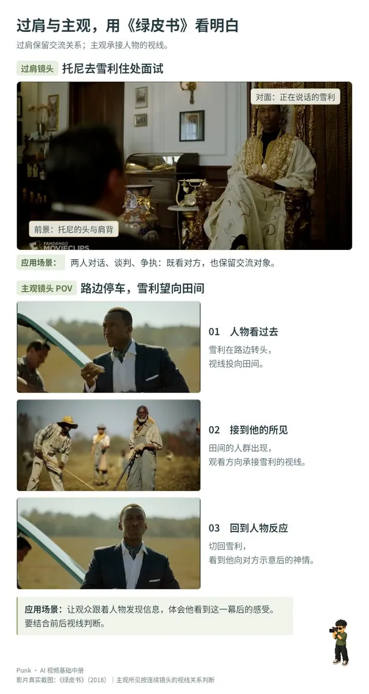

判断主观镜头，要把前后联系起来：人物看向哪里 → 接着看到什么 → 人物怎样回应。 并非每段都需要把这三步拍齐，但要能理解这一眼属于谁。单独出现一条路、一只手，或者画面里没有人物的脸，都不足以证明它是 POV；普通的环境镜头和物件特写也可能拍成这样。

过肩把观察者的一部分身体留在前景；主观镜头着重把观众带到人物的观看位置。两种拍法都能用于对话，选择哪一种，要看此刻更需要交代双方关系，还是让观众体验某个人的所见。

## 四、构图、对焦和景深：重点要找得到，也要看得清

机位选好了，还要安排人和物件在画框里的位置，这叫构图。主体太小、贴边、被挡住，或者背景比人物更抢眼，都可能让观众错过重点。

### 1. 构图与留白：给动作留出空间

画框要保留完成动作所需的部位。递接物品时，脸、双手和交接位置往往都需要辨认；如果手和物件出了画，观众就可能看不懂是谁递给谁。构图前先确定需要交代的信息，再安排画框边缘。

留白是有意给视线、动作或文字留出的空余区域。雪利向上伸手，画面上方要容得下递来的食物；如果加字幕，也要检查字幕有没有挡住手指和交接处。构图要照顾接下来会发生的动作。

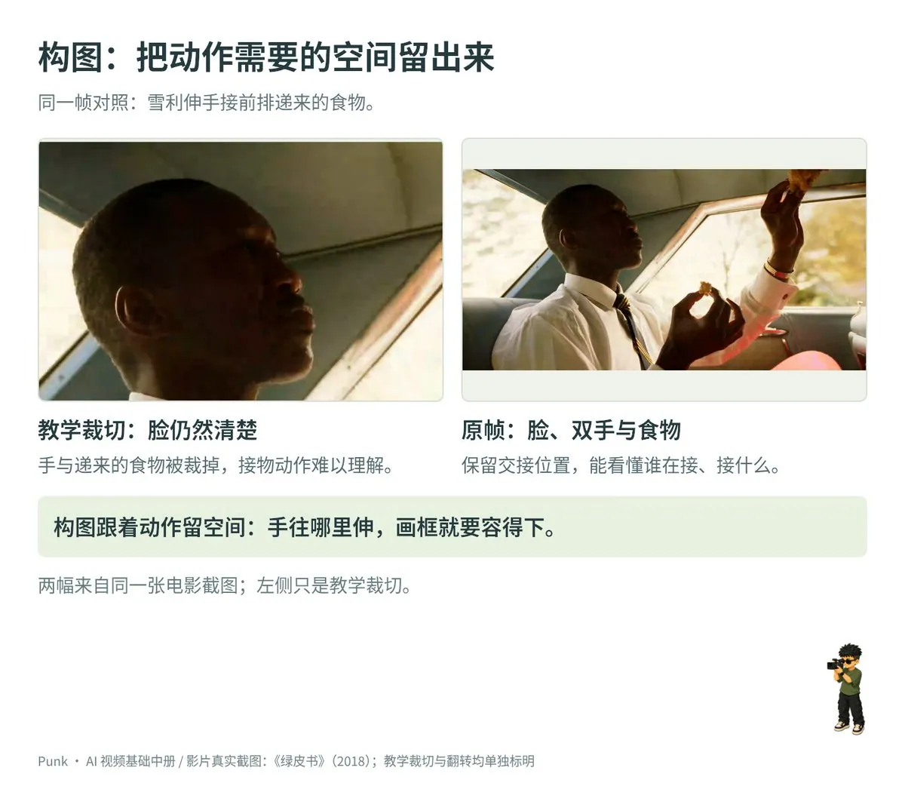

### 2. 三分法：用九宫格辅助安排位置

三分法是把画面横竖各分成三份，形成九宫格，帮助你尝试主体位置。人物在一侧、另一侧还要展示环境或保留朝向空间时，可以借它安排位置；想突出正面交流或整齐的建筑，居中、对称也都能用。人物有没有刚好压在分割线上，远没有“动作有没有出画”要紧。

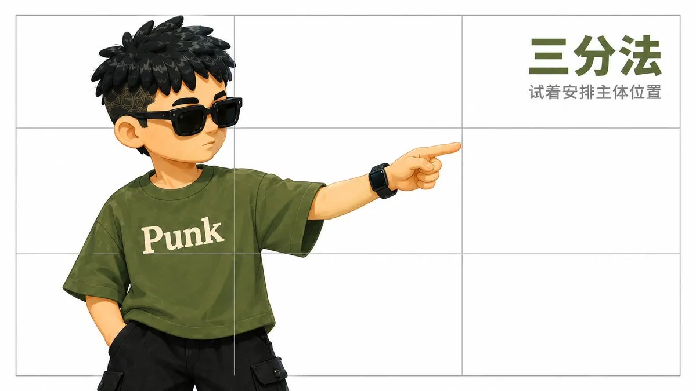

### 3. 对焦：你要让哪个位置清楚

对焦就是选择画面里要清楚的位置。焦点落在前排人物身上，观众更容易注意他的表情；若要表现后排的回应，就需要保证后排的脸也达到需要的清晰程度。关键是让这一镜必须交代的对象看得清。

### 4. 景深：前后多大范围能看清

景深说的是前后方向上，仍能被看作清楚的范围。只有某一段前后距离清楚、其他位置明显虚化，是浅景深的常见效果；前排、后排和更远处都能辨认，清楚的前后范围就更大。这里的“深”说的是前后距离。

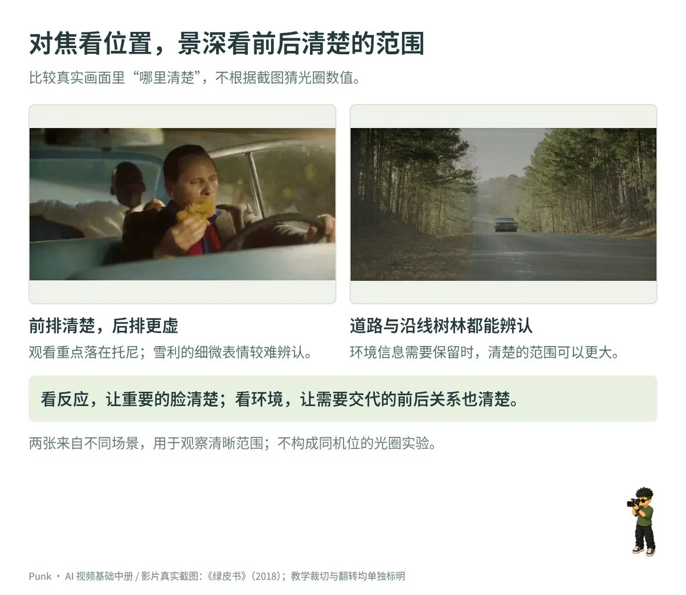

焦距、对焦、景深要分开。 焦距会在后面讲变焦时用到；对焦管清楚的位置；景深管可接受清晰的前后范围。实拍里的光圈、距离等也会影响景深，做 AI 视频先把想要的结果写明白。

《绿皮书》车内正面拍托尼时，前排的脸比较清楚，后排雪利更虚，注意力会先落在托尼身上。拍到林间公路，路面和沿线树林又需要保持可辨认，观众才能理解汽车所处的环境。

做 AI 视频时，可以把要求写成：“后排人物的脸和接食物的手都清楚，车窗外景物略虚。”要展示两人同时交流，就检查两张脸是否都达到需要的清晰程度。

应用场景： 人物表情是重点、背景又比较杂时，可以让背景虚一些，集中注意力。需要展示前后排两个人的互动、空间布局或一排产品时，则要保留较大的清楚范围。背景虚化有助于集中注意力，但不能把需要解释的东西也虚掉。

## 五、光线：先看从哪里来，再看阴影边缘

《绿皮书》这段车内戏里，人物受光和车窗位置有明显关系。分析光线时，可以先判断主要光源从哪里来，再比较受光面和阴影面的明暗。这样更容易把电影里的效果转成 AI 能执行的描述。

### 1. 柔光、硬光：观察阴影怎样过渡

柔光的阴影边缘通常比较缓，明暗过渡更柔和；硬光更容易留下清楚的明暗边界。判断时可以观察鼻子、下巴或物件投影的边缘。光源相对被拍对象的大小、距离等，都会影响光线的软硬。

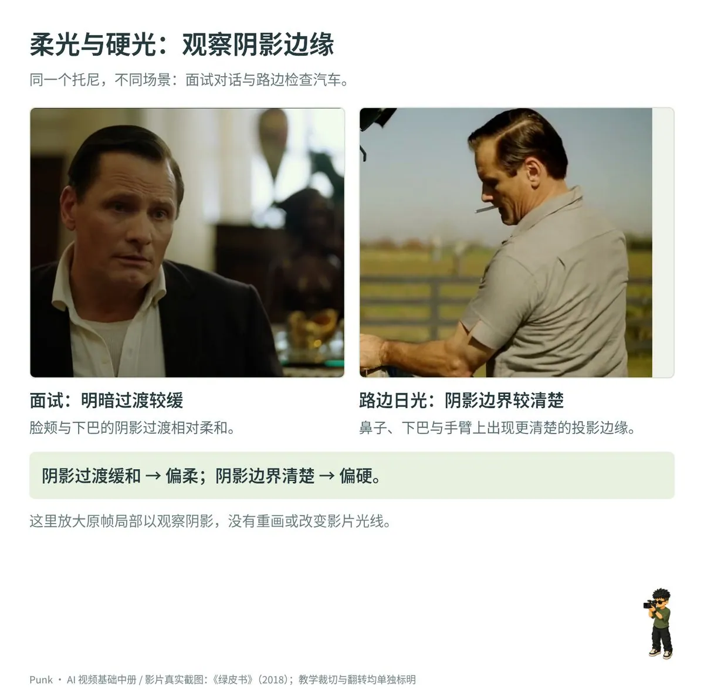

《绿皮书》求职面试那场戏里，托尼脸颊、下巴的明暗过渡相对缓和；路边检查汽车时，日光在鼻子、下巴和手臂上留下更清楚的投影边缘。把这些边缘看清，就更容易判断光线偏柔还是偏硬，不必先猜现场用了什么灯。

应用场景： 想让人物脸上的明暗过渡缓和，口播、访谈可以先尝试柔光；想突出物件纹理、清楚的投影或强烈的明暗对比，可以考虑硬光。柔光也会有阴影，硬光也能拍人，选择取决于想展示的细节与气氛。

柔光也可以偏冷，硬光也可以偏暖。颜色、亮度和阴影软硬是不同的观察，别用“偏黄”直接代替“柔光”。先指出自己看见的变化，描述才会准确。

### 2. 曝光与冷暖：让相邻画面协调

曝光先按画面的明暗来理解。看电影时，有些窗外高光会很亮，这是创作者的视觉选择；做教程或产品演示，要另外检查必须展示的细节有没有被黑暗或亮光盖掉。画面有没有完成任务，要结合内容判断。

同一段连续行动，人物受光可以随着车经过树影而变化。需要保持的是变化符合这个环境：窗在这一边，突然凭空从相反方向照来一束光，就值得检查。冷暖则看整体偏黄橙还是偏蓝等颜色倾向，先让相邻画面协调，再考虑统一风格。

## 六、运镜：画面在变化，究竟是谁在动

车外景物后退，可能是车在走；人物抬手，是人物在行动；镜头从托尼换到雪利，也可能只是剪辑切换。把这些变化分开，才能写清 AI 这一镜要做什么。

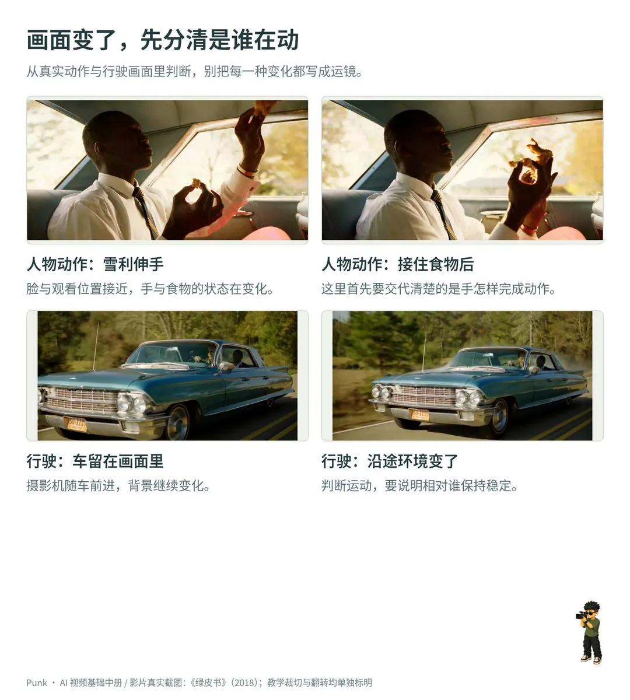

### 1. 固定镜头：先说明相对什么保持稳定

摄影机放在三脚架上，位置和朝向保持，人物照样可以行动，这就是固定镜头的基本理解。车里还要补一句参照：如果要求“摄影机相对车内保持稳定”，车窗外的景物仍然可以随着行驶而变化。背景动了，不能据此认定摄影机在摇摄。

应用场景： 观众需要专心听讲解、观察完整操作或看清两人的表演时，摄影机可以先保持稳定。画面有动作、有信息变化，就不必为了“电影感”一直移动。

第一条 AI 练习可以先写“相对车内固定，角色抬手接食物”。先把双手和食物做对，再增加必要的运动。只凭一张电影截图，也无法确认实际使用了哪一种摄影装置。

### 2. 摇摄和横移：一个转朝向，一个挪位置

摇摄是机位基本不动，把摄影机朝向从左转到右，或从右转到左。向上、向下转动朝向，通常称为俯仰运动。你站在原地转头看两个人，先用这个动作体会。

横移是摄影机本身向旁边移动。假如另拍蓝车停在路边的画面，摄影机沿车身平行移动，近处车窗和远处背景的相对位置会变化。描述时把摄影机往哪里移动、镜头朝哪里看分开写。

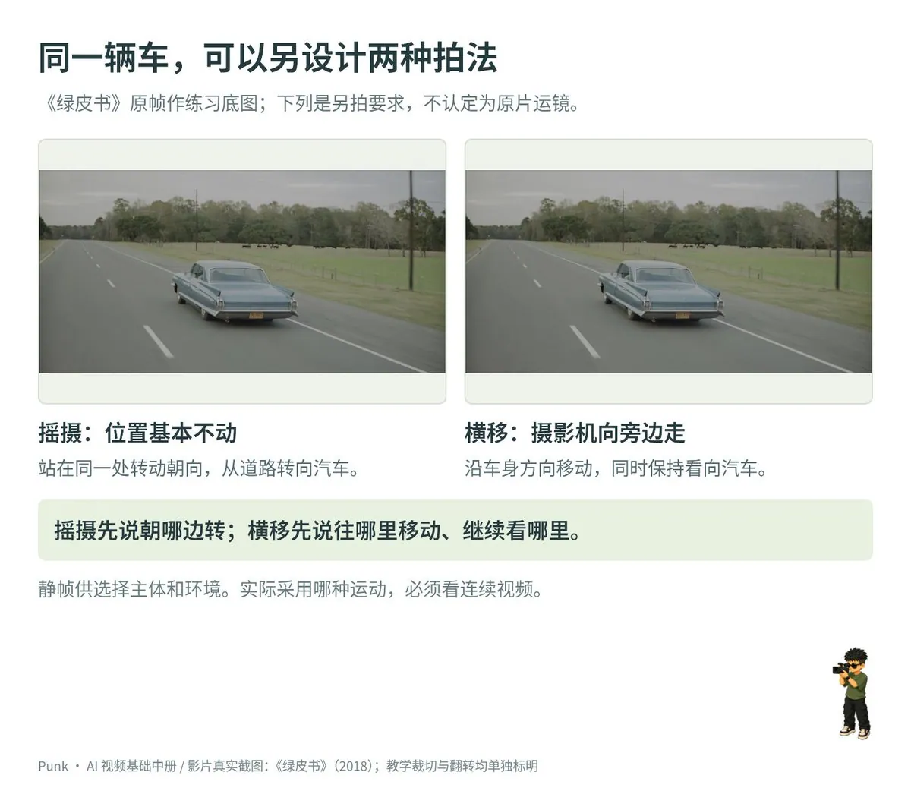

应用场景： 想从一个对象转向旁边的另一个对象、让观众逐步看到横向展开的环境，可以用摇摄。想沿着车身展示细节，或借近处物体与远处背景的相对变化表现空间层次，可以考虑横移。要跟住行人，也可以边横移边保持他在画内。

“摄影机在原位置向右转，直到另一人进入画面”，和“摄影机沿车身向右移动，保持对着车窗”，是两种要求。把往哪里走、朝哪里看分开写，就不容易混。

### 3. 推近与变焦：人都变大，做法可能不同

推近是摄影机在空间里靠近主体，观看位置发生变化；拉远往相反方向离开。靠近时，前后物体的大小和遮挡关系也可能变化。假如准备补拍雪利的反应，可以计划从较宽范围缓慢靠近他的脸。

变焦是在机位可以不动的情况下，改变镜头焦距，调整取景范围。摄影教程里常见的 24mm、50mm，就是焦距标注；同一台相机、同一拍摄位置上，焦距变长，通常取到的范围更窄，人物更大。位置不变时，透视关系基本保持。

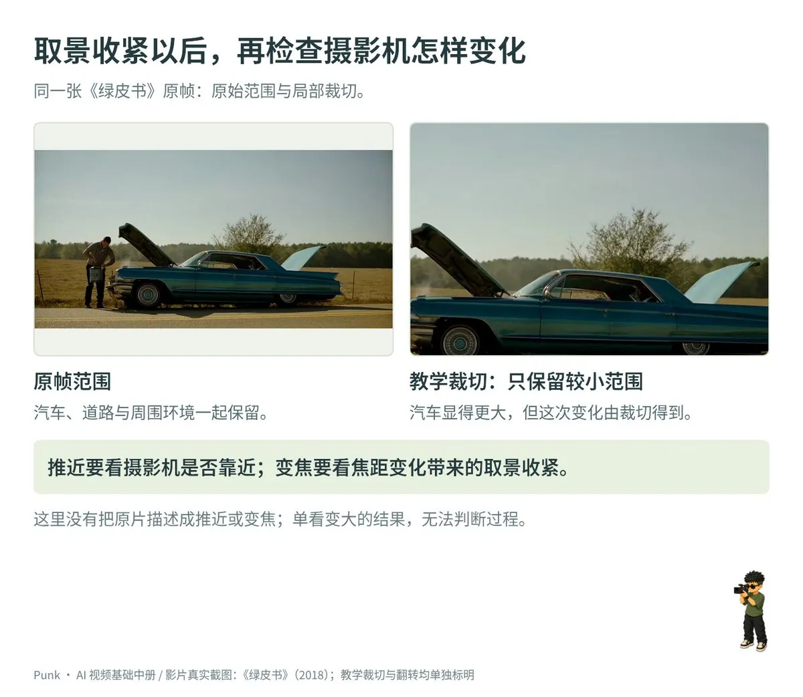

应用场景： 想随着情绪逐渐靠近人物，或者带观众一步步注意到某个细节，可以考虑推近。想逐渐展示人物周围的环境、让观众发现更大的空间关系，可以考虑拉远。机位受限，或者有意表现取景范围逐渐收紧的效果时，也可以安排变焦；它与移动摄影机带来的空间变化不同。

手机上的放大还可能包含数码裁切，不能把所有放大都当成光学变焦。写 AI 要求时，直接说明“摄影机靠近人物”或“机位不动，取景逐渐收紧”，生成后再看整段是否成立。只有一张变大的结果图，仍然不能确认它是怎样变化的。

### 4. 跟拍：摄影机随着主体行动

人物走，摄影机也随他移动，并保持需要的观看关系，这叫跟拍。可以从身后跟、侧面跟，也可以在前面后退着拍。只写“跟着走”，还没交代摄影机在人物哪一侧。

应用场景： 行走、跑步、穿过房间等过程需要连续交代，或者想让观众有陪着人物一起走的感觉，就可以用跟拍。若只需要知道他已经到了，切到目的地也能交代，不一定要跟完整段路。

例如，摄影机从人物侧后方跟随，他走向停在路边的汽车，人物全身和车门始终在画内。写给 AI 时，把跟随位置、移动方向和保留范围说清楚。第一版先安排一种主要运动，方便检查结果。

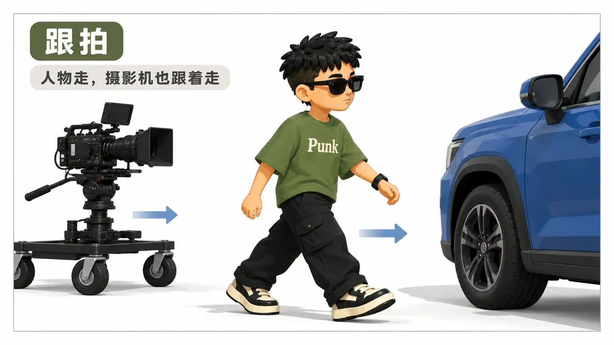

### 5. 换个范围，也可能只是换了一镜

先看车内正面的托尼，再看后排侧面的雪利，观众注意的对象和观看位置都变了。这里是两段画面的切换，不能描述成“摄影机从托尼一路推到雪利”。


分镜里写“切到雪利的反应”，就是准备另一镜；写“在同一镜里缓慢靠近雪利”，则需要一段连续过程。切换、机位移动、变焦，要结合连续播放区分。

## 七、画面连续性：前后要像同一段行动

一个镜头好看，和几个镜头接起来讲清楚，需要分别检查。车的内饰、人物座位、衣服、手里拿什么、动作做到哪一步，都会影响你能不能把前后画面接起来理解。

### 1. 行进方向：车有没有被看成突然掉头

《绿皮书》这组公路行驶画面中，车头朝向画面左侧。剪接时，如果前一镜建立了这个方向，下一镜却突然朝右，观众可能以为车掉头了。这里先检查屏幕上看见的方向，再判断故事里是否真的发生了转向；配图中的反向画面明确标为教学翻转。

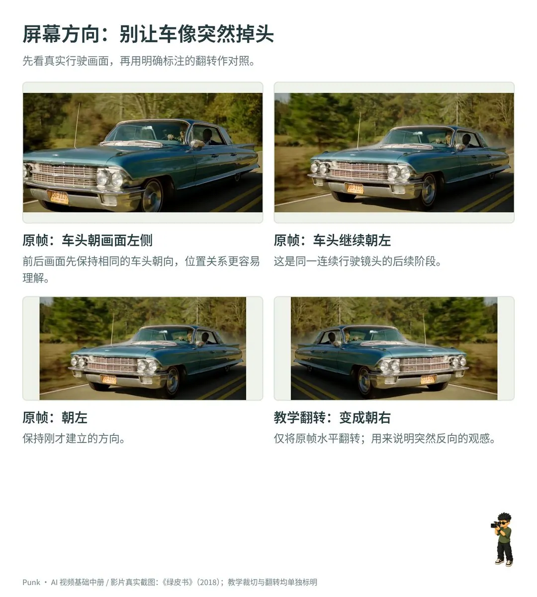

故事需要转弯、回头，就让人看到这个过程，或者重新交代道路关系。新手第一版先保持同向，出问题时更容易查。方向规则帮助理解空间，具体作品也可以有意改变。

### 2. 180 度轴线：先在两人之间想象一条线

把两个人之间的连线当作一条轴线，先把相关机位放在线的同一侧，左右位置和视线通常比较稳定。判断车内前后排这种布局时，还要结合座位、车窗和人物视线认清空间关系。


《绿皮书》求职面试的双人画面先交代两人相对而坐。随后切近，托尼朝画面右侧看，雪利朝画面左侧看，相对的视线让观众容易把两张画面放回同一个交流空间。突然跨到两人连线的另一侧拍摄，左右关系可能反过来，观众就需要重新辨认位置。第一条练习片先保持同侧，容易排查。

作品可以越轴，比如把摄影机绕过去的过程展示出来，或用能看清新站位的画面重新交代。人物走位也会改变轴线。学会它，是为了知道观众什么时候可能迷路。

### 3. 动作阶段：这只手刚才已经拿着什么

《绿皮书》里，托尼把一块炸鸡送向后排，雪利抬手接过来。这时既要交代新食物怎样被接住，也要保留雪利另一只手原本拿着的那一小块食物。两只手的状态都有来路，动作才容易连起来。

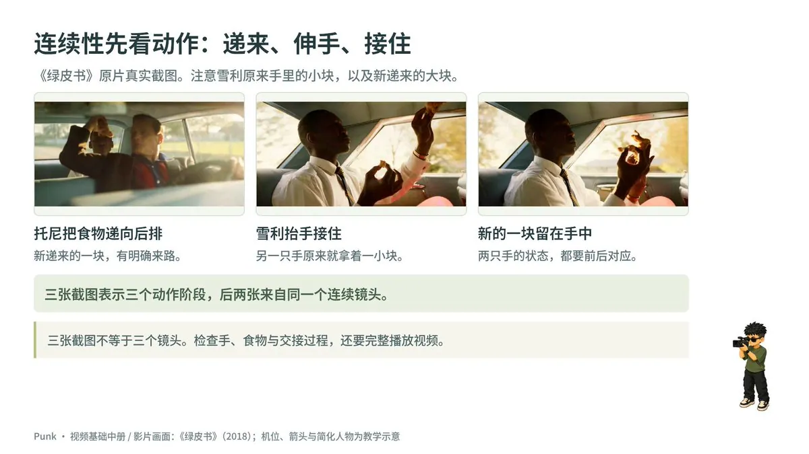

检查到这里，就不能只数“画面里有没有炸鸡”。要看食物在哪只手、何时递来、何时接住，以及另一只手原有的东西有没有保留。它们有清楚的来路，观众才能把动作接起来。

动作阶段和镜头数量要分开计算，一个连续镜头可以包含抬手、接住、松手等多个阶段。三张截图不等于三个镜头。 制作视频时，既要检查前后镜头的交接，也要播放中间过程，确认手和物件没有变形。

### 4. 连续性卡：把需要保持的条件记下来

连续性卡就是一张备忘单，记录这组镜头里哪些条件要保持。比如托尼在前排、雪利在后排，雪利穿白衬衫和条纹领带，车内是蓝绿色座椅；拍到递接食物，再记两只手各自的状态。

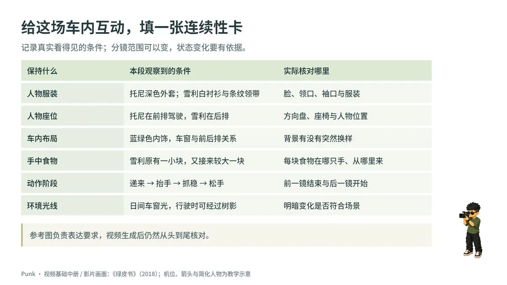

画面范围可以变，状态要有依据地变化。给 AI 传入参考图后，也继续核对实际视频：先看人物和道具，再看双手与动作，再看座位、方向和光线。第一帧很像，不能代表整段都接得上。

## 八、回看开头的片段，分清观看位置和动作变化

《绿皮书》这段互动可以拆成三个任务：交代动作、表现回应、给出动作的结果。递食物和扔骨头让两人的关系靠近，扔纸杯又引出新的分歧；镜头需要把这几步交代清楚。

这里选取后半段的四个动作节点，截图直接来自开头视频，时间也按这段视频计算。

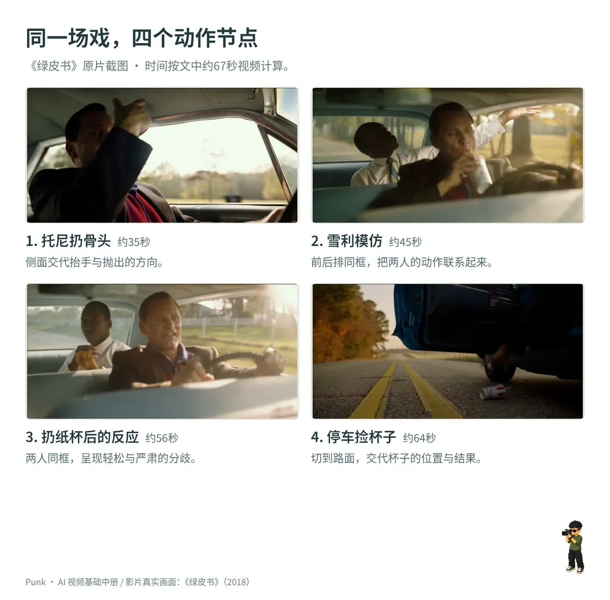

### 1. 托尼扔骨头：交代动作的方向

约 35 秒，托尼举手往车窗外扔骨头。从侧面看，他抬手的方向比较清楚。

### 2. 雪利模仿：把两个人的动作联系起来

约 45 秒，后排的雪利也把手伸向车窗。前后排同在画面里，我们能把他的模仿和托尼的动作联系起来。

### 3. 扔掉纸杯：用反应表现分歧

约 56 秒，托尼扔掉纸杯之后，雪利的反应变了。两个人同时入画，能同时呈现前排的轻松和后排的严肃，把这次分歧表现出来。

### 4. 停车捡杯子：把分歧接到行动上

约 64 秒，画面转到路边，托尼伸手去捡纸杯。镜头把杯子在路上的位置拍出来，也把刚才的分歧接到了具体行动上。

侧面镜头可以交代抬手的方向，双人画面可以表现彼此的反应，切到路面则让纸杯成为重点。每一次切换，都要让观众多了解一件与当前情节有关的事。

取景范围、观看位置和动作阶段是三个不同的问题。静帧有助于分析范围与位置，运动过程和动作衔接还需要结合连续播放判断。

## 九、照着电影，写一张三镜练习表

为了练习，可以把这次递食物安排成“递出、接住、回应”三个观看任务。镜头表记录每一镜要交代的信息、拍摄安排和检查条件，先把动作讲清楚，再考虑每镜保留多久。

### 1. 把观看任务写成镜头表


写“切到雪利侧面”，是换一镜；它没有要求摄影机在上一镜里穿过车厢。把观看任务写清楚，再决定用现成素材、补拍，还是生成练习画面。

### 2. 换成自己的角色，写出动作要求

做一个车内递食物的练习，可以保留这种观看关系，把人物换成你自己的角色。下面写的是第二镜：角色 B 接到前排递来的食物。人物外观和车内布局由你的参考图提供，文字把动作和检查要求补齐。

```text
镜头任务：看清后排角色B接过前排递来的一块食物。
画面范围：上半身与双手都在画内，交接位置不能被挡住。
观看位置：从后排侧面看角色B，摄影机相对车内固定。
开始状态：B的右手已有一小块食物；前排伸来的手拿着较大一块。
主要动作：B抬起左手，抓稳新递来的食物；递出者随后松手、收回手。
结束状态：B右手保留原来的一小块，左手拿着新接的一大块，动作短暂停稳。
清楚与光线：脸、双手和食物可辨认，车窗受光关系与前一镜协调。
连续性：沿用同一人物、服装、车内布局和两块食物的状态。
验收：看得清接住和松手，没有换手、凭空增减或手指变形。
```

先把交接这个动作做清楚，再增加一种确有必要的镜头运动。原片让你观察拍法，裁切和标注帮助你比较取景范围，练习要求则用来制作和验收。

### 3. 换别的内容，沿用这份空模板

口播、科普和短片都能这样问。口播先保证脸和手势看得清，科普先保证物件和步骤可辨认，短片再多检查人物位置与动作状态。每一镜都写出可以直接看见的结果。

```text
这一镜要让观众看懂：【一个具体信息】
画面拍到：【全身／腰部以上／脸／手与物件等实际范围】
从哪里看：【前后左右、接近什么高度、朝哪里看】
主要动作：【谁做一个什么动作】
摄影机：【相对什么固定，或一种明确的运动】
清楚与光线：【哪些部位必须清楚，主要光源来自哪里】
开始和结束：【开头是什么状态，最后做到哪一步】
前后保持：【人物、服装、道具、方向、用手和场景条件】
最后检查：【能在画面里直接确认的结果】
```

### 4. 生成后，逐项检查画面

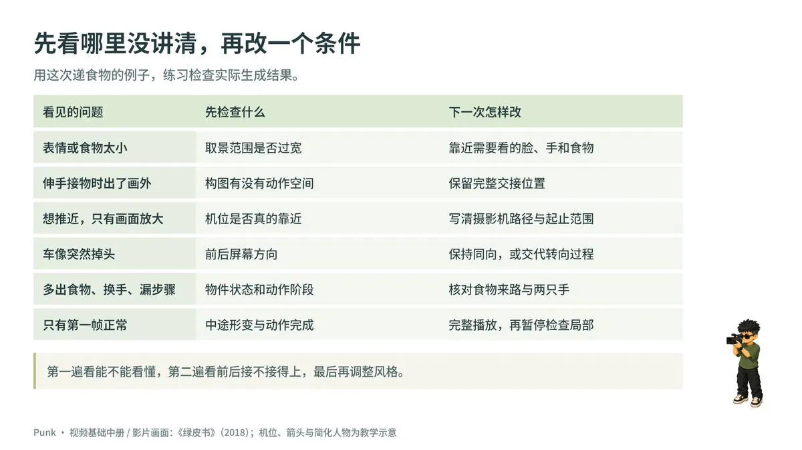

第一遍看能不能看懂，第二遍看前后接不接得上，最后再选颜色和运动。拿《绿皮书》这段练一次：谁递、谁接、接完怎样了，每一镜让观众多看清一件事。 然后把这套问法用到你自己的视频里。

### 关于作者

Punk｜中科大管理学硕士｜AI 提示词、AI 小白教程｜Punk 系列 Skills 作者｜3 个月赚了 8 位数｜Learn in Public｜FDE 文章浏览量 240w｜[@AdrianPunk115](https://x.com/@AdrianPunk115)


## 相关页面

- [[sources/aiwarts-awesome-seedance-463-ai-video-skills]]
- [[sources/leo-xiaolei-ai-character-consistency-skill]]
- [[concepts/prompt-engineering]]
- [[concepts/ai-content-pipeline]]
