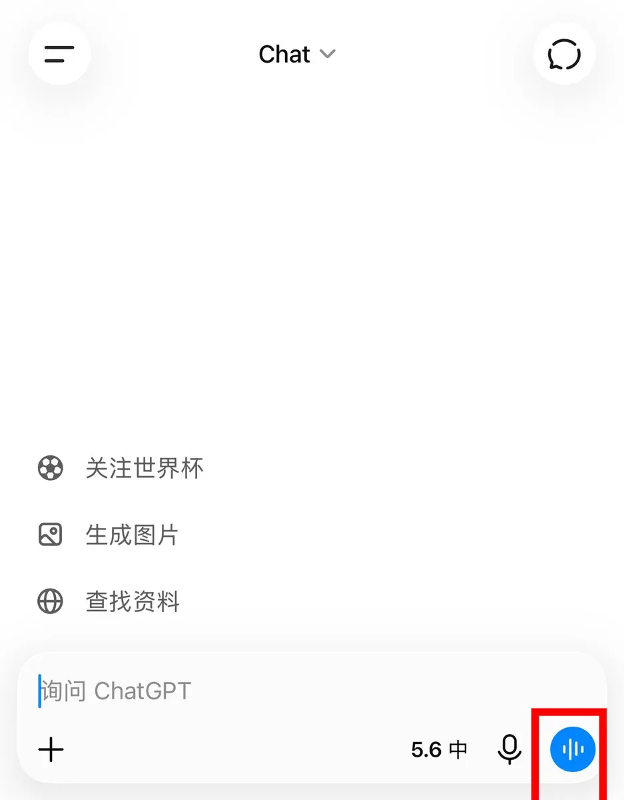
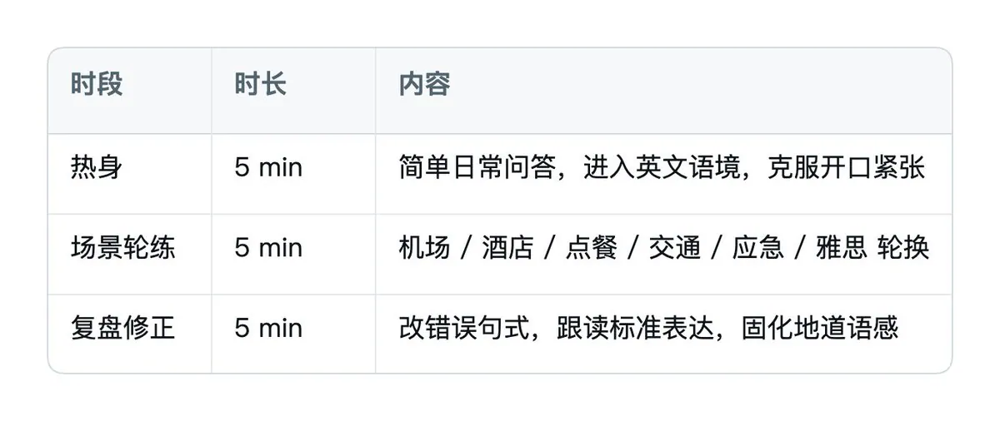
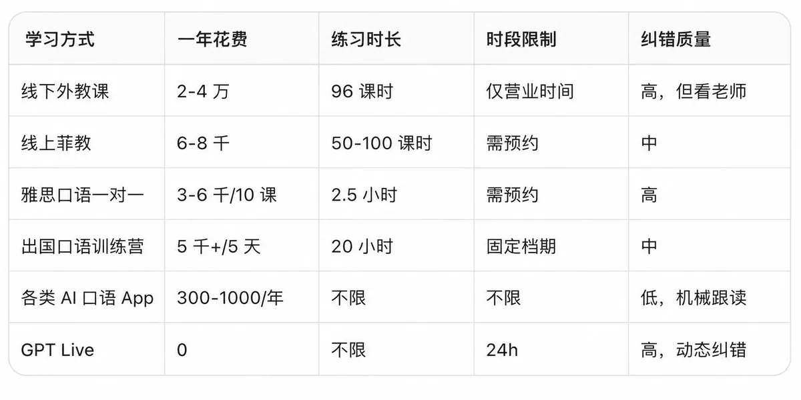

# Adrian Punk（@AdrianPunk115）：一年省下 2 万块口语课｜GPT Live 实测——英语外教可以下岗了，保姆级口语自学教程

> 详细测算 AI 实时语音模型替代真人外教的经济账与使用心法：一线城市外教口语课 200-400 元/节、一年 96 节至少 2 万起，线上菲教 6-8 千，雅思口语冲刺 10 课时 3,000-6,000，出国前 5 天突击营 5,000+，而 GPT Live 全天候随叫随到零成本且不打断、不嫌卡壳、不笑中式发音；面向零基础、留学备考与职场人群给出完整可落地的口语自学操作教程。

<!-- more -->

先给你算笔账。

一线城市一节外教口语课，均价 200-400 元。一周 2 节，一年 96 节，至少 2 万起步。 线上菲教便宜点，一年也要 6-8 千。 雅思口语一对一冲刺班，10 课时报价 3000-6000。 出国前突击口语训练营，5 天收你 5000+。

而你现在打开手机，点一下语音按钮，0 元，24 小时随叫随到，不打断你、不嫌你卡壳、不笑话你的中式发音，比 80% 的真人外教还有耐心。

这不是夸张广告，是 OpenAI 的 GPT Live 实时语音模型真实能做到的事。

如果你还在为“不敢开口、没人陪练、报课太贵、外教约不上”纠结，这篇教程能帮你一年省下一台 iPhone，顺便把口语练出来。零基础、出国党、烤鸭、职场人都能用，照着做就行。

## 一、为什么是 GPT Live？不是别的 AI

先泼盆冷水：市面上 90% 的“AI 英语口语 App”，都是假陪练。

它们的本质是「一问一答」——你说一句，AI 回一句，一旦你卡顿、改词、中途换话题，AI 就抢话、报错、对话崩掉。练起来像在跟一个没有耐心、随时想挂电话的客服说话，和真实交流差了十万八千里。

GPT Live 不一样，它搭载的是全双工实时对话，逻辑完全贴合真人沟通：

- 边说边听：你说话时它安静听，偶尔“嗯”“uh-huh”回应，全程无冷场
- 允许卡壳：你想词、停顿、改口、换话题，全部 OK，不会强行打断
- 节奏可控：随时让它放慢、重复、换简单说法，零压力
- 中英无缝切换：不会的词直接中文问，学会了立刻切回英文
- 噪音免疫：居家、通勤、咖啡厅背景音不影响识别

翻译成人话：它就是你那个永远在线、永远不烦、还免费的白人朋友。

外教能做的它都能做，外教做不到的（凌晨 3 点陪练、无限重复同一句、同一场景模拟 100 遍）它也能做。

## 二、开通 + 必做设置（3 分钟搞定）

### 1. 谁能用？要钱吗？

全部免费，不用充会员：

- 免费用户 → GPT-Live-1 mini，日常 + 出国口语完全够用
- 付费用户（Go/Plus/Pro）→ 完整 GPT-Live-1，更流畅、推理更准

### 2. 找不到功能？

把 ChatGPT 更新到最新版，更新后点输入框旁边的语音按钮即可开启。



### 3. 90% 的人练没效果，都栽在这一步

直接开聊 = 自杀式练习。

因为 AI 默认会频繁抢话、实时纠错、一次问一堆问题，你刚开口就被打断，信心碎一地，练两次就放弃。

每次开始前，先复制这段指令，锁定新手练习模式：

```
I am a Chinese English learner at around B1 level.
Please be my speaking partner. Speak clearly and not too fast.
Ask only one question at a time.
Do not interrupt me when I pause or make small mistakes.
Only correct me after I say I am finished.
Use Chinese only when I ask for help.
```

这一段的作用：AI 单次只问一个问题、不打断你、全程结束才统一纠错、语速适配新手。把开口的主动权 100% 交给你。

复制粘贴 3 秒，但它是你能不能坚持练下去的分水岭。

## 三、保姆级实操｜五大出国实景训练（指令直接复制）

出国口语的高频场景就那么几个，集中火力练透这五个，90% 的实战交流都能覆盖。每条指令直接复制即可开启模拟对练。

### 场景 1 ｜机场全程（出国最高频）

覆盖值机、行李托运、超重、航班延误、换登机口、安检、行李丢失全套。

```
Act as an international airport staff.
Simulate real airport conversations including check-in, baggage check, overweight luggage inquiry, flight delay, gate change, security check and lost luggage.
Speak slowly and wait for my reply each time.
Give me short Chinese hints when I get stuck.
Correct my errors after the whole conversation ends.
```

练习重点：主动问询航班信息、听懂工作人员指令、处理行李与航班突发状况

### 场景 2 ｜酒店 Check-in 入住

模拟海外酒店入住、退房、核对订单、咨询早餐、WiFi、延迟退房全流程。

```
Act as a foreign hotel front desk receptionist.
Simulate the whole check-in and check-out process, including reservation confirmation, room type introduction, breakfast time, Wi-Fi password, early check-in and late check-out application.
Speak slowly, pause after every question, and correct my mistakes after we finish the roleplay.
```

练习重点：完整办理入住退房、精准提出个人需求、听懂酒店服务信息

### 场景 3 ｜国外餐厅点餐

解决出国只会手势点餐的尴尬，模拟完整点餐、问询、特殊饮食沟通。

```
Act as a friendly restaurant server in London.
I want to order food in English.
Stay in character and ask me normal questions about the menu.
If I get stuck, give me one short Chinese hint, then wait for me to try again.
Do not say the full answer for me.
At the end, tell me three useful phrases from our conversation.
```

练习重点：回应店员提问、描述口味、完成点餐与结算

### 场景 4 ｜酒店应急问题

房间故障、设施损坏、卫生问题、换房等突发状况沟通。

```
Act as a hotel receptionist.
My room has a problem and I need help.
Please speak naturally but slowly.
Do not correct my English during the roleplay.
When I say I am finished, give me only three corrections that matter most.
Then ask me to say the improved sentences again.
```

练习重点：清晰表达问题、主动求助、提出换房与售后诉求

### 场景 5 ｜打车 + 问路 + 交通

海外打车、公交、地铁、问路、确认地址、路线咨询全覆盖。

```
Act as a local taxi driver and pedestrian.
Simulate real transportation scenarios, including asking for directions, taking a taxi, confirming destination, asking for subway and bus routes, inquiring about travel time and route changes.
Speak slowly. Give me hints when I am stuck.
 Correct my expression after the conversation.
```

练习重点：报地址、问路线、沟通目的地、应对路线临时变动

## 四、雅思口语专项训练（烤鸭刚需）

很多人不知道，GPT Live 可以直接当雅思口语外教用，而且比报班更高效——因为它可以无限次模拟同一个 Part，直到你彻底熟练。

### Part 2 独白训练（最难提分的部分）

雅思 Part 2 要求 1 分钟准备 + 2 分钟独白，传统训练极难自己练，GPT Live 完美适配：

```
Act as an IELTS speaking examiner.
Ask me a Part 2 cue card question (a topic where I need to talk for 1-2 minutes).
Give me 1 minute to prepare silently, then tell me to start.
Listen to my full response without interrupting.
After I finish, score me on Fluency, Lexical Resource, Grammar, and Pronunciation (each out of 9).
Point out 3 specific weaknesses, give me a better version of my weakest sentence, and ask me to say it again.
```

### Part 1 & Part 3 问答训练

```
Act as an IELTS speaking examiner conducting Part 1 and Part 3.
Ask me one question at a time and wait for my answer.
In Part 1, ask familiar-topic questions.
In Part 3, ask abstract follow-up questions that require me to give reasons, examples, and opinions. Do not interrupt me.
After 5 questions, give me band scores and 3 concrete improvements.
```

烤鸭重点提醒：

- 每天换一个话题卡（人物 / 地点 / 事件 / 物品轮着来）
- 录音回放，自己听一遍比 AI 纠错更管用
- Part 3 别背模板，AI 能识别套路并追问，逼你真说

报班对比：雅思口语一对一，2h 课程 1000-1500 元。用 GPT Live，同样时长免费、无限次、想练几遍练几遍。

## 五、5 分钟复盘法：越练越地道的关键

光对练不复盘 = 固化错误。每次场景练习结束，用这段指令收尾：

```
Review our conversation like a helpful English teacher.
Find only three repeated mistakes or unnatural phrases.
For each one, show my sentence, a more natural version, and a short explanation in Chinese.
Then ask me to say the three improved sentences aloud again.
Do not give me a long grammar lesson.
```

复盘逻辑：每次只改 3 个核心错误，避免信息过载，跟读优化句式，慢慢改掉中式英语、语序混乱、滥用 big words 的通病。

这一步是付费外教最值钱的部分，现在 GPT Live 免费给你做。

## 六、每日 15 分钟科学计划表

不用每天练 2 小时，15 分钟 × 坚持 3 个月 > 偶尔猛练 2 小时。



3 个月节奏建议：

- 第 1 个月：只练五大出国场景，建立开口自信
- 第 2 个月：加入雅思 Part 1，开始接触抽象话题
- 第 3 个月：主攻 Part 2 独白 + Part 3 追问，冲 6.5-7.0

## 七、终极算账表：不学真的亏



看清了吗？

花 2 万报外教，一年练不到 100 小时；用 GPT Live，0 元，一年能练 500+ 小时。

前者每分钟 3 块多，你卡壳会紧张、会心疼钱、会不敢说第二遍。 后者每分钟 0 元，你说错 100 遍它都陪你，直到你说对为止。

真正贵的不是钱，是你那不敢开口、怕被笑话、怕浪费课时费的自尊心。

GPT Live 把这个心理门槛直接拆了。

## 八、常见疑问

Q1：零基础、发音烂到爆能练吗？

能，而且强烈推荐。GPT Live 容错率极高，能精准识别不标准发音，全程耐心引导。零基础最大的敌人不是词汇量，是不敢开口——它正好治这个。

Q2：能练雅思、托福、面试口语吗？

能。改一下指令就能模拟雅思 Part 1/2/3、托福 Independent Speaking、外企英文面试。本文第四节给了雅思完整指令。

Q3：有噪音会影响吗？

基本不会，模型自带强效降噪，居家、通勤、咖啡厅都能用。

Q4：跟传统跟读 App 比优势在哪？

跟读 App 是死的，你说一句它放一句录音。GPT Live 是动态真人对话，会随机追问、临场换话题、模拟突发状况，更贴合真实出国和考试场景。

Q5：免费版够用吗？要不要充 Plus？

日常 + 出国口语，免费 mini 版完全够。想练雅思 Part 3 深度追问、追求更自然语感，再考虑付费，非必需。

## 九、说句实在话

练英语口语这件事，过去 20 年的核心矛盾从来不是“方法不够多”，而是——

练口语需要一个人陪你，而这个人要么贵、要么约不上、要么没耐心。

外教贵，语伴难找，同学水平差不多互相纠不了错，自学软件又太机械。所以全世界那么多人才被困在“哑巴英语”里出不来。

GPT Live 第一次把这个“陪练人”的问题，用 0 成本解决了。

你不用再纠结报哪个班、约哪个老师、花多少钱、有没有时间。你只需要——

打开手机，点语音按钮，开口。

每天 15 分钟，3 个月后人还是那个人，嘴已经不是那张嘴了。

出国旅行敢点餐、敢问路、敢处理突发状况； 雅思口语敢 Part 2 说满 2 分钟、敢 Part 3 跟考官掰扯； 职场敢接英文会议、敢发语音回复老外。

而这一切的代价是 0 元，和每天 15 分钟。

再算一遍：你现在不开始，明年今天还在纠结要不要报班、还在哑巴英语、还在为开口紧张。

而那些今天就开始的人，3 个月后已经能流利出国交流了。

外教可以下岗了，不是因为它不好，是因为我们终于有了更好的、免费的、随叫随到的替代品。

错过这一波，真的亏。

### 关于作者

Punk｜中科大管理学硕士｜AI 提示词、AI 小白教程｜Punk 系列 Skills 作者｜3 个月赚了 8 位数｜Learn in Public｜FDE 文章浏览量 240w｜[@AdrianPunk115](https://x.com/@AdrianPunk115)

## 相关页面

- [[sources/aiwarts-awesome-seedance-463-ai-video-skills]]
- [[sources/jason-zhu-chiang-mai-university-language-program-guide]]
- [[concepts/ai-free-quota-rotation]]
- [[concepts/digital-products-side-income]]
