# Adrian Punk（@AdrianPunk115）：用 WorkBuddy 做老板爱看的 PPT

> 讲解如何用 WorkBuddy 产出「老板爱看」的汇报型 PPT：从理解向上汇报的真实诉求（结论先行、支撑数据、风险提示与行动建议）出发，如何把零散素材组织成有说服力的叙事结构、选择恰当的图表与版式，并给出让 PPT 直接服务于决策而非堆砌信息的实践技巧。

<!-- more -->

昨天在 AI 群里，有人问：现在有没有好用的 AI PPT 工具？

他试过用 HTML 做，但是效果不理想，老板也不喜欢。

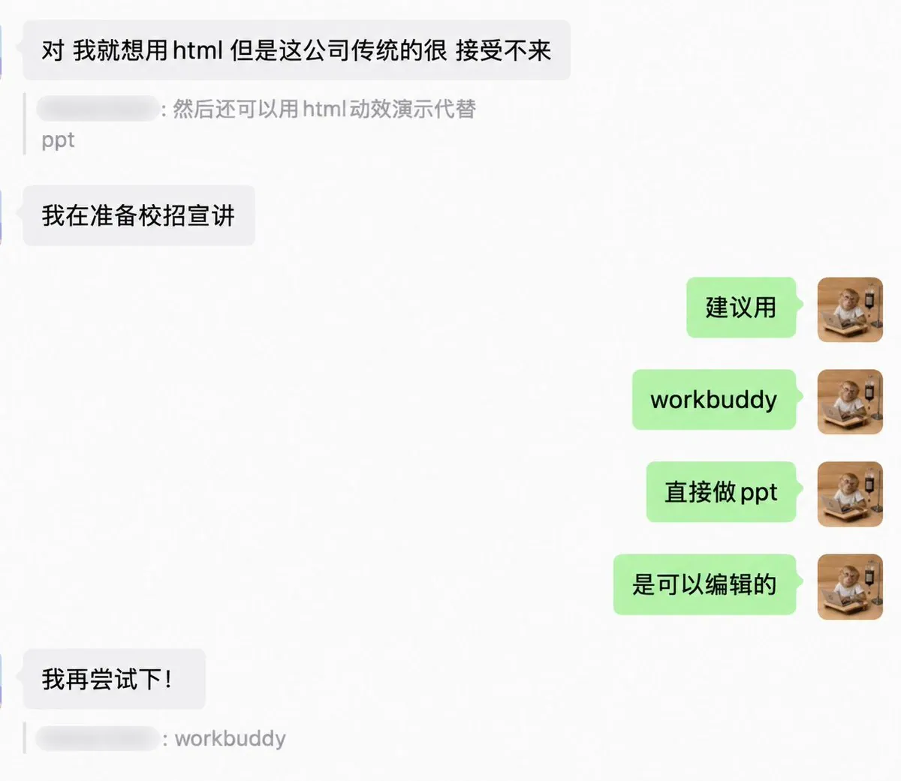

于是我向她提供了最近我用 Workbuddy 做的 PPT。说实话，目前 Workbuddy 做的 PPT 已经比之前我用 AI 做的 PPT 要排版灵活很多了，基本可以满足日常办公使用的要求所以涉及企业汇报、线下讲课和文件交接时，我现在会优先做可编辑的 PPT。

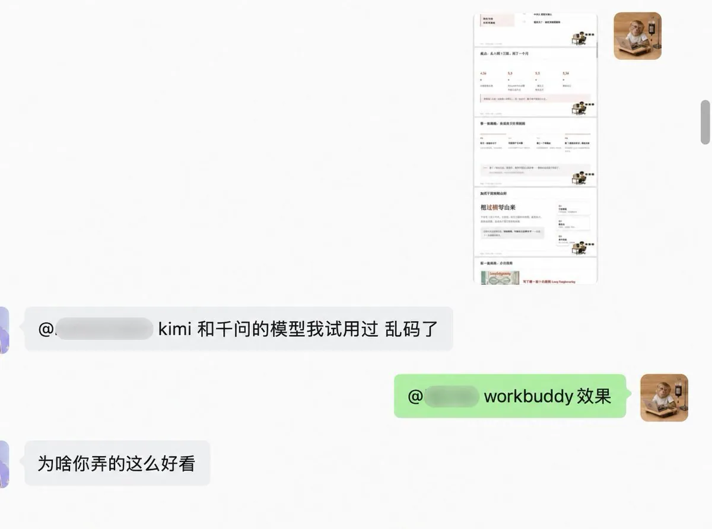

## 一、为什么我不使用 HTML 呢？

其实之前我也尝试过用 HTML 做演示文稿。

HTML 的优点很明显：可以插链接、图片和视频，动画效果也更灵活，做出来很像一个精致的网页。如果是个人作品展示、在线发布，或者需要现场交互，HTML 确实很好用。

但真正拿到企业和线下分享的场景里，我发现它还有几个现实问题。

1. 很多 AI 生成的 HTML 演示会沿用固定模板。页面看起来很漂亮，但经常留白过多、字号偏小、信息密度不够。自己坐在电脑前看没有问题，投到会议室的大屏幕上，后排的人可能根本看不清。
2. HTML 没有想象中那么方便修改。标题长一点，页面可能重新换行；多加两段文字，元素可能重叠；换一张比例不同的图片，原来的版式也可能被打乱。不会前端代码的人，只能继续依赖 AI 修改，有时改了这一处，另一处又出问题。
3. 企业内部对 HTML 演示的接受度也没有那么高。领导和同事更习惯接收一个 PPT 文件：打开以后可以直接批注、改字、换图、复制页面，也方便交给其他人继续完善。

所以，从企业协作和实际交付的角度看，“古法修改”依然是 PPT 最方便、最直接。哪里不合适就点哪里，文字、图片和版式都能现场调整；在审美和使用习惯上，老板也更熟悉传统 PPT。

这也是为什么我最近参加线下活动讲课，最后还是选择了可编辑的 PPT。HTML 很适合展示创意，但如果要汇报、演讲、交接和反复修改，我目前还是更愿意用 PPT。

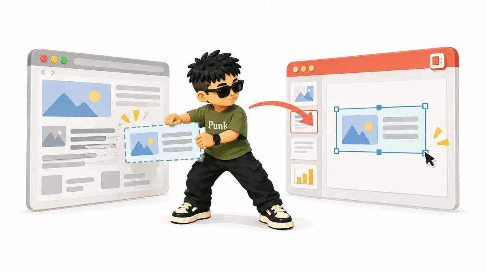

## 二、我的制作过程

9 月 19 日，我要在上海做一场线下分享，主题是「如何做自媒体 + AI 图片工作流」。如果放在以前，我肯定开始了古法手搓 PPT 了，但那样确实效率太低。所以这次我口喷了内容，让 AI 给我生成 PPT 大纲。并，抱着“死马当活马医”的状态，尝试使用 Workbuddy 做 PPT。

同一份材料，我分别发给了 ChatGPT 和 WorkBuddy。比较以后，我觉得这一次 ChatGPT 写的大纲更详细，章节之间的逻辑也更顺，于是采用了 ChatGPT 的版本。

当然，这只代表我这次的实际结果，不代表 ChatGPT 永远更适合写大纲。我的做法很简单：谁整理得更好，我就用谁的。

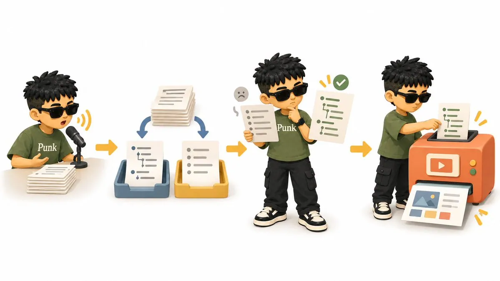

确认大纲以后，我把它发给 WorkBuddy。它没有直接开始出图，而是先和我确认几个设计问题：PPT 要不要配图、我偏好什么风格，以及有没有参考文件。

这些问题确认以后，WorkBuddy 才开始生成 PPT。出图完成后，除了可编辑的 PPT，它还给了我三个配套内容：

1. DESIGN.md：这套 PPT 的配色、字体、留白、版式和图片风格；
2. PPT 逐页文稿：每一页放什么标题、文字和案例；
3. 演讲稿：每一页对应的口播、解释和转场。

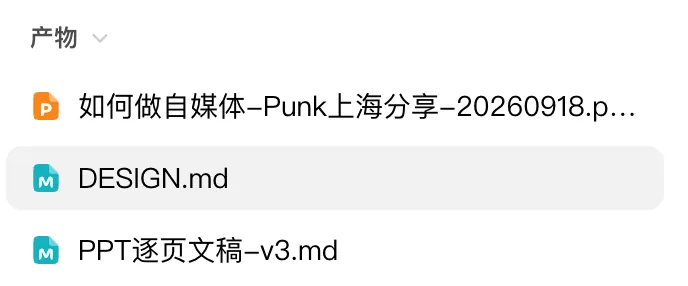

整体 PPT 的效果比我预想的要好很多

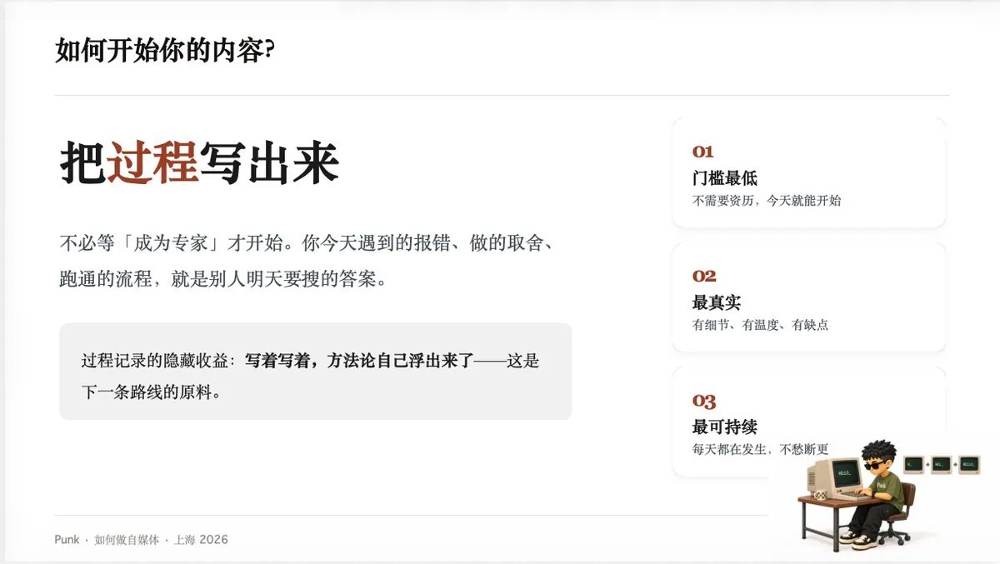

于是我查阅官方文档，结合自己的制作经历，整理了一份可实操的 Workbuddy 做 PPT 的操作步骤。

## 三、标准制作步骤（含提示词）

1. Workbuddy 制作 PPT 的入口

- 首页对话框处可直接选择“幻灯片”，Workbuddy 会给你提供一些写好的类型以及模版供你选择

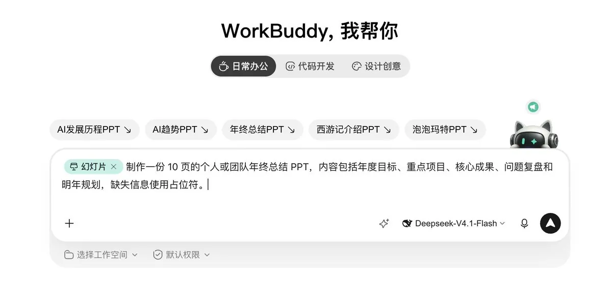

- 调用 Tencent-pptx skill

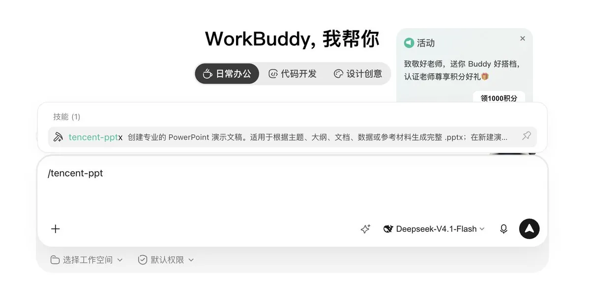

- 直接告诉它你要做一个什么样的 PPT

2. 整理你手上的资料，形成一份大纲

先别急着直接一口气就生成 PPT，这样大概率是要返工，浪费 Token。把口述、会议记录、文章或零散想法交给 AI，让它先整理大纲。

可以直接复制这段提示词：

```text
我要做一份 PPT，请根据下面的材料整理大纲。

主题：【填写主题】
讲解对象：【给谁看】
使用场景：【汇报 / 培训 / 路演 / 公开分享】
演讲时长：【填写时长】
希望讲清楚的内容：【填写目标】

原始材料：
【粘贴口述、文章、会议记录或其他资料】

请输出：
1. 整套 PPT 的主线；
2. 章节顺序；
3. 每一章要讲的重点；
4. 建议保留的案例；
5. 重复、跳跃或缺少依据的内容。

先整理内容，不要设计页面，也不要补写材料里没有的事实。
```

我这次让 ChatGPT 和 WorkBuddy 各写了一版，是为了比较结果。你也可以只用一个工具，只要最后的大纲是你认可的就行。

3. 把确认的大纲发给 WorkBuddy

大纲确认后，再把它交给 WorkBuddy。讲解对象、使用场景和时长可以一起写进去，方便它理解这份 PPT 要用在哪里。

```text
请根据下面的大纲制作一份 PPT。

讲解对象：【给谁看】
使用场景：【汇报 / 培训 / 路演 / 公开分享】
演讲时长：【填写时长】
必须保留：【案例、数据、品牌信息】
不要出现：【保密信息、未经确认的数据、页码等】

这是已经确认的大纲：
【粘贴大纲】

请先阅读大纲，再继续制作 PPT。
```

4. 回答设计问题，再让它生成

收到大纲后，WorkBuddy 会继续和你确认设计方向。它会问到是否使用图片、偏好的视觉风格等信息，你按照自己的需要选择即可。

如果你有公司模板或喜欢的 PPT，可以在这一步上传。参考文件通常比「高级一点」「有科技感」这类形容更准确。

```text
需要配图：【需要 / 不需要】
图片方向：【真实照片 / 插画 / 图标 / 数据图表】
偏好风格：【简洁商务 / 杂志感 / 科技感 / 其他】
参考文件：【已经上传 / 没有】
配色或字体要求：【没有可以不填】

请按照以上偏好开始生成 PPT，最终导出可编辑的 .pptx 文件。
```

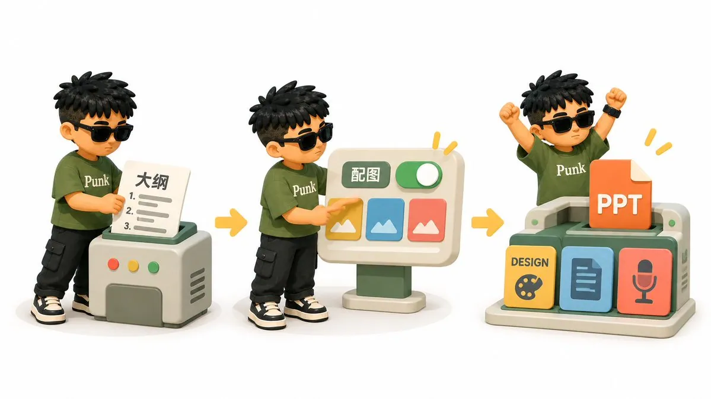

5. 查看交付内容，再按页修改

生成结束后，你会拿到可编辑的 PPT，以及 DESIGN.md、PPT 逐页文稿。它们是出图后的配套交付：

- DESIGN.md 记录整套视觉规则；
- PPT 逐页文稿方便检查每一页的内容；
- 演讲稿可以直接拿来准备现场口播。

如果内容方向不对，就回到大纲修改；如果只是某一页不好看，直接按页修改即可。我的第一版曾经生成了 20 页，但内容完全不对，我就让它停下来，先重做大纲，再重新生成。

整套生成以后，哪里不满意就改哪里。这里我建议一开始不需要让他给每一页去标页码，因为有可能你会删除某页内容。所以可以在最终的成稿上再标注页码。修改指令写清页码、动作和需要保留的内容：

```text
请修改第 12 页：
- 把左侧长段文字压缩成 3 个要点；
- 右侧改成流程图；
- 保留原来的标题、配色和案例；
- 参考第 8 页的排版节奏。
```

当然，最方便的地方是可以手动编辑文字、图片和图形。

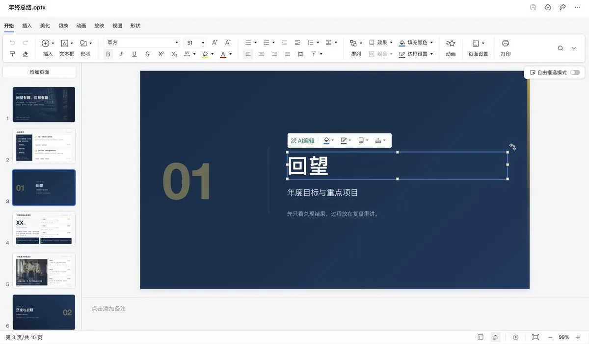

6. 导出后再检查一遍

导出 .pptx 后，用 PowerPoint 或 WPS 打开，至少检查下面四项：

- 随机选几页，确认文字、图片和图形可以编辑；
- 检查有没有乱码、字体替换、换行和元素重叠；
- 在真正演讲的电脑上播放一遍；
- 另外保存一份 PDF，现场出现兼容问题时备用。

整个过程可以压缩成一句话：先整理大纲，交给 WorkBuddy，确认用图和设计风格，等待生成，再根据交付文件继续修改。

## 关于作者

Punk｜中科大管理学硕士｜AI 提示词、AI 小白教程｜Punk 系列 Skills 作者｜3 个月赚了 8 位数｜Learn in Public｜FDE 文章浏览量 240w｜[@AdrianPunk115](https://x.com/@AdrianPunk115)

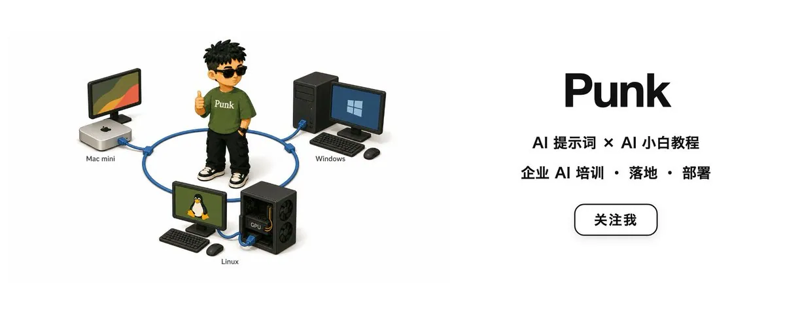

## 相关页面

- [[sources/adrian-mckinsey-style-consulting-visual-prompts]]
- [[sources/wangdachui-codex-content-production-solo-primer]]
- [[concepts/ai-content-pipeline]]
- [[concepts/prompt-engineering]]
