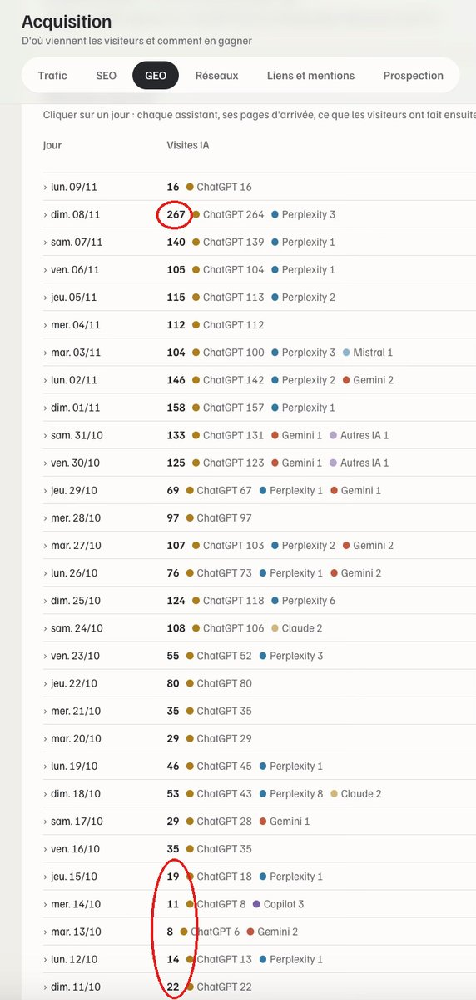
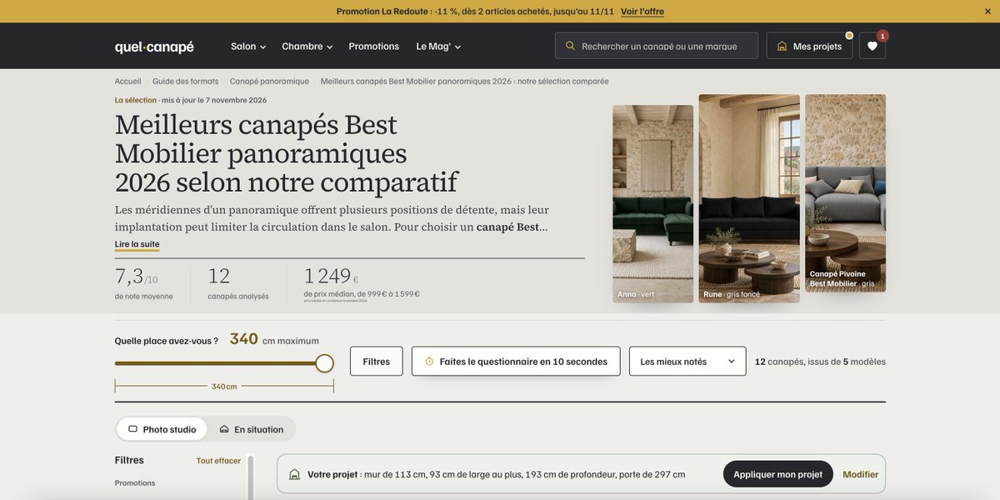
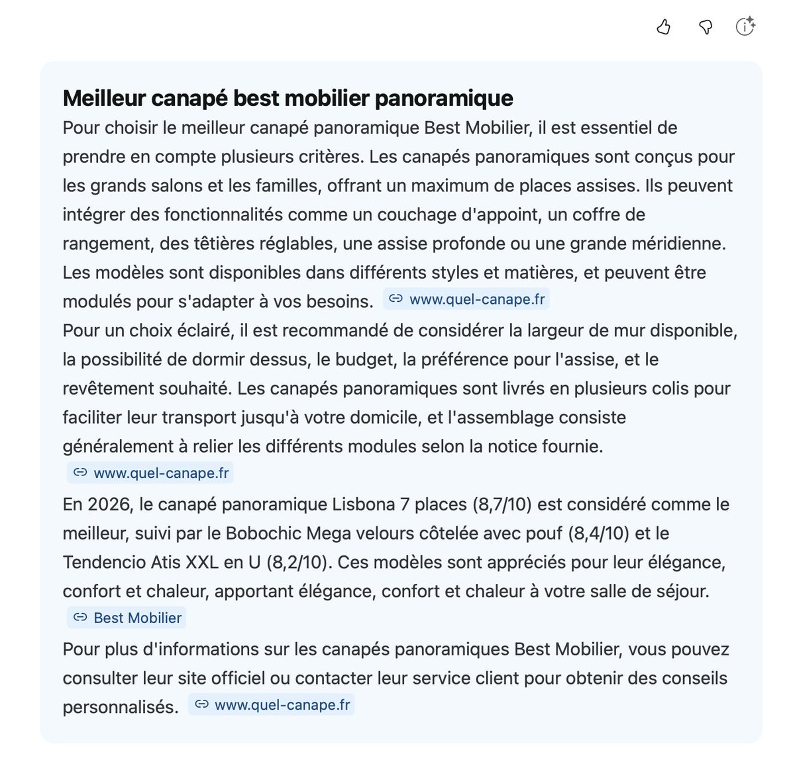
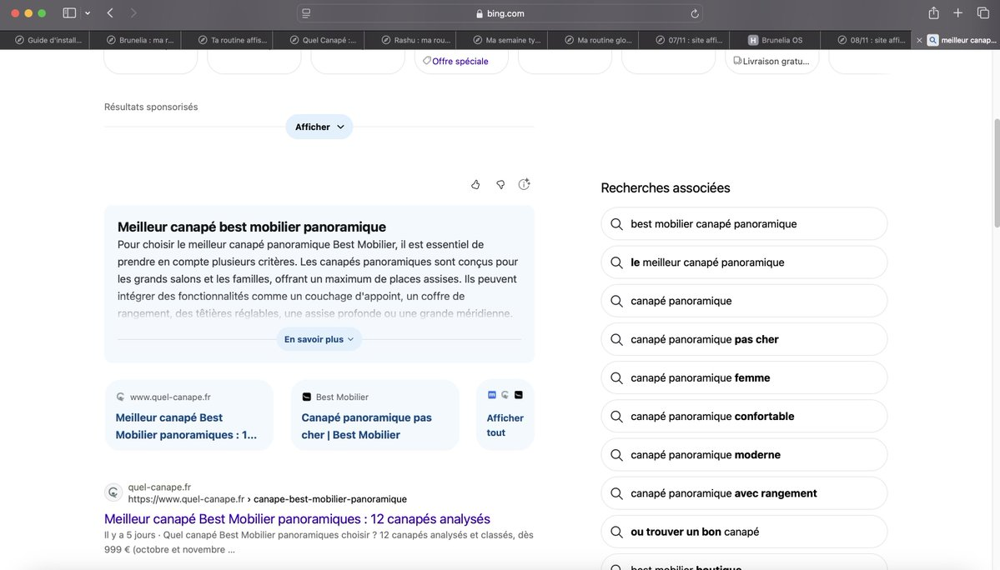

# Romain Brunel（@Affiseo_）：GEO 实测——AI 搜索带来的访问从 5/天涨到 267/天

> 法语实测记录（附中文要点）：从 10 月 11 日到 11 月 8 日，来自 AI 搜索的访问从每天 5 次涨到 267 次且曲线仍在上升。两条关键动作：① 把站点收录进 Bing（ChatGPT 需要联网检索时默认以 Bing 为搜索引擎）；② 专攻超长尾查询——例如「Matelas 160x200 Ressorts Ensachés / Canapé Couchage Quotidien / Canapé Best Mobilier Panoramique」这类极具体的长尾词，页面完美对应搜索意图就能带来高精准流量。文中举例某长尾页在 Semrush 上月搜索量为 0，却单日带来 4 个精准访客，全部此类长尾合计单日 267 个；因为几乎没有真实竞争，这类页面同时也很容易在 Google 上自然浮现。对联盟营销与电商站同样有效，也正是作者看好 POD（近乎无限长尾）的原因。

<!-- more -->

C’est facile d’obtenir du trafic (beaucoup de trafic) depuis Chat GPT. Enregistre en signet car le GEO peut complètement faire exploser ton business.

Depuis que j’ai appliqué ces conseils, je suis passé de 5 à 20 visites par jour depuis les IA le 11 octobre à 267 le 8 novembre (moins d’1 mois et la courbe ne fait que monter)

1. Indexez votre site sur Bing. , ChatGPT utilise Bing comme moteur de recherche par défaut lorsqu’il a besoin de faire des recherches sur le Web

2. Visez des requêtes d’ultra longue traine. Exemple sur mon site Quel Canapé : Matelas 160x200 Ressorts Ensachés / Canapé Couchage Quotidien / Canapé Best Mobilier Panoramique

--> + Vous serez niché et précis dans la requête, + vous répondrez à l’intention de recherche très précise d’un utilisateur.

Exemple de question de l’utilisateur de Chat GPT : Je recherche un Canapé Best Mobilier Panoramique. Aide moi

Chat GPT lui fera des recommandations. Mais si votre page répond parfaitement à l’intention de recherche, il enverra des visiteurs hautement qualifiés sur vos pages.

Ma page est référencée sur “Meilleur canapé Best Mobilier Panoramique”. Le volume de recherche est de 0 dans un outil comme Semrush. Mais cette page a attiré 4 visiteurs qualifiés hier. Et tout ce genre de requêtes = 267 visiteurs qualifiés hier. Sans doute 1000/jour dans quelques semaines. Exponentiel.

Bonus : Votre page a aussi de grandes chances de ressortir directement sur Google car 0 concurrence sérieuse.

Fonctionne aussi bien sur les sites d’affiliation que e-commerce.

C’est d’ailleurs une des raisons pour lesquelles je crois énormément au Print on Demand qui nous permet d’aller chercher une longue traine quasi infinie (comme je vais le faire sur Brunelia)

Rejoins le Affiseo Hub (double accès avec une grosse partie gratuite et beaucoup de value) 👉 https://t.co/nbQKiBem0x

## 相关页面

- [[sources/yaohongan2025-seo-and-geo-two-layers-of-one-thing]]
- [[sources/geektao-geo-google-and-chatgpt-traffic-step-by-step-guide]]
- [[concepts/seo-basics]]
- [[concepts/gefei-seo-keywords]]
