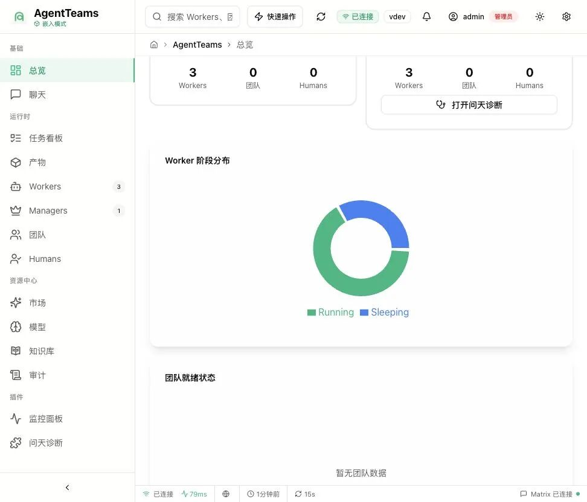
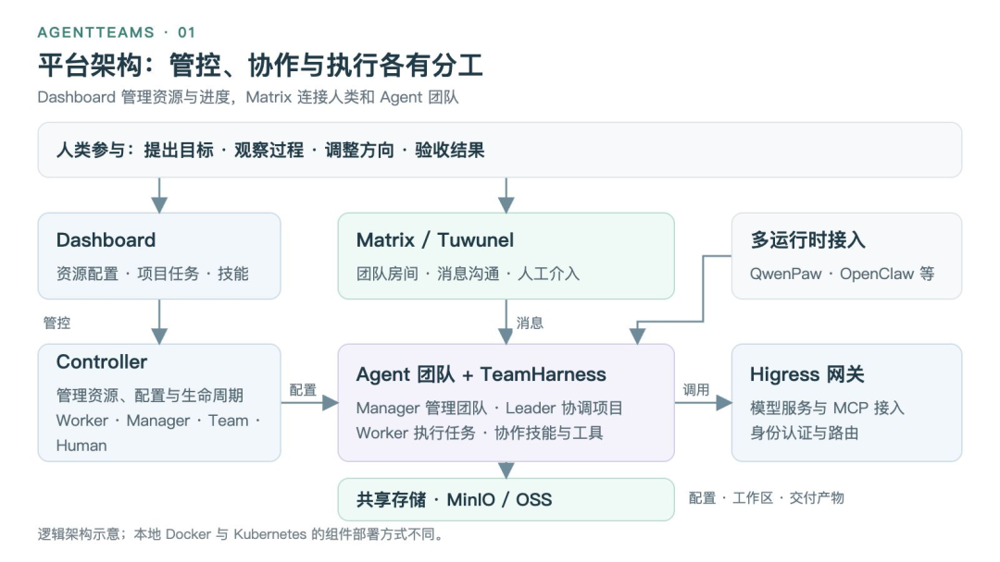
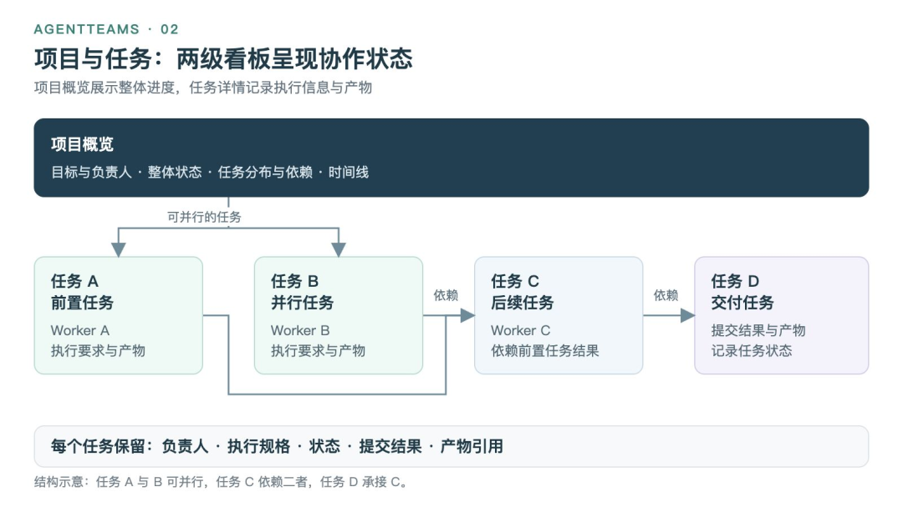
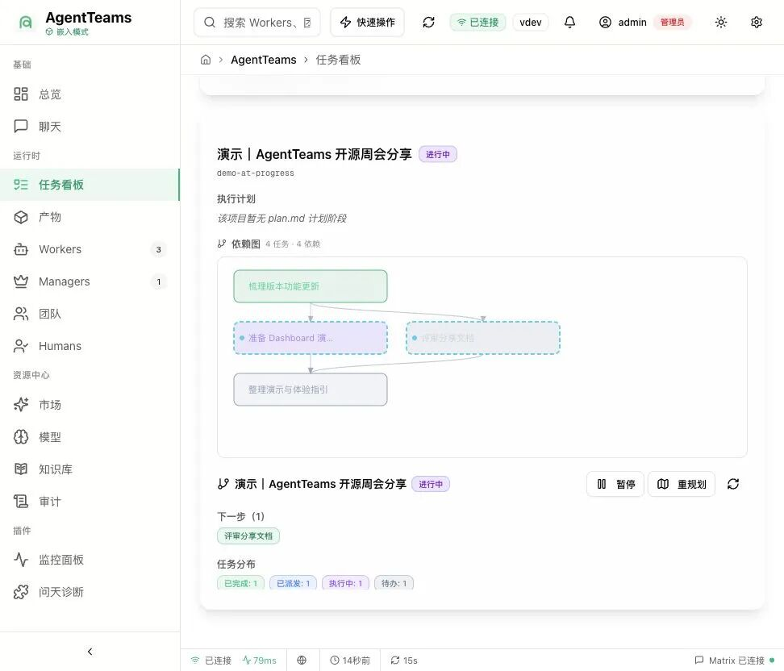
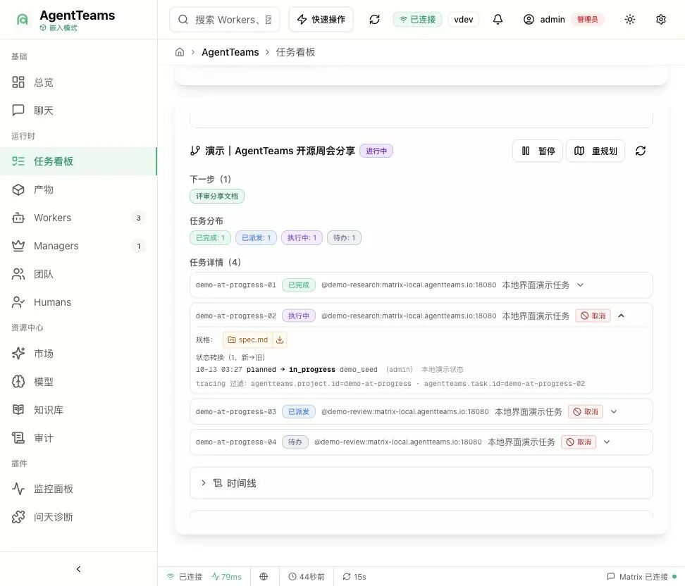
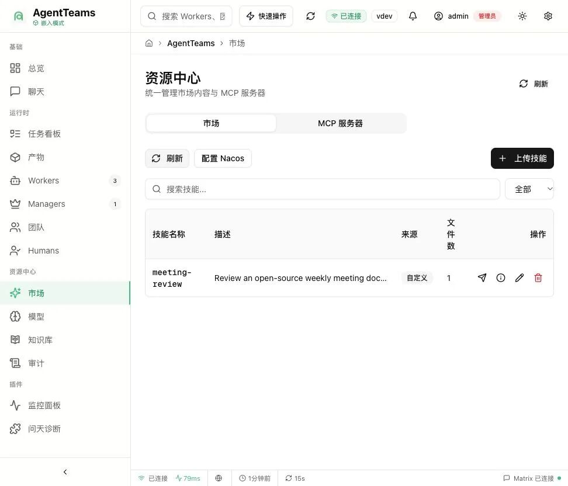
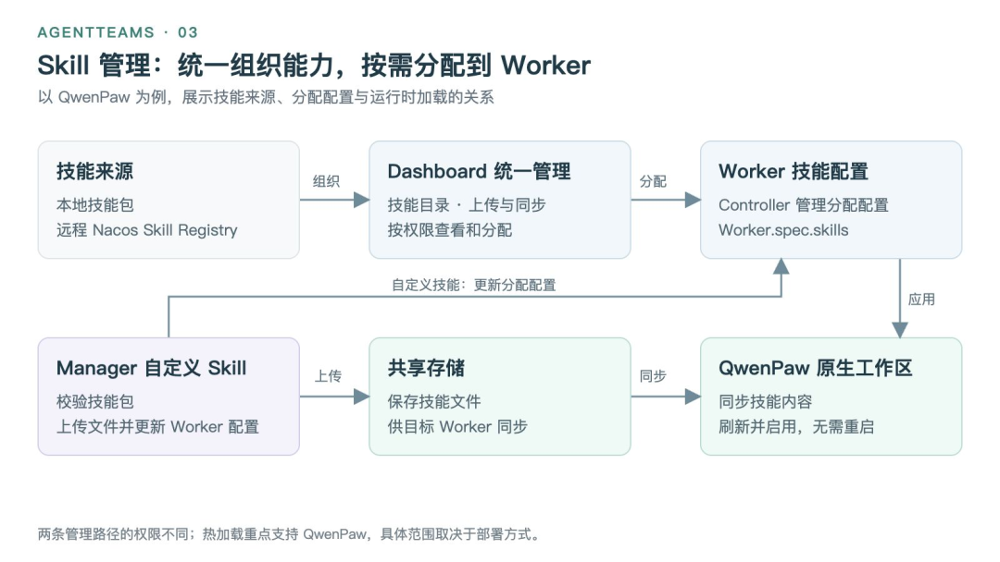

# AgentTeams Dashboard：统一管理团队、项目与资产

> AgentTeams Dashboard 是多 Agent 团队的统一控制面，把成员权限、项目任务、Skill/MCP/模型资产、运行时和编码 CLI 执行记录集中到结构化界面中。

<!-- more -->

作者：柳遵飞（翼严）

## 产品定位

[AgentTeams](https://github.com/agentscope-ai/AgentTeams) 是开源的多智能体协作与运行管理项目，支持将多个 Agent 组织成团队，由 Team Leader 协调项目、Worker 分工执行任务，并允许人类参与沟通、审批和结果调整。

AgentTeams 从 HiClaw 升级后，在 1.2.0 到 1.2.5 之间逐步加入 Dashboard 作为统一管控面。AgentTeams 1.2.5 默认搭配独立发布的 Dashboard v1.3.1，新增编码 CLI 管理、执行记录和 LLM 参数调优等能力。

原文重复推广了商业化产品 AgentCore。归档版删除该推广段，只保留开源 AgentTeams 与 Dashboard 的产品能力。

## 团队与资源管理

Dashboard 集中管理用户权限、Agent 实例、团队关系、Skill、MCP 工具和模型路由。

主要资源包括：

- **用户与权限**：管理 Human 用户可访问的团队和 Worker；管理员维护敏感配置，成员在授权范围内查看项目、管理 Skill、处理审批或获得指定 Worker 的只读权限。权限变化保留审计记录。
- **Worker 与 Manager**：查看 Agent 实例的运行状态、会话和配置，维护运行时、频道、模型、工具和 Skill。
- **Team**：维护负责人和成员关系。团队协作关系与 Worker 自身运行配置分开管理。
- **Skill**：管理内置、共享、团队和插件技能，上传自定义 Skill，并按职责分配给 Worker。
- **MCP**：管理 MCP 服务与接入配置，为 Worker 分配可调用工具。
- **模型与路由**：集中维护模型、网关和访问路由，并为不同 Agent 配置模型。

Dashboard 与 Matrix 的职责不同：Matrix 房间承载人类与 Agent 的协作对话，Dashboard 提供资源、配置、任务和执行状态的结构化视图。

## 项目与任务两级看板

Dashboard 将目标管理拆成 Project 和 Task 两层：Project 表达完整目标、任务分布和依赖关系；Task 记录具体负责人、执行要求、状态、结果和产物。

项目详情可展示工作流拓扑、阻塞点和具备推进条件的任务。任务详情记录派发、状态转换、事件、进度和提交结果，使用户能够从全局项目定位到单个任务，并追溯已经发生的执行过程。

项目支持暂停和恢复，状态变化写入时间线。AgentTeams 1.2.5 增加两项一致性约束：存在未终结任务时不能提前完成项目；任务重新委派后发送新通知，降低改派后无人接收的风险。

## Skill 管理与分发

Skill 管理界面统一提供查看、上传、分配、下载和复用能力。团队可以维护技能资产，再按 Worker 的职责配置能力，而不是逐个实例重复安装。

技能目录覆盖内置、共享、团队和插件 Skill，并提供远程 Nacos Skill Registry 的接入和同步入口。QwenPaw Manager 与 Worker 支持技能热加载，更新后无需重启运行时；1.2.5 还支持下载完整 Skill ZIP 包。

## 运行时管理

一个团队中的 Worker 可以采用不同运行时。Dashboard 提供运行状态、会话、执行循环、频道、工具、Skill 和模型配置入口，具体能力取决于对应 Worker 实现。

近期运行时变化包括：

- 主要链路从 CoPaw 升级到 QwenPaw，1.2.4 使用 QwenPaw 2.2.1。
- DeepSeek Harness 作为实验性 Worker 接入，仅用于 Worker 路径。
- OpenClaw、Hermes 等已有 Worker 路径继续保留。
- 子 Agent 可以继承团队默认模型或使用独立模型，并支持运行时热更新。
- QwenPaw Worker 可调整重试次数、并发限制、流式首段等待和输出间隔超时。
- 支持升级前兼容性检查、原地升级、状态查询和失败回滚；原地升级会重启目标运行时。

1.2.5 还修复了 Manager 重启后的 Worker 恢复和设置保留问题，改进 MCP 注册、文件同步、配置重载、上传重试、模型通道检查和 Dashboard 会话密钥保留。

## 编码 CLI 与执行记录

AgentTeams 1.2.5 增加 Coding CLI 扩展，支持 Qwen Code、OpenCode 和 Qoder。Worker 可以把编码任务委派给这些工具，Dashboard v1.3.1 提供：

- 工具安装和状态检查。
- 授权配置与执行参数管理。
- 编码执行记录和只读详情。
- 关联任务、结果和日志查看。
- 被阻止执行的记录查看。
- Worker 环境变量编辑和网关身份探测。

这个能力把外部编码 Agent 从“黑盒命令”变成可观察的团队执行单元。使用前仍需安装对应 CLI 并完成有效授权。

## 架构意义

AgentTeams Dashboard 的核心价值不是增加一个后台页面，而是形成多 Agent 团队的控制面：

1. **组织面**：用户、权限、Team Leader 和 Worker 关系。
2. **工作面**：Project、Task、依赖、状态与人工介入。
3. **资产面**：Skill、MCP、模型和路由的集中管理与复用。
4. **运行面**：多种 Worker Runtime、会话、升级和可靠性配置。
5. **审计面**：状态历史、执行记录、日志、结果和受阻操作。

它与 Matrix 的对话面组合后，分别承载自然语言协作和结构化治理，避免把所有团队状态都塞进聊天记录。

## 相关资源

- [AgentTeams 开源仓库](https://github.com/agentscope-ai/AgentTeams)
- [安装与使用指南](https://github.com/agentscope-ai/AgentTeams/blob/v1.2.5/install/README.md)
- [AgentTeams 1.2.5 发布说明](https://github.com/agentscope-ai/AgentTeams/releases/tag/v1.2.5)
- [AgentTeams Dashboard](https://github.com/agentteams-group/agentteams-dashboard)
- [Dashboard v1.3.1 发布说明](https://github.com/agentteams-group/agentteams-dashboard/releases/tag/v1.3.1)

## 信息边界

本文根据项目作者的功能说明整理，描述的是 1.2.5 与 Dashboard 1.3.1 的产品能力。归档过程未部署项目进行独立验证，实际支持范围、稳定性和权限边界应以对应版本文档与源码为准。
