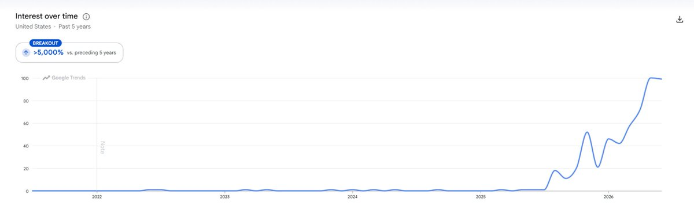
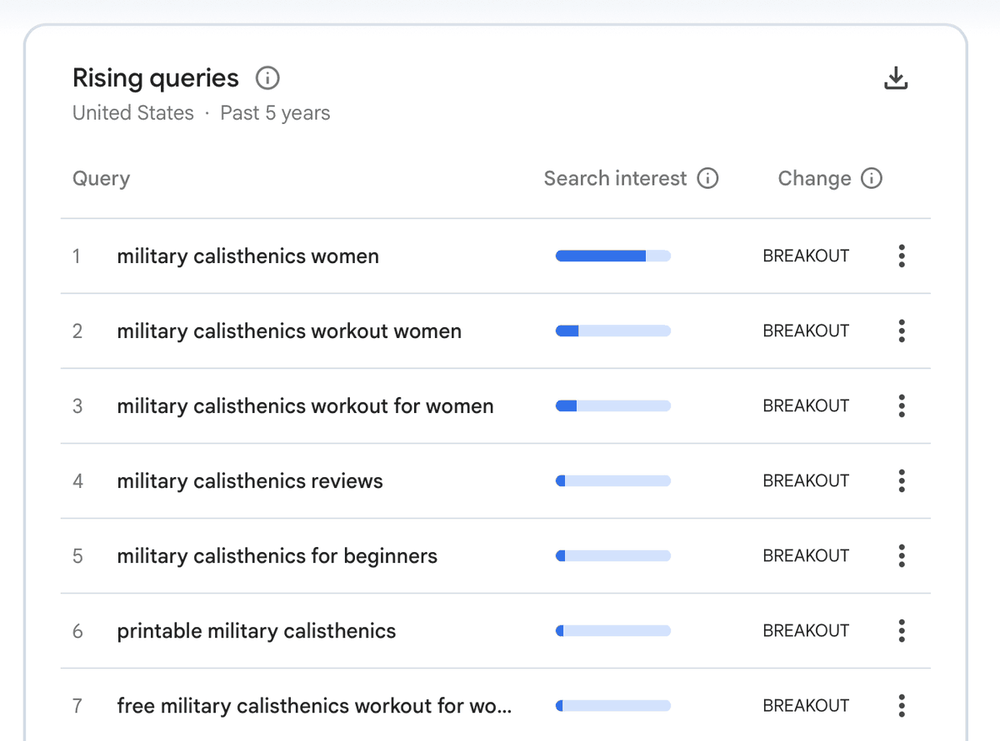
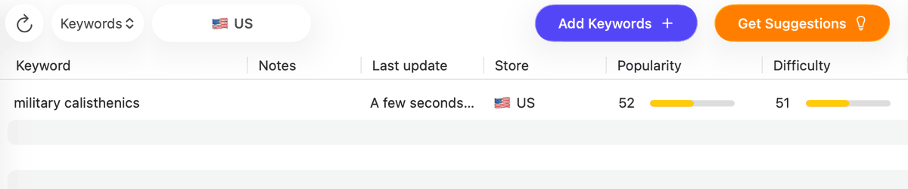
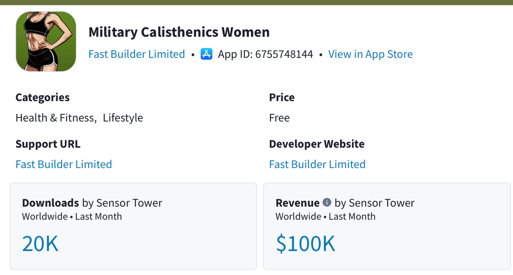
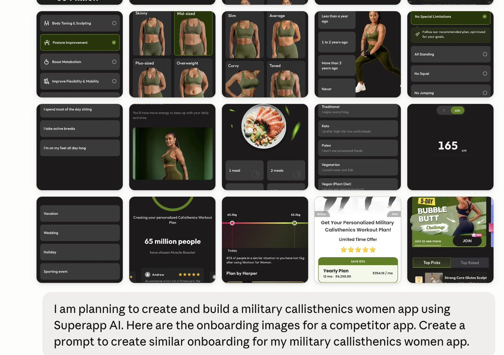
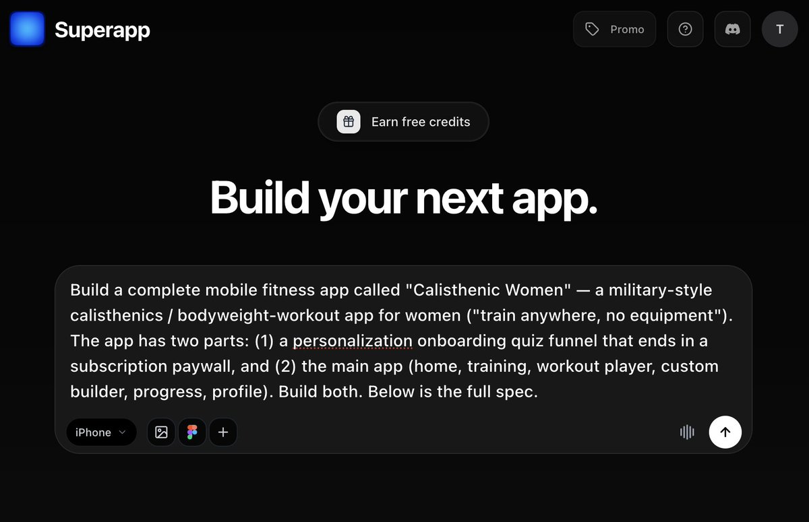

# AI, Ads & Apps（@AIAdsApps）：How to find an app idea that already has people waiting to pay for it（含 10 万美元/月案例）

> 系统拆解「先有需求、再做产品」的正确选品顺序：从 Google Trends 找增长信号、到验证是否已有真实付费、最后才动手开发；并以一个 6 个月做到约 10 万美元/月的军事体能训练女性 App（Military Calisthenics Women）为完整案例，展示如何在小众到被多数人嘲笑的赛道中找到高付费意愿的细分需求。

<!-- more -->

Most people find app ideas backwards.

They think of something clever, build it for three months, launch it - and then find out if anyone wanted it.

There’s a faster way. You find the demand first, confirm real money is already changing hands, and only then build.

Here’s the exact system I use. It’s the same one that led me to Military Calisthenics Women - a 6-month-old app doing ~$100K a month in a niche most people would laugh at.

Quick heads up before we start: this one’s brought to you by [Superapp AI](https://superappp.com/?utm_source=x&utm_medium=influencer&utm_campaign=superapp_creators_jul26&utm_content=article_1&utm_term=growthlab) ( @SuperAppIOS )- the AI app builder I use for the final step, actually shipping the app. They sponsor this article, but I’d say it anyway, and I’ll show you exactly how I use it at the end.

## 1. Start with Google Trends

Don’t start with your imagination. Start with what people are already searching for.

Open Google Trends and type in the things around your niche that are growing right now - the workouts, methods, tools, and topics people in that world are starting to talk about. One at a time, see which ones the chart is pulling upward.

You’re hunting for breakout terms - searches climbing fast with no ceiling yet.

“Military calisthenics” was up 5,000%+ in five years. That’s not a fad. That’s a wave forming.

## 2. Dig into the rising queries

A breakout term is the headline. The money is in the sub-searches under it.

Scroll to the top rising queries. That’s where you find the specific version of the demand - the one narrow enough to own.

Under “military calisthenics,” the query “military calisthenics women” was rising fast. Same demand, ten times more specific. That specificity is the opening.

## 3. Pressure-test it with ASO

Now check whether you can actually win the keyword.

Two filters do most of the work:

→ keyword popularity above 20 (enough people searching)

→ keyword difficulty under 60 (not yet a bloodbath)

“Military calisthenics” came back at popularity 52, difficulty 51. High demand, low competition. That’s the rare box - not a niche, an open ocean.

If popularity is high and difficulty is low, you’ve found a keyword you can rank #1 for before the giants notice.

## 4. Confirm people are actually paying - with Sensor Tower

Interest is cheap. Revenue is proof.

Pull the category up on Sensor Tower and look for apps already making money in the space. You’re not looking for zero competition - you’re looking for proof that this audience opens their wallet.

Military Calisthenics Women sitting at ~$100K/month told me everything: the demand converts. People don’t just search this - they pay for it.

Demand (Trends) + winnable keyword (ASO) + proven revenue (Sensor Tower). Three green lights. Now you build.

## 5. Build it with Superapp AI in 14 minutes

The novelty window is open - but not for long. If your build takes 6 months and $15k in dev costs, someone else ships first and eats your head start. So speed is the whole game here.

Here’s my exact process.

First, I download the top military calisthenics apps and screenshot every screen of their onboarding. I drop those into Claude and ask it to design a better version. Then I ask it to walk me through the new flow one screen at a time - so I know precisely what I need to build.

Then I take those screen-by-screen notes plus my app details, paste them into [Superapp AI](https://superappp.com/?utm_source=x&utm_medium=influencer&utm_campaign=superapp_creators_jul26&utm_content=article_1&utm_term=growthlab), and hit Run.

A few minutes later, I have a working app.

[video](https://video.twimg.com/amplify_video/2079891101054603264/vid/avc1/898x1638/859NjEXQSJSQZYzW.mp4?tag=29)

What sets it apart from the usual no-code tools: it generates real native Swift not a webpage stuffed into an app shell. Apple bounces those wrappers constantly. Super App Ai builds to Apple’s own design guidelines, which is why 90%+ of the apps made with it clear App Store review.

It also handles the boring plumbing for you: your database on Supabase, your subscriptions on RevenueCat and hands you a TestFlight build within hours.

Two things that sold me:

- The code is 100% yours, living locally on your Mac. Nothing to get locked into.
- Their CTO shows up in the Discord and helps builders himself.

Beat the next person to the window: [Build with Superapp AI](https://superappp.com/?utm_source=x&utm_medium=influencer&utm_campaign=superapp_creators_jul26&utm_content=article_1&utm_term=growthlab)

New here? If you’re building your first app, use promo code GROWTHLAB10 for 10 free credits - enough to spin up your first build. Only works for the first 20 people, so move fast.

## The actual lesson

Great app ideas aren’t invented. They’re found - in the gap between what people are already searching for and what nobody’s built yet.

Google Trends shows you the demand. ASO shows you if you can win. Sensor Tower shows you the money is real. Superapp gets it built before the window closes.

Find the wave first. Then build. Not the other way around.

## 相关页面

- [[sources/qianshuixia-daily-review-finding-demands-core-competency]]
- [[sources/fanshifu-grok-bot-800-new-sites-monitoring-workflow]]
- [[concepts/app-idea-validation]]
- [[concepts/gefei-seo-keywords]]
