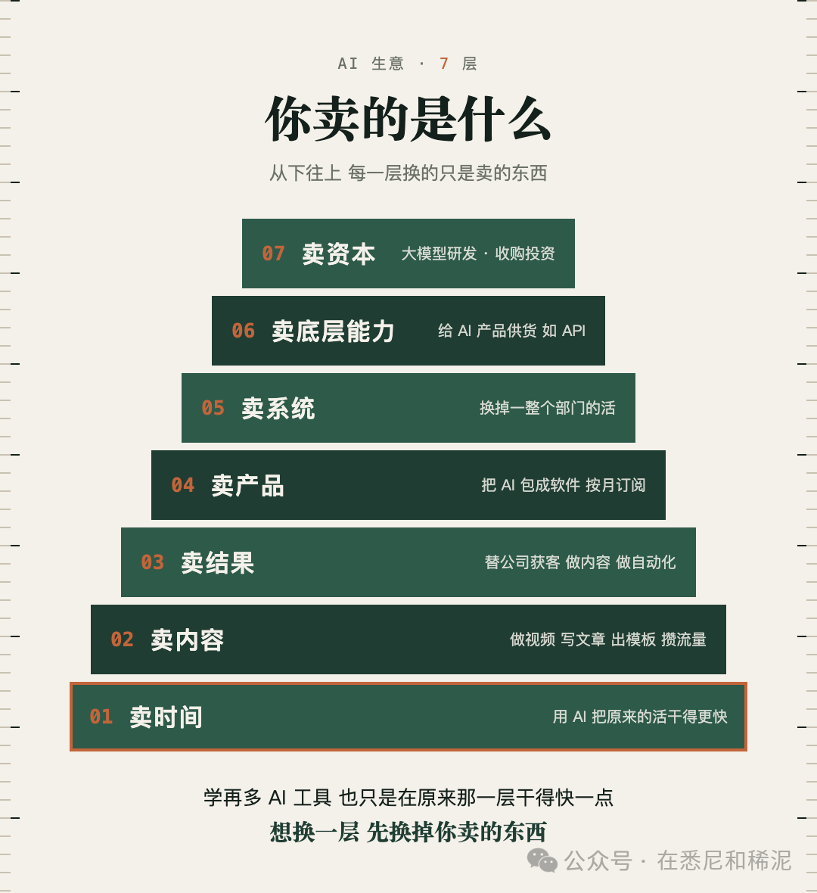

# 学了一堆 AI，还在卖时间

> AI 提高效率并不等于改变商业模式。真正的层级变化，来自交付标的从时间、内容和结果，逐步转向产品、系统、底层能力与资本。

<!-- more -->

学了一堆 AI 工具，可能从来没人告诉过你：AI 这门生意，是一层一层分的。

做自媒体也好，开店也好，想搞点副业也好，你卖的是哪一层的东西，决定了你能拿到什么样的结果。

现在教 AI 的，大多在教你怎么用工具，不讲这个。

作者表示自己直接实践过其中三层，其余层级来自观察与从业者交流。

下面从最底层开始拆解七种交付标的。

### 第一层：干得快了，卖的还是时间

第一层的人，多到数不过来。

设计师用 AI 出图，销售用 AI 找客户信息，老板用 AI 写文案、回邮件。

AI 让你一天干完原来三天的活。可你卖出去的东西一样没变，本质上还是你自己的时间。

快了，只是同样一天能多接几单。

待在这一层没什么丢人的。大多数人不会去开 AI 公司，只是把 AI 加进自己原来的活里。这一层也最好进，几乎每个上班的、做生意的人都能参与。

### 第二层和第三层：卖内容，卖结果

第二层开始卖内容。用 AI 做视频、写文章、出模板，攒到流量，再去接广告、卖课。

一个人一台电脑就能开始，门槛低，所以人挤人。人人一天都能做十几条视频，人人都能说自己是 AI 专家，视频本身就不值钱了。

值钱的是有人愿意听你说。

内容层真正稀缺的不是 AI 生成速度，而是持续实践形成的可信经验，以及长期输出积累的受众信任。

第三层，卖结果。帮传统公司做获客、做内容、做自动化，有点像代运营。

客户不管你用了什么 AI，只管你能不能帮他找到客户，能不能帮他降本。

以前一个营销公司十个人干的活，现在两三个人就够了。收入可能没降，人力成本降了一大截。AI 在这一层动的是毛利。

这一层还有个好处：你天天跟真实客户打交道，他们会告诉你愿意为什么掏钱。做一阵子，你可能发现十个客户都在要同一个功能，到那时候再把它做成软件，就到了第四层。

### 第四层：被笑话的「套壳」，是我营收的大头

第四层卖产品。把 AI 的能力包成一个软件或者一个服务，按月收订阅。

这一层有个词，叫套壳。技术圈很爱拿它开玩笑，觉得没技术含量，就是个二道贩子。

作者以自己的产品收入为例，认为垂直软件和订阅服务是更重要的收入来源；第三方支付数据核验平台也可用于减少收入案例中的自报偏差。

付钱的人不在乎你套没套壳，他在乎你有没有解决他的问题。

几乎所有软件都建在更底层的软件上，用别人的模型不丢人。要看的是你在上面加了什么：付款顺不顺、有没有做本地化、用起来方不方便、你能不能找到客户。所以做这一层，得懂产品，懂用户要什么，懂市场。

AI 让越来越多人能做软件，可它不会自动帮你找到客户。

### 再往上三层：系统、底层能力、资本

第五层卖系统。替一家公司把整个部门的活换掉，或者给它做一整套 AI 改造，也就是现在很火的 FDE。

打个比方，一家公司请一个客服一年要 8 万美元，你的 AI 客服系统一年收 2 万，它省下 6 万，照样愿意付。这种系统值多少钱，就不能按每个月 20 美元的会员来算了。

这一层排在套壳软件上面，对 AI 的理解、对客户整个业务的理解，要求都高得多。现在不少做 AI 内容的人，把自己包装成能做这一层的服务。说实话，大部分是做不了的。

第六层卖底层能力，给别的 AI 产品供货，比如做 API 接口。

这一层我也做过。2023 年，我还在上班，用业余时间做了一个 AI 出图的接口。当时我以为来买的会是程序员，拿我的接口去做产品。

上线一个月，我去翻客户记录，发现来问的人用的都是公司邮箱。一看后缀，做设计的，做营销的。他们愿意付钱，可是不会写代码。

我马上给他们做了个网页版，第二个月营收翻了五倍。

你看，我是从第六层退回了第四层，生意反而更大了。

第七层在塔尖。一种是做基础大模型研发，全世界数得过来的几个团队；另一种是拿资本做事，收购公司，做投资。到这一层，比的是你调动资源和资本的能力，会不会用 AI 已经排不上号了。

### 想换一层，先换掉你卖的东西

所以这座塔，不是越往上越好。我自己就是往下退了一层，才把生意做大的。

每往上一层，变的只有一样东西：你卖的是什么。时间，内容，结果，产品，系统，底层能力，资本。

学再多 AI 工具，也只是让你在原来那一层干得快一点。想换一层，得先换掉你卖的那样东西。

归档已删除评论引导、个人背书和悉尼线下课程报名信息，仅保留七层模型、业务案例与产品化路径。
