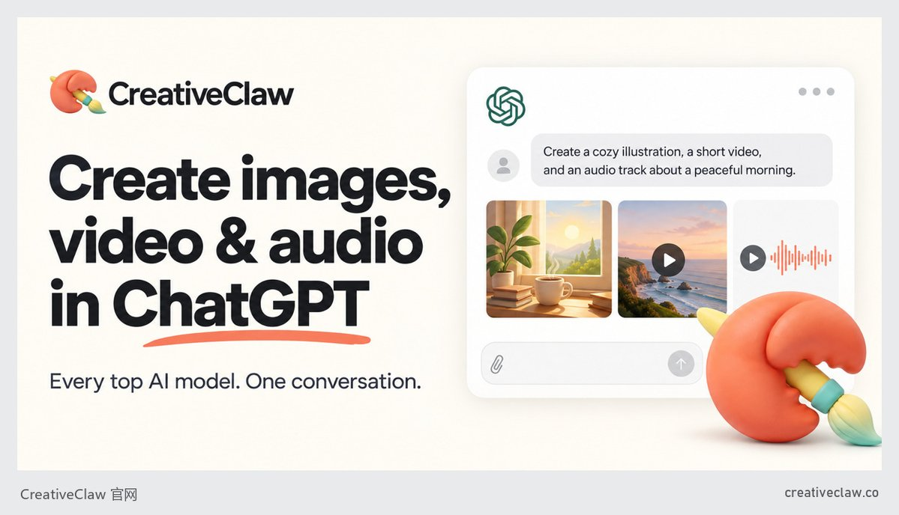
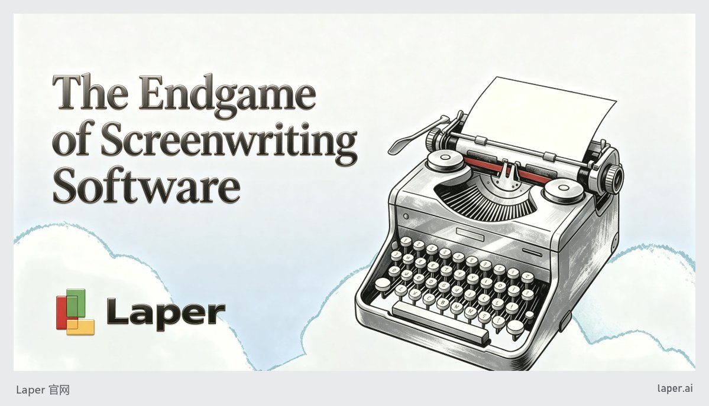
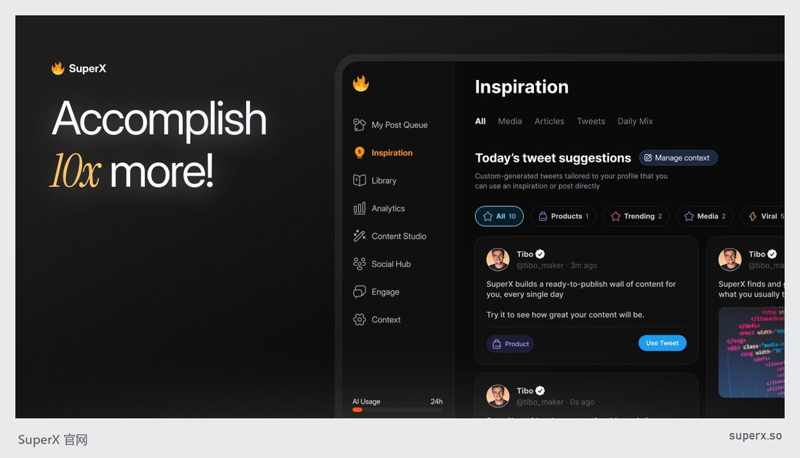
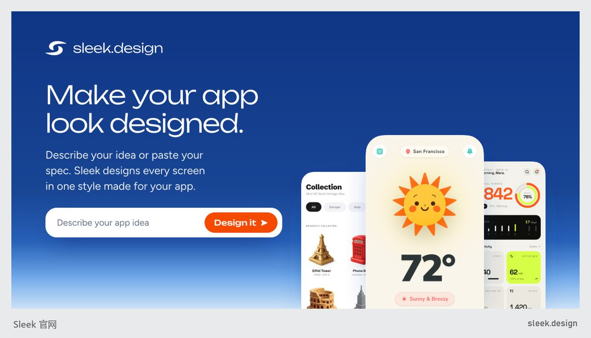
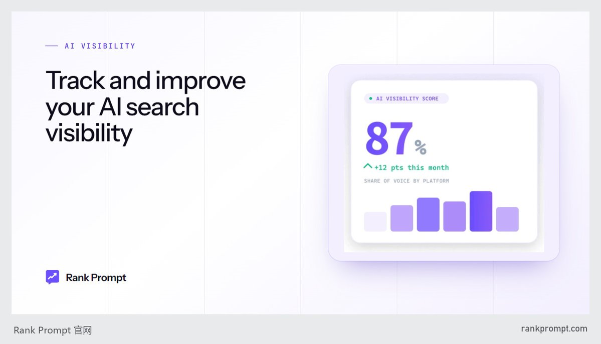

# 爱出海：46 个闷声发财的小站——翻完 1.5 万个收银台和 1161 份真实收入

> 花 1.5 万买的真实收款数据包：15000 个往 Stripe/Paddle/Lemon Squeezy 导流的网站 + 1161 份 TrustMRR 收入。筛掉大公司、停服站、查不到起步方法的，剩 46 个——31 个有真实月收入（20 个 2026 年才成立，19 个单月过$10K），15 个付费页流量暴涨。按起步方法分五组拆解。

<!-- more -->

我花钱买了一个数据包，里面 15,000 个往 Stripe、Paddle、Lemon Squeezy、Creem 这些收银台导流的网站，外加 1,161 个 TrustMRR 产品的真实收款。

一个一个筛下来，大公司全扔掉，同步停掉的扔掉，起步方法查不到的扔掉，最后剩 46 个。

31 个是真金白银的收入（TrustMRR 自动同步的 Stripe 等收款），15 个是付费页流量在暴涨的新站。

31 个收入案例里，20 个是 2026 年才登记成立的，19 个在 2026 年 9 月单月收款过了 $10,000。

说白了，这不是“AI 创业很难”的年份，是很多人闷声在收钱的年份。下面按起步方法分五组，每个案例：是什么、数字、怎么起来的、一句话结论。

## 先说清楚数据怎么看

不说清楚，这篇就是在扯淡。

- 数据来源：发大财 Pro 数据包（2026-10-30 版）。付费页流量用 Similarweb 估算，数据月份是 2026 年 9 月；收入用 TrustMRR，创始人接入收款账户后自动同步的真实收款。

- 付费页访问不是收入。点开收银台不等于付钱。小站的数会落在固定档位，是 4,298 的整数倍（4,298 / 12,894 / 21,490 / 25,788 / 30,086……），碰到这种数我会标出来，别当精确值。

- TrustMRR 只选同步正常的。入选的 31 个，同步时间都在 2026-10-23 或 10-24。2026 年 10 月是没过完的月份，所以我比的都是 9 月整月收入，10 月的数只当参考。

- MRR 和月收入不是一回事。有的站 MRR 很低、月收入很高，说明里面有一次性积分包，或者代收的流水，下面会单独点出来。

## 第一组：寄生上游，吃 Claude / ChatGPT / Apify 的饭

这一组最值得 AI 出海的人看。流量不在你自己的网站上，在别人的目录、插件市场、API 市场里。

1. CreativeClaw（creativeclaw.co）

- 是什么：一个远程 MCP 连接器，在 Claude、ChatGPT、Codex、Cursor 里加个网址，就能调 Flux、Seedance、Kling、ElevenLabs 出图、出视频、配音，按积分付费，$10 = 1,000 积分，不过期。

- 数字：2026-06 收入 $1,715，2026-08 $5,254，2026-09 直接干到 $92,894。累计 $187,123，MRR $11,040。TrustMRR 登记团队 1 人，创始人 Itay Dressler（X 443 粉）。

- 怎么起来的：Similarweb 9 月第一渠道是 Gen AI（AI 助手引荐）33.7%。挂在 Smithery、mcpservers.org、OpenAI 插件目录和 Claude 连接器目录，博客几乎每天更新“How to use X model in Claude/ChatGPT”。

- 一句话：别人在 Claude 里问“Claude 能不能出图”，答案就是你。

2. NotFair（notfair.co）

- 是什么：把 Google、Meta、X、LinkedIn、Reddit、TikTok 的广告账号接进 Claude、ChatGPT、Codex，AI 读实时数据给建议，用户批准后改出价、停关键词，写操作可撤销。Growth 约 $79/月。

- 数字：2026-04 首笔，2026-05 $5,285，2026-09 $14,519。MRR $12,878，108 个订阅。创始人 Tong Chen。

- 怎么起来的：官网自己的流量很小，入口在外面。Claude 目录、GitHub 开源技能库 notfair-plugin 有 4,081 星，再加十个 /xxx-mcp 落地页，覆盖 7 种语言。联盟 50% 分成。

- 一句话：开源一个插件当鱼饵，收费的是背后的服务。

3. Socialcrawl（socialcrawl.dev）

- 是什么：一个 Key 调 Reddit、X、TikTok、Instagram、Threads 等几十个平台的数据，统一格式，按积分扣，带 MCP 和 Agent 技能包。

- 数字：2026-06 $5,295，2026-08 $26,192，2026-09 $23,374。累计 $103,462。注意 MRR 只有 $1,083、订阅 1 个，基本全是一次性积分包。

- 怎么起来的：创始人 2026-04 发 Show HN，说首个客户来自 Threads 的一条回复。TrustMRR 来源统计里 Google 约 79%、ChatGPT 4.7%，搜索词里有竞品名 apify。

- 一句话：给 Agent 卖数据，积分包比订阅好卖。

4. Xquik（xquik.com）

- 是什么：第三方 X 数据服务，REST API、MCP、Webhook、SDK，搜推文、导粉丝、监控关键词，也在 Apify 商店卖。

- 数字：2026-03 $1,417，2026-05 $5,875，2026-09 $6,260，累计 $39,530。团队登记 1 人。

- 怎么起来的：Apify 商店自报 10K+ 用户、7.2M+ 次运行，GitHub 约 34 个仓库做 OpenClaw、Hermes、n8n 等插件，从这些地方把人引回官网充值。

- 一句话：Apify 是你的分销商，GitHub 仓库是你的广告位。

5. SoldComps（sold-comps.com）

- 是什么：一个 GET 请求返回最多 240 条 eBay 已成交价，覆盖 8 个 eBay 站点，后来加了 Poshmark、Mercari、TCGPlayer。给二手转卖定价用。

- 数字：2026-06 $1,070，2026-07 $4,337，2026-08 $12,791，2026-09 $19,984。MRR $23,526，567 个订阅。

- 怎么起来的：官网写了也在 Apify Actor 和 RapidAPI 上卖；搜索词有 ebay sold comps、ebay sale history api。

- 一句话：转卖圈的人天天要查成交价，一个 API 就够了，难的是选对这个刚需。

6. PostPeer（postpeer.dev）

- 是什么：统一社交媒体 API，一个接口在 X、Instagram、YouTube、TikTok、Threads、Pinterest 发帖、定时、回评论。

- 数字：2026-05 $843，2026-07 $3,972，2026-09 $7,374。MRR $5,179。

- 怎么起来的：2026-04 到 10 月发了约 49 篇“How to X With an API in 2026”“Best X Posting API”，加 Ayrshare 等竞品替代页；搜索词里有开发者排障的长尾问题。

- 一句话：开发者搜报错的那一刻，是最好的推销时机。

7. Adlicio（tryadlicio.com）

- 是什么：从 Reddit、Amazon、Product Hunt 等 30 多个平台批量抓真实评论，整理成广告角度、钩子和用户异议，网页、Chrome 扩展、CLI、MCP 都能用。

- 数字：2026-03 $822，2026-06 $5,266，2026-09 $10,323。MRR $10,945，527 个订阅。

- 怎么起来的：付费流量 0%，自然搜索是第一渠道。TrustMRR 归因里有个叫 “alex” 的来源占 41.1%，含义不明，档案推测是某个联盟标签。

- 一句话：投手最缺的不是素材，是用户的原话。

8. OpenTweet（opentweet.io）

- 是什么：X 发帖排期工具，带 REST API、CLI 和 MCP，让 Claude、Cursor、OpenClaw 这些 Agent 不用 X 开发者账号就能发推。

- 数字：2026-03 $2,078，2026-09 $4,374。MRR $4,011。团队 1 人，创始人 Branko（X 约 2 万粉）。

- 怎么起来的：Product Hunt 2 票，Show HN 1 分，首发基本白干。真正的量是免费工具：9 月自然搜索 76%，热词几乎全是 shadowban twitter、shadowban checker。

- 一句话：发布会没人鸟不要紧，一个免费检测工具能养活整个站。

9. NOCAPMOCAP（nocapmocap.com）

- 是什么：一句话或一段手机视频生成 Roblox R15 动画，免费 Roblox Studio 插件直接发布，也能导出 FBX。

- 数字：2026-03 $1,394，2026-07 $2,523，2026-09 $3,084，10 月没过完已经 $3,282。团队 1 人，创始人匿名（@0xcarnival，约 6,000 粉）。

- 怎么起来的：自然搜索 52.36%，词都是 roblox animation generator、roblox ai animator，引荐里 55% 来自游戏类网站。

- 一句话：Roblox 开发者是个巨大但没人伺候的小圈子。

10. localprospects.ai

- 是什么：实时抓 Google 商家资料，补老板姓名、邮箱、电话类型，CSV、API、MCP 都能取。Starter $39/月。

- 数字：2026-05 $803，2026-06 $3,585，2026-09 $10,420。MRR $8,452，192 个订阅。

- 怎么起来的：博客从 2026-03 起写 Google Maps 抓取、Claude Code 做本地线索，2026-07-07 一次发了 9 篇 Apify、Outscraper、ZoomInfo 等的替代方案对比文。30% 终身佣金。

- 一句话：竞品替代页一次铺 9 篇，两个月后收入翻了快三倍。

11. Klifgen（klifgen.app）· 付费页流量

- 是什么：按次买点数，用 Veo 3.1、Sora 2、Seedance、Wan、Grok Imagine 生成视频和图片，不用订阅。Veo 3.1 每条 $0.55 起。

- 数字：付费页访问 9 月 24,723，8 月 15,764，4–6 月均 11,895（Similarweb 估算）。

- 怎么起来的：直接访问 69.4%，社交 23%（YouTube > Reddit > X），新客来自模型教程和讨论区。

- 一句话：模型一更新，套壳按次卖的人就吃一波，订阅反而是门槛。

12. eSIMfox（esimfox.com）· 付费页流量

- 是什么：出境 eSIM 流量包，200+ 目的地，€1.99 起。

- 数字：付费页访问 9 月 31,356，8 月只有 796（Similarweb 估算）。

- 怎么起来的：搜索 50.8%，非品牌词是 esim can no longer be added 这类设备故障长尾。

- 一句话：不是 AI 也能起，故障词就是买家词。

## 第二组：老老实实吃搜索长尾

这组没啥花活，就是挑一个具体到变态的需求，把页面铺满。最适合没粉丝、不想露脸的人。

13. Laper（laper.ai）

- 是什么：网页版 AI 编剧软件，按行业格式排版剧本、分析结构、多人协作，能从剧本生成角色、场景图和分镜。

- 数字：2026-04 $595，2026-05 $5,136，2026-07 $27,108，2026-09 $46,079。MRR $46,865，1,444 个订阅，累计 $183,932。创始人赵纯想（X 约 4.7 万粉），团队 2–5 人。

- 怎么起来的：自然搜索约 40%，非品牌词是 ai screen writing、ai script writer；Similarweb 约 45% 访问来自中国，中文 AI 工具导航站收录了它。2026-05 起量的具体触发事件，档案里没查到。

- 一句话：中国团队做海外垂直工具，这是这批数据里最硬的一个样本。

14. DOWNCONVERT SKETCHUP FILES（downconvert-sketchup-files.com）

- 是什么：把新版 .skp 文件转成 2017–2023 旧版本格式。单次 $3.90，终身 $24.90。

- 数字：2025-12 首月就有 $1,132，2026-09 $7,600，累计 $37,686。

- 怎么起来的：创始人在 TrustMRR 自述 100% Google 自然搜索、无广告。65 个搜索词全是 convert sketchup 2025 to 2017 online 这种。

- 一句话：域名就是关键词，这种站丑但赚钱。

15. Play Designer Pro（playdesignerpro.com）

- 是什么：橄榄球教练在网页画战术，系统按战术本自动出测验题，球员答题上榜。

- 数字：2025-08 首笔 $100，熬了大半年，2026-04 $2,212，2026-09 $6,802。MRR $5,818。

- 怎么起来的：自然搜索 57.24%，按教练类型、战术类型（tackle/flag/touch、4v4 到 12v12）铺落地页，加队名生成器这类免费工具。

- 一句话：熬了 8 个月才过 $1K，长尾站就是这么慢热，别两个月就放弃。

16. Road to offer（roadtooffer.com）

- 是什么：麦肯锡、BCG、贝恩 case 面试和在线测评模拟，AI 面试官打分。月付 $49。

- 数字：2026-04 $971，2026-08 $4,524，2026-09 $3,523，10 月没过完已有 $4,640。

- 怎么起来的：自然搜索 67.04%，约 1.5K 个关键词，博客 590 篇。档案写明创始人在全职上班、没时间深耕。

- 一句话：上班的人也能做，前提是选一个付费意愿极强的考试。

17. MON ATELIER（monatelier.net）

- 是什么：法国手机、电脑、家电维修店用的 ERP，工单、发票、库存、POS，内置 NF525、电子发票等法国合规。Solo €19/月。

- 数字：2026-05 $2,334，2026-07 $5,222，2026-09 $3,419。团队 1 人。

- 怎么起来的：创始人自填 SEO、Facebook、Instagram、冷邮件，写明没花过营销费；博客从 2025-12 起每周一篇法语合规指南。

- 一句话：合规就是护城河，法国政府替你写了需求文档。

18. FireCert（firecert.uk）

- 是什么：消防报警、应急照明承包商出符合英国标准（BS 5839-1）的证书，证书带验证二维码。£79/月起。

- 数字：2026-04 $1,170，2026-07 $3,107，2026-09 $4,832，一个月一个台阶。

- 怎么起来的：约 262 个页面，87 个关键词落地页、144 个城市目录页；客户收到证书时会看到 FireCert，目录徽章换反链。

- 一句话：B2B 无聊行业 + 产出自带品牌，增长曲线稳得一批。

19. Aisle（aisle.wedding）

- 是什么：婚礼网站、RSVP、宾客名单、座位表，宾客能在站内订房付款，还有场地目录和 AI 策划助手。会员 $19.99/月，宾客付款收 5%。

- 数字：2026-08 $3,726，2026-09 $9,855，10 月没过完已 $13,889。注意 MRR 只有 $2,119，月收入里很可能有宾客付款的流水，档案也这么说。

- 怎么起来的：自然搜索 42.01%，116 个词几乎都是具体婚礼场地长尾，比如阿尔巴尼亚海边能住 41 人的场地。

- 一句话：场地目录拉流量，抽佣才是真收入。

20. TubeTube（tubetube.io）

- 是什么：粘贴歌词或故事，自动作曲配音、拆分镜、保持角色一致，出儿歌、睡前故事视频。Starter $22/月。

- 数字：2026-08 $2,212，2026-09 $7,513。MRR $5,981。

- 怎么起来的：1,100 多条社区公开视频，免费导出带 tubetube.io 水印，40 多个落地页（AI kids song video generator、Sora 2 alternative 等）。

- 一句话：水印是最便宜的广告，儿歌赛道还没被卷死。

21. Autoclip（autoclip.dev）

- 是什么：粘视频链接，AI 找高光、裁 9:16、加字幕，可监控 YouTube/Twitch/Kick 频道自动出片。

- 数字：2026-05 $900，2026-06 $3,678，2026-09 $10,068。MRR $12,756，408 个订阅。

- 怎么起来的：自然搜索 54%，博客铺“最佳 AI 剪辑工具”“XX 替代品”。官网 Earn 页直接对接 Content Rewards、Vyro 这些按千次播放结算的剪辑活动，让用户先用工具赚到钱再续费。

- 一句话：帮用户赚钱的工具，续费不用求。

22. rapp-app.com · 付费页流量

- 是什么：比利时荷兰语驾照理论考试练习站，Premium 一次性 €9.99 用 14 天。

- 数字：付费页访问 9 月 32,562，8 月 185（Similarweb 估算）。

- 怎么起来的：搜索 43.2%，词是 theorie examen belgie rijbewijs b 这种考试词。

- 一句话：小语种 × 考试，竞争小到离谱。

## 第三组：自带圈子，把粉丝搬进产品

有号的人看这组。起步最快，但天花板就是你圈子的大小。

23. SuperX（superx.so）

- 是什么：X 帖子 AI 写作、定时发布、数据分析的网页加 Chrome 扩展。Pro $49/月。

- 数字：2025-10 首个整月 $9,927，2026-02 $30,356 见顶，2026-09 $20,753。MRR $21,423，505 个订阅。

- 怎么起来的：创始人 Rob Hallam X 约 6.7 万粉，公开建造发帖带来最早的用户；引荐里有 indiehackers.com 3.09%。

- 一句话：粉丝起步很猛，但从顶峰回落了三分之一，圈子用完要换引擎。

24. Alchie（alchie.fr）

- 是什么：AI 先语音采访你 10 分钟，再用你自己的语气写 LinkedIn 帖子，法语英语都行。€19/月起。

- 数字：2026-05 $5,476，2026-09 $19,343，比 8 月 $8,975 翻了一倍多。MRR $11,479。

- 怎么起来的：创始人是 4.4 万粉丝的 LinkedIn 代笔写手（档案推测新客来自他自己的圈子），直接访问 77%，关键词几乎全是品牌词。

- 一句话：把自己的手艺做成产品，卖给原来的同行和客户。

25. Ton-piston（ton-piston.com）

- 是什么：聚合 30 多个法国招聘站的实习、学徒、CDI 岗位，打匹配分，挖“隐藏岗位”决策人邮箱。Pro €9.99/月。

- 数字：2026-08 首月 $4,915，2026-09 $13,004，846 个订阅。10 月没过完是 $5,707。

- 怎么起来的：TrustMRR 登记账号 encorevitoo 约 5.3 万粉，Similarweb 唯一社交来源是 X，全部访问来自法国。创始人身份在档案里有分歧，没核实。

- 一句话：大号 + 学生刚需，上线两个月过万，但能不能留住还得看。

26. Kolbo.AI（kolbo.ai）

- 是什么：一份订阅调 GPT、Claude、Midjourney、Kling、Veo、Suno 等上百个模型，同一项目里出图、视频、音乐、成片。

- 数字：2025-06 $527，2025-11 $8,564，2026-03 $19,560，2026-09 $59,533。MRR $37,462，662 个订阅。

- 怎么起来的：直接访问 70.07%。Starter Story 访谈称主要靠创始人发作品加教程（Instagram 为主）和联盟返佣，无融资无付费广告，但 Similarweb 记到少量付费社交。

- 一句话：聚合站被骂烂了，照样有人一个月收 6 万刀，差别在作品和教程。

27. AIWriteBook（aiwritebook.com）· 反面教材

- 是什么：AI 写书，人物、大纲、正文、封面、有声书、KDP 导出。

- 数字：2026-06 冲到 $38,054，然后 7 月 $22,609、8 月 $13,169、9 月 $9,187，一路往下。

- 怎么起来的：自然搜索 41.05%，挂满 AppSumo、BetaList 等目录徽章；同团队还有读书平台 NanoReads。

- 一句话：AppSumo 终身版加目录冲出来的峰值，不等于留得住，四个月掉了四分之三。

28. JourneyFuse（journeyfuse.com）

- 是什么：给旅行顾问和旅行社的 CRM，管询盘、行程单、付款、佣金。$25/席/月。

- 数字：2026-06 $2,627，2026-07 $4,013，2026-08 $12,798，2026-09 $15,950，10 月没过完已 $16,798。MRR $10,145，509 个订阅。

- 怎么起来的：官网页脚挂旅行顾问 Facebook 群、YouTube 频道、Host Agency Reviews，档案判断获客在旅行顾问圈子里，属于推测。

- 一句话：按席位收费的行业 CRM，一个圈子传开就是一整片。

29. fantasypresidentcareer.com · 付费页流量

- 是什么：AI 总统模拟游戏，选团队、定政纲、打辩论，AI 生成的选民实时打分。订阅 £5.99/月。

- 数字：付费页访问 9 月 57,650，8 月 17,647，4–6 月均 16,080（Similarweb 估算）。

- 怎么起来的：起步方法记为已有圈子迁移，但现在付费社交约 49.9%，新客主要靠投放。

- 一句话：AI 游戏能收订阅，选题越“能聊”越好。

## 第四组：被点燃的——首发、网红、病毒

这组最爽，也最不能当方法论直接抄，因为点火那一下多半有运气。

30. Speak Silq（speaksilq.com）

- 是什么：教达里语、普什图语这些主流 App 不覆盖的中亚南亚语言，让海外后代学会家人母语。$8.25/月起。

- 数字：2026-03 首月 $9,232，2026-07 $24,155，2026-09 $18,064。1,383 个订阅。

- 怎么起来的：创始人自述：2026-03-18 X 上发布，Replit 创始人 Amjad Masad 转发；2026-03-22 一条 Instagram 帖子约 6 万播放带来爆发（脚本用 Claude 起草）；拿了 Replit 挑战赛 $5K 奖金。

- 一句话：Duolingo 看不上的语言，就是你的市场。情感需求 + 小语种，这个太对了。

31. Sleek（sleek.design）

- 是什么：一句话生成整套风格统一的手机 App 界面，可导出 Figma 或代码。

- 数字：2026-03 TrustMRR 开始追踪当月就 $14,316，2026-04 $32,436 见顶，2026-09 $20,456。MRR $19,536。

- 怎么起来的：官网展示 Starter Story 视频（230K+ 播放）；现在最大的搜索词是 green screen remover 这种跟产品无关的免费工具词，来自 /tools 下的小工具。

- 一句话：媒体点火，免费工具接流量，但 MRR 从 $27K 掉到 $19.5K，档案里写着。

32. unfair.so · 口径要打星号

- 是什么：品牌写好 X 发布帖，平台匹配一批创作者到点同时引用转发，集中扩散。$99/月起，另收创作者花费的平台费。

- 数字：2026-08 $27,546，2026-09 $186,073，10 月没过完已 $381,008。但 MRR 只有 $32,273、44 个订阅。

- 怎么起来的：自然社交 59.6%，只有 X；访问者 81% 来自印度。官网称自家发布帖 23.1 万浏览、50+ 演示预约。

- 一句话：数字很吓人，但档案明说收入里含大量创作者代付预算，不是订阅收入，别拿来对标 SaaS。思路值得看：卖的是“发布当天的声量”。

33. OpenSEO（openseo.so）· 付费页流量

- 是什么：开源 SEO 平台，关键词、外链、排名、AI 可见度，可自托管，托管版 $10/月起按用量付费，带 MCP。

- 数字：付费页访问 9 月 54,365，8 月 25,527，7 月 60（Similarweb 估算）。

- 怎么起来的：首发平台起步，GitHub 开源（首页显示 24.6k），引荐有 ycombinator.com、saashub.com。

- 一句话：开源当获客，托管当收入，Ahrefs 太贵就是你的机会。

34. Lightreel（lightreel.ai）· 付费页流量

- 是什么：每天扫上万条 TikTok/Instagram 视频，帮品牌找达人、出脚本和钩子。Pro $199/月。

- 数字：付费页访问 9 月 48,558，8 月 24,248，4–6 月均 16,544（Similarweb 估算）。

- 怎么起来的：首发平台起步，引荐来自 viralbench.ai 8.91%、creatorstoolbox.com 6.46%。

- 一句话：$199/月的 UGC 研究工具也有人买，别把定价压太低。

35. Krillion（krillion.io）· 付费页流量

- 是什么：每日联想谜题，全球同一题，答案越冷门分越高。

- 数字：付费页访问 9 月 652,144，8 月 152,241，7 月 1,925（Similarweb 估算），档案记环比 +334%。

- 怎么起来的：8 月起 TikTok/Instagram 玩家自发扩散，9 月下旬 ohnePixel 等大主播接力；引荐里 nytimes.com 4.93%、twitch.tv 2.52%。

- 一句话：每日一题 + 能晒分，Wordle 的路还没走完。

36. Wiki Masters（wiki-masters.com）· 付费页流量

- 是什么：法语卡牌收集游戏，每张卡由一篇维基百科条目生成，开包、对战、公会、拍卖。

- 数字：付费页访问 9 月 202,770，8 月 13,762，7 月 1,092（Similarweb 估算）。

- 怎么起来的：主播或媒体点燃，增长引擎是拉人才能玩（好友对战、公会、排行）。

- 一句话：维基百科是免费的无限内容库，卡牌只是个壳。

37. TMOG（tmog.org）· 付费页流量

- 是什么：Windows 任务管理器原作者 Dave Plummer 做的跨平台任务管理器，Pro 一次性 $39.95。

- 数字：付费页访问 9 月 58,604，前几个月几乎为 0（8 月 1，7 月 2）（Similarweb 估算）。

- 怎么起来的：作者本人的 YouTube 和媒体报道，社交 YouTube > X > Facebook。

- 一句话：身份就是流量，“原作者重做”这个故事本身就是广告。

38. CareerHound（careerhound.io）· 付费页流量

- 是什么：汇总只在公司官网发布、不在 LinkedIn/Indeed 上的职位，付费解锁完整访问。

- 数字：付费页访问 9 月 31,658，8 月 39,195，4–6 月均 3,803（Similarweb 估算）。

- 怎么起来的：档案引用的核实信息称创始人 TikTok 70K+ 粉丝、1,700 万播放；搜索 86.9% 是品牌词。

- 一句话：短视频讲“隐藏岗位”这种信息差，转化特别直接。

39. Infinite Slop（infiniteslop.ai）· 付费页流量

- 是什么：@levelsio 和 fal.ai 做的 24 小时 AI 生成电视频道，观众投票决定下个节目。活动已经结束，转到 FAL.live。

- 数字：付费页访问 9 月 36,791，8 月 132（Similarweb 估算）。

- 怎么起来的：levelsio 在 X 上的传播。

- 一句话：大号的活动型产品，来得快走得也快，看个热闹就行。

## 第五组：花钱买量，和抢新品类窗口

买量能起，前提是你算得清 LTV。 这组数据里很多站付费渠道占一半。

40. White Glove Content（whiteglovecontent.com）

- 是什么：月付代做无脸频道内容，脚本、AI 配音、剪辑、缩略图全包。$54/月起。

- 数字：2026-04 首月 $2,142，2026-05 $22,363，2026-09 $68,310。MRR $65,140，548 个订阅。

- 怎么起来的：付费合计约 42.8%，展示广告、付费社交；Trustpilot 一位客户说在 Instagram 上看到。创始人和团队都没署名。

- 一句话：AI 做交付、广告做获客、订阅做留存，这是服务生意的 AI 版本，做得好比 SaaS 还猛。

41. VendPlacer（vendplacer.com）

- 是什么：按城市和场所类型列出能摆自动售货机的位置，首页称 22,876 个地点、420 个城市。$69/月。

- 数字：2026-05 $1,324，2026-07 $9,268，2026-09 $11,246。

- 怎么起来的：59 个关键词里付费占 41.24%，词是 best places to place vending machines near me 这种找位置的问句。

- 一句话：给“副业搞售货机”的人卖铲子，美国副业圈的需求是真的大。

42. Rank Prompt（rankprompt.com）

- 是什么：监测品牌在 ChatGPT、Gemini、Perplexity、Claude、Grok、Google AI Mode 里被提到和引用的情况，给代理商白标报告。

- 数字：2025-09 $4,077，2026-03 $21,245，2026-09 $45,493。MRR $43,721，累计 $305,697。

- 怎么起来的：外部事件顺风，GEO/AI 搜索可见度成了新品类；代理商通过 PartnerStack 返佣分发。

- 一句话：新品类出来的头一年，谁先占位谁收钱，现在做 GEO 监测已经晚了，但下一个品类不会晚。

43. MyClaw（myclaw.ai）· 付费页流量

- 是什么：一键托管 OpenClaw、Hermes Agent、Claude Code、Codex 等 Agent，24 小时在线。$29/月起。

- 数字：付费页访问 9 月 24,021，8 月 4,919（Similarweb 估算）。

- 怎么起来的：抢新平台窗口；付费搜索 55.3%，买的是 chat gpt、claude、openclaw 这种大词，品牌词 0%。

- 一句话：Agent 部署门槛就是生意，但全靠买大词，利润薄不薄只有自己知道。

44. votremelodie.com · 付费页流量（档位数）

- 是什么：法语定制歌曲礼物，填问卷讲故事，4 天交付。

- 数字：付费页访问 9 月 292,264，之前三个月都是 0（Similarweb 估算）。292,264 正好是 4,298 的 68 倍，落在档位上，只能看量级。

- 怎么起来的：付费社交 48.7%（Facebook 广告），邮件 35.1%。

- 一句话：情绪礼物 + Facebook 广告，从 0 起量最快的组合之一。

45. Questner（questner.ai）· 付费页流量

- 是什么：AI 主持的文字冒险游戏平台，玩家自建剧本。

- 数字：付费页访问 9 月 99,388，8 月 58,183，4–6 月均 1,229（Similarweb 估算）。

- 怎么起来的：起步靠花钱买量，增长引擎是创作者供给（社区剧本）。

- 一句话：买量拉第一批人，让用户自己生产内容，之后就不用一直买。

46. RPBuddy（rpbuddy.ai）· 付费页流量

- 是什么：AI 角色扮演沙盒，逐格搭六边形地图，AI 生成聚落、NPC、剧情，NPC 有记忆。$10/月起。

- 数字：付费页访问 9 月 39,694，8 月 5,333（Similarweb 估算）。

- 怎么起来的：付费社交 44.0%，搜索词只有 rpbuddy 和 ai rpg sanbox。

- 一句话：AI RPG 这个赛道正在被买量的人试，谁的留存好谁活。

## 看完 46 个，我的几个判断

1，最大的流量入口已经不是 Google，是 AI 本身。

CreativeClaw 9 月最大的渠道是 AI 助手引荐，NotFair 的入口在 Claude 目录和 GitHub。做 MCP、做插件、上 Apify，这是 2026 年最便宜的分发。

2，积分包比订阅好卖，尤其卖给 Agent 的。

Socialcrawl 只有 1 个订阅，9 月收了 $23,374。按量付费的东西，别硬塞订阅。

3，长尾站慢，但稳。

Play Designer Pro 熬了 8 个月才过 $1K，FireCert 每个月一个台阶。没粉丝的人，这条路最实在。

4，有号起步快，但别把峰值当常态。

SuperX 从顶峰回落三分之一，AIWriteBook 四个月掉了四分之三。粉丝和首发能把你送上去，留不留得住是产品的事。

5，看到吓人的数字，先看口径。

unfair.so 9 月 $186,073，MRR 才 $32,273；Aisle 月收入远高于 MRR。代收流水和订阅收入是两码事，拿来对标会把自己坑死。

6，小语种、小行业、小考试，全是机会。

达里语、比利时驾照、法国维修店合规、英国消防证书，这些需求大公司根本看不上，你看得上就够了。

说白了，这些人没啥神秘的，就是选了一个具体的人群，找到了一个具体的入口，然后一直干。

数据会骗人，但收款记录不太会。

数据来源：发大财 Pro 数据包（2026-10-30 版）。付费页访问为 Similarweb 估算，数据月份 2026 年 9 月，不代表收入；收入为 TrustMRR 同步的真实收款，入选案例同步时间为 2026-10-23/24，2026 年 10 月为不完整月。

## 相关页面

- [[sources/xuxuanzhou-72h-5480usd-new-word-site]]
- [[sources/hezhiyan7-new-word-site-recap-roundup]]
- [[sources/web30708-30-overseas-income-recaps]]
- [[sources/taowithsaas-ezmaker-traffic-analysis]]
