# 让 AI 用代码做视频：四类路线与九种实现方法

> 代码视频不是让模型直接生成像素，而是让模型编写一个可复现的渲染程序：程序根据帧号或时间计算画面，再由浏览器、图形引擎或 3D 工具逐帧输出，最终通过 FFmpeg 合成为视频。

<!-- more -->

作者：空格丶  
原文发布日期：2026-10-20

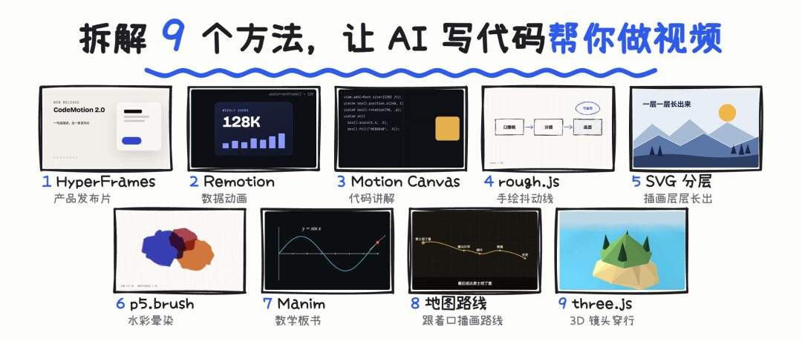

## 代码视频与生成式视频的差异

生成式视频模型直接预测每一帧的像素；代码视频则先定义场景、对象、时间轴和渲染函数，再把每一帧确定性地算出来。

```text
帧号或时间
  -> 动画函数计算状态
  -> 浏览器或渲染引擎绘制画面
  -> 逐帧截图
  -> FFmpeg 编码为 MP4
```

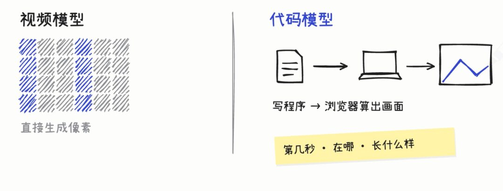

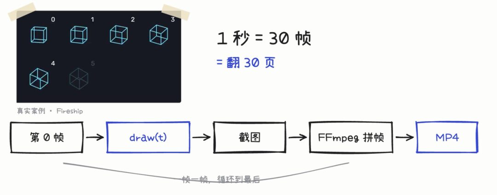

代码视频最直接的优势是：

- **可复现**：同一份输入和代码可以重复得到一致结果。
- **可精确修改**：位置、颜色、字号、节奏和镜头都能参数化调整。
- **可模板化**：替换数据、文案和素材即可批量生成同类视频。
- **Agent 友好**：模型通常比操作传统剪辑 GUI 更擅长读写 HTML、React、TypeScript、Python 和 JSON。

它的代价是前期需要建立代码结构、素材规范和渲染环境；人物表演、自然运动和开放世界镜头也未必适合纯代码生成。

## 类型一：浏览器逐帧渲染

### 1. HyperFrames：HTML + GSAP 时间轴

HyperFrames 把视频当成网页：文字和卡片是 HTML 元素，样式由 CSS 控制，动画由 GSAP 时间轴描述。渲染时暂停时间轴，依次跳到目标帧并截图。

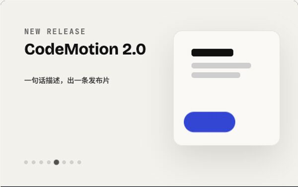

适合信息图、产品演示、口播包装和网页视觉。它还能组合 rough.js、p5.js、Three.js 等浏览器库。

### 2. Remotion：React 组件根据帧号计算画面

Remotion 将视频表达为 React 组件。组件通过当前帧号计算元素状态，常用 `interpolate` 映射数值，用 `spring` 产生弹性运动。

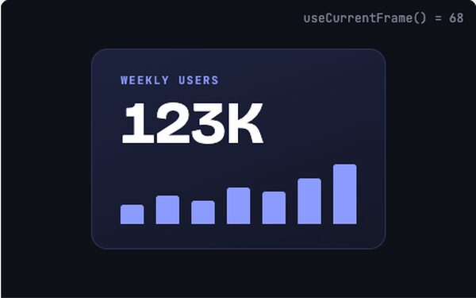

它适合多场景拼接、逐词字幕、数据驱动模板和批量视频。优势是组件复用与 React 生态，代价是需要理解 React 和帧驱动动画。

### 3. Motion Canvas：按时间顺序编写动画剧本

Motion Canvas 更接近生成器式时间轴：开发者按顺序描述动作、等待和转场，而不是在每一帧自行计算所有状态。其代码块、矢量图形和时间轴能力适合编程教学和技术演示。

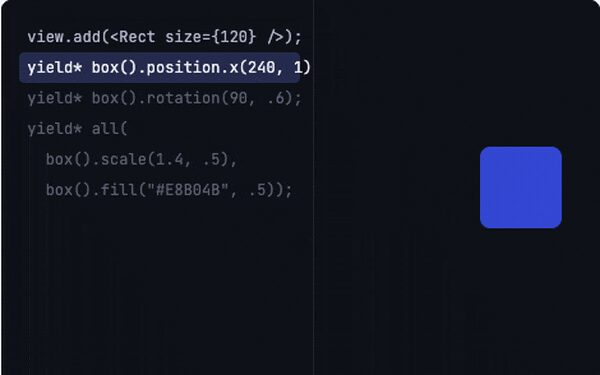

## 类型二：手绘、分层插画与水彩

### 4. rough.js：用受控随机模拟手绘线条

rough.js 会对端点和路径加入小幅随机扰动，并叠加多条略有差异的曲线，形成铅笔重复描线的效果。

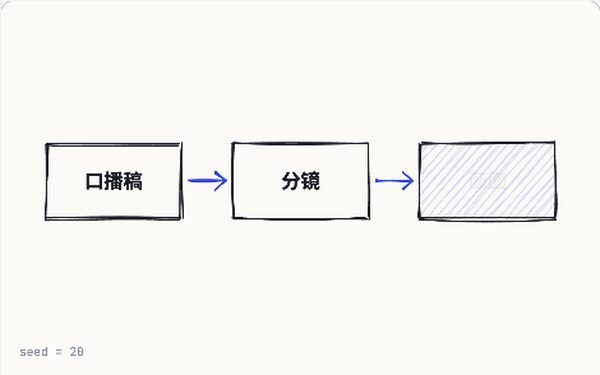

为了保持视频可复现，随机数应使用固定种子，而不是每次渲染都产生不同结果。

### 5. 分层插画：把静态画面拆成可独立运动的层

将插画拆为天空、远山、近景、人物、装饰和文字等图层，再让各层错开入场。SVG 路径常通过 `stroke-dasharray` 与 `stroke-dashoffset` 制作描边生长动画；纸拼贴则把每一层替换为独立图片。


关键工作不在“让整张图片动”，而在前期建立可分离、可遮挡、可排序的图层资产。

### 6. 数字水彩：多层低透明度随机形状叠加

数字水彩可以从一个多边形开始，递归细分边缘并加入小幅扰动；随后生成多份略有差异的形状，以较低透明度叠加。中心区域覆盖次数多、颜色深，边缘覆盖次数少、颜色浅，从而形成晕染感。

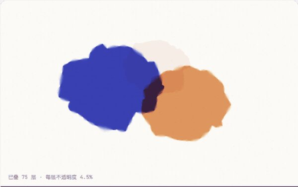

p5.brush 等库把水彩、铅笔、马克笔和炭笔效果封装为可调用的浏览器笔刷。

## 类型三：数学板书与地图路线

### 7. Manim：数学对象与公式变换

Manim 将曲线、坐标轴、几何图形和公式表示为数学对象。LaTeX 公式被渲染为矢量路径，动画则描述对象状态之间的变换，特别适合数学、科学和算法讲解。

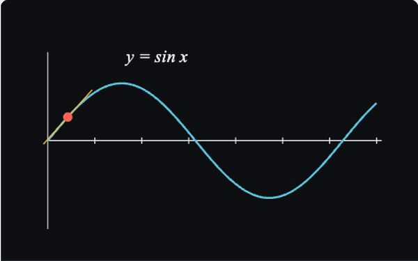

### 8. 地图路线：用音频时间戳驱动空间进度

地图动画可以先生成旁白和句级时间戳，再把每句话对应到路线节点。两句话之间，路线进度和镜头位置从上一个节点平滑插值到下一个节点。

```text
旁白文本 -> TTS 音频与时间戳
         -> 地名解析与路线规划
         -> 镜头表 JSON
         -> Chromium 逐帧渲染
         -> FFmpeg 输出
```

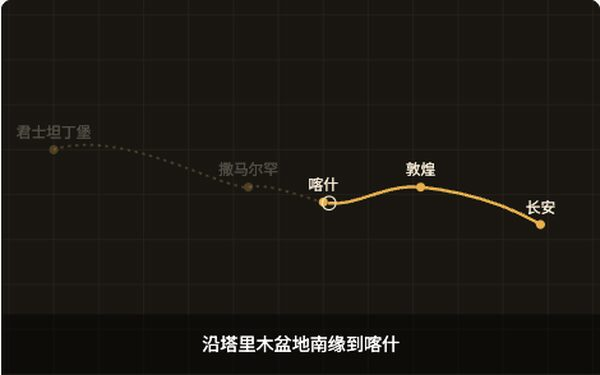

地图底图、路线和经纬度应来自可靠地图服务；原文示意图中的城市位置并非真实地理数据。

## 类型四：3D 视频

### 9A. Three.js：网页中的实时 3D

Three.js 场景的核心是物体、灯光和相机。视频镜头可以沿平滑曲线运动，并持续朝向路径前方或目标对象。

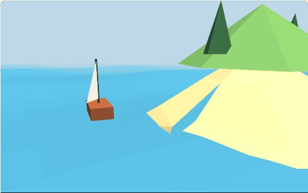

给 Agent 描述场景时，可以明确三部分：主体是什么、场景必须包含什么、禁止出现什么。还应补充画幅、材质、光照、相机路径和运动节奏。

### 9B. Blender + MCP：完整 3D 资产与关键帧

需要复杂模型、骨骼动画、黏土材质或真实灯光时，可以让 Agent 通过 Blender MCP 操作 Blender：创建对象、设置材质、添加关键帧、渲染截图并依据结果迭代。

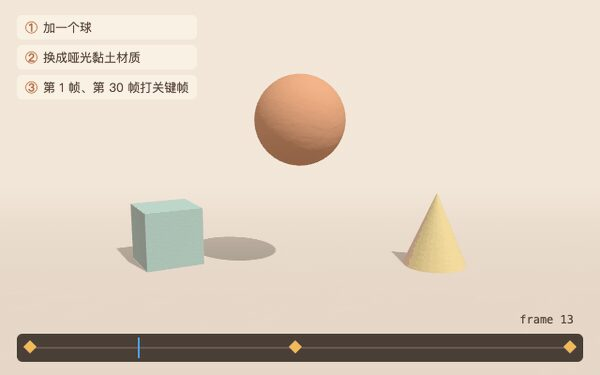

Blender 的能力更完整，但环境、资产和渲染成本也更高，不应因为能被 Agent 调用就忽略 3D 制作本身的复杂度。

## 选型矩阵

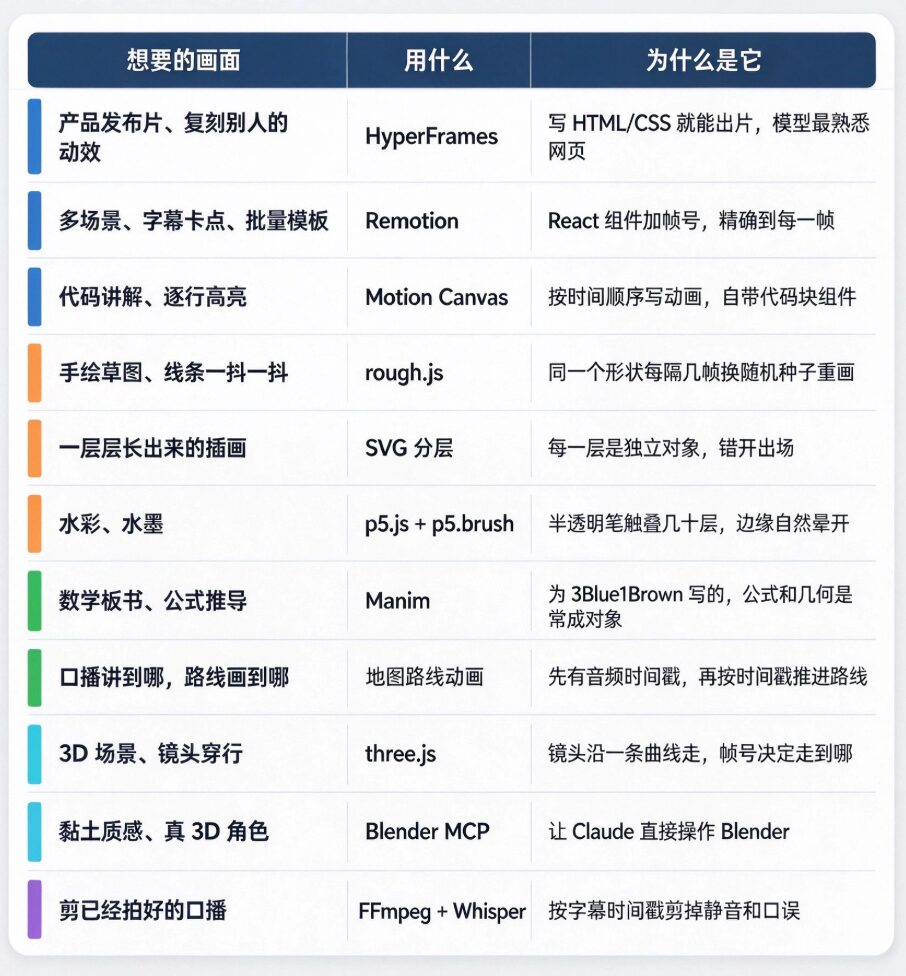

| 目标 | 优先工具 | 选择理由 |
|------|----------|----------|
| 信息图、口播包装、产品演示 | HyperFrames | HTML/CSS/GSAP 容易被 Agent 生成和修改 |
| React 模板与批量栏目 | Remotion | 组件和数据驱动能力强 |
| 编程教学与时间轴叙事 | Motion Canvas | 生成器式剧本和代码组件成熟 |
| 手绘线框、草图风 | rough.js | 受控随机形成手绘质感 |
| 分层插画、纸拼贴 | SVG / 图层动画 | 图层可独立控制与复用 |
| 水彩、笔刷和生成艺术 | p5.js / p5.brush | 像素与笔刷控制灵活 |
| 数学和科学解释 | Manim | 数学对象、LaTeX 和变换语义明确 |
| 旅行、路线和空间叙事 | 地图 API + 浏览器渲染 | 真实地理数据可与旁白时间轴绑定 |
| 网页 3D 与轻量镜头 | Three.js | 浏览器实时渲染，容易嵌入网页管线 |
| 复杂角色、材质和完整 3D | Blender + MCP | 完整 3D 制作与离线渲染能力 |

## 给 Agent 的任务描述框架

与其只说“做一个好看的视频”，不如固定以下输入：

1. **输出规格**：画幅、分辨率、帧率、时长和编码格式。
2. **叙事结构**：场景清单、每段时长、旁白和转场关系。
3. **视觉系统**：色板、字体、材质、线条、背景和参考图。
4. **时间轴**：对象何时出现、移动、强调和消失。
5. **素材契约**：图片、音频、字幕、地图数据和 3D 资产路径。
6. **确定性约束**：固定随机种子，避免依赖实时数据和不稳定网络资源。
7. **质量门禁**：检查溢出、缺字、遮挡、空帧、音画同步和编码结果。

## 边界与风险

- “代码视频能媲美视频模型”取决于视频类型。信息图、教学、地图和可视化适合代码；自然人物表演和复杂真实世界运动通常更适合生成式视频或实拍。
- 稳定输出依赖固定字体、锁定依赖版本、本地化素材、固定随机种子和一致的渲染环境。
- 批量生产之前应先验证一条完整样片，而不是直接扩大产量。
- 第三方素材、地图、字体、音乐和模型资产仍受版权及平台许可约束。
- “起号”是内容分发结果，技术管线只能降低制作成本，不能保证流量或商业回报。

## 相关页面

- [[concepts/ai-content-pipeline]]
- [[sources/codex-video-production-skills]]
- [[summaries/hypit-agent-video-workflow]]
- [[patterns/video-prompt-reverse-engineering]]

归档时已删除点赞转发话术、作者自有 Skill 的推广入口和结尾二维码，并把动态图转换为代表性静态帧以控制站点构建体积。
