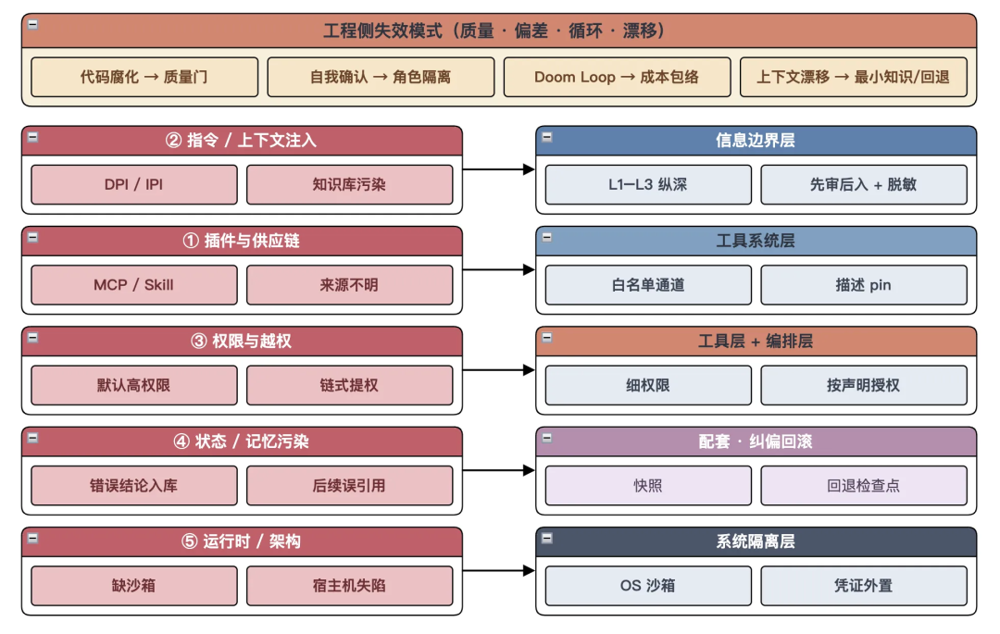
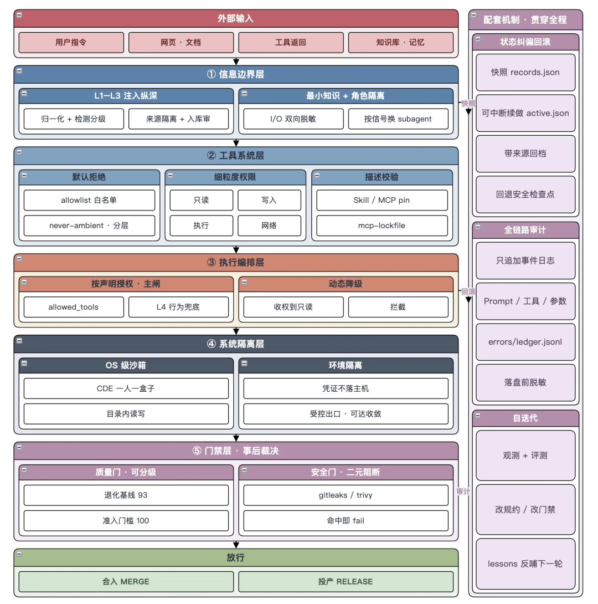
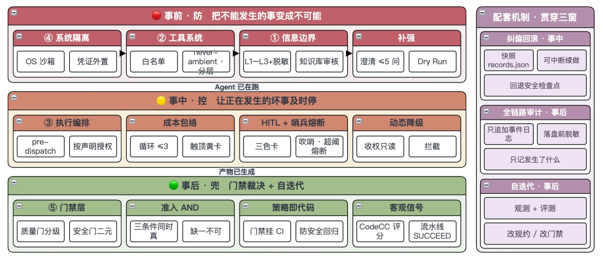
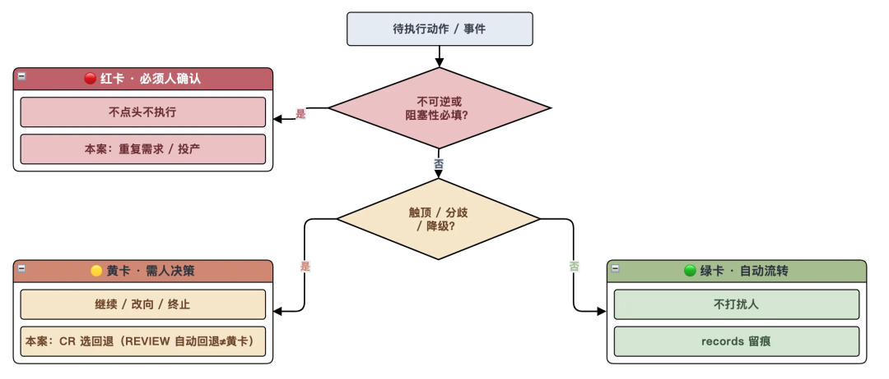
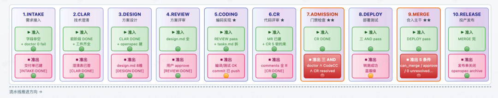
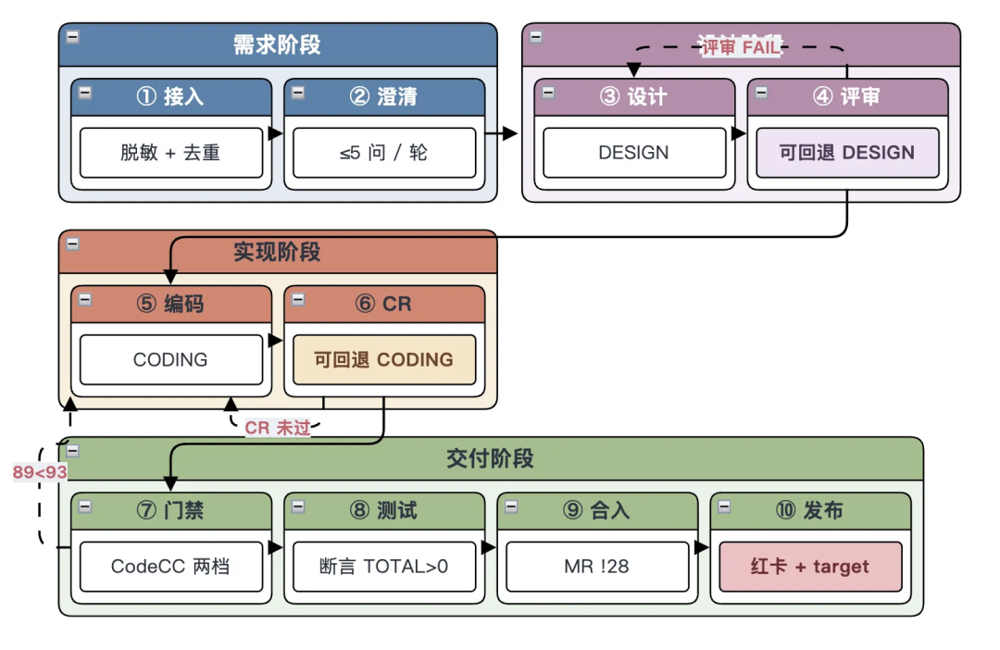
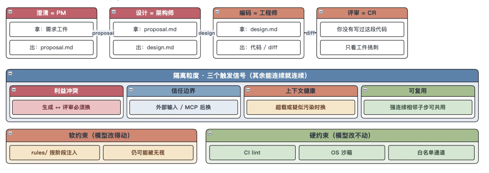
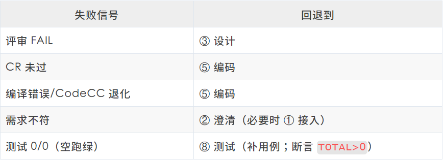
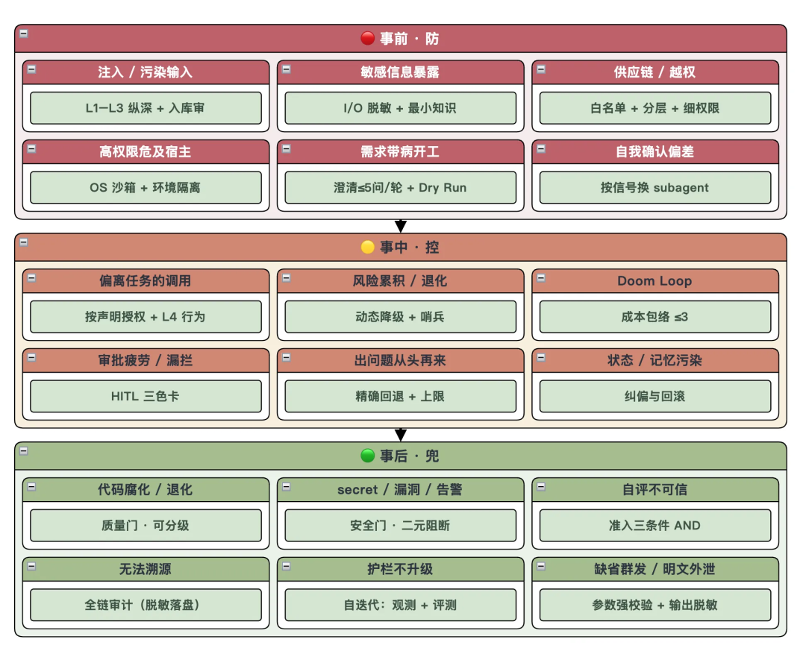

# AI 工程化防翻车指南：把安全边界外置到 Harness

> Agent 获得代码、文件、网络和工具权限后，安全不能只靠提示词，而要外置到模型无法绕过的 Harness 执行点：事前缩小攻击面，事中限制运行，事后用确定性门禁裁决，并以审计和评测持续升级护栏。

<!-- more -->

作者：徐鑫

## 问题：能力与风险同时上升

Agent-First 开发中，人的工作逐渐从亲自编码转向设计运行环境、制定规范、拆分任务和验收结果。模型可以调用工具、执行代码和修改文件后，风险也从错误回答升级为真实副作用。

风险分成两类：

### 工程侧自然失效

- **代码腐化**：每次生成引入少量冗余、不一致和次优实现，长期累积为技术债。
- **自我确认偏差**：同一 Agent 同时实现和评审，倾向于认可自己的产物。
- **失控循环**：Agent 反复修改同一处，持续消耗时间和预算。
- **上下文漂移**：长任务被历史对话带偏，逐渐忘记原始目标。

### 外部攻击面

- 直接或间接提示词注入。
- 恶意网页、PDF、代码注释、知识库条目和工具描述。
- MCP、Skill 和插件供应链投毒。
- 权限过大、凭证泄露、危险默认参数和未授权副作用。

聊天机器人被注入时主要污染输出；拥有工具权限的 Agent 被注入后，可能影响数据、权限和真实系统。因此目标不是宣称彻底消灭注入，而是持续压低成功率并锁死损失上限。

## 核心原则

文章将 Harness 安全概括为 **Never Trust, Always Verify**：默认不信任输入、中间产物和工具调用，在整个生命周期持续验证。

四条设计原则是：

1. Harness 配置、工具、权限和门禁是一等治理资产。
2. 安全评估对象是“模型 + Harness”的组合，换模型后需要重新评估。
3. 状态变更必须可中断、可恢复、可回滚。
4. 强制边界应放在模型无法修改的网络、系统和执行层，而不是只放在提示词或配置文本中。

## 事前、事中、事后三个窗口

四层纵深防御包括信息边界、工具系统、执行编排和系统隔离；高破坏动作还需要通过门禁层。回滚、审计和自迭代贯穿全过程。

### 事前：缩小攻击面

#### 系统隔离

- 在 OS 级沙箱中限制代码、文件和网络访问。
- 每个任务只挂载必要工作区。
- 真实凭证不驻留 Agent 主机，按调用注入短时、任务域 Token。
- 启动自检不通过即 Fail-Closed。

#### 工具与权限

- 默认拒绝，使用白名单而非依赖黑名单。
- 将读、写、执行和网络权限拆开授予。
- 高危能力 Never-Ambient：按主体、按本次运行授权，用完回收。
- 按爆炸半径分层：只读可自动放行，非生产写受限，生产写强制审批。
- 对 MCP 和插件固定版本，并校验名称、描述和 Schema 哈希，防止服务端静默修改工具语义。

#### 信息边界

所有用户输入、网页、工具返回、RAG 结果、记忆和 MCP 描述都先视为不可信数据：

1. **归一化**：解码 Base64、HTML Entity、URL 和 Unicode Escape，移除零宽与方向控制字符。
2. **来源隔离**：可信系统规则与不可信外部数据分槽，禁止裸拼接。
3. **检测分级**：规则与判别模型组合，根据风险放行、确认或拦截。

知识库不能天然视为可信内参。条目需要入库审核、来源追溯、版本和过期机制；检索结果进入上下文前仍需净化。输入和输出都要程序化脱敏，避免密钥、卡号和连接串随日志或通知二次泄露。

### 事中：限制运行

#### Pre-dispatch 决策点

工具真正执行前，通过确定性逻辑返回允许、拒绝或转人工审批。主闸门按声明式 `allowed_tools` 授权，动作合理性判断只能作为补充；高风险累积时自动降级为只读或冻结权限。

#### 成本包络

每类修复和评审循环设置明确上限。触顶后不继续硬闯，而是暂停并交由人选择继续、改变方向或终止，防止 Doom Loop。

#### HITL 三色卡

- **红卡**：不可逆动作或阻塞性必填，必须人工确认。
- **黄卡**：循环触顶、评审分歧或模型降级，需要人决策。
- **绿卡**：常规低风险交接自动流转并留痕。

#### 哨兵与熔断

Trip Wire 对异常先记录、提醒和暂停，而不是首次命中就直接终止。若单任务触发高危阈值或单位时间违规超限，则启动全局熔断，转人工或冻结工具权限。

### 事后：确定性裁决

- **硬门禁**：质量指标、安全扫描和准入条件以程序运行，任一条件失败即阻断。
- **软门禁**：独立角色按 Rubric 审查逻辑合理但可能次优的方案。
- **策略即代码**：门禁脚本本身有测试并进入 CI，避免规则退化。
- **客观信号优先**：检查真实构建、测试、扫描和评分，不以“文件存在”作为通过证据。
- **危险参数显式校验**：缺失通知目标、删除范围、批处理上限或灰度范围时直接拒绝，不能采用危险默认值。

## 三项贯穿机制

### 状态纠偏与回滚

对任务阶段、中间产物、记忆和检查点持续快照。出现污染或异常时，回到最近的安全责任阶段，而不是从头重跑。Agent 系统的关键运维能力不只是高可用，也包括可中断、可恢复和可逆。

### 全链路审计

记录 Prompt、工具调用、参数、权限校验和结果，回答“发生了什么”。审计记录落盘前必须脱敏，否则可追溯链会成为新的泄露面。

### 观测与评测驱动自迭代

审计、哨兵和过程指标提供观测；测试、扫描、Dry Run 和人工确认的 Bad Case 提供评测。两者共同转化为新规则、权限收缩、脱敏策略、参数白名单、门禁阈值和回退映射。

## 映射到十阶段研发流水线

文章将护栏映射到需求接入、技术澄清、方案设计、方案评审、编码、代码评审、准入检查、测试、合入和发布十个阶段。

关键做法包括：

- 外部需求先脱敏、净化和去重，再允许开工。
- 澄清问题按风险分批，阻塞问题没有答案就不进入设计。
- 设计、实现与评审分离，存在利益冲突时必须换独立 Subagent。
- Agent 只接收当前阶段所需的工件，不传递全量历史。
- 失败回到最近责任阶段，不把整个流程推倒重来。
- 测试门禁必须断言用例数大于零，避免“0/0 通过”。
- 合入和发布只能走受控工具通道；生产发布强制红卡审批。

## 用 Dry Run 验证 Harness

Dry Run 使用虚拟需求完整走一遍流程，但不产生真实合入、发布、通知或生产写入，用于验证 Harness 本身。它应提前发现：

- 零测试用例仍显示成功。
- 空报告因文件存在而被判通过。
- 失败没有明确回退阶段。
- 状态没有持久化，任务中断后无法恢复。
- 高危操作存在绕过受控通道的路径。

## 十条可迁移原则

1. 边界设在模型改不动的执行点。
2. 永不信任，持续验证。
3. 按声明授权，不依赖意图猜测。
4. 外部输入默认不可信，知识库也不例外。
5. 每个循环设置成本上限，并配置全局熔断。
6. 人工介入按破坏力分级，避免审批疲劳。
7. 实现与评审分离，但不必机械地每一步都换 Agent。
8. 失败回到最近责任阶段，状态必须可恢复。
9. 质量可以分级，安全门必须二元 Fail-Safe。
10. Harness 需要 Dry Run、审计、评测和持续迭代。

## 信息边界

原文中的具体分数、轮数和案例状态用于演示作者的内部流程，不代表通用行业基准；“部分控制覆盖约 60% 攻击面”等表述也被作者标注为非实测经验。实际权限、阈值和审批策略必须根据业务风险重新设计。

归档时已删除公众号群聊、活动名额、服务器代金券和其他推广图片与话术。
