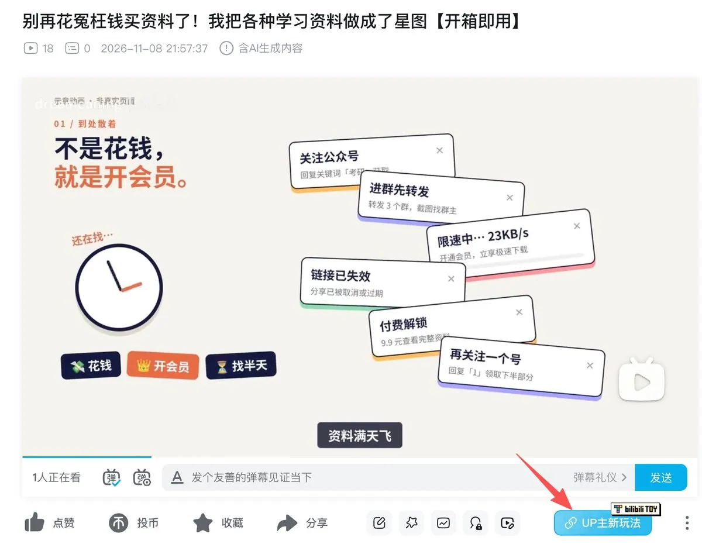
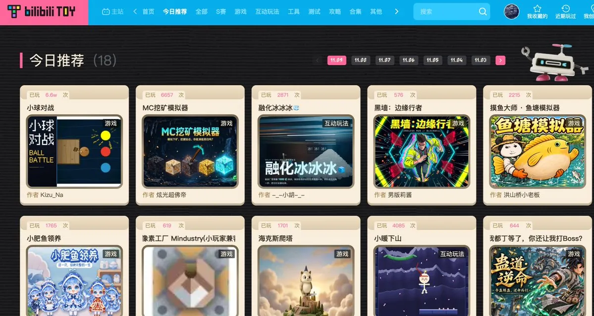
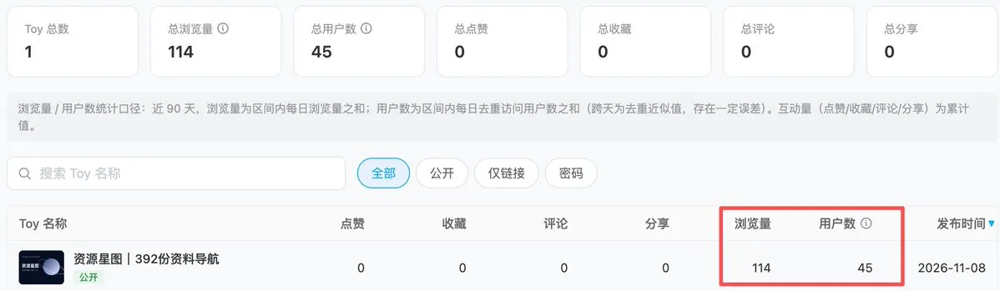
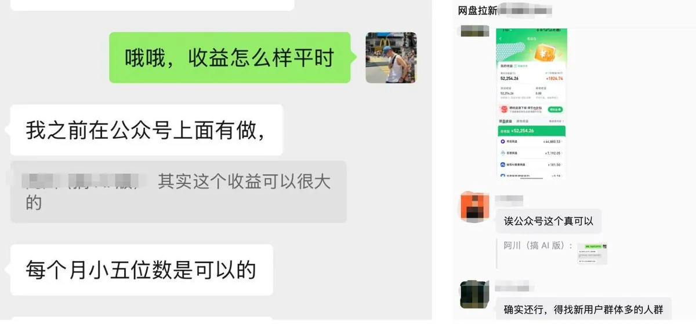
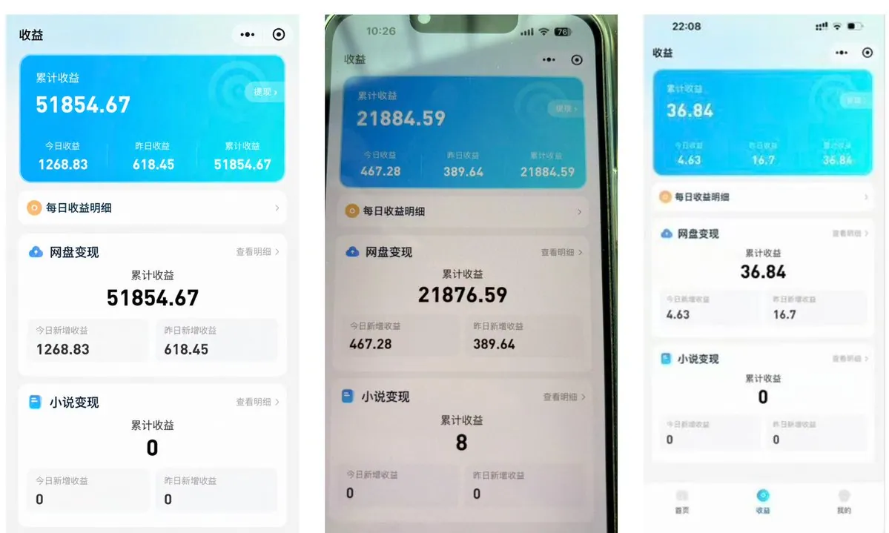
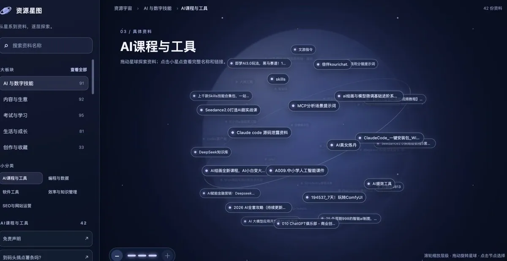
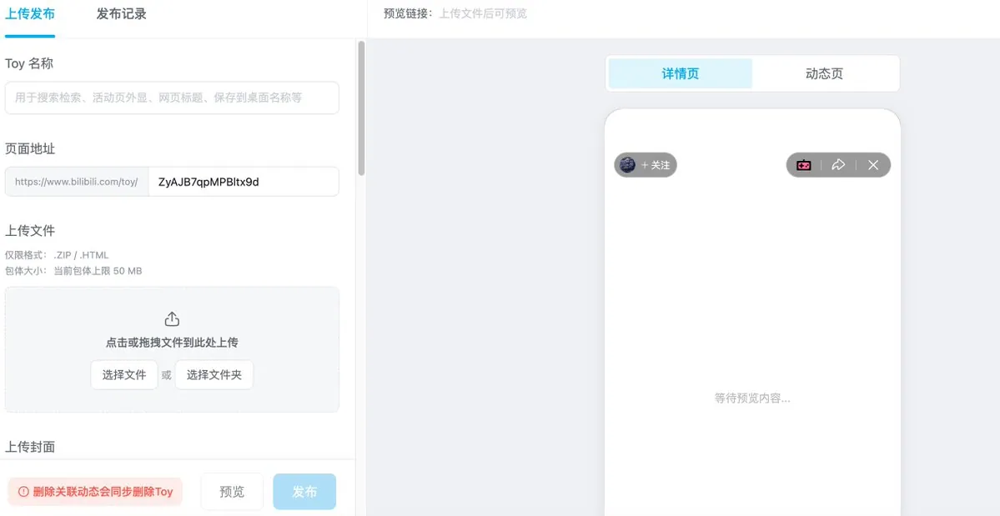
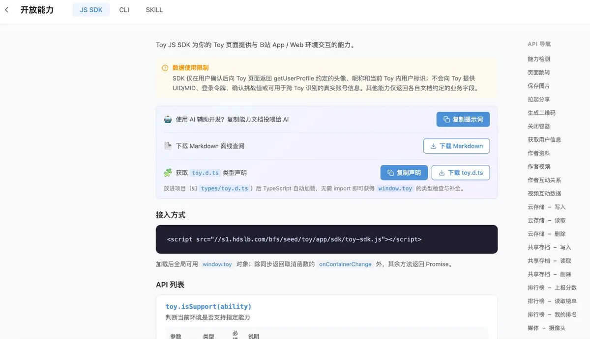

# 阿川（@AI_jacksaku）：蓝海！月入五位数的 B 站 TOY 新玩法

> 针对 B 站新上线的 TOY（Vibe Coding 发布平台，网页代码审核通过即可运行并可挂载到视频下）给出蓝海玩法拆解：如何把 TOY 做成能承接流量的互动工具并与内容/直播/短剧结合、如何借 B 站生态的分发与 TOY SDK 读取用户关注与互动状态做增长、以及月入五位数量级的变现路径设计。

<!-- more -->

兄弟们卧槽，B 站这波真的要冲啊！

我最近在 B 站挖到一个新入口，资料往里一放，网盘拉新的钱就自己往兜里走了

关键是，现在几乎没人在做。

它叫 Toy。

## 一、为什么偏偏是 B 站

兄弟们想想，你考公、考研、考编的时候，去哪看课？

雅思托福、高数、经济学，网课一搜，第一个打开的是哪个 App？

是 B 站，不是抖音，也不是小红书。

抖音小红书是刷着玩的，B 站是真有人坐下来、一集一集学的。

人在看课的时候，最想要什么？配套的讲义、真题、笔记、课件。

看视频学习的时候顺手存一份资料，这个概率几乎是 100%。

每存一次，就是一次转存。每一次转存，都是网盘拉新的钱。

全中国最想要资料的那批人，天天就泡在 B 站。

## 二、现在大多数人在 B 站怎么赚钱？

在 B 站搞副业的兄弟，现在主流就一条路：B 站好物。

套路基本是固定的。先选品对标，看同类账号、商品热度、价格和佣金；再拍好价速报、产品横评、实拍开箱；发布时挂上好物蓝链，观众点进去下单，你拿佣金；最后按订单反推内容，哪个型号出单就接着拍哪个。

这条路能跑通，但问题也很明显。

观众点进去，只有一个动作：买，或者不买。

一条视频只能卖几件货，卖完这波就没了。想持续出单，就得一条接一条地拍、一个品接一个品地追，跟着热度跑断腿。

你不是在做账号，你是在给商品打工。

做资料号的兄弟更憋屈。评论区置顶、简介挂链接、私信回关键词、拉粉丝群，每一种都要用户多绕好几步，链接一失效、一被折叠，人全在路上跑光了。

视频播放破万，到手的钱没几块，谁被气过谁知道。

但是 toy 真的不一样！

## 三、Toy 一出来，我直接坐不住了

Toy 是 B 站今年 7 月开始内测的网页互动平台。你把做好的网页传上去，就是一个 B 站站内链接，用户在 B 站里点开就能用。

它能绑定到你自己的视频上，显示在视频详情页下方，还能申请推流。公开发布以后会进 Toy 广场，没有试玩量门槛，站内也能搜到。

跟好物蓝链比，Toy 最大的不同是：观众点进来之后，还能自己动手。

蓝链把人带到一个商品页。Toy 能把视频里的东西做成可以搜索、筛选、反复用的工具。

一条视频只能演示几个场景，页面却能让观众按自己的需要接着找下去。视频负责勾起兴趣，Toy 负责接住他接下来的每一步。

而且一个 Toy 能绑多条视频，反复被用，后台还能看访问数据。

好物是卖一次赚一次，Toy 是做一次用很久。

## 四、我翻完 Toy 广场，兴奋坏了

目前 Toy 广场 一共 4000 多个 Toy，游戏就占了 2600 多个，剩下的大多是人格测试和互动小玩法。

爆款也基本是娱乐类。「大狗大狗叫叫叫」玩了 900 多万次，SBTI 人格测试有 800 多万次。

工具类只有 500 多个。

可就这么点工具，照样跑出了上百万的数据。

三角洲查数据的工具玩了 160 万次，PDD 福袋组队互助也有 79 万次。

游戏和测试火得快，凉得也快。垂直工具是用户有需求就会回来用，UV 更持续，也更长青。

官方在 FAQ 里自己都写了，「本周必玩」分娱乐和工具两条赛道，工具赛道相对不拥挤。

我一个没有粉丝的新号，昨天凌晨刚上线的 toy 就已经有 45 个用户了

官方都明着告诉你工具没人抢了，做资料导航的更是一片空白，这还不出手更待何时？

## 五、说点实在的，这玩意儿到底能赚多少

如果你在做网盘拉新，积累了一段时间下来，现在每个月的收益都不会太差，

网盘拉新的逻辑是，用户通过你的链接转存、注册，你按行为拿收益。资料只要选对了，就是一台不停转的拉新机器。

玩法当然不止我说的这一种，你感兴趣的话在 x 或者生财搜一下虚拟资料就知道了，各种赛道的大佬八仙过海，

我知道月入五位数以上的就有@weiyux2021 、@yhslgg、 @DongQingAsk、@qihang_zeng6688，大佬还有很多我就不一一列举了

甚至还能再往上叠加一层 CPS。别人想转存你的资料，文件太大就得开网盘会员，这一单你能分到钱。你在资料里放了课程或工具的推广链接，用户买了，你也拿佣金。

一条视频，一个 Toy，拉新和 CPS 两份钱一起吃。

你在上班，它在拉新。你在睡觉，它还在赚钱🍟。

## 六、我当天就上手做了一个 toy-资源星图

在 B 站找过资料的兄弟，肯定都被坑过。

视频里说「资料免费送」，结果先让你关注公众号、加群、私信，有的还得额外付费。折腾一圈，想要的那份还不一定拿得到。

我是看了冬青 @DongQingAsk 的这篇文章以后，当天就动手了。

引用推文：冬青 (@DongQingAsk)

https://t.co/2QX2TJ2o6n

https://x.com/DongQingAsk/status/2119301955348824295

我用 AI 把整理好的公开资料做成了一个 Toy，叫[「资源星图」](https://www.bilibili.com/toy/CiUk570jVh8gI0Uy/index.html)

所有资料都在一个页面里，不用关注、不用加群，点进去直接搜、直接拿。

大板块、小分类、具体资料分三层，资料像星点一样绕着星球排列，左边可以搜索和筛选。想逛的慢慢逛，知道要什么的直接搜就行了。

最爽的是，Toy 的上传简单到离谱。

页面做好以后就四步：准备好网页文件，上传并填写信息，提交审核，审核过了就上线。再绑到自己的视频上，观众看完点一下就进来了。

当然，toy 也支持直接 agent 直接接入来完成，我就是用 codex 做好的

## 七、普通人现在冲，还来得及

先挑一个你熟的垂直方向，比如考研考公资料、AI 入门资料、剪辑教程和素材、语言学习课程。

主题越窄越好，越窄越知道什么有用，视频也越好拍。

选好资料、用 AI 做出页面、上传成 Toy、拍条视频绑上去，就能开跑了。

不会写代码也没关系，页面交给 AI，你只管选资料。

但我必须泼一盆冷水：这个窗口不会一直开着。

小红书资料号、抖音网盘号，哪个不是最早那批人吃饱了，后来的人只能捡剩的。

等工具赛道也挤满了人，你再进场，就只能抢别人吃剩的流量了。

我的已经在跑了，你也可以参考看看👇

- [资源星图 Toy](https://www.bilibili.com/toy/CiUk570jVh8gI0Uy/index.html)
- [我的 B 站介绍视频](https://www.bilibili.com/video/BV1yQWE6XEVi/)

总之蓝海从来不等人，看到就是赚到，先干再说！

免责声明：本文记录我个人制作与使用 Toy 的过程，仅供交流参考，不构成任何收益承诺。资源星图整理的是全网公开可见的资料信息和第三方链接，仅供检索与学习参考。建议大家分享时尽量选择官方公开、允许转载的资料，并注明出处；或者分享自己整理的笔记、总结和书单，而不是直接分享原文件。请注意版权问题。

## 相关页面

- [[sources/dongqing-bilibili-toy-cloud-disk-cps-playbook]]
- [[sources/leaf-sanren-douyin-offline-commercial-orders-playbook]]
- [[concepts/selfmedia-compound-model]]
- [[concepts/digital-products-side-income]]
