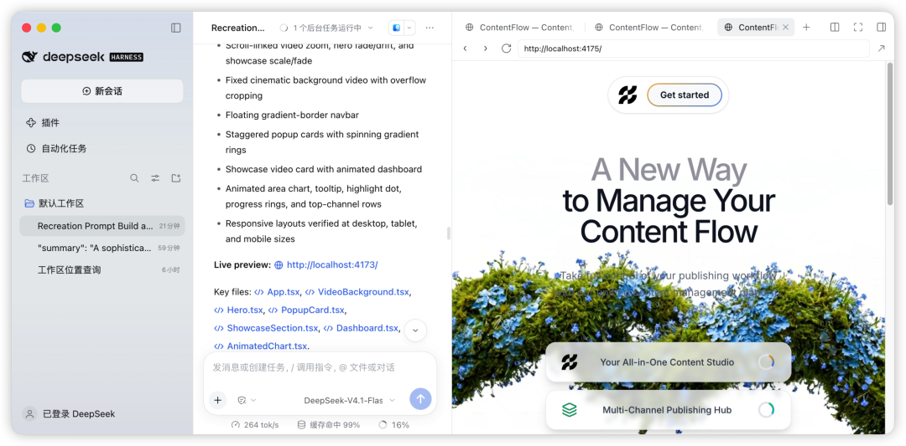

# AI 出海建站流水线：从流量、信任到支付闭环

> AI 降低了写代码和搭页面的成本，但网站能否产生收入，仍取决于三个商业目标：让目标用户到达、建立可信理由、完成可验证的支付或留资动作。

<!-- more -->

原文标题：《我用800条提示词，把AI出海建站这件事做成了流水线》  
作者：橙哥  
原文发布日期：2026-10-20

## 两种常见失败

技术团队做出海网站时，常见问题并不是页面做不出来，而是工作停在了错误的目标上。

第一种失败是长期打磨 UI。首页反复改版、配色和字体，却始终没有上线。设计细节没有接受真实流量检验，时间和域名成本持续消耗。

第二种失败是只展示功能。页面充满产品能力列表，却没有回答用户真正关心的三个问题：它能帮我完成什么、为什么值得信任、下一步怎样购买或联系。

## 三个商业目标

出海网站的类型很多，但都可以还原为三个目标：

1. **让人来**：通过搜索、内容、广告、社交传播或既有渠道获得目标流量。
2. **让人信**：用清晰定位、结果型文案、真实证据、案例和一致体验降低决策风险。
3. **让人付钱**：让 CTA、表单、试用、支付或预约链路真实可用，而不是只展示一个静态页面。

落地页追求最短成交路径；博客和目录站积累可被搜索与 AI 问答持续引用的内容资产；SaaS 则把高频痛点封装为可订阅功能。形态不同，仍然服务于同一个闭环。

## 赛道选择的三个约束

选择网站形态时，不应只看热门程度，而应回答：

- 当前掌握哪些资产、技能、渠道或客户资源？
- 可以接受多长的回报周期？
- 愿意长期重复哪类工作？

需要较快验证时，可以优先使用落地页或交易型网站；愿意等待内容复利时，可以积累博客或目录站；已经具备产品与持续交付能力时，再投入 SaaS。

## 四步上线闭环

### 1. 调研定位

观察竞品如何表达、用户怎样搜索、评论区集中抱怨什么。第一版页面只解决一个明确问题，避免同时服务多个模糊人群。

### 2. 设计搭建

先确定信息结构，再处理视觉。首屏必须快速说明产品是谁做的、服务谁、解决什么问题；移动端应作为基础验收面，而不是桌面版完成后的附加项。

### 3. 文案转化

标题表达结果，副标题解释实现方式，CTA 指向清晰的下一步。减少抽象形容词，增加可核验的数字、案例和具体约束。

### 4. 上线变现

至少跑通埋点、表单、支付中的一条完整路径。上线后先观察三个指标：首屏跳出、CTA 点击、下单或提交完成。真实数据比继续主观改 UI 更能决定下一轮迭代。

## 最小质量门

第一版不需要堆叠大量版块，但必须满足：

- 单一目标用户与单一核心问题明确；
- 首屏价值主张可以在数秒内读懂；
- 至少有一种可信证据，而不是产品自夸；
- CTA 对应的表单、支付或预约链路可完成；
- 移动端没有溢出、遮挡或不可点击元素；
- 埋点能回答访问、点击和转化发生在哪里。

核心原则是先上线获取反馈，再根据真实行为完善。AI 可以批量生成页面和方案，但不能替代定位、信任建立和商业验证。

## 相关页面

- [卖空气验证需求](/md/wiki/sources/sell-air-mvp)：把支付验证提前到产品完成之前。
- [B2C 独立站转化率优化七法](/md/wiki/concepts/b2c-conversion)：用证据与页面结构降低决策成本。
- [竞品调研四步法](/md/wiki/patterns/competitor-research-four-step)：从流量、关键词和历史变化判断竞品策略。
- [基于模板的上站 SOP](/md/wiki/sources/template-sop)：先上线获取反馈，再补充功能和内容。

归档已删除付费提示词手册、价格、购买入口、关注引流话术及对应销售图片，仅保留可复用的建站方法与执行证据。
