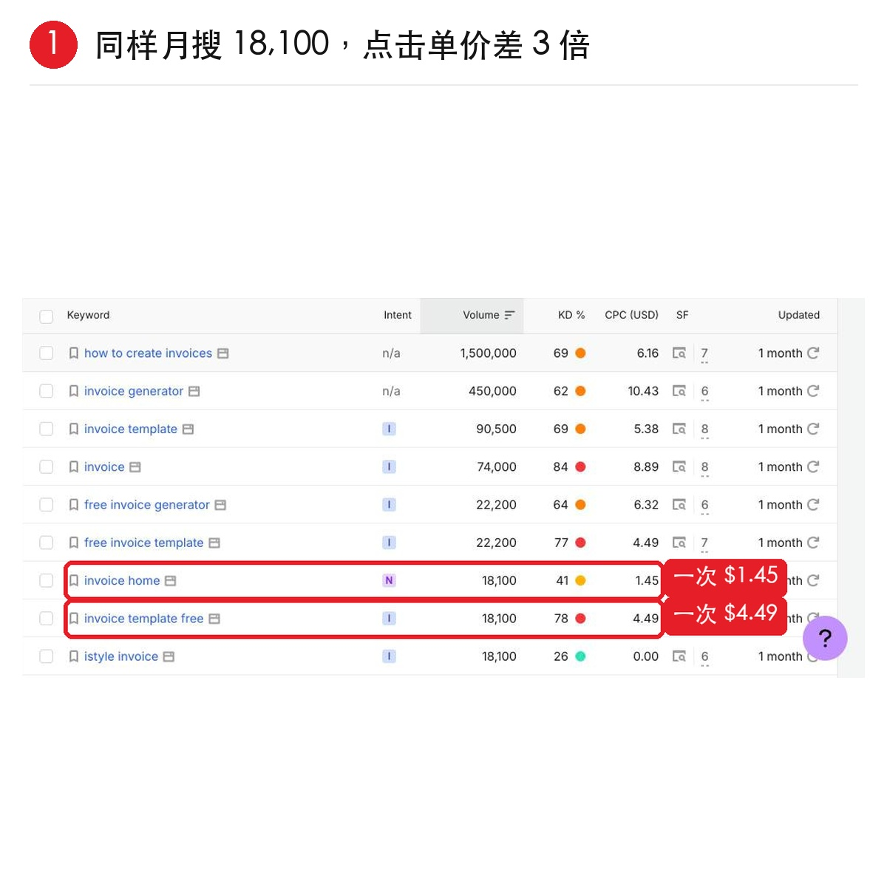
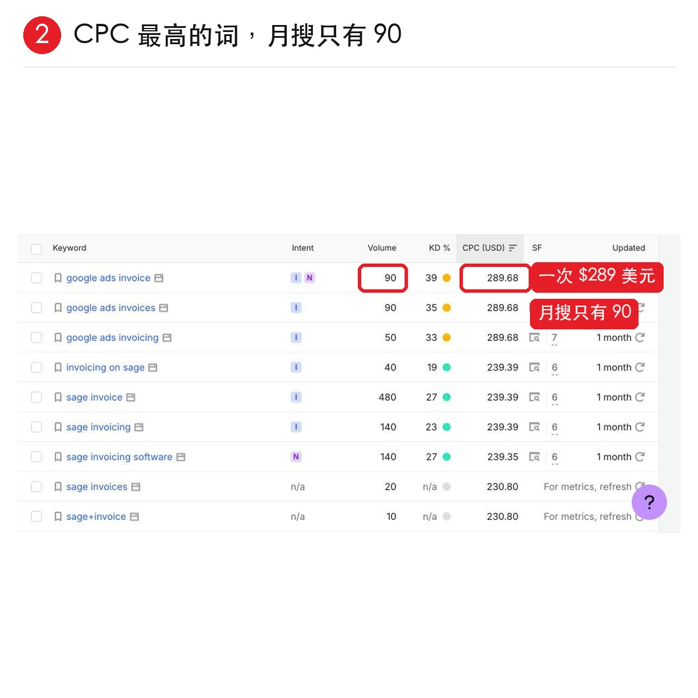

# 用 CPC 判断一个词值不值钱

> 同样每月 1.8 万次搜索，`invoice template free` 点一下 $4.49，`invoice home` 只有 $1.45——**月搜量一样，单价差 3 倍**。CPC 是广告主愿意为一次点击付的钱，越高说明这个词背后越有钱赚。

<!-- more -->

*图 1：在 Semrush Keyword Magic Tool 中查看 CPC 列。*

---

## 三步操作

### 1. 打开 Semrush 的 Keyword Magic Tool，搜 `invoice`，看 CPC（USD）这一列

| 关键词 | 月搜索量 | CPC |
|---|---|---|
| `invoice template free` | 18,100 | **$4.49** |
| `invoice home` | 18,100 | **$1.45** |

> 「足足差了 **3 倍**。」

### 2. 理解 CPC 的含义

> 「CPC 的意思是**广告主愿意为一次点击付的钱**，越高说明这个词背后越有钱赚。」

### 3. 但别只看 CPC——要排序后一起看三个数

> 「需要按 **CPC 从高到低排**。」

| 关键词 | 月搜索量 | CPC | 判定 |
|---|---|---|---|
| `google ads invoice` | **90** | **$289** | 看着最值钱，但**月搜只有 90，这种词没流量，大概率做不起来的** |

### 所以判断的时候，需要一起看三个数

- **搜索量够不够**
- **KD 高不高**
- **CPC 值不值钱**

> 以上词和数据来自 **Semrush 美国库**，仅作演示，会随时间变化，参考思路即可。

*图 2：搜索量 + KD + CPC 三者交叉判断。*

---

## 这个方法在整条选词链路中的位置

CPC 判断是**商业价值维度**，而本批已归档的其他文章覆盖了另外几个维度：

| 维度 | 由谁判断 | 关键结论 |
|---|---|---|
| **量的门槛** | [[sources/wavborn-keyword-screening-playbook]] | Trends 比值法，低于基准词 0.02～0.1 倍直接扔 |
| **竞争的门槛** | 同上 | Google 前十被大站或官方免费工具占满直接扔 |
| **趋势方向** | [[sources/jinjingx3-new-word-speed-war]] | 词还没进搜索框就搭站 |
| **商业价值（本文）** | AI Robert | CPC 越高，背后越有钱赚 |
| **形态匹配** | [[sources/yikun-seven-hot-word-site-types]] | 7 种形态按变现门槛排序 |
| **落地路径** | [[sources/jiang-yunhe-first-100-usd-new-word-playbook]] | D0–D5 上站 SOP 与首单到破千 |

> **CPC 补上的正是「量够、竞争小、趋势涨」之后的最后一问：赚不赚钱。** 一个词可以有量、可以打、可以涨，但 CPC 只有 $0.3，说明背后没有付费人群——那它只适合做流量站，不适合做主站。

> **关键细节**：排序方向是 **CPC 从高到低**（先看最值钱的），而不是从低到高。排在第一的可能是陷阱（`google ads invoice` 月搜 90），所以**必须三个数一起看，不能单看任一个**。

---

## 相关页面

- [[sources/wavborn-keyword-screening-playbook]] — wavborn：选词三板斧与 72 组词验证率
- [[sources/jinjingx3-new-word-speed-war]] — JK3：抢新词拼的不是工具而是谁更早动手
- [[sources/yikun-seven-hot-word-site-types]] — yikun：出海做热词站的 7 种形态
- [[sources/jiang-yunhe-first-100-usd-new-word-playbook]] — 蒋云何：副业出海小白首日破百刀，5 天破千刀
- [[sources/seo-stripe-reverse-product-discovery]] — AI Robert：从 Stripe 收银台倒着找出海产品
- [[sources/seo-zero-cost-trend-watch]] — AI Robert：出海找词零成本技巧
- [[concepts/gefei-seo-keywords]] — 哥飞 SEO 关键词方法论
- [[sources/bainian-seo-daily-002-higgsfield-teardown]] — 百年 AI×出海：SEO 日课 002 拆 Higgsfield
