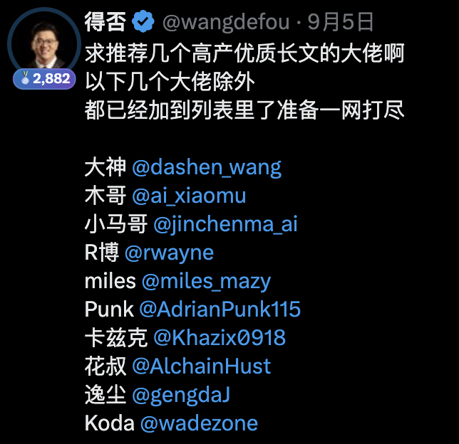
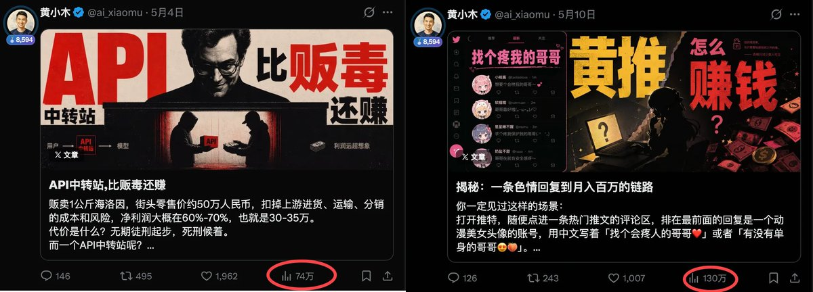
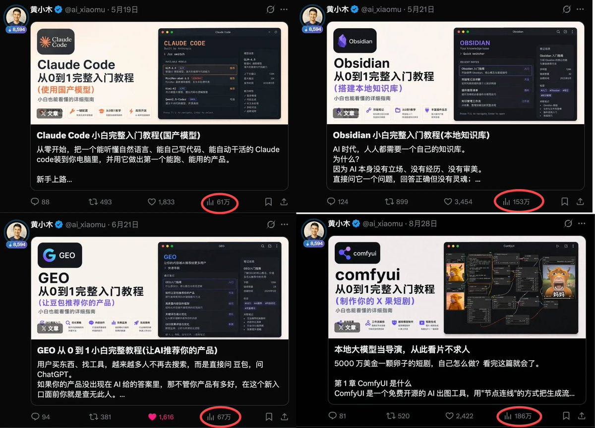
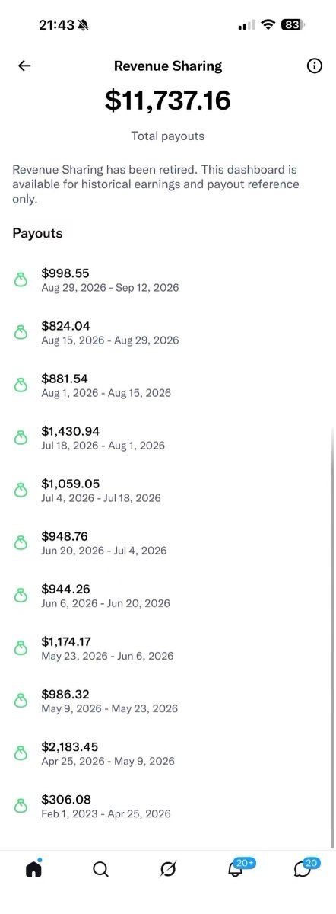
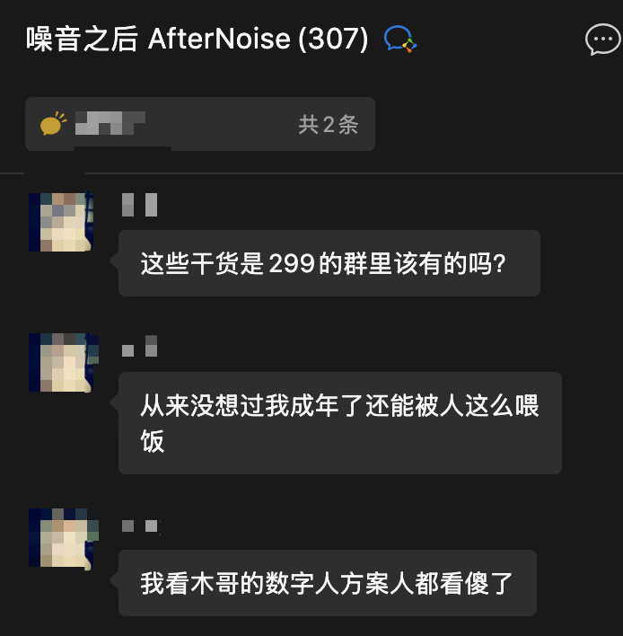
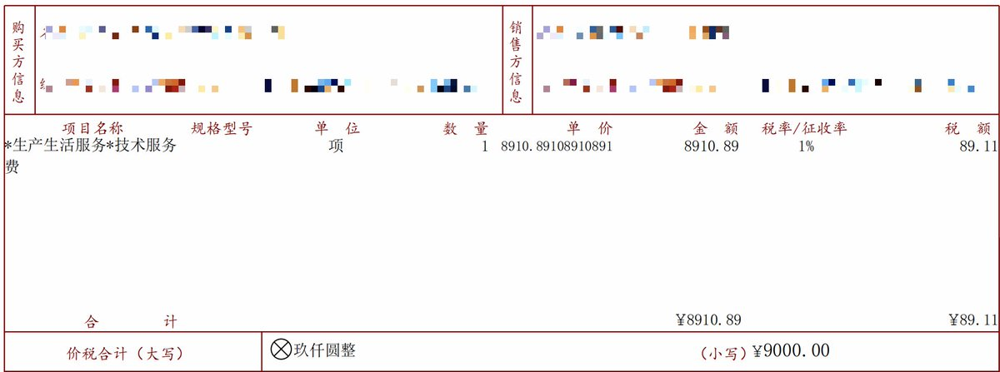

# 黄小木：半年 5 万粉变现 6 位数全复盘——起号四阶段与七种变现模型

> 35 岁离职大厂 T11，半年 51k 粉丝变现 20+ 万。冷启动到万粉（借势对标+利他输入）、1-3 万粉（叠罗汉+开火车+蹭热点）、3-5 万粉（回归老本行写小白教程）、5 万后（内容复利+时间复利+一鱼多吃）；七种变现模型（流量/商单/社群/咨询/线下/信息差/产品 aff）。

<!-- more -->

我 4.2 号发表来时路起号，到今天 10.2 号，整整半年，目前粉丝 51k，变现了 20 多个，感谢各位粉丝，这篇长文无保留分享我的起号与变现经验。

## 冷启动到万粉：

我接触 x 是因为生财有术社群去年 12 月的一次航海，所以对 x 这个平台有基本认知，正式开始做号是 3 月底，当时我在纠结做产品还是做流量，自己想不出答案，所以就去知识付费，我报了刘小排的深海圈，也在 x 上加了一些付费社群，花钱找拿到结果的人学经验是最快的。

我通过付费和多个拿到结果的人链接后，有了自己的判断，saas 产品这条路周期很长，我熬不住几个月没正反馈，所以我果断选择了做流量。

起号贴我研究的是 @iamzhihui 和  @ai_muzi，我自己也有足够多的标签：大厂 T11，年薪百万，35 离职，又找了足够多的大 v 帮我转发，所以爆是必然的，这个帖子帮我涨粉 2000+，完成冷启动。

> 引用推文：黄小木 (@ai_xiaomu)
> 去年大病一场，瘦了 20 斤，身体给我敲了记警钟—我不再是能 996 的年轻人了。等了半年大礼包，这个月签了字。多年打工生涯，算是画上了句号。有人问：大环境这么差，年薪百万放弃了不可惜？可惜，也不可惜。为了这份薪水，我把身体熬出了问题，工作日从没见过深圳的夕阳，有事也不敢请假，怕影响领导对我的那点评价。多年绩优，在决定离开的那一刻，显得特别可笑。但我想清楚了：我没碰深圳的水泥盒子，多年的积累也足够托底，家里人也支持我的决定。这个时代方向很明确：all in AI。去年就开始试了——小程序、AI 短剧，交了学费，也涨了认知。每次试错都让我更清楚自。..
> https://x.com/ai_xiaomu/status/2039677715721138457

这一阶段推友们可借鉴的是先找对标，冷启动是需要依靠自己和大 v 一起完成的，近期[@liangzhu_AI](https://x.com/@liangzhu_AI)也通过我的开源方案复刻了我这一战绩。

> 引用推文：良竹 (@liangzhu_AI)
> 离职第 2 天，X 突破 4000 关注，首篇出海长文拿下 3000 收藏。感谢每一份沉甸甸的信任！这 48 小时的台前文案、台后借势与避坑清单，全盘开源复盘在这了 🧵👇 https://t.co/ZXQX1HVah3
> https://x.com/liangzhu_AI/status/2104548529972658559

为了帮新人冷启动，我们也发起了 firstcheck，已经持续一个月了，当然最近被某些屌毛把我们当免费抖+快玩坏了，希望大家珍惜我们不可再生的注意力：

> 引用推文：Roland.W (@rwayne)
> 很多小伙伴反馈 First Check 的列表玩不明白 今天我就用最直接最直白最棒绕弯子的方式告诉你怎么玩 1、把下面这些在 List 的各位关注上 @dashen_wang 大神哥，你只要关注他，你的 AI 知识能领先至少半年 @ai_xiaomu 木哥，拉爆了一群新账号，就这一点足够了 @AdrianPunk115 Punk，高强度输出提示词小白教程 @Jackywine Obsidian 我见过玩的最 6 的 @rwayne 8 个月近 5.6 个亿的曝光量 @AI_jacksaku 阿川，小龙虾三天万粉百万曝光 @HoodyLiu Hoody，你跟他学 AIGC 就行。..
> https://x.com/rwayne/status/2096598628811104420

完成冷启动后账号会有一波持续的推流，我抓住这波推流当时进行了长文日更，日更的方法我早期推文里也开源了，自己去翻，同时借助 @dashen_wang 开源的作战计划 skill 录了个视频讲解，这个视频帮我涨粉 4000+，所以我花了 20 多天到了万粉。

> 引用推文：黄小木 (@ai_xiaomu)
> 35 岁 + 程序员+ i 人 + 转型 OPC + 从未做过自媒体。来 X 20 天，6000fo，6M 流量，拿到老马工资。我是怎么做到的？秘密都在这个视频里了，回馈大家👇。https://t.co/cynPIuVV8Q
> https://x.com/ai_xiaomu/status/2046749466028601373

当时推特上流行过一阵录视频的玩法，也是因为我这个视频带动起来的。

这个阶段推友们可以借鉴的就是冷启动完成以后持续的输入利他的内容，我的打法是写涨粉和搞钱相关的，大家可根据自己的天赋点自行发挥。

冷启动到万粉可参考的案例：

@qihang_zeng6688  我们帮他冷启动完成后，他持续输出小红书虚拟资料的信息差，很快到了万粉。

## 1 万 - 3 万粉：

我当时的玩法是：叠罗汉 + 开火车 + 蹭热点 

叠罗汉：就是不停的晒涨粉经验，这个方法已经被大量的人验证了有效，比如：

> 引用推文：黄小木 (@ai_xiaomu)
> 发这个视频的时候 6kfo，过去了 5 天，现在 1.2wfo。日均涨粉 1000+，几点经验分享给大家：1. 视频里的涨粉 skill 速度用起来，我就是最好的案例；2. 露脸真诚分享，活人感在 x 是降维打击；3. 多互动转发，@longdechen12 被我 quote 后，一天涨了 4000 粉，利他就是利己。https://t.co/HYhDRneQPZ
> https://x.com/ai_xiaomu/status/2048700996449382763

开火车：x 上最有效的涨粉玩法之一，这个大家因该见到很多了，比如：

蹭热点：

什么有流量就干什么，这个需要一定的网感，比如孙哥开中转站我就写中转站，黄推泛滥时我就写黄推拆解，这些东西相当于 saas 里面的抢新词，必然有流量。

这个阶段我把这套组合拳玩的飞起，基本上每天都是百万流量，涨粉 1000+，从 1 万到 3 万我只花了 1 个月，当然我当时过快的增速也吸引了不少人对我进行攻击，这个就是大流量带来的反噬，所以我这个账号虽然时间不长，但基本上把该经历的都经历了一遍。

推友们可借鉴的是这套组合拳玩法当前依然有效，近期有不少增长很快的账号，其实也是这个玩法，只不过有些推友把叠罗汉玩到了 100 粉叠一次，就大可不必了，适度即可。

1-3 万粉阶段可参考的案例：

@AdrianPunk115  1 到 3 万粉期间一直稳扎稳打写提示词开源利他，靠 punk skill 出圈，然后高频率的和各个博主互动，上周 afternoise 社群 3 天 300 人，足以证明了这条路是跑通了且大家可学习的。

## 3 万 - 5 万粉：

这个阶段我改了玩法，不再玩组合拳了，回归了我的老本行，我在职场的主要工作之一就是需求分析，所以我很擅长和不懂技术的人讲技术。

因为我就做自己擅长的事写 ai 小白教程，每天都有新模型和 agent 发布，所以我素材源源不断。

多篇百万爆款后，我就五万了。

这个阶段你的目标不应该是追求粉丝和流量，稳扎稳打即可，做你擅长的事，只有这样你才能坚持和卷出来，比如 @ZhanlinYan74392 擅长两性关系，一篇约炮指南就能涨万粉。

3-5 万可参考的案例：

@isnail 经历了多次封禁，停留意，关小黑屋，坚持开源利他和社交，把自己公众号拿到的结果毫无保留的分享，每天在 300 多人的公众号社群高强度交付，那涨粉赚钱是必然结果的。

## 5 万以后：

在往上都是各路神仙，不是可复制的了，你得找到自己的路，所以我去上了 don 哥的线下，学到的经验就是内容复利，时间复利，一鱼多吃，你可以拍口播视频，多平台分发，但我有出镜的心理问题，毕竟我干了 10 多年技术，骨子里是个 i 人，所以我最近在研究数字人技术，还未跑通，若有结果了也会开源给大家。

## 赚钱方面：

流量收益：

我能做到每个周期都是千刀收益，是因为我做到了按时出摊，我从起号开始到现在半年时间坚持每天输出，从未间断，玩 x 到现在见到了太多朋友中途放弃了，但这是你来 x 因该最先拿到的收益之一。

商单：

这个 玩 x 的都懂，根据你的粉丝数和影响力从几百到上万不等，我现在基本上 3k ~ 5k 左右浮动，比不上一些大佬，但作为一个自媒体新人也知足了。

推友们从 2000 粉左右就可以开始尝试去接商单了，所以说做一个万粉 x 账号是 roi 非常高的事情。

社群与分销：

有一定影响力以后就可以社群变现。

比如我的答疑群，买我写的 [x 增长文档](https://flowus.cn/08d68f8b-5968-4b5e-a5d5-291de4b3ae4c) 就会送。

比如 afternoise 社群，进了这个群的人都知道有多值。

这个推友们可借鉴的是你影响力不够的时候，你也可以帮别人卖社群，一样能挣钱，比如 xbangdan 作者 @jedeeai。

咨询：

比如我在 x 拿到了结果，那找我的人是很多的，不过我接的比较少，因为咨询对我而言没有复利可言。

线下交付：

通过一个 x 账号你可以链接到资源和人，在结合你的能力进行变现，比如现在大火的 fde，对人的要求极高，刚好这些技能点我都有，所以根本不缺单子。

信息差变现：

x 上最不缺的就是信息差，比如 dashen 在 170hx 暴涨前开源了这张卡的价值。

> 引用推文：AI 最严厉的父亲 (@dashen_wang)
> https://t.co/jggHZ2InkU
> https://x.com/dashen_wang/status/2090713829462458699

在比如我和 @rwayne 在 dgx spark 30k 不到的时候买了 5 台，现在价格已经 40+了，这些信息都是通过 x 获取到的。

当然这个需要一定的执行力和财力，推友们量力而行。

产品与 aff:

这个玩 x 的都懂，太多案例了，build in public，一鱼多吃，你有产品就推广自己的产品，你没产品就把自己当成产品，用流量变现。

可对标的账号：@imwsl90  @yihui_indie 

## 一些想说的：

中推这个圈子挺小，每隔几天就撕比吵架，逻辑很简单，都是成年人，没有无缘无故的爱与恨，背后都是利益，所以如果你被波及到，切勿内耗，这是自媒体的必经之路，最近我一朋友被网暴到断更，也是很唏嘘。

x 是个社交和资源链接平台，你得混圈子，借助这个平台去链接人，然后去线下沟通获取信息差，切勿只盯着线上这点收益。

如果有被 AI 冲击在迷茫的朋友看到这里，作为过来人我可以分享一句你可以尝试做个万粉的 x 账号，这将是你人生 roi 最高的事情之一。

与我接触过的都知道我是个真诚利他的人，也欢迎大家与我交朋友。

要感谢的人太多，不一一写了，用行动表达我对你们的爱即可。

黄小木｜T11 级工程师｜本文由微信输入法创作｜持续分享 AI 信息、副业赚钱、程序员转型 OPC 心得｜X：[@ai_xiaomu](https://x.com/@ai_xiaomu)

## 相关页面

- [[concepts/selfmedia-compound-model]]
- [[patterns/ai-business-seven-layers]]
- [[concepts/ai-oneperson-company]]
- [[sources/jasoncharlie-selfmedia-lead-generation]]
