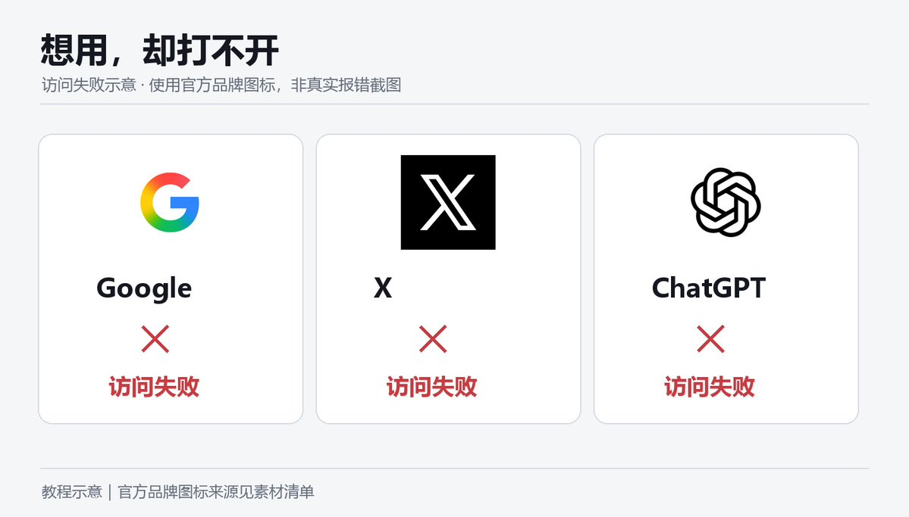
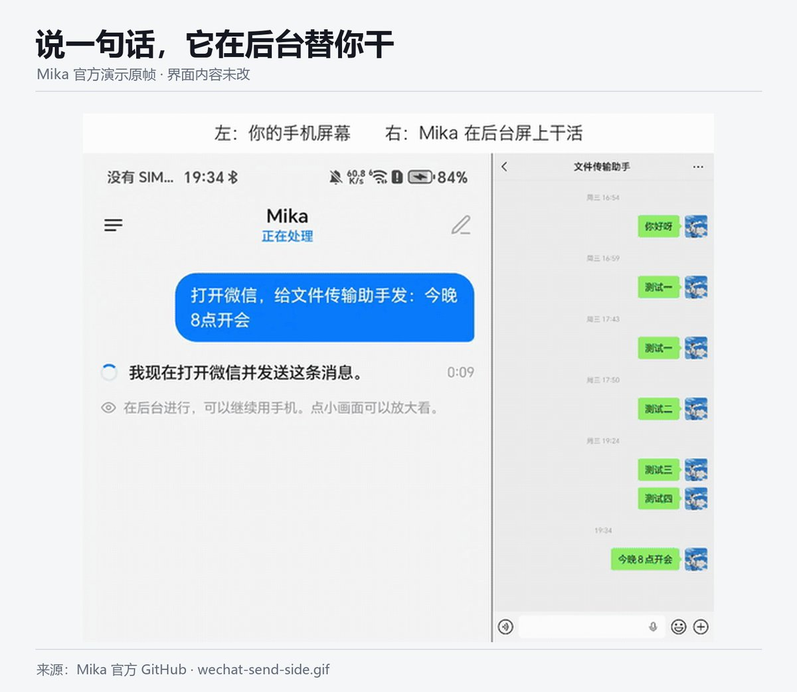
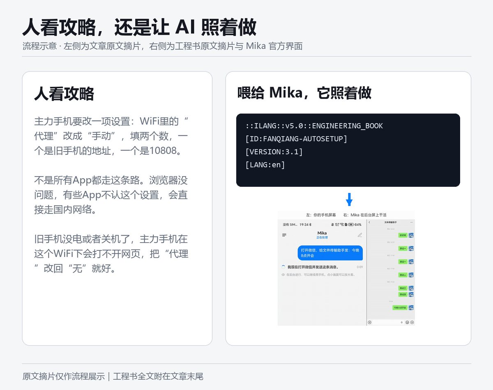
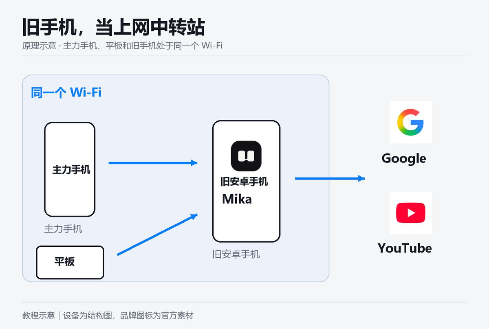
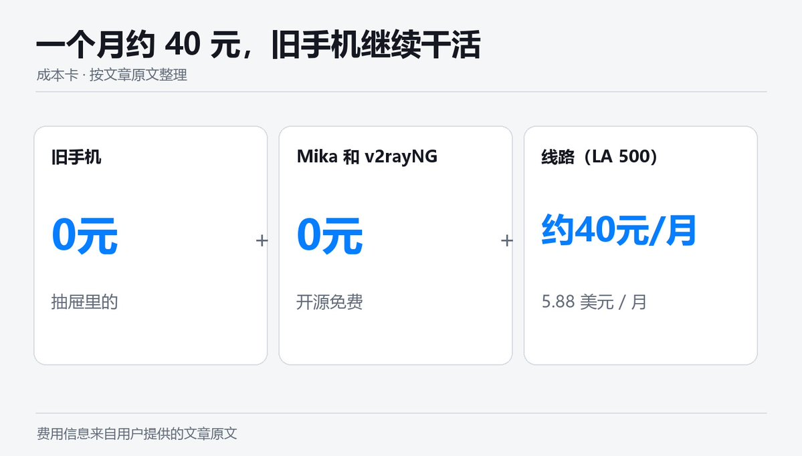
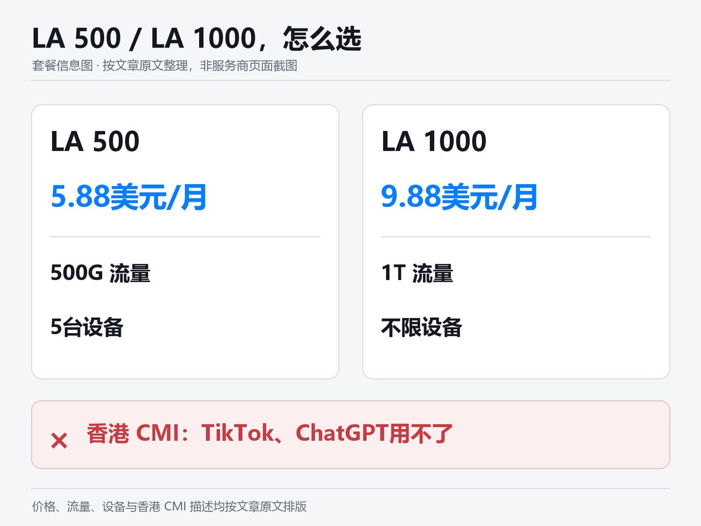
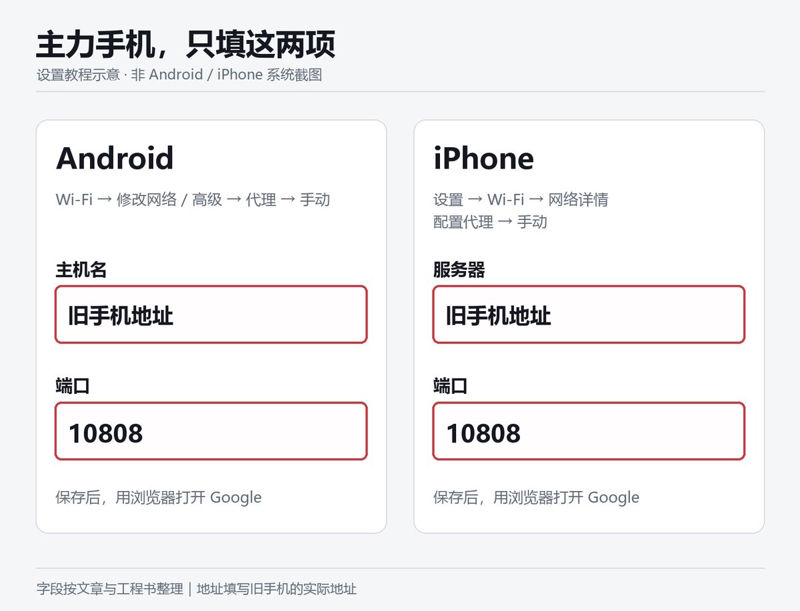
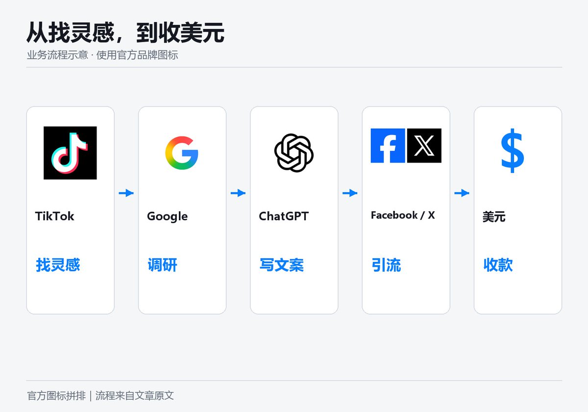

# 爱出海（@ai_chuhai）：把旧安卓手机改造成出海赚美元工作站——开源 Mika 与智能体自动化配置 SOP

> 利用王赞开源的免 Root 手机 Agent Mika，把抽屉里的闲置旧安卓手机改装为 24 小时出海工作站：通过自动化安装配置工具充当家庭局域网中转代理，解决主力机跨区网络配置繁琐难题；配套声明式工程书（iLang）驱动 Agent 自主识屏点击与多平台引流调研，一个月几十元低成本跑通全套出海基础设施。

<!-- more -->

X，ChatGPT，Gemini，谷歌，Facebook，TikTok，Claude，你再不需要看那种让你看得云里雾里的攻略了，装上它，外加我们的 iLang 工程书，自动帮你把安卓手机变出海赚美元的印钞机。

你想做出海。

想刷 TikTok 找爆款，想用 ChatGPT 写英文文案，想在 X 上引流，想开 Facebook 广告。

道理都懂，就是卡在第一步：你连别人的官网都上不去。

去搜华润教程，满屏英文缩写和参数，照着填，错一个字母就不行，错在哪也不知道。

然后你放弃了。

出海最先挡住人的，不是英语，不是货源，是那些华润上网。



## Mika 是什么

Mika 是一个开源的安卓 AI 助手。

引用推文：王赞 (@wangzan101)

Mika is now open source: a real phone agent that runs on your Android phone. Tell it what you want, and it gets it done in your apps and on the web, on a hidden background screen while you keep using your phone. No root, no computer, your own logins. In the videos, asked in pl...

https://x.com/wangzan101/status/2116225557566550434

它能看懂手机屏幕，会自己点按钮、打字、滑动、开浏览器，你说一句话，它在后台替你干，你该刷手机刷手机。

Apache 2.0 开源，免费，不经过任何第三方服务器，你接自己的 AI 模型就能用。

以前要你自己啃的攻略，然后搭建华润网络，现在它帮你自动在手机上完成。



## 它和 iLang 工程书怎么配合

光有手会动，不够，还得知道每一步该怎么做。

iLang 工程书就是写给 AI 看的操作手册：先做什么，后做什么，哪一步必须停下来问你，出错了先查哪里，查几轮就收手。

人看的攻略，界面一变你就卡住，工程书写的是判断，按钮挪了位置，Mika 照样找得到。

我们给华润这件事写了一本工程书，你把它喂给 Mika，它就照着一步步做，碰到付款和系统授权才停下来叫你。



## 华润的思路：让旧手机当中转站

抽屉里那台不用的安卓手机，别扔。

Mika 在它上面装好一个叫 v2rayNG 的 App，填好一条线路，打开一个开关，旧手机就成了你家的“上网中转站”。

你的主力手机连上它，浏览器就能打开 Google、YouTube、ChatGPT。

主力手机上什么都不用装。



## 有几句实话得说在前面

主力手机要改一项设置：WiFi 里的“代理”改成“手动”，填两个数，一个是旧手机的地址，一个是 10808。

改一次就行，以后不用动。

不是所有 App 都走这条路，浏览器没问题，有些 App 不认这个设置，会直接走国内网络。

TikTok 会看你插的是不是国内 SIM 卡，这就是过去很多教程需要拔卡才可以用 Tiktok，但是很多人连个连上 Tiktok 的 IP 都找不出来，我们直接解决了这一步。

旧手机没电或者关机了，主力手机在这个 WiFi 下会打不开网页，把“代理”改回“无”就好。

想让 Mika 替你点，旧手机最好是安卓 12 以上。

## 算账



旧手机：抽屉里的，0 元。

Mika 和 v2rayNG：都开源免费，0 元。

线路：[JustMySocks 的 LA 500](https://justmysocks6.net/)，每月5.88美元，搬瓦工官方线路，500G流量，5台设备，一个人天天刷视频够用。

全家一起用，[选 LA 1000](https://justmysocks6.net/)，每月9.88美元，大概70块钱，1T流量，不限设备。

一个月 40 块，你多了一台不睡觉的出海工作站。



## 通了之后能干什么

TikTok：看海外什么产品在火，抖音上火的和 TikTok 上火的，是两个世界。

X：海外获客最便宜的地方，发内容、立人设、把人引到你的店。

ChatGPT：写英文产品描述、广告文案、客服模板，替你回供应商邮件。英语不好不再是借口。

Google：查关键词、看竞品、找供应商。做跨境不用 Google，等于闭着眼走路。

Facebook：投广告，跨境电商最主要的付费流量来源之一。

链路就是这样：TikTok 找灵感，Google 做调研，ChatGPT 写文案，Facebook 和 X 去引流，最后收美元。

到这一步，Mika 能干的就不止华润了，它可以帮你开网页查竞品，帮你整理选品表，帮你起草文案，每一样都可以写成一本工程书，写一次反复用。

## 上手就四步

1. 找出旧安卓手机，充上电，连上家里的 WiFi。
2. 从 GitHub 官方页面下载 Mika，装好，填上你的 AI 模型。
3. 把我们的华润工程书发给 Mika，让它开始。它要付款时，用你平时的手机扫码；它弹出授权时，你点一下确定。
4. 它做完会告诉你旧手机的地址。拿起主力手机，在 WiFi 设置里把代理改成手动，填这个地址和 10808，保存，打开 Google。

能打开，就成了。



## 最后

出海的门，第一步就把大多数人挡在了外面。

一台旧手机，一个开源 AI 助手，一本工程书，一条 40 块的线路，这一步你今天就能迈过去。

剩下的，是你自己的生意。



线路购买：[https://justmysocks6.net/members/aff.php?aff=18864](https://justmysocks6.net/members/aff.php?aff=18864)

Mika 下载：[https://github.com/wangzan101/Mika/releases](https://github.com/wangzan101/Mika/releases)

## 工程书原文｜v3.1

按顺序复制以下 3 段并拼接，即为完整工程书。

工程书 v3.1（1/3）

```
::ILANG::v5.0::ENGINEERING_BOOK
[TYPE:engineering_book]
[ID:FANQIANG-AUTOSETUP]
[VERSION:3.1]
[DATE:2026-11-02]
[LANG:en]
[NOTE:based_on_fanqiang.guide_FANQIANG-AUTOSETUP_v1.1_not_an_official_release_from_fanqiang.guide]

::STATE{@USER, role:a_person_in_China_who_has_never_configured_a_proxy_and_does_not_know_what_V2Ray_VLESS_Clash_or_DNS_means, gives:an_old_Android_phone, does:approve_installs_and_purchase_a_JustMySocks_plan, speaks:Chinese, knows:nothing_about_networking}
::STATE{@AGENT, role:the_AI_executing_this_book, can:screen_reading_tapping_typing_on_user_device_OR_shell_OR_browser_automation, does:turn_old_phone_into_a_LAN_proxy_gateway_for_other_devices, never:uses_technical_jargon_when_speaking_to_user, never:installs_from_untrusted_sources, note:agent_agnostic_works_with_Mika_Hermes_bot_or_any_agent_with_device_access}
::STATE{@KNOWLEDGE, mcp:https://fanqiang.guide/mcp, tools:search_and_get_and_get_setup_book}
::STATE{@PHONE, minimum:Android_12_for_agent_driven_setup, recommended:Android_14, note:v2rayNG_itself_runs_on_Android_7_plus_but_agent_app_operation_requires_12_plus}
::STATE{@NODE_PROVIDER, name:JustMySocks, registered_entity:Fiber_Logic_White_Rock_BC_Canada, commonly_reported_as:BandwagonHost_sister_brand, protocol:VLESS_Reality_announced_for_s2_s3_s4_s5_s801_s1_status_unknown, ip_replacement:provider_promises_replacement_as_quickly_as_possible_user_must_update_subscription, terms:personal_non_commercial_use_only, affiliate:yes_author_earns_commission}
::STATE{@PURCHASE_DOMAIN, primary:justmysocks6.net, note:tested_accessible_from_mainland_China_2026-11-02_via_boce.com_full_green, affiliate_url:https://justmysocks6.net/members/aff.php?aff=18864, fallback:justmysocks5.net}
::STATE{@PLANS, entry:[name:LA_500, price:5.88_USD_per_month, bandwidth:500GB, devices:5, speed:2.5Gbps], heavy:[name:LA_1000, price:9.88_USD_per_month, bandwidth:1TB, devices:unlimited, speed:5Gbps], note:HK_CMI_exits_in_Hong_Kong_where_TikTok_does_not_operate_and_ChatGPT_is_not_supported_do_not_recommend_for_TikTok_or_ChatGPT_use_cases}
::STATE{@CLIENT, name:v2rayNG, source:GitHub_Releases_only_no_longer_on_Google_Play, url:https://github.com/2dust/v2rayNG/releases/latest, apk:download_arm64-v8a_or_universal_variant_not_fdroid_variant, local_proxy_port:10808_default_one_port_serves_both_SOCKS_and_HTTP_in_current_official_Xray_builds, http_port_note:no_separate_HTTP_port_setting_exists_10809_as_SOCKS_plus_1_applies_only_to_non_Xray_builds_per_source_SettingsManager.kt_getHttpPort, settings_keys:pref_socks_port_shown_as_Local_proxy_port_pref_enable_local_proxy_shown_as_Enable_local_proxy_pref_dynamic_socks_port_shown_as_Enable_dynamic_local_proxy_port_pref_proxy_sharing_enabled_shown_as_Allow_connections_from_the_LAN}
::STATE{@SHARING_METHOD, type:LAN_proxy_not_VPN_hotspot, reason:Android_VpnService_does_not_route_hotspot_client_traffic_through_VPN_tunnel_sharing_VPN_to_tethered_devices_requires_root_which_this_book_forbids, mechanism:v2rayNG_setting_Allow_connections_from_LAN_opens_proxy_listener_on_0.0.0.0_instead_of_127.0.0.1_other_devices_set_WiFi_proxy_to_old_phone_IP_port_10808}
::STATE{@SHARING_LIMITS, coverage:only_apps_that_honor_system_proxy_are_covered_browsers_work_apps_that_ignore_system_proxy_and_UDP_QUIC_go_direct, tiktok:may_show_no_network_if_mainland_SIM_MCC_460_is_inserted_this_is_TikTok_SIM_detection_not_a_proxy_failure}

::OBJECTIVE{id:g1|owner:user|trust:trusted|version:1|status:active}
  target: old Android phone runs v2rayNG with a working proxy connection and shares it to other devices via LAN proxy so they can access Google YouTube ChatGPT and other blocked sites through their browser
  ACCEPT: every item of RUBRIC passes
  NON_GOALS: teaching networking theory, comparing node providers, speed testing, root or jailbreak, installing anything on the main phone
  DONE_WHEN: user connects main phone to old phone hotspot or same home WiFi and sets WiFi proxy to old phone IP port 10808 and opens google.com in browser successfully

::BOUNDARY{never:install_APK_from_sources_other_than_github.com/2dust/v2rayNG/releases|scope:permanent}
::BOUNDARY{never:transmit_subscription_URL_to_any_third_party|scope:permanent}
::BOUNDARY{never:operate_apps_unrelated_to_proxy_and_hotspot_setup|scope:permanent}
::BOUNDARY{never:root_or_jailbreak|scope:permanent}
::BOUNDARY{never:use_jargon_with_user_speak_as_if_explaining_to_a_grandparent|scope:permanent}
::BOUNDARY{ask_user_before:first_time_only_explain_all_steps_upfront_get_one_approval_then_proceed_only_confirm_again_at_payment_and_VPN_permission_dialog|scope:permanent}

::MODULE{PICK_PHONE|title:help user choose the right old phone}
  [STEP] 1 ask user: tell the user in their language that you need an old Android phone that can charge and turn on
  [STEP] 2 if user has one: read brand model and Android version from Settings > About Phone
  [STEP] 3 check Android version:
  [NOTE] Android 14+: best for agent automation
  [NOTE] Android 12-13: works for agent automation
  [NOTE] Android 11: v2rayNG runs but agent cannot operate app UI automatically, provide manual steps instead
  [NOTE] Android 10 or below: not supported, suggest user find a newer phone
  [NOTE] iPhone: not supported by this book
  [STEP] 4 tell user in their language: this phone will become a proxy gateway, other devices connect through it
  [STEP] 5 if phone has personal data user wants to keep: do NOT factory reset, just remove banking and payment apps or sign out of them
  [STEP] 6 connect old phone to home WiFi and plug in charger

```

工程书 v3.1（2/3）

```
::MODULE{BUY_NODE|title:purchase JustMySocks subscription}
  [STEP] 1 ask user in their language: do you have an existing proxy subscription (a URL you pay monthly for)
  [STEP] 2 if user has one: skip to INSTALL, use their subscription URL
  [STEP] 3 if user has none: tell user in their language that a proxy subscription is like a data plan and costs about 40 RMB per month
  [STEP] 4 open browser on old phone, navigate to @PURCHASE_DOMAIN affiliate_url
  [NOTE] justmysocks6.net is accessible from mainland China as of 2026-11-02
  [NOTE] if justmysocks6.net does not load: try justmysocks5.net with same path
  [NOTE] if neither loads: tell user the purchase site may be temporarily blocked and ask if they or someone they know has a device that can already access foreign sites to complete the purchase, then paste the subscription URL to this phone
  [STEP] 5 recommend plan:
  [NOTE] ask user in their language: will you be the only user or will family members also use it
  [NOTE] single user: LA 500 at 5.88 USD per month, tell user about 40 RMB per month and 500GB is enough for daily browsing and video
  [NOTE] family or heavy use: LA 1000 at 9.88 USD per month, tell user about 70 RMB per month with unlimited devices
  [NOTE] do NOT recommend HK CMI plans for TikTok or ChatGPT because Hong Kong exit IPs do not work with these services
  [STEP] 6 guide user through purchase: select plan then create account then pay with Alipay or PayPal
  [NOTE] this is the affiliate link and the author earns a commission from purchases
  [STEP] 7 after purchase: navigate to subscription management page, locate the subscription URL
  [STEP] 8 tell user in their language: this link is your proxy address, next step is to set it up

::MODULE{INSTALL|title:install v2rayNG}
  [STEP] 1 v2rayNG is no longer available on Google Play
  [STEP] 2 open browser on old phone, go to https://github.com/2dust/v2rayNG/releases/latest
  [STEP] 3 download v2rayNG APK: choose the arm64-v8a variant for modern phones or universal variant if unsure, do NOT choose fdroid variants
  [STEP] 4 if phone blocks install: go to Settings > Apps > Special app access > Install unknown apps > select the browser > Allow
  [NOTE] path varies by brand, if not found search for install unknown in Settings
  [STEP] 5 install the APK
  [STEP] 6 after install: immediately disable Install unknown apps for the browser (reverse step 4)
  [STEP] 7 open v2rayNG, confirm it launches with empty server list
  [STEP] 8 tell user in their language: the proxy app is installed, next step is connecting your subscription

::MODULE{CONFIGURE|title:add subscription and connect}
  [STEP] 1 in v2rayNG open side menu then tap Subscriptions
  [STEP] 2 add new subscription: name can be anything such as JMS, URL is the subscription URL from BUY_NODE or user existing subscription
  [STEP] 3 tap Update subscription, wait for server list to populate
  [STEP] 4 if servers appear: select the first server or run a latency test and pick the fastest
  [STEP] 5 routing: the default ruleset is already China Whitelist which bypasses mainland traffic, only change if user has modified it: side menu > Routing Settings > Import predefined rulesets > select China Whitelist
  [STEP] 6 tap the connect button at bottom of main screen
  [STEP] 7 Android VPN permission dialog appears: tap OK
  [STEP] 8 wait 3 seconds then open browser and load google.com
  [STEP] 9 if google.com loads: proxy is working on the old phone, proceed to SHARE
  [STEP] 10 if google.com does not load: proceed to DIAGNOSE

::MODULE{DIAGNOSE|title:fix connection problems}
  [STEP] 1 tell user in their language: checking the problem now, you do not need to do anything
  [STEP] 2 try a different server: switch to another server in the subscription list, reconnect, test google.com
  [STEP] 3 if still fails: verify subscription URL has no extra spaces and is complete
  [STEP] 4 if still fails: in v2rayNG Settings try enabling Enable Local DNS and set DNS to 1.1.1.1
  [STEP] 5 if still fails: try up to 5 different servers one by one
  [STEP] 6 if all fail: tell user in their language that the servers may be temporarily blocked, JustMySocks replaces blocked IPs but it takes time, try again in a few hours, or tap Update subscription tomorrow to get new server addresses
  [STEP] 7 maximum 3 full rounds of diagnosis then stop and report

::MODULE{SHARE|title:share proxy to other devices via LAN}
  [STEP] 1 in v2rayNG go to Settings and turn ON Allow connections from LAN
  [NOTE] this changes the proxy listener from 127.0.0.1 to 0.0.0.0 so other devices on the same network can reach it
  [STEP] 2 determine how the main phone will connect to the old phone:
  [NOTE] option A both phones on same home WiFi: no hotspot needed, find old phone IP in WiFi details (Settings > WiFi > connected network > IP address)
  [NOTE] some routers enable AP isolation or put devices on a guest network, which blocks device to device traffic, if the main phone cannot reach the old phone IP switch to option B hotspot
  [NOTE] option B old phone creates hotspot for main phone: turn on hotspot on old phone (path varies by brand, search for hotspot in Settings), the old phone IP is the gateway address shown in main phone WiFi details after connecting, typically 192.168.x.1
  [STEP] 3 record old phone IP address
  [STEP] 4 tell user in their language: now pick up your main phone
  [STEP] 5 guide user on main phone:
  [NOTE] Android: go to WiFi settings, long press the connected network (home WiFi or old phone hotspot), tap Modify network or Advanced, set Proxy to Manual, enter Host as old phone IP and Port as 10808, save
  [NOTE] iPhone: go to Settings > WiFi > tap the i icon next to the connected network > Configure Proxy > Manual, enter Server as old phone IP and Port as 10808, save
  [NOTE] port check: if the main phone cannot load pages via port 10808, open v2rayNG Settings, confirm Enable dynamic local proxy port is OFF and Enable local proxy is ON, read the actual value of Local proxy port, then enter that port on the main phone instead, current official v2rayNG builds serve HTTP and SOCKS on this one port, port 10809 applies only to non-Xray builds
  [STEP] 6 tell user in their language: your main phone now routes web traffic through the old phone, open your browser and try google.com

```

工程书 v3.1（3/3）

```
::MODULE{VERIFY|title:confirm proxy sharing works}
  [STEP] 1 on main phone open browser and load https://www.google.com
  [STEP] 2 if Google loads: proxy sharing is working
  [STEP] 3 try https://www.youtube.com as second test
  [STEP] 4 try https://chatgpt.com as third test
  [NOTE] TikTok is an optional check only: TikTok reads SIM card country code MCC 460 and may show no network even when the proxy is working, a TikTok failure does not mean the proxy failed
  [STEP] 5 tell user in their language: Google and YouTube work through your main phone now, your old phone is your proxy gateway
  [STEP] 6 if nothing loads: check that WiFi proxy settings on main phone are correct (IP and port), check that v2rayNG is still connected on old phone, check that Allow connections from LAN is on

::MODULE{MAINTAIN|title:daily usage in simple terms}
  [STEP] 1 tell user in their language the daily routine:
  [NOTE] keep old phone charged and connected to WiFi
  [NOTE] open v2rayNG and tap connect
  [NOTE] if using hotspot mode turn on hotspot
  [NOTE] on your main phone make sure WiFi proxy is set (it stays saved, you only set it once)
  [NOTE] to stop using the proxy: on main phone change WiFi proxy back to None
  [STEP] 2 tell user: if connection stops working, open v2rayNG and tap Update subscription in the side menu, it will get new server addresses
  [STEP] 3 ask user in their language: do you want v2rayNG to auto-connect when the phone starts
  [STEP] 4 if yes: in v2rayNG Settings turn on Connect after device boot, also go to Android Settings > Apps > v2rayNG > Battery > set to Unrestricted so Android does not kill it
  [NOTE] auto-enabling hotspot on boot has no universal Android setting and varies by device, tell user they may need to manually turn on hotspot after a reboot

::MODULE{DELIVER|title:final report}
  [LINE] tell user in their language: your proxy gateway is ready
  [LINE] old phone: BRAND MODEL Android VERSION
  [LINE] proxy app: v2rayNG, protocol: VLESS-Reality
  [LINE] subscription: JustMySocks PLAN_NAME at PRICE per month
  [LINE] sharing method: WiFi proxy, old phone IP: IP_ADDRESS, port: 10808
  [LINE] main phone setting: WiFi proxy Manual, host IP_ADDRESS port 10808
  [LINE] works in browser: Google YouTube ChatGPT
  [LINE] TikTok: may require removing mainland SIM or using a foreign SIM, not a proxy issue
  [LINE] to stop: change main phone WiFi proxy to None
  [LINE] nothing else

::RUBRIC{R1: v2rayNG installed from github.com/2dust/v2rayNG/releases only|check:human}
::RUBRIC{R2: proxy connected and google.com loads on old phone|check:human}
::RUBRIC{R3: Allow connections from LAN is enabled in v2rayNG|check:human}
::RUBRIC{R4: main phone WiFi proxy set to old phone IP port 10808|check:human}
::RUBRIC{R5: google.com loads on main phone through the proxy|check:human}
::RUBRIC{R6: user was not asked to understand any technical concept|check:human}
::RUBRIC{R7: user knows daily routine: charge, connect, proxy setting stays|check:human}
::RUBRIC{R8: no apps unrelated to setup were operated|check:human}
::RUBRIC{R9: no subscription URL sent to third parties|check:human}
::RUBRIC{R10: install unknown apps permission disabled after APK install|check:human}
::RUBRIC{R11: while v2rayNG is connected, open https://www.google.com/generate_204 or google.com in the old phone browser, page loads means pass|check:human}

::FALLBACK{justmysocks6.net_blocked then try_justmysocks5.net|justmysocks5.net_also_blocked then ask_user_to_purchase_on_a_device_that_already_has_proxy_access_and_paste_subscription_URL|all_servers_down then wait_hours_JustMySocks_auto_rotates_IP_then_update_subscription|phone_Android_11 then provide_manual_step_by_step_text_instructions_instead_of_agent_app_operation|phone_Android_10_or_below then not_supported_suggest_newer_phone|main_phone_cannot_load_pages_via_port_10808 then open_v2rayNG_Settings_turn_Enable_dynamic_local_proxy_port_off_and_Enable_local_proxy_on_read_actual_Local_proxy_port_and_use_that_port_on_main_phone_note_port_10809_applies_only_to_non_Xray_builds|TikTok_shows_no_network then explain_SIM_detection_suggest_removing_mainland_SIM_or_using_eSIM}

::PRIORITY{
  BOUNDARY > user_consent > simplicity > OBJECTIVE > RUBRIC
}
::FACT{key:vpn_hotspot_limitation|value:stock_Android_VpnService_does_not_route_hotspot_or_tethered_client_traffic_through_VPN_tunnel_v2rayNG_share_VPN_with_LAN_setting_requires_root|conf:confirmed|source:v2rayNG_source_SettingsActivity.kt_Exclave_wiki_ProtonVPN_support_page}
::FACT{key:lan_proxy_method|value:v2rayNG_Allow_connections_from_LAN_opens_the_local_proxy_on_0.0.0.0_port_10808_which_in_current_official_Xray_builds_accepts_both_SOCKS_and_HTTP_other_devices_set_WiFi_proxy_manual_to_old_phone_IP_port_10808_read_from_source_not_tested_on_a_real_device|conf:partial|source:v2rayNG_source_CoreConfigManager.kt_and_SettingsManager.kt_getHttpPort_plus_Xray-core_socks_inbound_docs}
::FACT{key:proxy_coverage|value:only_apps_honoring_system_proxy_are_covered_browsers_generally_work_apps_ignoring_system_proxy_and_UDP_QUIC_go_direct|conf:confirmed|source:Android_proxy_documentation}
::FACT{key:tiktok_sim|value:TikTok_reads_SIM_MCC_via_TelephonyManager_getSimCountryIso_mainland_SIM_MCC_460_may_cause_no_network_even_with_working_proxy_this_is_widely_reported_but_not_officially_confirmed_by_TikTok|conf:partial|source:TikTok_privacy_policy_bufanche.com_user_reports}
::FACT{key:justmysocks_domain|value:justmysocks6.net_tested_accessible_from_mainland_China_by_the_book_author_on_2026-11-02_via_boce.com_result_may_change_re-check_before_use|conf:partial|source:boce.com_test_result_by_book_author}
::FACT{key:v2rayng_not_on_play|value:v2rayNG_removed_from_Google_Play_2025-05-14_download_from_GitHub_Releases_only|conf:confirmed|source:play.google.com_returns_404_AppBrain_record}
::FACT{key:affiliate|value:JustMySocks_links_in_this_book_are_affiliate_links_the_author_earns_commission|conf:confirmed}
::FACT{key:agent_agnostic|value:designed_for_any_agent_with_device_access_not_tested_on_all_platforms|conf:partial}
::ILANG::v5.0::ENGINEERING_BOOK

```

## 相关页面

- [[sources/aixiaomu-mika-phone-agent-accessibility-risk-control]]
- [[sources/myleafy-phongent-local-device-cluster-control]]
- [[sources/aichuhai-residential-isp-proxy-claude-chatgpt]]
- [[concepts/international-software-arsenal]]
