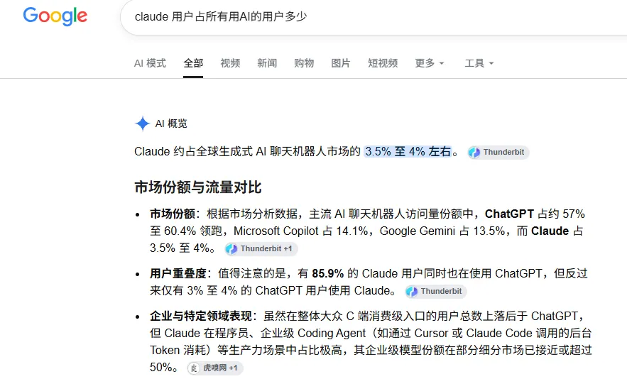
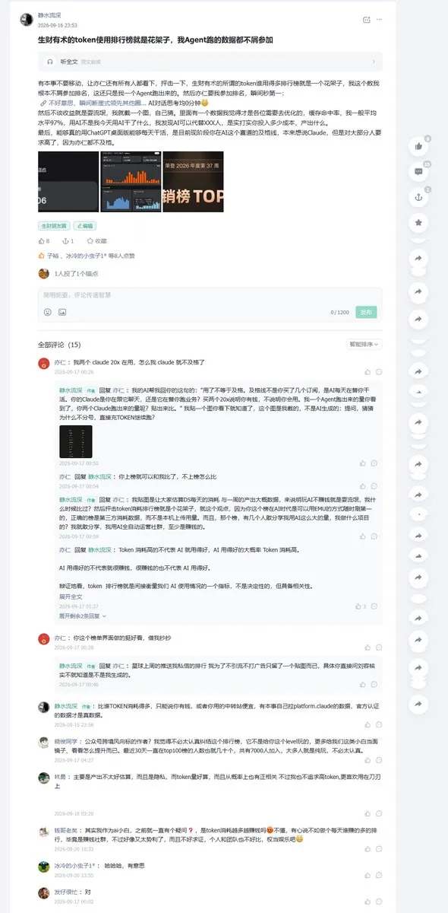
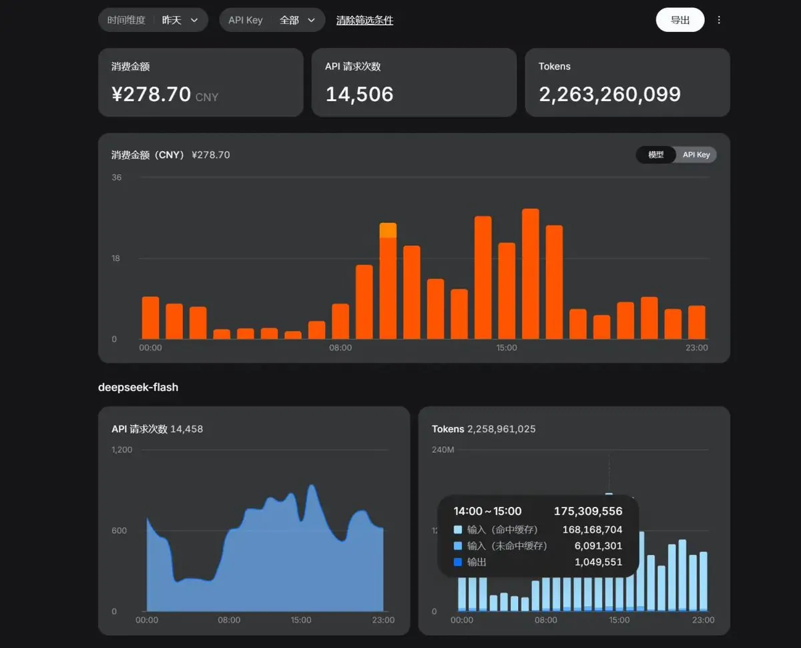
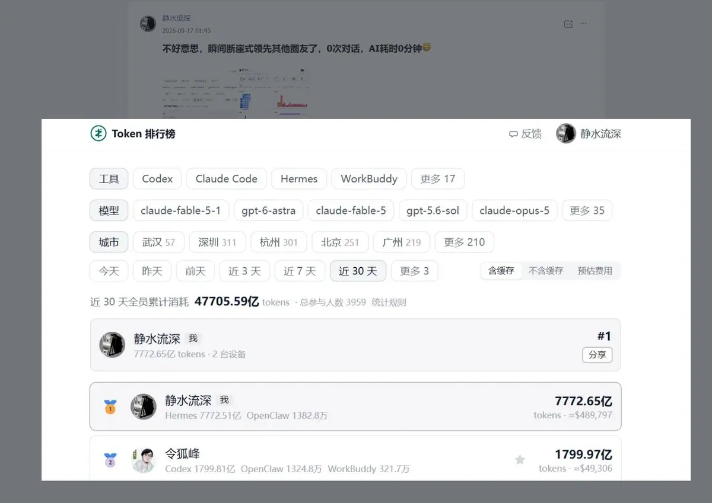
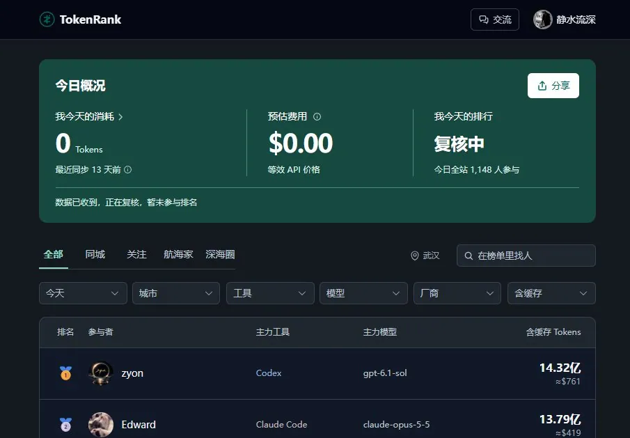
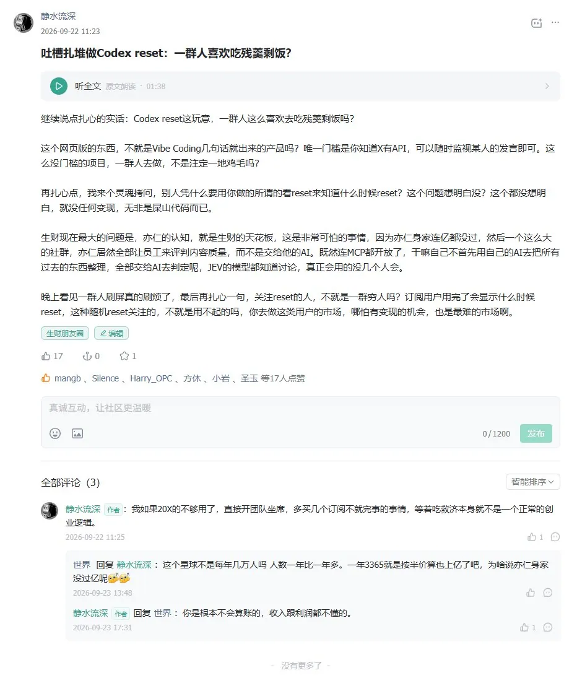
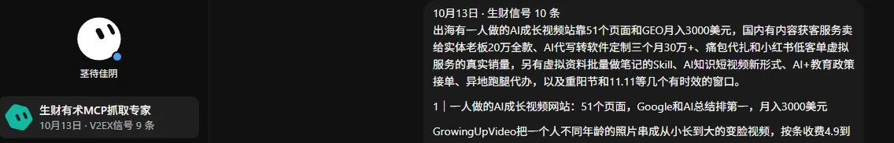

# 爱出海（@ai_chuhai）：说下我眼里的生财有术，可能很多你都不知道

> 出海社群深度拆解与价值观察：从信息分发机制、圈子信任背书、大咖认知碰撞到航海实战打卡，理性分析顶级商业社群对独立创作者的真实杠杆价值，提示普通人入群后如何避开「收藏夹狂欢」的信息陷阱，聚焦最小可执行动作快速破局。

<!-- more -->

我跟亦仁、杨涛都是好友，但朋友归朋友，生意归生意，客观地评价对方的生意，我觉得比拍屁更好。

我买过一年的生财有术。买的时候，算盘打得很明白：里面那么多项目，我挑几个出来翻拍，卖培训。一年的会员费，对我来说就是白菜价。

结果我尼玛找了半天，居然没找到一个我觉得适合拿出来卖的，先别急着骂，这不等于里面没有好项目，我找的东西，跟很多人找的不一样。

我看一个项目，不能太挑人，门槛不能太高，还得有包装成高溢价知识付费产品的基本盘。一个人靠自己的资源、能力，把一件事做成了，当然很好，但换一批人来做，还剩多少人能赚钱？按我的标准，至少 20%的人能回本、赚到钱，我才觉得它有做成爆款知识付费产品的可能，比如我们的谷歌套利，我就是按这个标准来考量的。

我也是做知识付费的，江湖都说我是老镰刀，这个不重要，说难听点，做知识付费跟做鸡其实差不多，都是提供服务，收高昂的费用，别人说你做鸡的，你难道还要跟人狡辩吗？我不是，我是良家，我卖艺不卖身？我没这个包袱，我在意的是，钱收了，被骂做鸡是应该默默承受的职业素养。

很多做培训的，讲项目的时候什么都敢讲，一问多久回本，就开始绕，我做产品，只考量一个核心指标：客户回本赚钱率。拿谷歌套利来说，你准备投多少广告费，我们过去的学员平均 ROI 是多少，放在一起，回本周期就可以估算。过去的数据不是给未来开保单，但这笔账总能摊开算吧？你可以一次性投，也可以按自己的现金流安排，别把一个能算的东西讲成玄学。

不扯我这边了，继续聊生财。有人说生财是中国最大的韭菜池，我觉得还好，我在线下接触到的一部分人，钱没有多少，人又太纯良，说难听点，就是钱不多，还很好骗。

我通过生财参加过一些线下局，也听过不少八卦，什么山头林立，各有各的小算盘，一群志愿者做着免费的 Volunteer，白给平台打工。先说清楚，这些是我听来的，不是我逐一核实过的客观事实，但那些局给我的感觉是真的：不少人太纯良了，对赚钱很认真，对生意场上的险恶没什么概念。

我长期搞海外，几千人民币，在我的日常开支里就是几百美元，几个 20X 订阅的事情。但这笔钱落在另一个人身上，可能是他犹豫了很久才掏出来的，说难听点，有人可能真是咬着牙交钱，指望进去以后翻身，我花这笔钱，是想挑几个能卖的项目，有些人花这笔钱，是想给自己找一条出路。

所以我说他们穷，不是在炫耀这几千块钱我出得起，他们一旦把翻身的希望也交进去，这个会员费就重了。项目越多，反而越怕自己漏掉；别人赚得越多，越容易觉得是自己不行。在我看来，这也是生财越来越卷、口碑开始分化的一个原因。尤其到了 AI 时代，外面的机会天天变，一个会员进去转了一圈，还不知道自己该干什么，他当然会失望。

有件事也得说清楚：我第一年交的会员费，早就十倍以上赚回来了。龙珠大概也有三个，具体没去数，但我最不具备代表性。

我连孙哥做 B.AI，充了 50 刀，一开始就知道他尼玛模型有问题，后来都靠用他的免费 DeepSeek，按我的用量把这 50 刀嫖回来了，你说，还有谁割得动我的韭菜？

不要拿我赚回来了，来证明你进去也一定能赚，也别因为我说了这么多不好听的，就以为我是交了钱没回本，出来撒气。

一个社群再优秀，大佬再多，跟你能不能发财，也没半毛钱关系，项目能带你找到一点入门的感觉，但真正决定你能不能赚钱的，是你怎么判断、怎么做生意。这也是我觉得生财最没教透的东西，我教这些，但韭菜们不认，没办法。大家更喜欢一个听上去马上能赚钱的项目。

在我的观察里，生财的口碑明显分化，是从 AI 破局俱乐部出来之后开始的，两个社群当时还干了一仗。我看这件事，没那么多谁对谁错，生财以前缺少同量级的竞争，很多人也没意识到，付费社群这门生意居然可以做这么大，我那时候还跑去搞在线旅游项目呢，如果我跟生财同期起步，或者早期被我发现了生财有术的模式，说不定现在没生财什么事情了。

后来大家看见了，知道这条路能赚钱，有人来做，不是最正常的事情吗？人家学你的模式，挖你的人，抢你的推广渠道，甚至有人往你身上泼脏水。这些我不认同，但做生意不能指望它们不发生，你最该忙的，是让自己的生意继续往前走。

我觉得亦仁当时最大的败笔，就是太愿意回应了，有些事情，默默处理，让那些词慢慢消失就行了，就跟我们伟大的党一贯的做法一样，这么现成的样本，不会抄吗？

比回应更值得想的，是另外一个问题：为什么后来我们这些能拉新的人，跑去帮破局拉新了？

傲慢，是我不再看好生财未来的最大理由，易洋在这件事上，至少让我看到了另一种做法：愿意礼贤下士，也愿意拿出更多利益，让推广头部帮破局宣传。人为什么愿意来，来了为什么愿意出力，这个账他愿意算，更多时候，很多人在钱的面前，反应是最真实的，感情都是不重要的。

亦仁能不能放低姿态，去达成一个商业目的？我对此有疑问。这话我也不想把自己摘出去，我也做不到，道理我都懂，真要把身段放下来，心里那口气未必过得去，但生意不会等你把这口气顺过来。

再说 AI，从黄小刀开始搞 AI 风向标的时候，生财就已经有了先手，在我看来，那时候就该转，破局刚起步，它怎么玩，生财就跟着怎么玩，把已有的内容、用户和渠道接上，我不觉得后面还会留给破局这么大的空间，结果先手拿到了，后面的动作，我没看到足够的紧迫感。

这也是我不能理解的地方，AI 生财明明聊得那么早，最后拿出来讲的，却还是自己是多大的 AI 社群。在中国搞 AI，人数最多，就等于做得最好吗？真要比人数，豆包、元宝摆在那里，对我来说，一个社群里大家是不是已经在用 Claude，用它做到了哪一步，比群里一共多少人重要得多。

我认的头部，是这批人已经走到了哪里，哪怕人少，也是头部，聪明不需要多数，Claude 其实只占 AI 的人数不到 5%，但是不妨碍他就是断档第一：

再说 Token 排行榜，这个我在生财里喷过，客户端放一个读取器，把消耗量排出来，大家看谁跑在前面。问题是，你今天用了这么多 Token，到底干了什么？做出了什么？值不值这些钱？这些不讲，光比消耗，我不知道有什么好比的。

当时我指出机制有漏洞，亦仁让我先上榜再说。我用了十分钟，把所有榜都跑到了第一。

然后，我的号被限制了。

榜我上了，漏洞还在那里。那我们到底是在讨论机制，还是在讨论谁有资格开口？

还有 X 上那个 ChatGPT reset，被当成一个巨大的风口来讲，我当时的判断就是：残羹剩饭。你可以不同意我对这个机会的评价，但这件事让我越来越担心，亦仁一个人的认知，会不会变成整个生财的天花板，一个人觉得新鲜，下面就跟着觉得是风口；一个人没看到，大家就一起晚半拍，社群大了以后，这比看错一个项目可怕。

更逗的是，评论区还有人拿“每年会员费都过亿了”来杠，仿佛这就能证明所有事情，我的个乖乖，会员费流水、公司净利润、创始人个人身家，是一回事吗？一个天天讨论赚钱的社群，讨论到最后，连收入和利润都混在一起，还杠得挺起劲，这比赚多赚少更让我在意。

最后说 MCP，生财开 MCP，我觉得是败笔中的败笔。更让我意外的是，AI 破局也很快跟了上来，我知道有人会说，这叫拥抱 AI，方便会员使用，但对一门生意来说，方便之后呢？

知识付费的护城河，在我看来，是信息长期沉淀下来的价值。你把这些东西开放给 AI 调用，知识星球又有了 CLI，整理、分类、重新组织一套内容的成本，会变成多少？以前一个人要进去看，要花时间翻。现在 AI 先过一遍，什么值得看，什么可以归到一个主题下面，都能省掉大量人工。

如果别人围绕同样的需求，把内容重新研究、整理，搭起自己的社群，再用 AI 做日常运营，他还需要解决什么？引流与成交。我说的是这门生意复制起来越来越容易，不是说付费原文就可以随便搬，内容授权另说，但你原来的信息壁垒，还剩多少？这种情况下，一句“社群链接一切”，能顶住多少？

我对链接这件事，一直没什么滤镜。社群里人链接得越多，生活有时候反而越虚伪。这话是不是又很打人？你去链接，靠什么链接？要么有互相交换的利益，要么一个人相信另一个人以后能带自己赚钱，没有这些，大家凭什么持续花时间陪你？

朋友当然可以有感情，但我们现在聊的是一个收费的生意，不是几个人交朋友，连利益怎么分都说不清，就开始讲温度、讲情怀，我只会觉得这笔账以后更难算，谈钱会伤感情吗？我不觉得。做生意，不谈钱，不把利益摆在前面，尤其你还在创业的时候，大概率要多走很多弯路。

这也是我觉得很多生财会员没想明白的一件事。你付钱进去，想找一个能赚钱的项目，可摆在你眼前、已经有人做成的生意，就是知识付费，就是社群本身。研究需求，组织内容，做好引流和成交，这条路，人家已经走给你看了。当然，不是谁照着做就一定赚，也不是把东西搬一遍就能回本。

我当初买生财，想找能拿出来卖的项目，到最后，我觉得最值得研究的，反而是生财怎么把自己卖给了这么多人。

一个靠知识付费赚钱的社群，很多人不去研究它已经做成的生意，非要去里面探索那些不确定的项目，你不赚钱，不是很正常的事情吗？

最后，我是邪修。你可能看完迅速成了我的铁粉，也可能迅速成了黑粉。都正常。

我的粉丝里，没有中间态。

## 相关页面

- [[sources/svwang-wealthy-entrepreneurs-path-dependency-and-waiting]]
- [[sources/xiaoniaoziming-lie-down-income-system-20-to-now]]
- [[concepts/selfmedia-compound-model]]
- [[concepts/b2c-conversion]]
