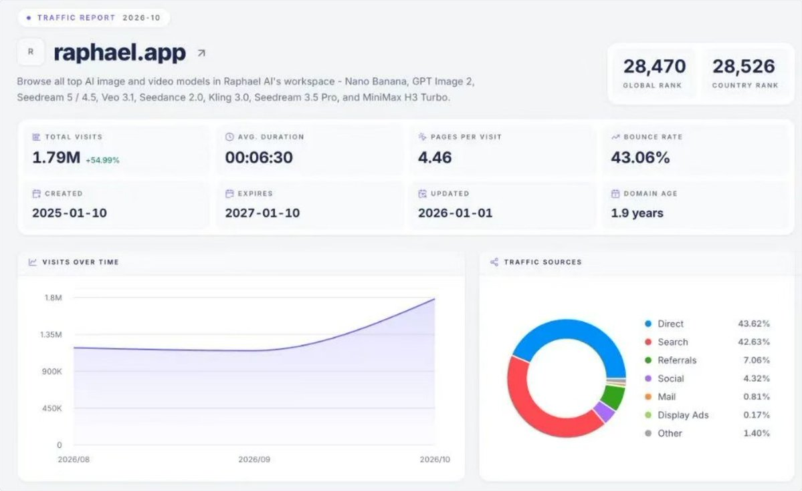
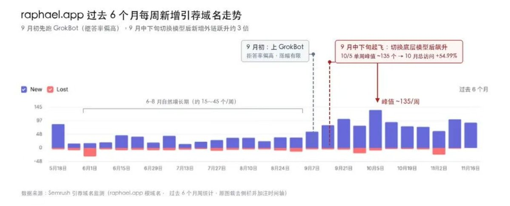
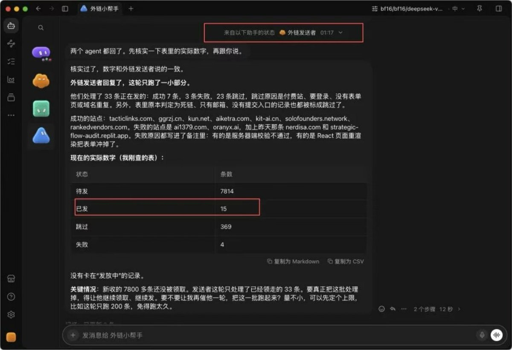

# AI 出海：刘小排 1000 元 Raphael 文章值不值——拆开 200 万月访问的增长叙事

> 对一篇卖 1000 元、卖了 150 份的 Raphael AI 文章的冷水拆解。免费开头放最能抓人的数字（Similarweb 截图：2026 年 10 月 179 万访问、平均停留 6 分 30 秒），随后作者立刻指出闲鱼一两小时后必有盗版。把 Raphael 冲到月访问 200 万拆成三段：① 早期靠一个别人拿走源码也复刻不了的差异化拿到曝光；② 中期持续养权重与精细化产品打磨；③ 熬住时间、域名权重到位后自动化用到极致——**域名权重低时别用极致自动化，否则站可能突然消失**。作者强调很多事「付了 1000 元你也成不了」：坚持两年做一个事、别把外链当一切（垃圾一日速成的东西给外链也没意义）、别迷信自动化外链（Grok 与各种 Agent 比所谓 OpenBot 好用得多）。结尾吐槽知识付费又迎来好时光（失业者太多）。

<!-- more -->

刘小排昨天一篇讲 Raphael AI 的文章卖 1000 元，然后 150 个人购买。

最能抓住人的数字，他放在了免费的开头。按他贴的 Similarweb 截图，2026 年 10 月，Raphael 有 179 万次访问，平均一次停留 6 分 30 秒。

然后当时我就说，咸鱼稍微等一两小时，一定有盗版大甩卖，果然没错，当然我是朋友分享给我看的正版。

## 把 Raphael AI 冲上月访问 200 万这件事从头到尾拆开，其实也就这么回事：

1. 早期靠一个差异化（一个就算别人拿走源代码也不能复刻的差异化），获得了短期大量曝光；

2. 中期持续养权重和做精细化产品打磨；

3. 等熬住了时间，域名等权重到位了，自动化用到极致。（如果域名权重低，不要用如此极致的自动化，否则你的站很容易突然消失不见）

我个人觉得，人家 1000 元卖给你了一个梦想，你觉得你看完了你也能成。

## 我说下里面你哪怕付了 1000 元，你也成不了的事情：

1，做到现在差不多两年，200 万访问量，没说 ARPU 值与 CPM 回报，哪怕晒了收入，也没啥，因为还有成本，只是很多人，两年坚持做一个事情都做不了。

2，外链，很多人觉得外链是一切，但是有没有想过，人家花两年去打磨一个产品，你一个垃圾一日速成的东西，一样的外链给你也没意义。

3，自动化外链，这东西很多人觉得是有价值的地方，我觉得有这种观点的就是纯一韭菜，Grok 还有各种自动化的 Agent 比那个所谓的 OpenBot 要好用得多，举个例子你就懂了，你觉得你找个女朋友，谈恋爱上床，你很满足，觉得很好，你为什么不想下，人家职业做妓女的，就是靠床技吃饭的，一定比女朋友好用啊。

至于一篇文章收 1000 元，卖了 150 份，这不是很正常的事情吗，他的那个教人 AI 编程的课，卖几千客单价卖了几千份，一篇文章低客单有啥奇怪的？

我反正就感叹一句，这年头因为失业的人太多了，所以知识付费又迎来好时光。

## 相关页面

- [[patterns/content-arbitrage-pattern]]
- [[sources/gefei-seo-selling-courses-community]]
