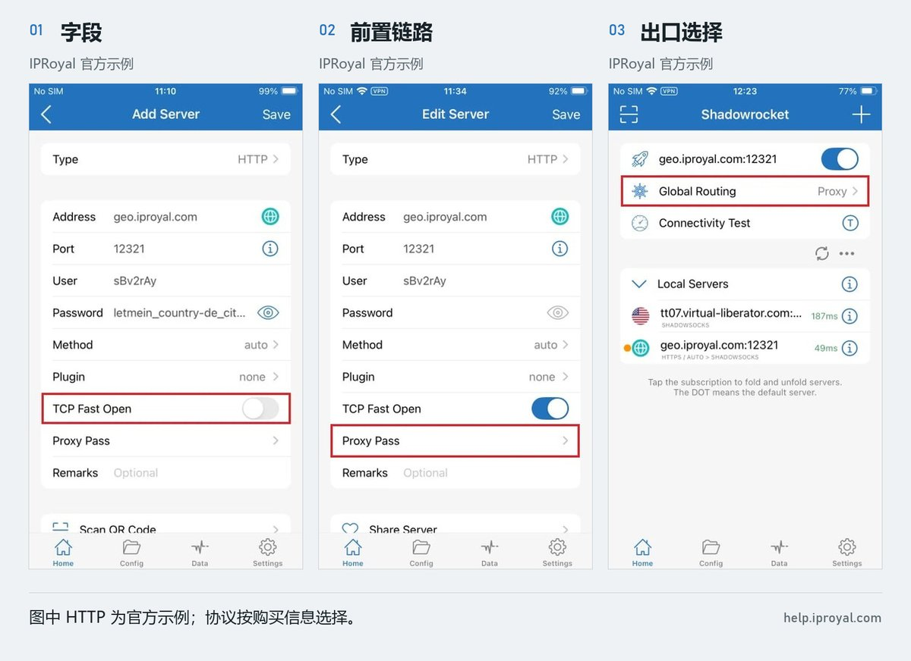
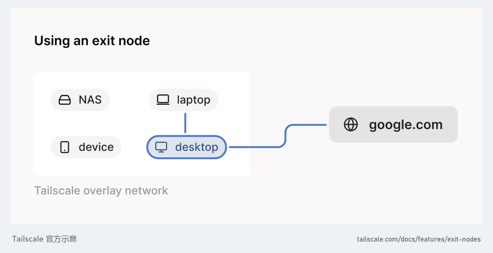

# 爱出海（@ai_chuhai）：想用 Claude / ChatGPT？静态住宅 ISP 代理选购、配置与排错全攻略

> 针对跨境独立站与 AI 开发者深度拆解家宽 ISP 代理：区分网络层、出口层与平台地区资格；对比 IPRoyal / Decodo / Oxylabs 三大服务商；Mihomo 链式代理（dialer-proxy）与 Shadowrocket 配置；命令行环境变量（HTTP_PROXY）与 Tailscale 出口节点自建，以及 403/407/429 报错定位指南。

<!-- more -->

夜总会包厢挂着“私人专属”，不代表昨晚没坐过几十拨人，IP 也一样：独享说明现在谁在用，不能证明过去干净。

这篇从选线路讲到验收：先认清家宽，再选服务商，接好电脑和手机，最后按报错排查。

### 01｜先判断：你到底缺哪一层

第一层，网络能不能到。 当前网络能否连上目标网站或代理服务器。超时、连接中断，先查这一层。

第二层，网站看到哪个出口。 登录网页、桌面端、CLI 是否走了你选定的 IP。浏览器能打开，不代表命令行也接好了。

第三层，平台是否向你提供服务。 账号、所在地、企业资格和付款要求，由平台决定。网络通了，这一层也要单独核对。

目前官方范围要分产品看：

- ChatGPT 与 OpenAI API： 中国大陆均未列入各自支持地区。参考 [ChatGPT 地区表](https://help.openai.com/en/articles/7947663-chatgpt-supported-countries)与 [API 地区表](https://help.openai.com/en/articles/5347006-openai-api-supported-countries-and-territories)。
- Claude 网页与 API： 中国大陆均未列入对应支持地区。参考 [Claude 使用地区](https://support.claude.com/en/articles/8461763-where-can-i-access-claude)与 [Claude API 地区表](https://platform.claude.com/docs/en/api/supported-regions)。
- Gemini 网页： 官方列有“中国大陆，仅限 Workspace”的例外，要看组织订阅与管理员配置；不能套到普通个人账号。参考 [Gemini 网页范围](https://support.google.com/gemini/answer/13575153?hl=en)。
- Google AI Studio／Gemini API： 另有地区表，中国大陆未列入，不能沿用 Workspace 的例外。参考 [开发者服务范围](https://ai.google.dev/gemini-api/docs/available-regions)。

人在中国大陆，遇到明确的地区限制，应先确认可用的组织服务或其他向所在地开放的产品，改出口不会自动改变实际所在地与使用资格，下面解决的是网络配置，适用于你有权使用的服务。

### 02｜“家宽”水很深，新手大概率不懂

真实家庭宽带出口： 海外某户家庭的电脑或路由设备替你转发流量，设备和线路来源可以核实，但公网 IP 可能随运营商重新分配而改变。

静态 ISP 代理： 固定分配一个 ISP 地址给你使用，设备可以托管在机房，它适合需要稳定出口的场景；“ISP”标签本身不能证明机器在谁家客厅，[Oxylabs 的 ISP 产品说明](https://oxylabs.io/products/isp-proxies)就明确区分了地址归属与托管位置。

动态住宅代理： 从住宅池中分配出口，可能按请求或会话轮换，Sticky 是粘性会话，通常有时限，节点离线也可能换 IP，持续登录场景，优先核对固定分配产品，别买成轮换流量包。[会话控制示例](https://developers.oxylabs.io/products/proxies/residential-proxies/session-control)

独享、静态、住宅。 独享问谁共用，静态问多久不变，住宅问出口从哪来。

已有线路稳定、业务正常，就先保持，需要固定出口，再加静态 ISP；已有获授权的海外家庭设备，可以走本文第 07 节。

VPS 自建通常仍是机房出口；eSIM 的出口位置要看运营商路由。

### 03｜三家跨境电商行业使用的服务商

如果说只是为了用 AI 上个网是业余级别，今天用专业级别跨境电商领域来为大家讲解，这里埋下本文第一个菜单，你如果觉得 Claude 解决 IP 问题就比较难了，我再告诉你 etsy 的店铺，你如果可以开得出来，不仅 Claude 这种环境解决问题就是小儿科，etsy 的店铺市场价随便几千块就可以卖。

IPRoyal｜个人先做小额测试，可优先比较

看 Static Residential Proxies。官网列有 24 小时方案，起价约 1.80 美元／IP；30 天方案起价约 2.70 美元／IP。

该产品宣传独享静态出口，支持 HTTP(S)／SOCKS5，官方允许从 1 个 IP 起买。下单前确认地区现货、固定地址的保留规则，以及你的具体 AI 网站是否允许访问。别把其动态 Residential 产品的网关抄到静态套餐里。[价格](https://iproyal.com/pricing/static-residential-proxies/) · [产品](https://iproyal.com/static-residential-proxies/) · [最低订单](https://help.iproyal.com/en/articles/7222122-can-i-buy-one-isp-proxy)

Decodo｜需要几个独享固定出口时比较

看 Dedicated ISP。当前入门档为 3 个 IP，9.99 美元／月，另计适用税费，折合每个 3.33 美元。不要拿共享产品的低价，理解成独享产品价格。[价格与套餐](https://decodo.com/proxies/isp-proxies/pricing)

这里有个买前必须问清的坑：官方有 Dedicated ISP 的受限目标清单，而且该产品不能解锁这些受限网站，把你需要的登录、模型请求、文件上传域名发给售前确认，再付款。[受限目标说明](https://help.decodo.com/docs/dedicated-isp-proxy-restricted-targets)

Oxylabs｜团队、多产品需求时比较

看 Dedicated ISP Proxies。官网现行统一订阅的 Starter 为 30 美元／月，入门档 Dedicated ISP 标价约 3 美元／IP；别把单 IP 计费单位看成整套月费只要 3 美元。[当前价格](https://oxylabs.io/pricing/dedicated-isp-proxies)

它的自助产品文档较完整，但同样有受限目标，价格页也明确自助购买不退款。需要固定出口时，照控制台的固定端口／分配方式使用；其自助教程中的 8000 是轮换入口，8001、8002 等用于对应固定出口，不能填反。[接入说明](https://developers.oxylabs.io/help-center/getting-started/start-using-dedicated-isp-proxies) · [受限目标](https://developers.oxylabs.io/products/proxies/dedicated-isp-proxies/self-service/restricted-targets)

买之前，把这六个问题一次问完：

1. 这个套餐是否独享？租期内能否持续保留同一 IP？
2. 真实家庭设备还是机房 ISP？出口国家和 ASN 是什么？
3. 给的是固定入口还是轮换入口？支持哪种协议和认证？
4. 我需要的 AI 登录、请求、上传域名，是否全部允许访问？
5. 从我的现有网络怎样连接？是否需要前置代理？
6. IP 不可用时怎么更换或退款？是否有流量、公平使用和自动续费限制？

先短周期、少量购买，验收后续费。“包解锁”“永久干净”“绝不封号”，都不能替代实际套餐条款。

### 04｜电脑接法：前置负责到达，ISP 负责出口

如果本地不能直接连接买来的 ISP 代理，需要一条已有、可用的前置线路。实际顺序是：

浏览器／CLI → 本机代理 → 已有前置节点 → 固定 ISP 出口 → 网站

网站看到最后一跳的地址。把 ISP 放错位置，买了也白买。

下面以 Mihomo 内核客户端为例。你需要先备齐：可用的前置节点、供应商提供的固定 SOCKS5 地址、端口、用户名和密码。不同客户端按钮名称不同，配置含义相同。

第一步：复制现有配置，做一份测试副本。 保留原来的前置节点或 provider，不要拿下面的片段覆盖整个订阅。

第二步：合并 ISP 节点与 FRONT 策略组。 最终文件只能有一套顶层 proxies、proxy-groups、rules；把条目并入已有列表。以下 server、port、账号、密码及“已有前置节点名称”都要换成自己的实际值。

本地端口优先沿用现有 mixed-port。新增时别与原有 port、socks-port 或 listeners 占用同一地址和端口；以下 7890 若改了，浏览器与检测命令也同步改。

```
mixed-port: 7890
allow-lan: false
bind-address: 127.0.0.1
mode: rule

proxies:
  # 同一列表内保留原有前置节点的定义。
  - name: ISP-EXIT
    type: socks5
    server: isp-proxy.example.com
    port: 1080
    username: 'REPLACE_WITH_ISP_USERNAME'
    password: 'REPLACE_WITH_ISP_PASSWORD'
    udp: false
    dialer-proxy: FRONT

proxy-groups:
  - name: FRONT
    type: select
    proxies:
      - '已有前置节点名称'

rules:
  - NETWORK,udp,REJECT
  - MATCH,ISP-EXIT

```

第三步：在测试副本中用上面两行规则，客户端选“规则模式”。 FRONT 选你的前置节点，不能选 ISP-EXIT，也不能绕一圈又选回 ISP-EXIT。这里无需切客户端的“全局模式”。

上例引用的是顶层 proxies 中已定义的前置节点。若前置节点来自 proxy-providers，保留原 provider，并把 FRONT 组内的 proxies 列表改为 use: [你的 provider 名称]，再从组内选择具体前置节点；不要把 provider 名直接填成节点名。

关键是 dialer-proxy: FRONT 写在 ISP-EXIT 里面：连接 ISP 时先借道前置。旧教程里的 relay 组已弃用。[官方链式代理说明](https://wiki.metacubex.one/config/proxies/dialer-proxy/)

这份测试配置面向网页和普通 API 的 TCP 连接。它先拒绝进入内核的 UDP，再让其余流量走 ISP，避免不支持 UDP 的节点继续匹配到其他出口；语音、WebRTC 需要另测。没有进入内核的流量，这两行规则管不到。[规则行为](https://wiki.metacubex.one/config/rules/)

第四步：让浏览器连接本机代理。 使用客户端的系统代理功能，地址为 127.0.0.1，端口为这里的 7890；若客户端实际用了其他端口，两边一起改。Chrome 接本地 HTTP 代理，上游 ISP 的认证由 Mihomo 处理。不要把带账号密码的 SOCKS5 地址直接塞给 Chrome：Chrome 的 SOCKS5 不支持认证。[Chromium 官方说明](https://chromium.googlesource.com/chromium/src/+/HEAD/net/docs/proxy.md#SOCKSv5-proxy-scheme)

普通 SOCKS5 的账号认证本身不加密。供应商若提供 HTTPS 代理或 SOCKS-over-TLS，按它给的协议、端口配置并保留证书校验；只有普通 SOCKS5 的端口，不能凭空打开 TLS。[认证协议说明](https://www.rfc-editor.org/rfc/rfc1929.html#section-3) · [Mihomo HTTPS 代理配置](https://wiki.metacubex.one/config/proxies/http/)

第五步：验收后再恢复日常分流。 上面是专用测试规则，会让进入内核的 TCP 都走 ISP。日常只分流所需应用或域名时，要把规则放在宽泛规则前面，同时检查登录、文件、CDN 等依赖。不要配一个失败就自动 DIRECT 的回退，然后误以为始终同一出口。

订阅更新可能覆盖直接修改；优先使用客户端提供的扩展／覆写功能，并查看生成后的最终配置。原节点还在、名字对得上、没有环路，再启动。

### 05｜iPhone 接法：Shadowrocket 的三个位置

已经有可用的 Shadowrocket 和前置节点，就按以下顺序设置。没有前置线路时，先解决到供应商入口的可达性。



① 添加 ISP 出口。 点“＋”，Type 按供应商实际协议选择 HTTP 或 SOCKS5。Address、Port、User、Password 全部来自你购买套餐的控制台，名称可以记为 ISP-EXIT。

② 设置前置链路。 编辑这个 ISP 出口，在 Proxy Pass 中选择你已有的前置节点，再保存。方向仍然是手机 → 前置 → ISP。

③ 选中最终出口。 主界面选择 ISP-EXIT。测试时将 Global Routing 设为 Proxy，连接并完成系统要求的 VPN 配置授权，然后去查公网 IP。

上图取自 [IPRoyal 官方教程](https://help.iproyal.com/en/articles/10667956-how-to-use-iproyal-proxies-with-shadowrocket)，展示的是 HTTP 示例；图内地址属于它的示例产品，不能当成你购买的静态 ISP 地址。图里的账号、端口、前置节点都不要照抄。

如果查到的仍是前置 IP，先检查主界面选的是不是 ISP-EXIT，以及 Proxy Pass 有没有写反。测试完成后再按需求恢复分流，并重新验收。

### 06｜CLI、DNS、TUN：把遗漏的路径补齐

CLI 单独接。 浏览器已经能用，Claude Code 等命令行仍超时，常见原因是它没有读取浏览器的代理设置。

Windows PowerShell 可以在当前终端设置以下变量，再从同一终端启动 CLI。它们只影响当前进程及之后继承环境的子进程，不会替所有已打开的软件改设置。

```
$env:HTTP_PROXY = 'http://127.0.0.1:7890'
$env:HTTPS_PROXY = 'http://127.0.0.1:7890'
$env:NO_PROXY = 'localhost,127.0.0.1,::1'

```

HTTPS_PROXY 的值写 http://，表示使用本地 HTTP 代理；HTTPS 网站连接仍可通过 CONNECT 建立 TLS。Claude Code 当前官方支持这三个变量、不支持 SOCKS 代理；Gemini CLI 也有 HTTP(S) 代理配置。Codex 的公共出站实现支持相应代理环境变量，但外部工具、MCP、远端执行要分别核对。[Claude Code](https://code.claude.com/docs/en/network-config#proxy-configuration) · [Gemini CLI](https://geminicli.com/docs/cli/enterprise/#controlling-network-access-via-proxy) · [Codex 出站实现](https://github.com/openai/codex/blob/8806313db4c82c89efcae3e6ac682bed6f4d6a66/codex-rs/http-client/src/outbound_proxy.rs#L381-L406)

DNS 单独核对。 DNS 负责把域名解析成地址。改 DNS 不会把机房 IP 变成家宽。Mihomo 开了 DNS，也不代表全部应用自动使用它；要确认应用或系统确实把解析交给它。

配置 respect-rules 时，还需正确设置 proxy-server-nameserver，先解决代理服务器自身域名的解析，避免“先连代理才能解析代理”的循环。已有客户端 DNS 配置能正常工作，就先保留，按 [官方 DNS 文档](https://wiki.metacubex.one/config/dns/)检查，别叠加几套互相冲突的教程。

TUN 按需开启。 有些程序不读系统代理，才需要用 TUN 扩大接管范围。启用后检查路由、DNS、IPv6，以及与其他 VPN 的冲突；WSL、容器、虚拟机和远程服务器也要分别验收。TUN 没有“给 Claude 账号加分”的功能说明。[官方 TUN 配置](https://wiki.metacubex.one/config/inbound/tun/)

网页能用、CLI 能用、语音能用，是三项测试。一个成功，不能代替另外两个。

### 07｜已有海外家庭设备：直接使用自己的家宽出口

如果你自己或明确授权你的家人，在海外有常在线家庭设备，可以通过 Tailscale 出口节点使用那条家庭宽带。设备必须实际接在家庭网络上；放在云机房的机器，出口仍是云机房。



图中的 desktop 代表出口设备。只有它接在真实家庭宽带上，网站看到的才是那条家庭线路的公网地址。

以海外已有 Linux 设备为例：

1. 两端从官网下载 Tailscale，加入自己管理的同一个 tailnet。
2. 海外 Linux 端按官方步骤启用 IPv4／IPv6 转发，并保留防火墙对无关转发的限制。
3. 在海外设备执行 sudo tailscale set --advertise-exit-node，再执行 sudo tailscale up。
4. 管理后台 Machines 找到该设备，在 Edit route settings 中允许 Use as exit node。
5. 本地客户端的 Exit node 菜单选择这台设备。如果修改过访问策略，还需允许目标用户使用 autogroup:internet。
6. 验收家庭出口时，测试应用先停用前面配置的 ISP 代理，避免再次串回 ISP。查询公网 IP，核对是否等于海外家宽的出口；Tailscale 的 100.x 内网地址不是网站看到的地址。

设备保持在线，性能取决于实际连接路径和家庭宽带。Tailscale 也不能让运营商分配的动态公网 IP 永远固定。具体系统设置见 [Tailscale 官方出口节点教程](https://tailscale.com/docs/features/exit-nodes?tab=linux)。

### 08｜交钱后怎么验收：

第一项：实际出口。 在使用同一本地代理的浏览器里打开 [ipify](https://api.ipify.org/)，对照供应商分配的地址。

第二项：命令行出口。 Windows 使用下面的命令；本地代理端口按实际值调整。命令只查询公网 IP，不需要输入 AI 的账号或密钥。

```
curl.exe --proxy http://127.0.0.1:7890 --noproxy localhost --connect-timeout 15 --max-time 30 https://api.ipify.org

```

这里 --noproxy localhost 覆盖当前终端可能已有的排除规则，不会把 api.ipify.org 排除在代理之外。[curl 参数说明](https://curl.se/docs/manpage.html#--noproxy)

第三项：是否稳定。 隔一段时间、断开重连、重启客户端后各查一次，记下时间与出口 IP。套餐承诺固定、实际却不断变，拿这份记录找服务商。

第四项：真实业务。 分别测登录、普通对话、文件上传、CLI 请求；需要语音再单独测语音。出口查询成功，只能证明查询请求通了。

第五项：接管范围。 查看客户端连接记录，确认相关连接命中 ISP-EXIT。再核对 DNS、IPv6、应用自带代理和远端工具是否走了其他路径。

IP 数据库中的国家、ASN、住宅标签可以交叉参考；一张“纯净度 100 分”的检测图，不能证明这个地址没有历史，也不能替任何 AI 平台承诺结果。

### 09｜出了问题，按报错找层级

连接超时： 先测已有前置是否可用，再核对 ISP 地址、端口、余额和线路状态。不要一超时就删账号重注册。

407： 代理认证问题。检查用户名、密码、认证方式和来源 IP 白名单设置。

403／Access denied： 读完整报错，区分账号权限、边缘防护、目标限制。保存时间、请求 ID 或 Ray ID，供服务商或平台支持定位。403 不是“账号扣了多少分”的证据。

Unsupported country： 回到第 01 节查对应产品的地区资格。若你实际处于支持地区却被误判，带错误信息联系官方支持。

429： 区分速率超限和额度／账单不足。前者降低并发、按 Retry-After 重试；后者检查余额、预算和套餐，连续重试不会生出额度。

浏览器能用，CLI 不行： 检查代理环境变量、启动终端、NO_PROXY，以及工具是否在另一台机器上运行。

证书错误： 核对系统时间、代理协议、证书链。不要添加 -k、关闭证书校验，或为了登录安装来源不明的根证书。

付款失败： 另外检查发卡行、账单资料、验证流程及支付地区支持。换 IP 解决不了所有付款问题。

排错依据：[OpenAI 错误码](https://developers.openai.com/api/docs/guides/error-codes) · [Claude API 错误码](https://platform.claude.com/docs/en/api/errors) · [Cloudflare 403 说明](https://developers.cloudflare.com/support/troubleshooting/http-status-codes/4xx-client-error/error-403/) · [付款被拒说明](https://help.openai.com/en/articles/7232916-why-was-my-credit-card-declined)

实际操作就按这个顺序：确认服务资格，选一个短周期固定出口，接好链路，再逐项验收。保存能复用的配置和测试记录；账号密码、订阅链接、API 密钥不要出现在公开截图里。

撰写与整理：OpenAI Codex｜图片来源：IPRoyal、Tailscale 官方文档。

## 相关页面

- [[concepts/cloudflare-zero-trust-access]]
- [[concepts/international-software-arsenal]]
- [[concepts/b2c-conversion]]
