# 袋鼠帝（@aikangarooking）：狂揽 83.7K Star！开源版 Super-agent 来了，告别 AI 监工

> 从 DeepSeek Harness 团队《Super-agent 设计探索：迈向更自主的 Agent 系统》一文出发，梳理 Super-agent 的四个核心主张——跨信道连续、高效并发、主动干活、存算分离持久在线，并指出当前 Coding Agent 单兵虽强但任务一多就需人肉复制上下文、充当「人肉路由器」的痛点；随后指出 LobeHub 早在半年前已把这套类 Super-agent 体系跑在生产环境（GitHub 83.7K Star，配套 Skills 市场），提醒读者不要把 LobeHub 停留在 2023 年开源的 LobeChat 套壳印象。

<!-- more -->

大家好，我是袋鼠帝。

上周六，DeepSeek 的 Harness 团队发了一篇硬核长文《Super-agent 设计探索：迈向更自主的 Agent 系统》，各种 AI 群里直接炸锅了。

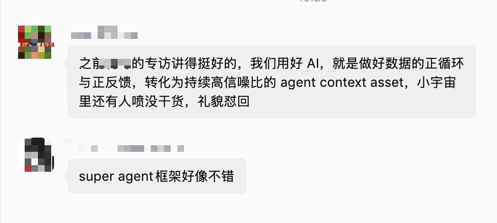

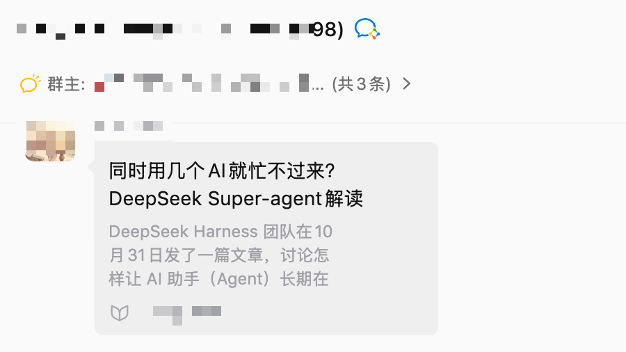

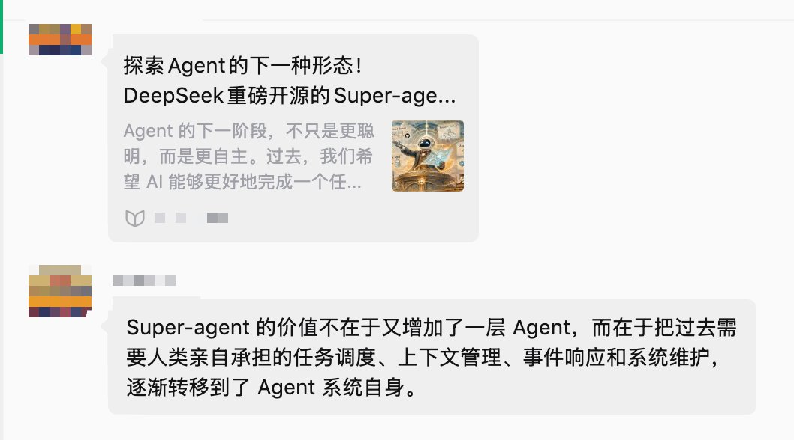

文中的描述的痛点真滴戳中了每一个天天用 Agent 的人（包括我自己）：

现在的 Coding Agent 单兵确实强，但任务一多，人就快被折腾疯了。。你得开几个窗口一边盯代码，一边人肉复制上下文。

而且现在的 Agent 大多像临时工，电脑一合上直接断开连接。看看下面这个图就知道了。。

这不就是出差的我吗🤣

到头来，人好像反而成了打下手的，天天当人肉路由器，把 Agent 们捧在手心

DeepSeek 正是为了解决这些痛点，提出了 Super-agent 设想：

跨信道连续、高效并发、主动干活、存算分离持久在线。

说实话上面提到的都是我的痛点，我是真想早点用上这套系统。可惜 DeepSeek 说明这只是架构探索原型，并非正式产品。。

不过我在众多信息里面注意到，其中一个群友分享的内容。原来已经有成品可以用了啊～

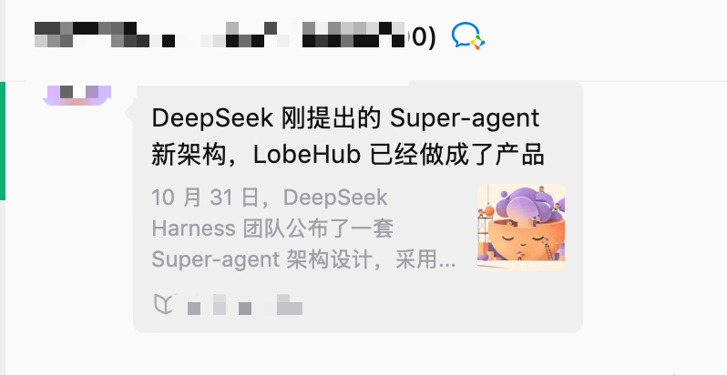

我了解了一下，没想到 LobeHub 早在半年前就已经把这套类 Super-agent 的体系跑在生产环境里了（这个待会儿会详细说说）。

提起 LobeHub 这个名字，我非常熟悉。

如果是一直玩 AI 的朋友肯定也会 LobeHub 不陌生，毕竟它在 GitHub 上已经有 83.7K Star 了。

即便名字没记住，我相信你应该对这个图标有印象，他们还有一个非常全面的 Skills 市场：

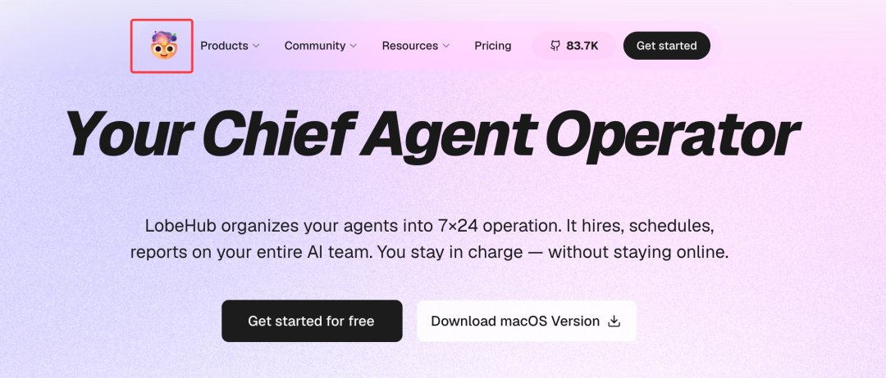

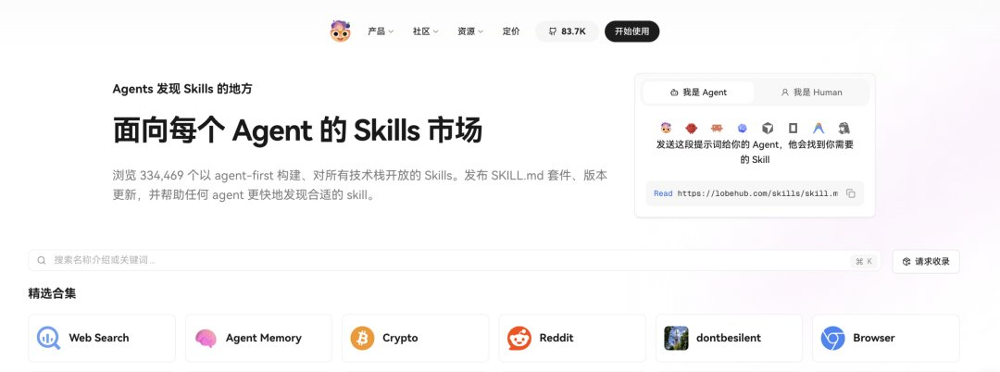

不过，说到 LobeHub，很多人的第一反应可能还是 2023 年开源的 LobeChat。相信有不少人用它套过壳，比如给公司内部部署模型使用，或者对外提供服务去卖 token。我那时候还专门本地部署了一套，用来连接各种大模型 API。

但如果你对它还停留在 UI 聊天框，那就太低估开源的进化速度了。

我翻了一下 GitHub 的迭代记录，两年多里，它早就从一个单纯的聊天框架，进化成了一个完整的多智能体协作平台：

从本地存储的聊天框到补齐数据库的 1.0，再到今年推出拥有 CAO、支持跨设备调度与异构框架管理的完整平台。目前 GitHub 斩获超 83.7K Star，Docker 部署破 700 万次。

而且 DeepSeek 官方多次选用 LobeHub 作为发布演示平台。展示 V3、R1 的深度思考与工具调用时，用的前端界面正是 LobeHub。

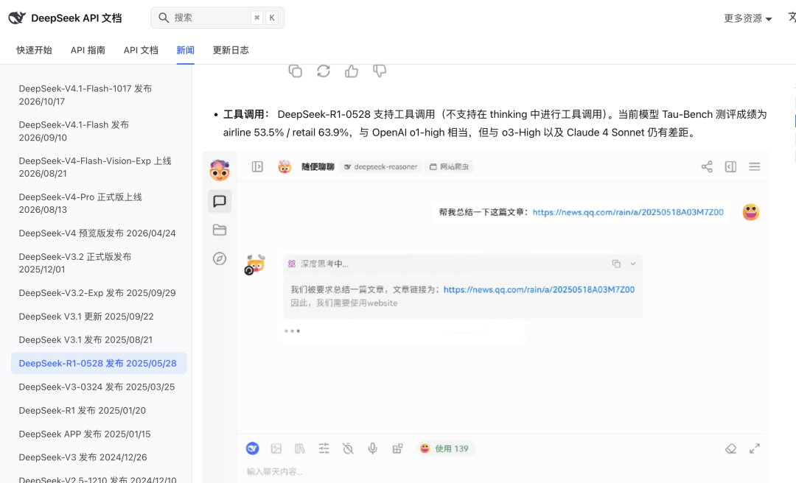

他们不仅做产品，还联合新加坡国立大学 NUS 发起了 MCP 的压力测试基准 MCPMark，以及专注评测 Coding Agent 能否打磨好用户体验的 Interaction Bench （iBench）基准。真是高精力啊。

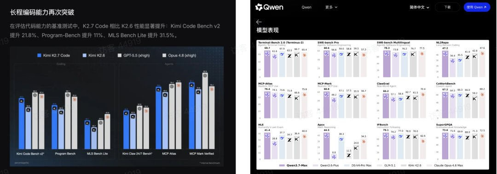

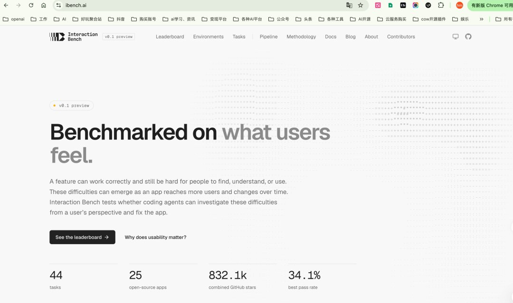

最骚的是他们团队表示：“We Build LobeHub with LobeHub”（我们正在用 LobeHub 开发 LobeHub）

主管 Agent 在 Discord 群里主动巡检、拆解需求；专门的执行 Agent 在各自隔离的环境里写代码、跑测试；代码改完直接交付 PR；最后再自动生成包含录屏和截图的多模态验收报告。

卧槽，这不就是我理想中的人和 AI 的交互方式吗？

DeepSeek 的 Super-agent 是系统架构推演；而 LobeHub 已经用这套架构在自己的生产环境里跑了大半年了。

为了搞清楚这套研发闭环到底是怎么运转的，我对照着 DeepSeek 文章的几个核心设计，去深挖了一下 LobeHub 现在的架构和代码。

首先解决人类注意力上限的问题：

如何避免一个人同时最多盯 3~5 个会话。在不同窗口切来切去传达上下文。

一、Router 和 Worker 分层。&#xA;

DeepSeek 在第二节提到，为了兼顾连续交互与多任务高并发，底层必须做双层解耦：由常驻的 Router 层统一对外交互和分派任务，由独立的 Worker 层并发执行。

LobeHub 的实践几乎完全对应了这个思路：

上层是 Manager Agent，在他们团队里有一个叫 Nasa 的主管 Agent，常驻在协作频道里，负责理解需求、拆任务、派活和验收。

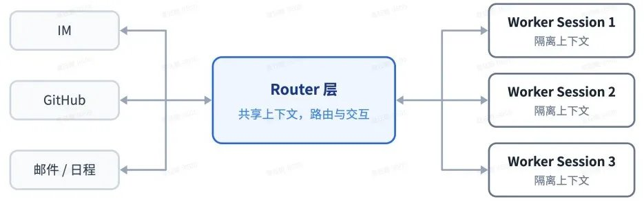

下层则是特化的 Worker Agent，比如专门跑 Claude Code 或者 Codex 的编程 Agent Dario。

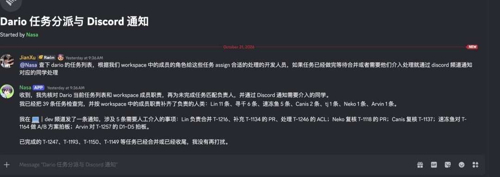

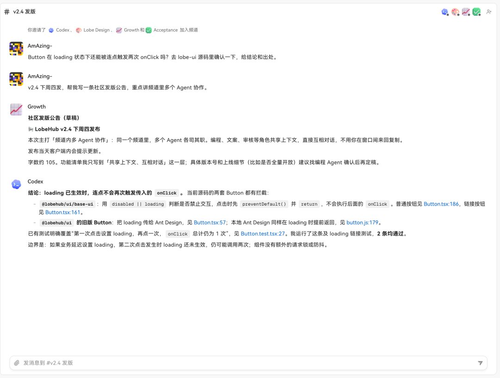

Worker 绝对不能直接在外部群里说话！只需要埋头干活即可，所有产出和状态都沉淀在任务内部，干完之后由 Manager Agent 统一整理成简短的高层摘要，汇报给人类。

而且每个任务只设两个位置：一个执行 Agent，一个负责人。负责人可以是人，也可以是另一个主管 Agent。Agent 能力不够时人是主驾驶，Agent 成熟了人就变成副驾驶。

如何让 Agent 们变主动？而不是每次都要我发消息它才干活？

二、事件驱动与两级过滤：无需@也能主动干活&#xA;

DeepSeek 文章第三节强调了主动性，提出了规则层 Fast Path 加语义层 Slow Path 的两级过滤。绝大部分群聊消息靠规则直接忽略，只有真正相关的才交给模型判断。

在 LobeHub 里，这套逻辑不仅做成了，而且直接做成了界面里可以点选配置的规则，非常方便。

这在群聊里面就特别方便，以前是只能@触发，要不就是每条消息都触发，就很烦人。现在可以从源头设置智能触发就很好。

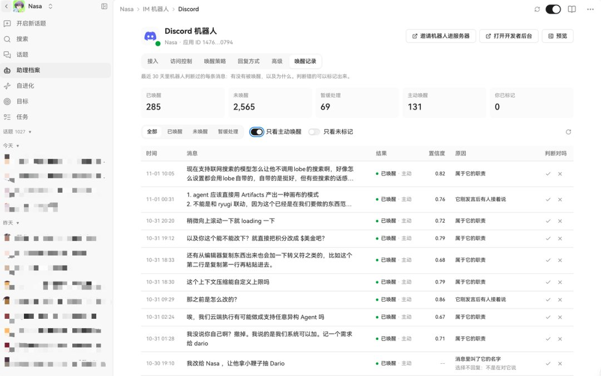

你可以给频道设置监听关键词、事件范围，再由模型按照职责进行语义二次裁决。

简单来说，就是该出手时才出手，不需要介入时保持静默即可。

如何解决本地电脑一合上，就直接 GG 的问题？

三、存算环境三层分离：云端的脑子，本地 Mac mini 的手&#xA;

很多玩本地 Agent 的兄弟肯定遇到过这个恶心的情况：

电脑一合盖、网络一波动，跑了一半的任务直接断开。

为了解决这个问题，DeepSeek 第五节提出了存算分离和环境解耦（BYOM，带上你自己的机器）：

Agent Loop 常驻云端，端侧只留一个轻量 daemon 守护进程。

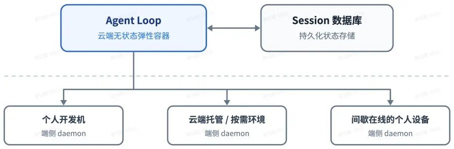

我看了一下，其实 LobeHub 在今年 1 月份发布的架构里，就已经实现了这种彻底的分离：

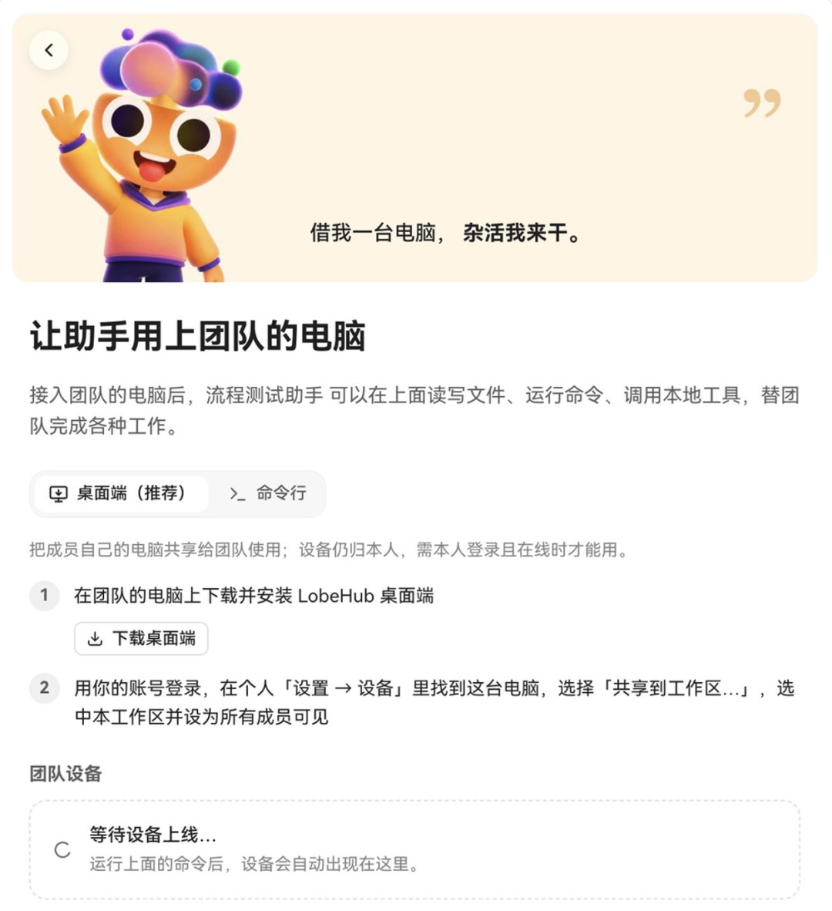

脑子（Agent Loop）跑在云端无状态容器里，哪怕受制于某些云平台的单次执行时长限制，它也能把每一次工具调用变成异步推进，然后状态（记忆）存进 Redis 和数据库。

而干活的手（工具链和代码环境），既可以放在云端沙箱，也可以直接挂载到你办公室里那台长期开机的 Mac Mini 上。

你在网页或者手机上给它安排任务，云端的大脑会开始调度，实际执行命令的是你本地设备上的轻量守护进程。

理论上只要守护进程没挂，这时你合上屏幕去睡觉，它照样能默默把活干完。

四、用 Task 管理上下文：解开 DeepSeek 留下的开放问题&#xA;

DeepSeek 在文章第 8.3 节，特意把上下文边界与多 Agent 协作列为了一个待探索的开放问题：谁共用 Agent？谁共享上下文？如果边界没搞清楚，要么信息割裂，要么上下文爆炸。

而 LobeHub 给出的解法比较朴素，但管用：

用类似 Linear 的任务（Task）来作为信息锚点。

他们把整个团队的协作搬到了 Workspace（工作空间）里。多任务并行推进的时候，每个任务拥有独立的 Task 看板。

这个 Task 从一开始的提问、代码修改的 Thread 对话、中间产物、CI 结果，到最终的 PR 链接，全部沉淀在同一个任务页里。

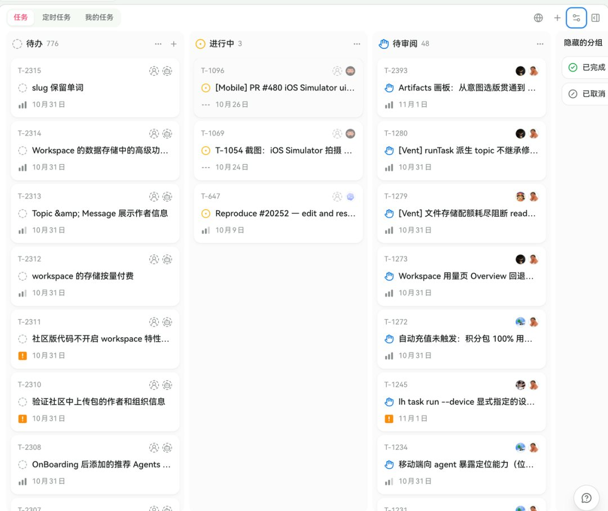

团队里的所有人和其他 Agent，只要点进这个 Task，上下文天然是完整的、可追溯的。它不需要一个万能的大脑去记住全世界的事，而是让每个具体的目标拥有自己的完整闭环。

这就有点像我以前做项目经理的时候的那种，冲刺看板。。

这玩意儿是怎么工作的？&#xA;

Agent 改完代码后，会把需求拆解成一个个可观察的验收项。它自己在无头浏览器里跑一遍，把每一个界面的截图、动效录屏、甚至控制台日志打成一份在线验收报告。

比如移动端小屏显示是否正常、明暗模式切换是否掉色、键盘 Tab 键能不能顺畅选中按钮……

人类开发者只需要在网页端打开这份报告，像刷 X 一样快速过一遍录屏和截图。哪一项看着不对劲，直接在画面上圈选打回；通过的项保留，Agent 带着打回的意见自动去改下一版。

甚至每次打回的记录都会变成经验沉淀下来，Agent 下次交付前自己就会自动先查一遍。

我觉得这种多模态验收闭环，是非常有必要的。

看到这里，可能有些朋友会问：袋鼠帝，这听起来全是软件工程的重型武器，对我们普通人或者普通开发者来说，门槛是不是太高了？

其实完全不用慌。

你甚至不需要去配置复杂的本地环境，只需要到 LobeHub 官网注册一个账号（他们有网页版、桌面客户端和 CLI 工具），花个十几分钟，就能很直观的感受到这种主管 Agent 组织多 Agent 协作到底是个什么感觉。

先直观看看它是怎么合上电脑后还能工作的：

可以多任务并行执行，然后有云端主机（原理跟上面 DeepSeek 提出的存算环境三层分离类似，这里不重复赘述了）。

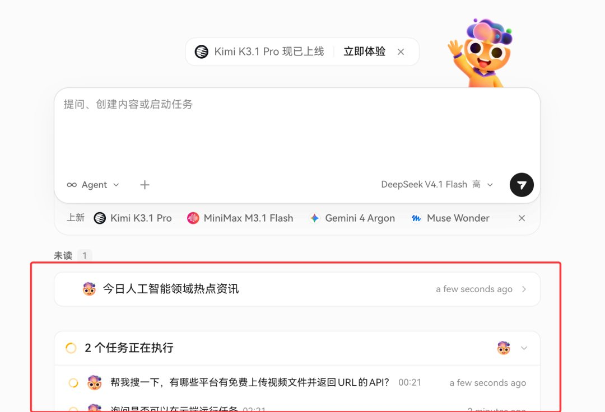

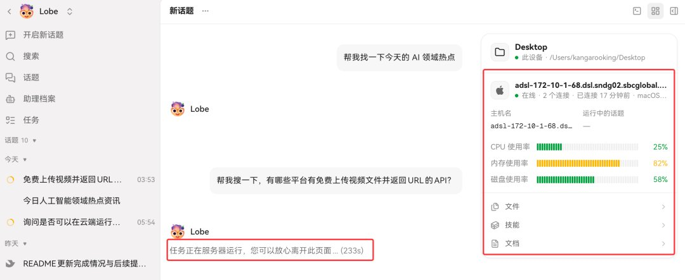

1. 群里一句话，它自己接活、拆活、派活&#xA;

我拉了一个小飞书群，同时把 LobeHub 和 OpenClaw 拉进了群，然后在飞书群里发了一句测试。

我没有没有 @任何一个 agent、没有唤醒词、没有「在吗」，但他理解到要干活了，一号牛马上线。

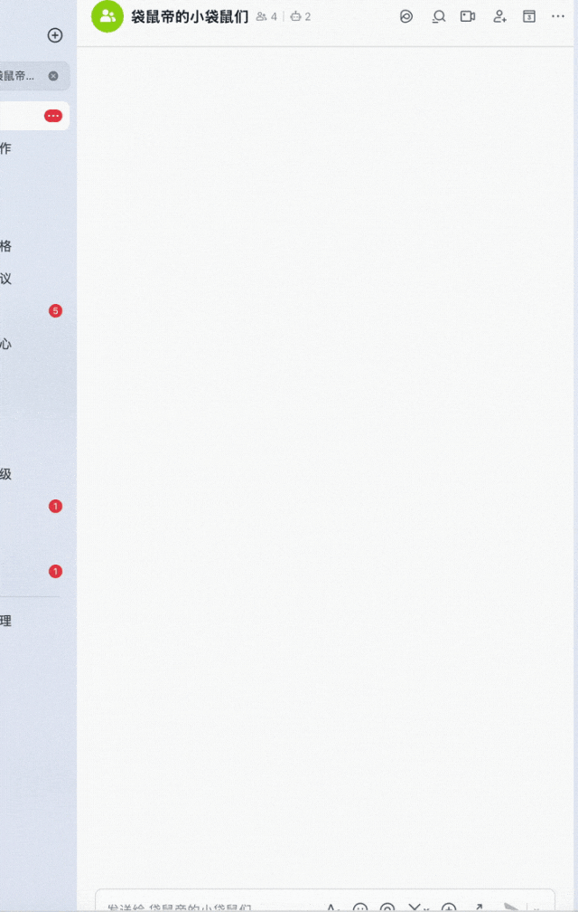

比如我把我在 github 上开源的仓颉.Skill 的一个真实维护需求丢给它

仓颉.Skill 的 README 好像和现在的用法有点对不上了

同样的问题，我也丢给了 OpenClaw。

9 秒后，我的 LobeHub 回复「已接单」。

然后它做的第二件事不是继续聊天，是去建好任务给部门里的员工们：

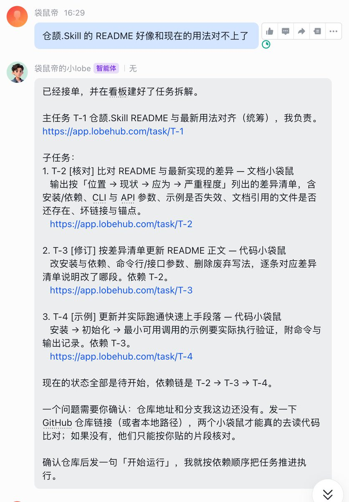

然后我打开 LobeHub 桌面端的任务页，它干了这么几件事：

建主任务 T-1 自己当统筹；

拆出 T-2 给文档小袋鼠 agent 核对、拆出 T-3 修订和 T-4 示例给代码小袋鼠 agent 去完成，最后再给我的产品写一个新的产品介绍（单独新增 task 拆了一个 T-5）；

还把依赖链配好了：T-2 → T-3 → T-4 → T-5。任务可以并行执行并且可以点开看任务内容、步骤、中间产物等。

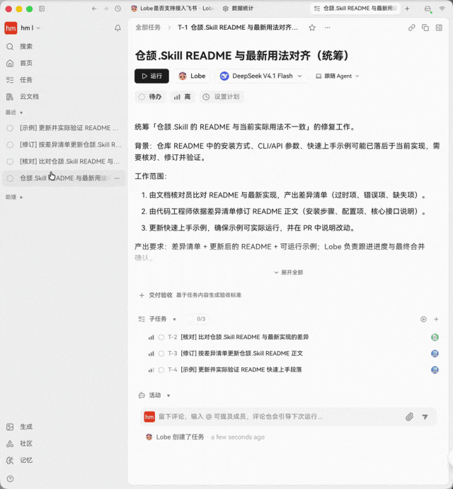

这确实让我感受到了新奇。

以往我们用 Agent，是「我 @ 它，它回答」，活是我安排的、进度需要我亲自盯着。

然后我又接着问：

现在到哪一步了？请分别说明每个任务的负责人、状态和卡点。

有进行中、运行中、未开始等等

能实时定位到任务、负责人和卡点的进度，很像一个小公司达到的颗粒度。哈哈 颗粒度，这个词大家很熟吧🤣

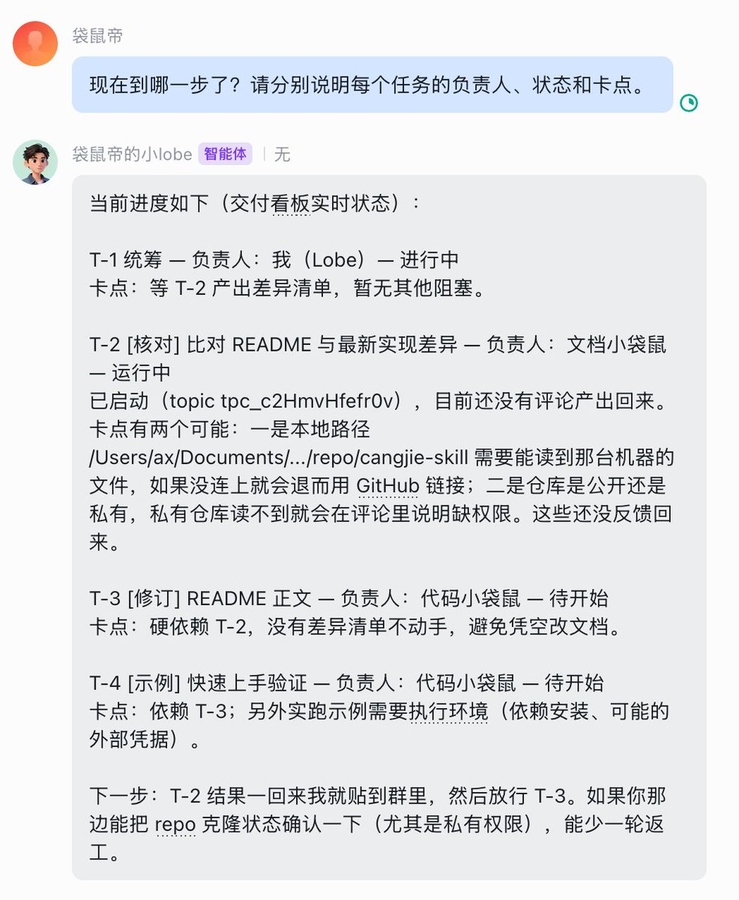

所以，LobeHub 的核心是 Task

2. 同一个群里的 OpenClaw&#xA;

相反同一句话，我 @ 了 OpenClaw 后才收到了回复：

不 @ 它完全静默。@ 之后等了 3 分 36 秒才回；回的是张卡片，内容还挺专业，确实指出了 README 和 v2.5.0 对不上的地方。但它没有任务树、没有分工、没有负责人。更不能并行执行任务，效率上就差了好几个量级。

3. 第二天接着干，记得昨天的事&#xA;

我隔了一天在群里问：

继续之前 README 的任务。请先告诉我哪些内容已经完成，哪些还没有完成。

不需要重新交代背景，直接给出。

这种有个总管其实挺好的。它有所有任务的上下文，以后想干嘛，直接找它就行，不需要每次交代上下文。

4. 验收环节实事求是，不讨好不美化&#xA;

LobeHub 的验收机制确实被他们的团队做的很好，这主要依赖于他们开源的另外一个 Agent loop 工具：Acceptance。

往往 Agent 在制作完成我们叫它自行验收时，它只会做正常的功能代码测试，代码测试能证明程序跑得通，却发现不了被截断的菜单、暗色模式下消失的文字、或小屏上溢出的按钮这样的细节--这些恰恰是人会留意的地方。 Acceptance 在工作时 Agent 会把一条需求拆成若干可观察的检查项，在真实产品上逐一运行，并为每个检查项附上截图、录屏和日志，汇总成一份在线报告并记住每一次打回的原因；人可以整体接受，也可以把单个检查项打回，已通过的部分保持有效，单个项目继续去打磨优化。

以我们现在跑的项目为例：T-2 上挂着一个验收清单，一共 5 项，已经跑过 3 轮，其中第 2 轮是返工。

但这轮我要求它「重启卡住的 T-2、跑完把验收报告贴出来」时，它回了我一段很实在的话：

一、重启失败了，而且是连续第三次。我 pause 后重跑了两次，加上之前挂住的那次，三次运行都被运行时直接 cancel / interrupted，一条产物都没有。T-2 现在还是 running 的僵尸状态，不是在工作。 二、截图证据我给不了。验收关卡输出的是逐项判定 + 依据文本，不产出图片；这轮也没跑出任何东西可以截。你要的截图我造不出来，也不会拿假的糊过去。

说实话，这一刻我对它的印象反而更好了。

很多产品的 Agent 到这一步会开始瞎编——给你一张看起来像那么回事的图，或者一段所有功能验收无误的漂亮话试图告诉你完成的很完美。但 LobeHub 没有。

后面我干预了一下后，它还是把活干完了：T-2 核对、T-3 修订、T-4 示例三个子任务全部完成，差异清单和 README 改动都写在了任务评论和本地仓库里。

LobeHub 还有 CLI，也可以直接通过 Cli 把报告完整渲染出来：

其实在之前，多 Agent 就火过好几波，但是那个时候我并不看好。

因为我觉得当时单 Agent 都还没进化好，都还没到一个好用的状态，就去考虑多 Agent。就有点还没学会走，就想着跑的感觉。

直到 Codex、Claude Code 上的单 Agent 模式，逐渐成熟，且越来越强大（现在已经非常强大了）

我就预感下一步肯定是要发展多 Agent 了

而体验完 LobeHub 后我感觉：

它不仅仅是简单地使用多 Agent 团队运行项目，而是从一个工具到一个真正的团队的进化。

是真正的多 Agent 的起点～

「最后」

我们简单回顾 Agent 的演化过程：

第一代是 Workflow+智能体，确定但脆弱，业务一变就需要改写很多节点；

第二代是单兵 Agent，学会了自主推理和调工具，但局限于单人会话。

而以 DeepSeek 架构探索和 LobeHub 工程实践为分水岭，行业正迈向第三阶段：

组织化协作。 未来的 Agent 的竞争，不仅仅再取决于模型在榜单上的跑分，更取决于工程架构。

期待我关机睡觉时，这帮 Agent 们还能帮我把活干好的那天快点到来😄。

DeepSeek 在上周的长文里，从理论上勾勒出了 Super-agent 的蓝图；

而 LobeHub 最让我佩服的地方在于，他们没有停留在理论上，而是先实际应用到了业务里面变成生产力，进而逐渐沉淀到了 8.3 万 Star。

AI 进化远比我们想象的更快。我感觉 Agent，很快将迎来一波全面的进化。

建议大家可以抽空体验一下 LobeHub，确实是前沿的 Agent，它也许会颠覆你对未来团队形态的认知～

我是袋鼠帝，一个致力于帮你把 AI 变成生产力的博主。我们下期见～

能看到这里的都是凤毛麟角的存在！

如果觉得不错，随手点个赞、在看、转发三连吧~

如果想第一时间收到推送，也可以给我个星标⭐

谢谢你耐心看完我的文章～

## 相关页面

- [[sources/arvin-lobehub-superagent-product-and-engineering-practices]]
- [[sources/antivo-deepseek-super-agent-architecture-gif-summary]]
- [[concepts/agent-autonomous-pipeline]]
- [[concepts/harness-engineering]]
