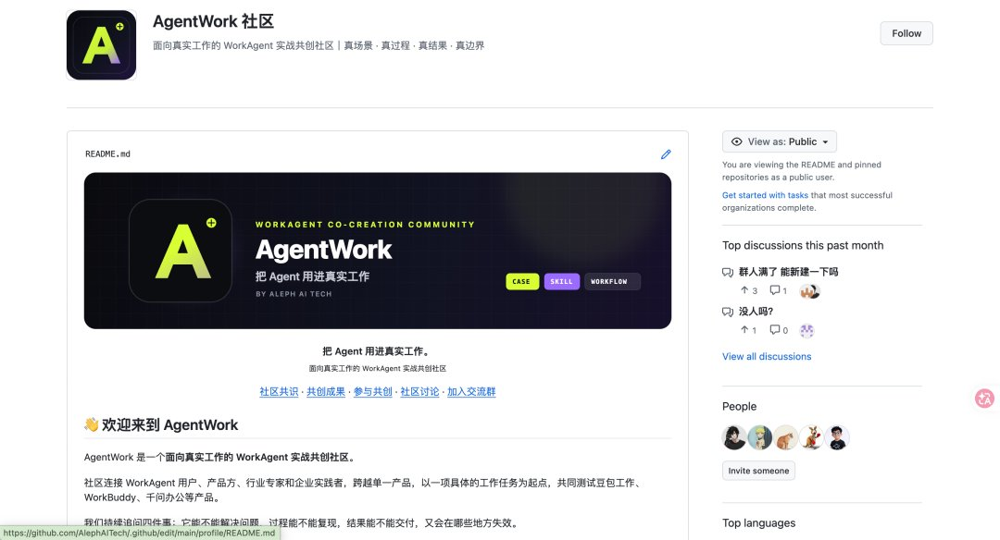
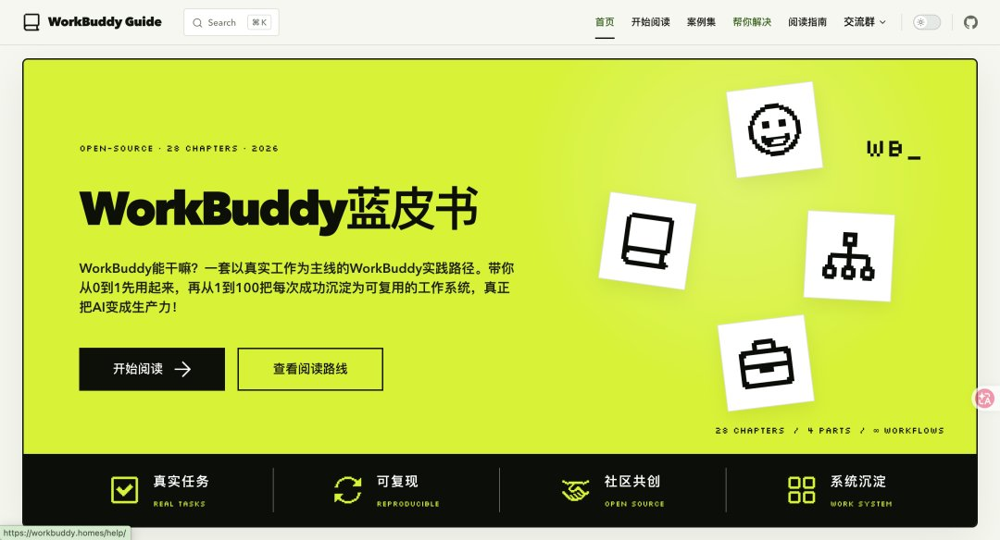
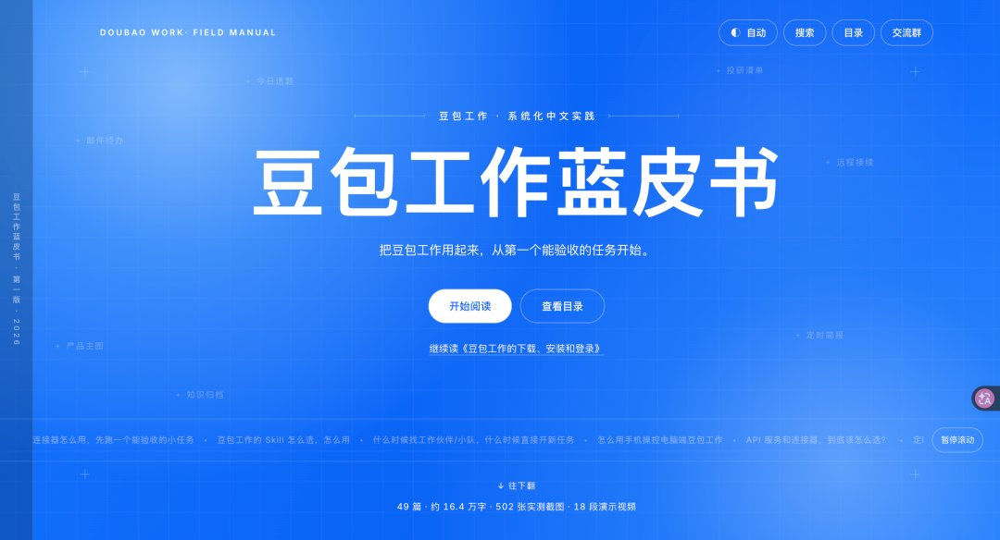
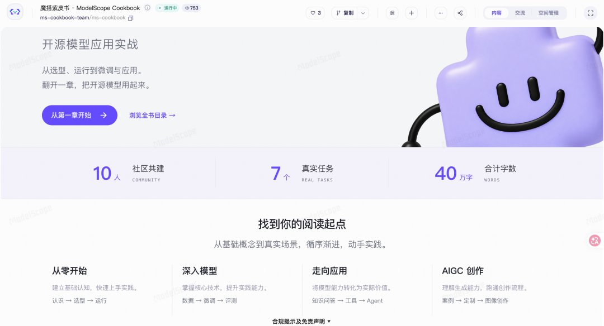
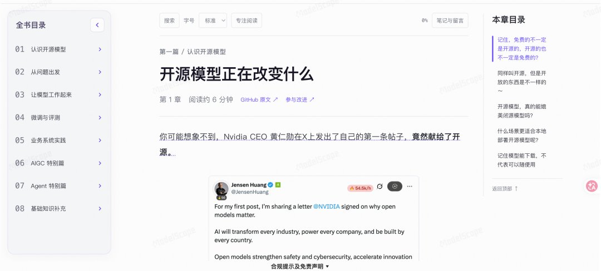
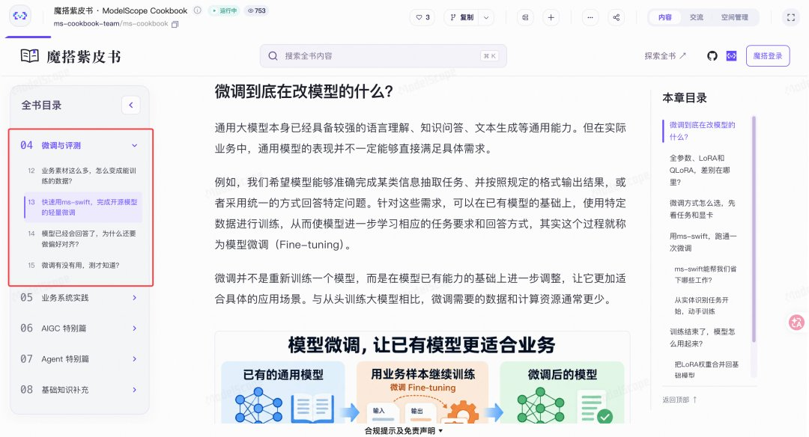
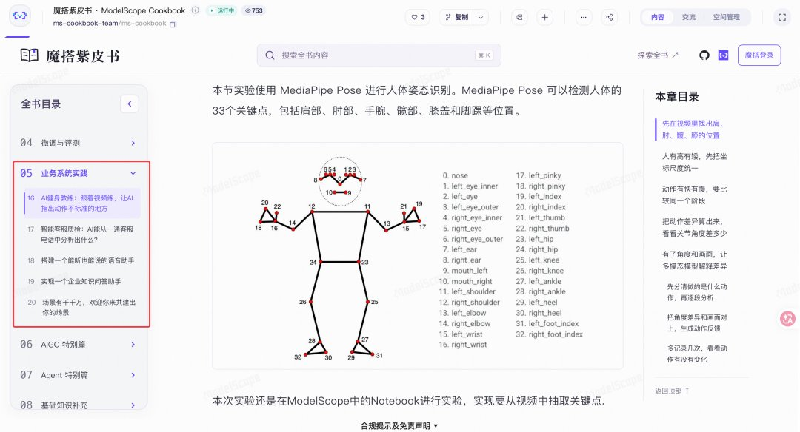
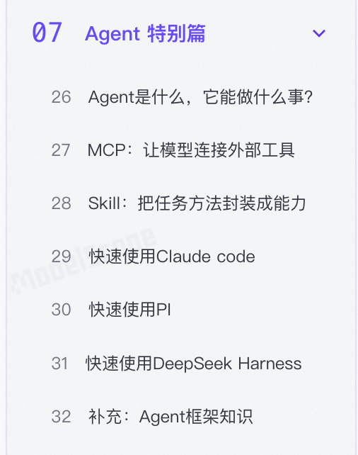
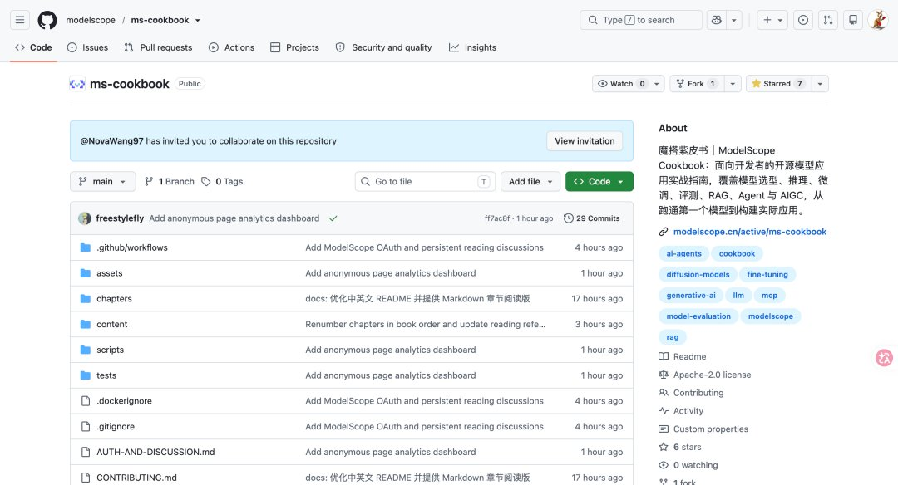
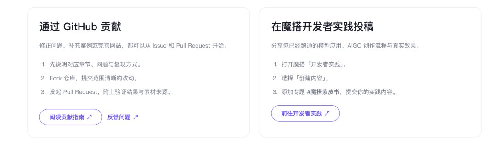

# 袋鼠帝（@aikangarooking）：爆肝 30 天！我们开源了一个让 AI 课程卖家集体失业的网站

> 30 天高强度开发并开源一款直接冲击 AI 课程售卖模式的自动化建站工具：深度拆解 AI 时代课程交付从「录制视频」转向「交付可交互生成式应用」的范式跃迁，说明开源项目如何用可生成、可定制、可实时更新的 AI 工具形态直接替代传统录播课，并向独立开发者与知识付费从业者开源全部实现。

<!-- more -->

## 大家好，我是最近猛猛写书的袋鼠帝

最近我和兄弟们成立了 AgentWork 开源社区，也陆续开源了 workbuddy 蓝皮书以及豆包工作蓝皮书。都获得了不错的反响。

前面两个蓝皮书都是办公类 Agent。但这次的书不太一样：

因为我们发现，一直以来，都有很多人希望自己能部署、微调、评测开源模型。但目前还没有比较系统全面的这样一份指南，于是我们几个一拍即合，决定再次给大家带来全新的指南。

蓝皮书用两次了，这次换个颜色。

于是，耗时 30 天，我们开源了《魔搭紫皮书》：

魔搭 modelscope，相信玩开源模型的朋友应该很熟悉了

不过我在这里还是科普一下：简单来说，它就是国内版的 huggingface。

魔搭是 2022 年阿里和 CCF 开源发展委员在云栖大会上推出来的。它干的事很简单：把开源模型集中放到一个地方，让你能免费下载、或者在线体验、直接运行。不仅仅是阿里的 Qwen、万相，像 DeepSeek、智谱、MiniMax、Kimi 这些知名的国产开源模型的权重，也是第一时间开源在上面。我查了下今年 3 月魔搭开发者大会公布的数据，目前魔搭上已经有 20 万+个开源模型，2700 万开发者。

如果说我们的蓝皮书主要讲从 0 开始的 AI Agent 的应用，那么魔搭紫皮书就是去教大家怎么从 0 开始学 AI、怎么去了解 AI，以及了解 AI 背后真正的原理，真正深入学习 AI 领域的技术。

这一块的内容，我个人认为更有难度、也更有深度。

这也是为什么，我们这次耗时这么久的原因。

如果你是小白，只想要上手用一用 AI Agent。那么你可以看 workbuddy 和豆包工作蓝皮书。如果你想从 0 开始，系统学习 AI，那么你一定要看看魔搭紫皮书。

先看目录，一共 8 篇 34 章（约 40 万字）：从简单，到进阶

开头几章解决的都是新手容易卡住的问题，比如「开源模型的下载」「没有资源也能玩开源模型」。

再往后是微调和评测。怎么把业务素材变成能训练的数据、用 ms-swift 做轻量微调、微调完到底有没有用得拿 EvalScope 测了才知道。这一块是很多人卡住的分水岭，从“会用模型”到“会调模型”，紫皮书是一步步带着你走的。

场景篇是我觉得最有意思的部分：AI 健身教练（跟着视频练，让 AI 指出动作不标准的地方）、智能客服质检、能听也能说的语音助手、企业知识问答助手。每一个都是完整的业务系统，可以直接照着搞。

并且，我们还有 Agent 篇，包含了 claude code、Pi、以及刚出不久的 DeepSeek Harness。

这一篇是从 MCP 和 Skill 讲起的，先搞清楚模型怎么连外部工具、怎么把任务方法封装成能力，再去上手这三个 Agent。

说实话，我们这本紫皮书一发布，很可能会导致 AI 课程卖家集体失业🤣。

不过，信息差永远存在，大概率会有人，拿这本魔搭紫皮书去卖钱。

所以，大家一定多多转发给你那些想要学 AI 的亲戚朋友们，让他们别再花冤枉钱了。两本蓝皮书，一本紫皮书，都是免费的，完全够学了。

紫皮书本身的代码和内容也都在 GitHub 上（欢迎 Star）：

如果你有想法，欢迎共建～

这本书会一直更新下去。

「最后」

写紫皮书这段时间，我回忆起来 7 年前的一些事。

那时，我刚到深圳找不到工作，贷款两万多报了半年的程序员培训班。

回头看，其实培训班教的东西，没有一样是网上找不到的。

现在学 AI 的人，处境跟我当年很像。模型开源，算力也有免费的，教程满天飞，但一个想入门的人打开电脑，第一个问题还是“我该从哪开始”。

所以这次我们写紫皮书，整理的就是一套从 0 到 1 的系统的免费手把手教程。从下载模型开始，到跑起来、调好、用到业务里，一章一章往前走，每章都有实操。你学到的每一步，都是自己实践出来的。

我一直觉得，AI 这波浪潮最大的魅力，是把大多数人拉到了同一起跑线上。不看出身，不看学历，但执行力很重要。特别是开源模型免费，算力免费，现在教程也免费了。

剩下唯一的门槛，就是你愿不愿意尝试

人至践，则无敌！开源万岁！

附上团队伙伴们的账号，也都是超级优质的 AI 纯血博主，推荐给大家：

刘聪 NLP，摸鱼小李，苍何，甲木未来派

我是袋鼠帝，一个致力于帮你把 AI 变成生产力的博主。我们下期见～

## 相关页面

- [[sources/gudunaonao-lifeos-personal-agent-architecture]]
- [[sources/su-vibe-marketing-translation]]
- [[concepts/digital-products-side-income]]
- [[concepts/ai-content-pipeline]]
