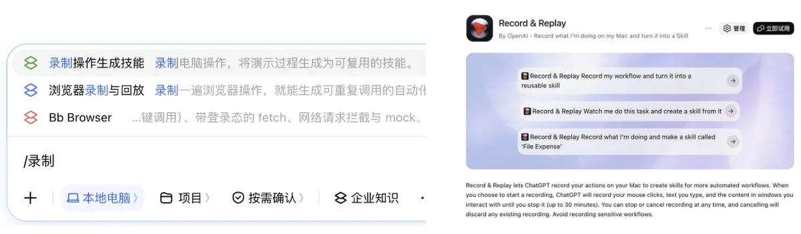
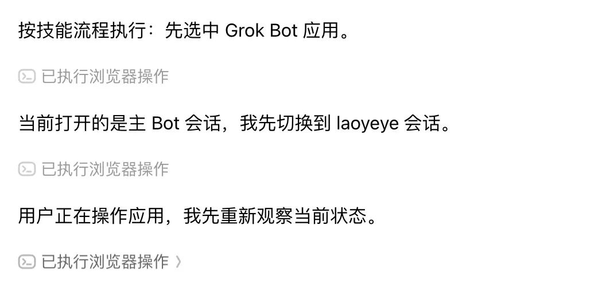
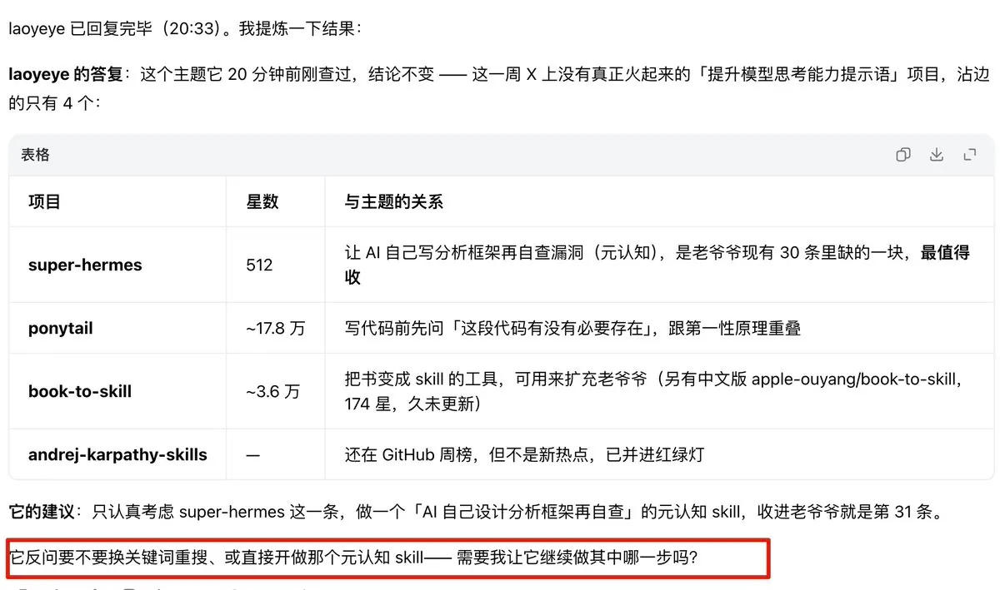
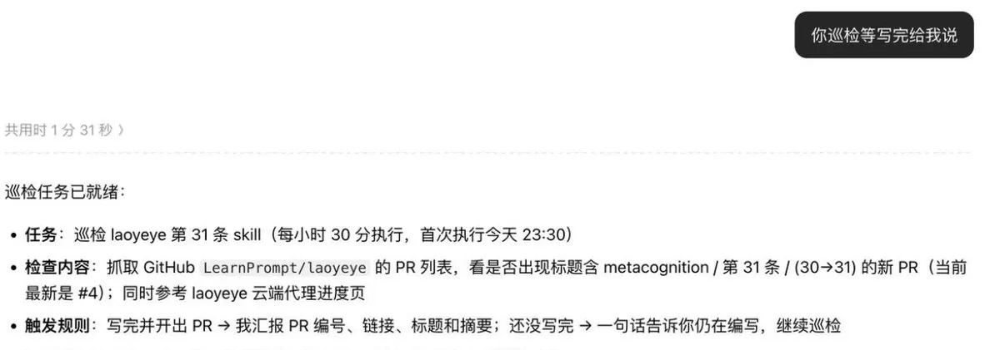
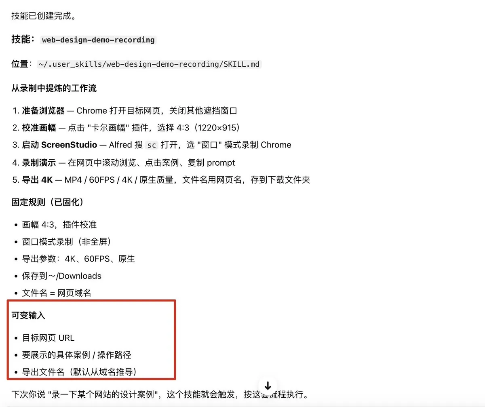
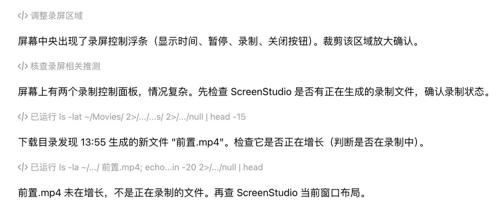
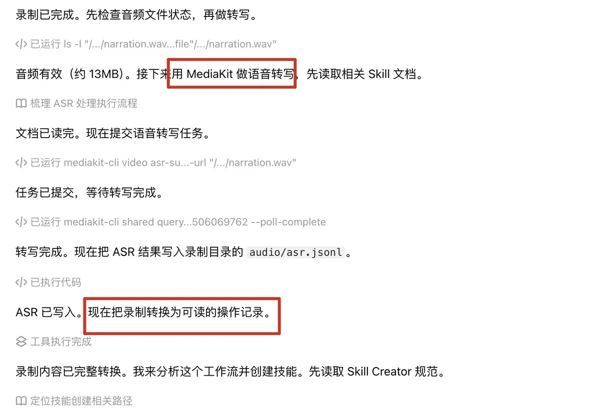
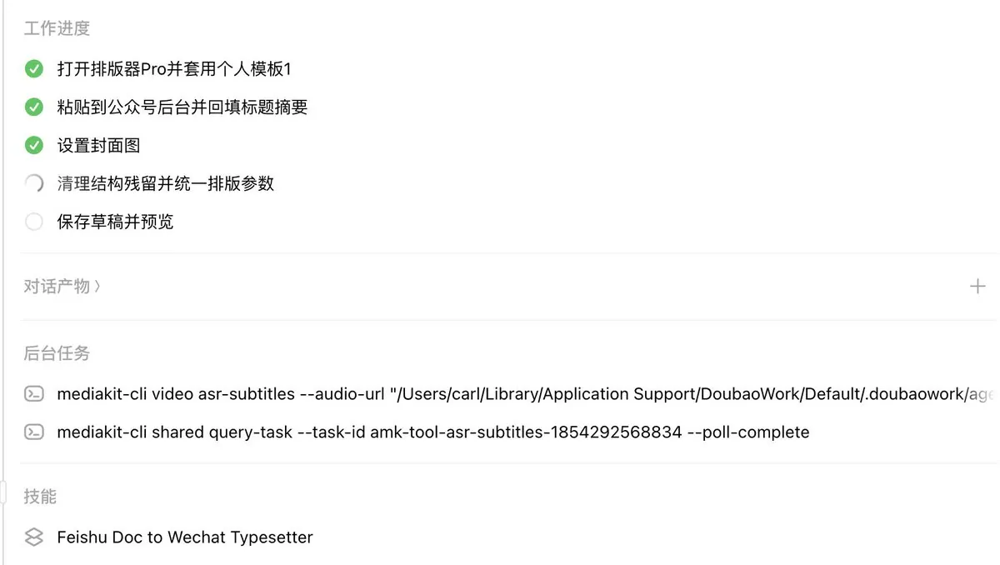

# 卡尔的 AI 沃茨（@aiwarts）：豆包工作录制回放全攻略——不写代码也能爽玩电脑自动化（30 分钟边讲边录、多平台巡检与风控规避）

> 字节跳动豆包工作台上线录制回放（Record & Replay）免编程 RPA 能力深度测评：最长支持 30 分钟边操作边讲解，AI 自主理解意图并自动编写复刻步骤；详述工作窗口防抢占与本地/远程暂停重试机制、利用人类独有的随机切换多平台（抖音/小红书/X）操作节奏彻底规避防爬虫风控，以及公众号排版发布与 Figma/剪映自动化批量导出的神级应用场景。

<!-- more -->

豆包工作还在卷，

我今天发现它居然偷偷上线了 codex 同款的录制操作生成技能，record & replay。

简单回顾一下，这个技能有点像超级简单版的 RPA（机器人流程自动化），不需要会编程，不需要调组件搭工作流，就是把你操作电脑的过程录制下来交给 AI，AI 自己去写步骤说明，自己在下一次复刻同款操作。

更骚的是，比起 codex，豆包工作还追加一个讲解功能，最长可以录制 30 分钟。我可以边操作边讲，告诉它我这步为什么这样选，这样就不需要死记硬背鼠标轨迹，我也不需要一次性完美录制成功，使用压力降低了很多。

我先尝试控制 Grok Bot 自动收集 Github 项目更新来试试水，

录制好的 Skill 执行过程中，跟 Codex 的 Computer Use 不同的是，中间如果我要用对应的这个窗口的话，它是会主动断掉的。

拿我在 Codex 上的经验说。经常会遇到我开了一个对话，那个对话要用我的浏览器，但我同时又想开另一个对话，两边就冲突了。操作软件的时候特别明显，浏览器其实还好，可以通过其他 Skill 绕开。

我说具体一些。

比方说我要用 Codex 操控 Grok，同样的环境给我出个日报。但因为我同时在录视频，或者在跟另一个 Agent 对话，它弹出来的页面就会打断我。我不断最小化 gpt 不断重试，很多时候就是因为反复切界面导致操作失败。

所以暂停和重试这两种机制，我觉得有好有坏。如果让我选的话，本机，就是我自己用的电脑，我希望有自动暂停的机制，因为不会打断我主要的工作。但如果是在远程的 Mac mini 上跑，重试更好，反正不挡我。

上次文章里，我没有写这个录制回放技能会跟已有的 Computer Use，Browser Use（浏览器自动化）去搭配使用。像豆包，它其实会先返回说目前的状态是什么，然后给出后续的行动。

那下一步，最好的做法就是让它去做巡检。

我刻意强调巡检这两个词，是因为以前我可能会说每隔 5 分钟，10 分钟去检查一遍。但其实很多时候，如果你不确定时间间隔，你可以直接让模型自己去做巡检，它们会自己判断合适的时间间隔，直到观测到任务完成为止。

录制回放技能整体来说是个互补的。

当你想要做的自动化没有 API，也不只是在浏览器上跑，操作的软件要横跨多个步骤，或者工作流要横跨多个软件，那我非常推荐把它录制成 skill。尤其是还可以搭配解说。我拿一个很经典的 case 来跟大家说明有解说到底有多重要，就拿我的一个录屏 skill 来说，

之前为了省事，我直接把当前操作的页面最大化才开始录屏，它每次都会复刻我的操作。但是这样会出现一个问题，只能录出刚好和我电脑屏幕尺寸一样大的视频，但我很多时候素材其实是要 4:3 的。

这就涉及到一个有点难用文字描述的操作，

我要把屏幕里除了当前窗口外其他所有的窗口都缩小。这个动作就从「把一个窗口扩大到全屏」变成了「把除了当前屏幕焦点外其他窗口都最小化」，从「某一个动作」变成「某一类动作」。因为我每次打开的软件都不是一样的。

这也是为什么今天已经有了那么多 Agent 有 Computer Use 的能力，然后也有了浏览器自动化的能力，我觉得还是需要有录制回放能力的一部分原因。

[video](https://video.twimg.com/amplify_video/2115460295359623168/vid/avc1/1280x832/JFrBrPR4m5ozlxj3.mp4?tag=29)

因为同时打开多个录屏软件会互相冲突，所以我后半段是拿 iphone 录制的，可以看到豆包工作遇到录屏软件这种每次录制的透明条都在屏幕上不同地方出现的情况也是可以全屏截图放大确认去按键的。

还有一个更离谱的操作，

我觉得很多 Skill 不会特意去做，但是非常适合我们使用习惯。

我觉得做 Computer Use 或者浏览器自动化，大家最常见的，一直想要解决的问题，就是去我们日常用的这些平台，去拿到热门帖子，低粉爆款的内容等等。这里面绕不开的一个高山，就是如何避免风控。

用录制回放这个 skill 就可以利用我们每个人独有的 ADHD 习惯。

假设你今天想找小红书的低粉爆款。用网页去刷，不需要限制固定页面和固定节奏，你只需要在 30 分钟内完成就行了。中间你可以去刷某抖，刷 X，甚至跑去某站看个视频，都无所谓，越贴近你日常习惯越好，做完录制之后，把它打包给豆包就好了，这时候一个几乎不可能被测出来的信息获取 skill 就诞生了！

[video](https://video.twimg.com/amplify_video/2115460030061572096/vid/avc1/1280x802/5UNdq1hfK2PDRPPP.mp4?tag=29)

大部分 Agent 被检测到，都是因为在固定的网页上操作得很固定，点击的时间间隔也很固定。我以前每次点击试过按 15 秒到 60 秒的随机时间来操作，但长时间还是会被检测出来。后面测出来的还是操作时间不正常，谁在网页刷某书一刷刷一个多小时，太不像人了。

一开始我想着先让它操作个 5 分钟，然后停 6 分钟，搞比较随机的节奏。但既然我们是有多平台采集需求的，为什么不试一下多个平台都采集。我的做法是串 5 个平台，实际上只有 2 到 3 个平台是真正要收集的，中间那些平台是没有意义的行动。

我一边操作一边给的解释是这样的。

我要演示一种随机跨平台采集：在某音、某书、X 之间不按顺序切换，每个平台随机停留几分钟，看到值得参考的内容就记到 notes 里。以后给你一个主题，按这种节奏采集 30 分钟，最后把表格给我。

我不想给 Agent 反复解释为什么要这样做，直接通过 skill 内化变成一个刻板动作就好了，就像实验室里做实验，有时候你得把东西放进微波炉然后跑出去吃顿火锅再回来就成功了。

之前会被监测的大部分原因都是因为在固定的网页，然后操作得很固定，点击的时间也很固定。虽然有的时候我把它区分开了，让它按照 15 秒到 60 秒的随机时间段，但是它还是会因为长时间，你有谁刷这玩意一刷刷一个多小时，还是网页端，这也太不像人了。

除了采集之外，我还有一个很痛的点，就是公众号的排版发布。

我现在的流程是从飞书选一个排版应用，把稿子复制过去公众号后台，调间隔行距，上传视频，贴结尾、封面、正副标题，发个预览。做这一套做完都得半个小时。所以我想试一下豆包工作能不能也复刻了。

[video](https://video.twimg.com/amplify_video/2115459783465791489/vid/avc1/1280x802/CKQ0sUCcqhx46ggg.mp4?tag=29)

在第一次用的过程中，我也会担心会不会有一些冗余的画面片段对整个技能的质量造成影响。

因为豆包工作这个功能在处理时会优先转换音频，所以我们可以在录制的开头就说明白接下来要做什么样的动作。这样哪怕中间或者开头结尾出现一些多余的画面，或者中间有消息通知稍微打断了录制过程都没关系。

Amazing 啊，

豆包工作台之前也更新了很多零零碎碎的小功能，所以你在这上面可以看到它的工作进度，后台任务以及对话的产物等等。虽然说它在跟你用同一个界面的时候会暂停任务，但同时打开多个网页浏览器是不会出现这个问题的，我可以把它放在后台让它自己去操作，不会影响其他工作流的正常使用

经过这几 case 测试出来，豆包工作其实比我想象中做得认真得多，迭代也快得多。

还有一些同类的场景。

比方说 Figma，Canva 的封面模板要导出多个样式，剪映也一样，素材录入排序，渲染之后的多格式文件导出，音频单独导出，这些操作都非常适合用录制回放做成 skill。

我很兴奋 codex 不是唯一选择。

Tibo 这 28 天内重置了 11 次，

我是起床蹬睡觉蹬出门手机蹬，我都已经已经把档位从 200 刀降到 100 刀了，还是用不完。

已经能想象出来 28 天过去之后额度会有多不够用了，估计到时候只舍得用 Terra 点点浏览器自动化。

我现在就打算把一批 codex 做出来的 record & replay skill 都迁移到豆包工作上。

## 相关页面

- [[sources/aichuhai-mika-phone-agent-cross-border-station]]
- [[sources/copperforge-orca-multi-agent-orchestration-guide]]
- [[concepts/agent-autonomous-pipeline]]
- [[concepts/agent-skill]]
