# aix 阿乐（@Leepriest1990）：3 天 120 单、变现 1 万——一人推特发售的完整手册（附 4 步法）

> 超级个体在 X（Twitter）小规模发售知识资产的完整实操闭环：拆解「前置钩子造势 → 痛点长文击穿 → 极简支付落地页承接 → 私域口碑裂变」的 4 步发售法则，实现 72 小时成交 120 单、变现万元的高净值交付路径。

<!-- more -->

Hello，我是阿乐，02 年，目前在杭州做 AI 获客。

先说结果。我自己做的小红书采集插件​，在推特上做了 3 天发售，卖了 120 单​，到手 1 万块​。没投流，没买粉，没群发。整场发售，从头到尾，就我一个人加一个小助理

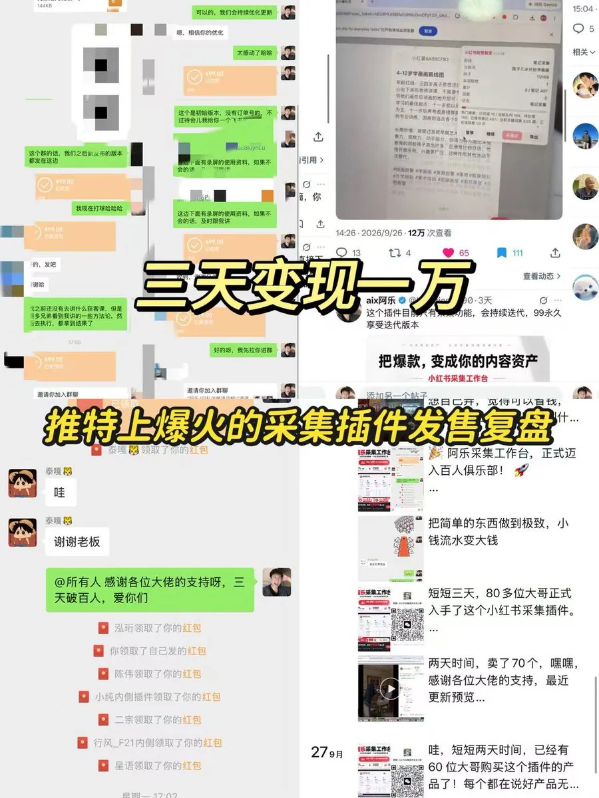

但我得先把丑话说前面：这个数字里，运气和取巧占了大

我甚至一度不敢认这件事。所以这篇我先讲那段让我抬不起头的日子，再讲方法。

先给你一张地图，这篇要带你走这几站：

一、先说结论：这场发售我做对了什么

二、为什么是我：一个连自己都不信的普通人

三、第一次发售，我踩了两个坑

四、第二场翻盘：我只留了两个字——轻量化

五、3 天，130 单：这一场到底怎么发生的

六、发售 4 步法（这篇最值钱的部分）

七、我搞砸的一件事：定价

八、为什么我最后选择做一个社群

写在最后

## 一、先说结论：这场发售我做对了什么

在讲故事之前，我先摆下战绩，真的感谢各位大哥的支持

先说这东西是啥。小红书的采集插件。

那会儿我正在做小红书项目，前期需要大量调研去收集笔记——一篇一篇去看同行的笔记，把对标内容存下来。手动存，一天存不了几十篇，存完还是一堆散图，没法用。

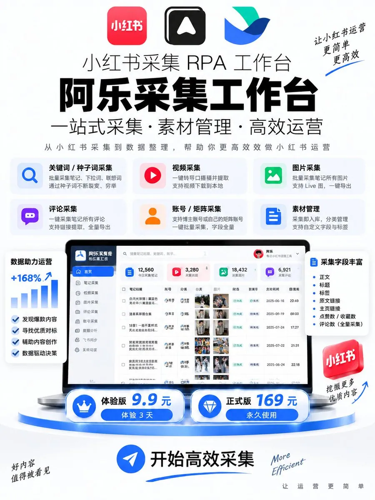

这个插件就干一件事：把小红书上你要的对标笔记，一键采集下来，直接导出成一张表。 不用截图，不用复制粘贴，采集完就是能直接拿来分析的结构化数据。

引用推文：aix 阿乐 (@Leepriest1990)

这个采集插件迭代了 30 个版本，总算可以了。 目前单个账号最高上限可以采集到 1500 篇。超过 1500 篇，账号可能会稍微遇到风控，不过隔一天就可以继续采集。 所以一般来说，我进行采集都会准备三个采集账号，并且要做好独立： 1. 给每个账号配置独立的 IP 2. 最好是用指纹浏览器进行采集 那采集可以干嘛呢？ 首先，你可以根据用户提问的所有种子词，去收集这个词下面所有的爆款笔记，直接抄近一个月以来的爆款笔记进行复刻。 你甚至可以找到单个词下面经常出现的多个账号，那它就是你的对标账号，直接去抄它的模板、抄它的方式。你还可以把近一年内所有爆款笔记...

https://x.com/Leepriest1990/status/2102788947567141146

就是在推特上发的。我发的东西也不多，就一条——自己录的一段 demo 视频，加上几个转化的帖子。

结果就是这样：

第 1 天：进来 100 人，成交 5 单

第 2 天：进来 300 人，累计成交 50 单

第 3 天：进来 500 人，累计成交 130 单

第 4～5 天：慢慢走到 150 单，出货基本停了

全程 0 元推广费。这个插件做出来，费了我很多心力，整整两周。发售那几天，就是盯着评论看。

我知道有人看到这个会说，不就是一个插件、一万块吗。对，确实不算大事。但我想说的不是这一万块。是一个人，没有团队、没有预算，怎么把一款产品从零推到有人愿意付钱​。这套动作，换个产品照样能用。

## 二、为什么是我：一个连自己都不信的普通人

前几天有一位做 VC 的大哥私信我，邀请我做一个 OPC（一人公司）的案例分享。

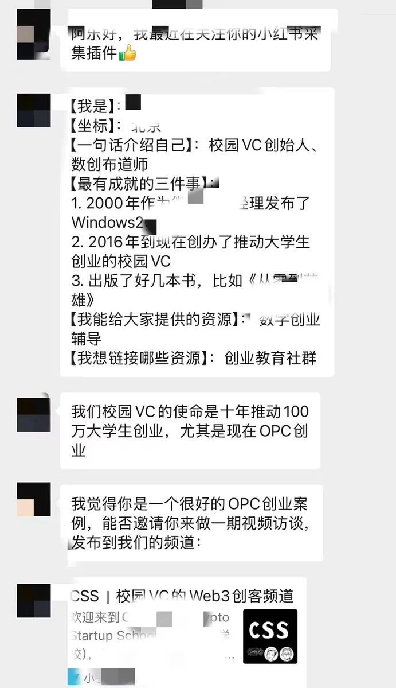

我看着愣了一下，第一感觉就是我不配。

第一，我又没做出什么非常牛逼的产品，它只是个插件和工具而已。

第二，整个卖出去变现一万，我觉得都有运气和取巧的成分，跟我能力强不强没什么关系。

所以我就把这场分享给拒绝了，因为我一直觉得自己配不上。潜意识里觉得，我就是一个普通人。这也不是什么大成就，也不是什么成功，只是说被逼上了一个绝境，然后疯狂努力地给自己找出路，完成了一场翻盘而已。

但拒绝完之后，我又把那段时间翻了一遍。因为我想着，如果连我这样的人都能翻这一次，那这套动作对别人可能也有用。

那几天是这么过的。

那天中秋节刚刚过完，我翻了翻兜，刚刚交了房租。当时 Punk 哥在发售社群，我真不骗人，我兜里一共只有几百块。完了我还咬咬牙加入到了这个社群，交完钱后，兜里只有 60 块​。我清楚地记得这个瞬间。

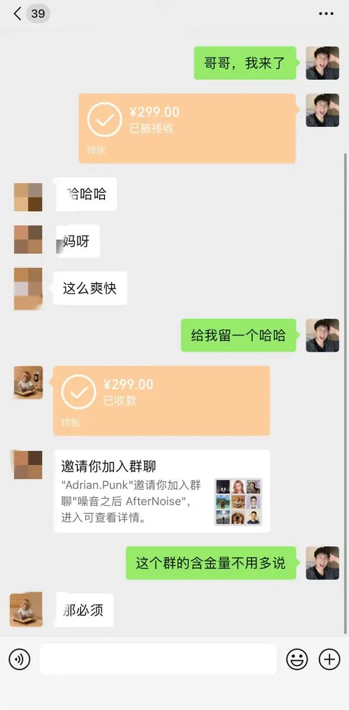

倒也不是非要逞强。我觉得一个优质的圈子能链接到很多大佬朋友以及人脉，它是很值得的。我自己做推特能起来，也是靠之前做推特的一些前辈，把我一点点拉起来的。

当时大家都想着出去玩儿，我只能把自己逼到一个工位里面，努力破局。

我刚刚结束工作，兜里只有 60 块。晚上我妈又给我打了电话，打完那场电话，我真的快哭了。那一刻我感觉自己好没用——明明说要来杭州创业，结果又把自己逼到这样的绝境。你说，这到底是怪谁？

在那个节点上，正好那个时候，我自己做的采集插件刚刚可以用。我当时甚至在想：

要不， 把这个采集插件卖了？

## 三、第一次发售，我踩了两个坑

我得先讲一场失败的。第二场能成，一半原因是我在第一场把该踩的坑都踩了。

我的第一次发售，是做 AI 出图代理。

我最初是靠做 AI 出图项目，开始获得曝光和流量的。那时候我一个人已经跑通了 AI 出图这条业务，接了十几个服装店商家。如果单吃流量、自己单干，每天给他们出图，勉强也能凑合过。但我并不喜欢自己一个人闷头出图，我更喜欢站在全局操盘手、总控的视角，把整个项目做下去。

引用推文：aix 阿乐 (@Leepriest1990)

Ai 出图这条链路，算是完整跑通了。 上个月其实已经运营了至少两周，结果交付跟不上，不得不停。最近对工作流以及获客的理解上了一个台阶，重新切入后反而发现了更多机会。 说个真实数据：重启 3 天，10 个线索，签下几单。 我发现电商和档口店老板，其实更愿意为结果付费。你只要按要求把图出好，他们非常愿意掏钱。甚至有些人还希望你帮他把整个账号工作流搭起来。 这让我更确定，这就是一个能快速验证市场、拿到正反馈的好模板。 所以我要做个私塾课，把这套东西完整交给你 1. 获客——没订单没客源？我教你怎么用流量手段搞，或者直接给你单子 2. 搭建个人工作流——手把手教你...

https://x.com/Leepriest1990/status/2082865219630707117

于是当时我就想到了去发售代理模式。我把打磨出来的获客案例、业务流程，以及做 AI 出图的一些经验，发到了推特上。结果第一次发就直接爆了：当天晚上进来 100 个人，最终成交了 10 个代理。卖 10 个代理，赚了几千块。

其实我对他们很愧疚。他们来找我、那么相信我，我却没有带他们赚到钱。甚至其中一个大哥，经常在我低谷期找我聊天，帮我梳理情绪，一直非常信任我，我做什么他都跟着去做。这些人真的让我特别感动。

整体复盘下来，我当时就是决策失误了。核心原因有两个。

第一个，定价问题。 当时我定价 30 块钱一张。对商家来说，如果没有一个足够好的销售团队来卖，这个价格很难成交。价格太低，代理在里面也赚不到足够的利润。

第二个，交付不稳定。 我当时钻了个聪明的空子，始终想赚差价，打算在闲鱼上找低价交付帮我兜底。我这边只负责招代理、获客，获客之后把服务流程做足，交付就直接甩给我找的低价渠道。

坚持了一个月，客户没达到，笔记内容也没发出去。然后我把这边助理的工资一发，交付那边的工资一发，又没有顾客，我又得想办法给他们去抓单。当时我的精力被分散了非常多。而且手上还有一些开发的单子要交付，我真的没有太多精力顾得上。于是这个项目，也自然而然地慢慢死了。

完了，我当时想的就是用系统帮他们出单。于是什么销售助手、内容自动化流水线、无限画布系统……整个工具层，我感觉投入了太多时间，导致获客层面上一个都没有。

虽然说有搞流量的方法和获客的技巧，但后面全部陷入到交付，以及做工具、做系统上面去了。

## 四、第二场翻盘：我只留了两个字——轻量化

由于上次我陷入到搭系统、做工具，以及搭建庞大获客机器的层面上，于是在卖这个产品、包括后面所有产品时，我只保留一个观点：

轻量化。

能借轮子、能借架构的，我不需要自己再去生产一次，直接借已有的东西。所有的交付都是最轻、且能拿到结果的。

比如我们整个批量出图工作台的流程，我对它的设计就是嫁接在一个已有的工作台上：一个总控，加上 10 到 20 个、或者 30 个出图区域，一起帮它批量出图。把每一个节点、每一条出图 SOP 和每一个流程全部固定住，让它全自动化运行。

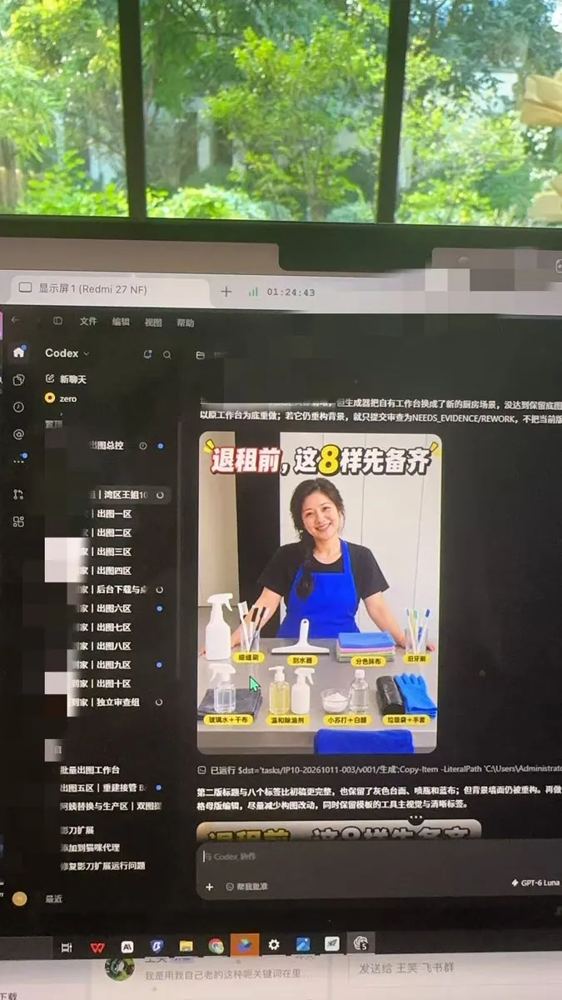

包括我的知识库和智能带教助手，都是用 Skills 以及蒸馏出来的技能支撑，直接在现在已有的模型上去做。我甚至不想要重新搭一个什么 Harness 架构、智能体之类的，我觉得这样太重了。对我来说，没有那么多时间和精力做这件事。

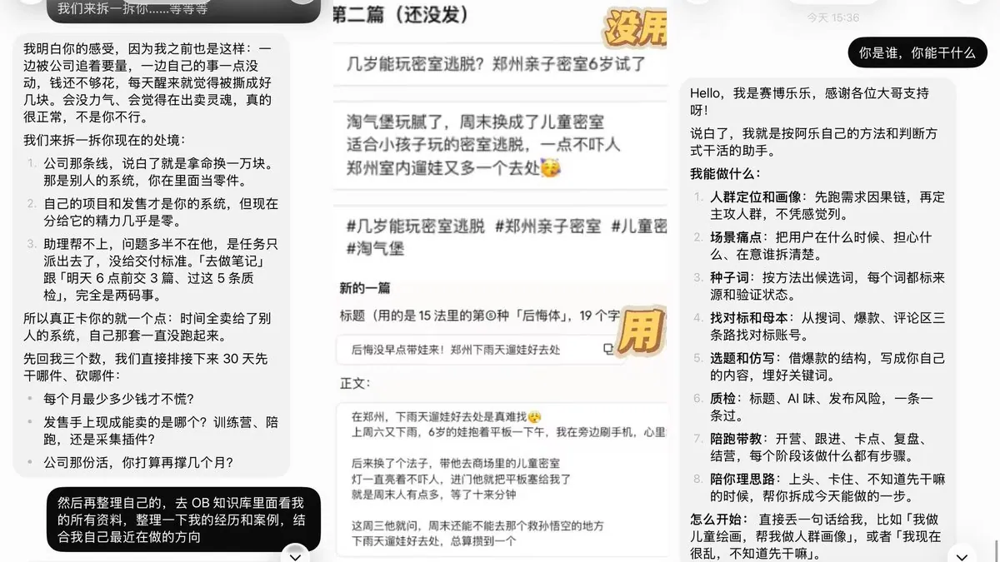

因为现在产品越来越不值钱了：

只要你有获客能力、有营销能力，就可以卖出产品。大不了去直接买别人的成品，在别人的产品基础上直接复制、直接去优化。

## 五、3 天，130 单：这一场到底怎么发生的

现在讲这场发售本身。

先说这个插件是怎么来的。

当时第一次看到这个插件产品的时候，我眼前亮了一下，觉得这东西能帮到我。因为那会儿我正在做小红书项目，前期需要大量调研去收集笔记，这个功能一下子击中了我。

于是仅凭一张截图，我就把它搓出了雏形，但里面还有很多功能没优化。后来有一位之前做代理的大哥，把他的插件产品拿给我看了一下，我研究了大概的功能模式，也基本知道该怎么做了，于是就继续做这个产品。包括整个架构、UI 设计，都是我一点点摸索出来的。后面改了很多 bug——当时发的那一版其实还不稳定，我承认它只是一个小 demo。

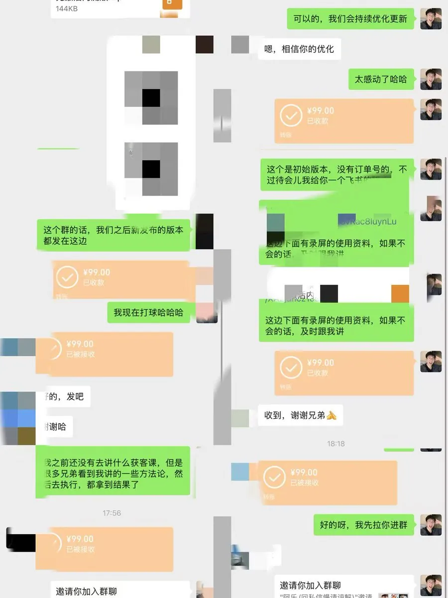

这个插件产品，我当时迭代了 50 多个版本才发售出去。拿去卖的那版虽然已经可以采集，但我还是觉得不够好，于是就一边收钱一边优化。

结果当时直接爆了。

第 1 天：进来 100 人 → 成交 5 单

第 2 天：进来 300 人 → 累计 50 单

第 3 天：进来 500 人 → 累计 130 单

第 4～5 天：累计走到 150 单，然后基本停在那了

三四天一个节点，节点一过我就知道了，这基本上也卖不了太多了。

为什么它能爆？我说三条。

1. 市场有需求。 这个产品功能上肯定是比较强大的，而且也有现实的案例。我知道有卖这种采集插件的，卖了 6000 多单，说明整个市场对它还是有需求的。
2. 我没跟人正面竞争。 我当时没去跟那个卖 6000 单的正面打，而是直接在推特上做。推特上那些人，也是第一次看到这个玩意儿。
3. 它确实取了巧。 这个我承认。一个平台上第一次出现的新东西，天然就带新鲜感。

## 六、发售 4 步法（这篇最值钱的部分）

最后说一个引流发售的技巧。我两次发售其实都很巧，也都是我下意识的营销手段，但我复盘下来，可以把它归为几类。

第一步，把产品摊开。

首先，还是要说明这个项目能带来什么、有什么机会、普通人怎么去参与，把所有疑惑点全部写出来。

- 这个项目能带来什么？
- 里面有什么机会？
- 普通人怎么参与？
- 这个产品有什么功能？给用户带来什么价值？用户可以用它来做什么？

把这些点全部罗列出来、写出来。这就是你的产品功能展示。

或者你直接展示自己的 demo，大胆发出来。你发出来，别人看到了就会有兴趣。

引用推文：aix 阿乐 (@Leepriest1990)

感谢大家这段时间的关注和等待，插件内测版本今天正式开放！ 先说说这个插件能干什么—— 采集能力 一、批量采集下拉词和联想词。输入你的种子词，自动把搜索框里所有的下拉词和联想词全部抓下来，词库一键扩充。 二、关键词笔记采集。根据关键词批量采集对应笔记的标题、正文、原文链接、ID、昵称、图片等所有字段，完整无遗漏。 三、账号与矩阵号采集监控。可以按账号采集其名下所有笔记。矩阵号不管十几个还是上百个，全部一次性采集，并实现持续数据监控。 以上数据全部支持一键同步到飞书。 采集完能干什么 一、锁定近一两个月的爆款笔记，直接拿去复刻。连图片都可以按你自己的风...

https://x.com/Leepriest1990/status/2103733026853392466

第二步，做案例证明，把所有的内容变成一个完整的证据链。

三个问题：

1. 你通过这个项目拿到了什么结果？
2. 这个项目为什么现在还可以赚钱？你又做了哪些？
3. 你是否真的有能力可以做这件事？

这三个问题，就是你的证据链。

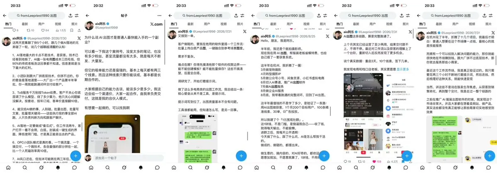

第三步，叠流量。

推特的流量机制是这样的：比如你发了第一篇，第二篇帖子就引用你这个产品去发。你转发引用了自己的帖子，并展开说点东西，平台就会给你的原始帖子增加曝光量。曝光量起来之后，它会慢慢增长，一个传两个、两个传三个；或者很多人来转发，帖子就爆了。

如果还没爆怎么办？继续叠。把产品帖的流量全部叠起来，叠到 2000 到 3000，让推特的自然流自动帮你扩散。大家慢慢看到了，只要感兴趣就会点赞、评论、转发。

把评论区做好。等这篇帖子一爆，后面发的一系列引用转发帖，就会像叠乐高一样，流量一层层叠上去。只要一个爆了，其他的跟着全爆。

我之前做两场发售，也都是这个做法：做案例证明，做方法论。

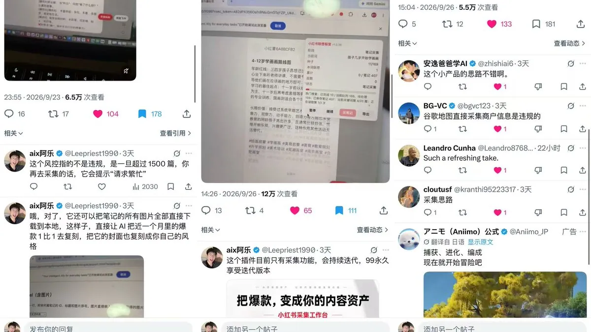

第四步，怎么做转化。

拉微信群，或者让他们加你的微信。进群之后，在群里不断去卖你的产品、卖你的玩法，持续做案例证明和信任展示。

做信任，核心是做什么？做你自己的人设。为什么你能靠这个拿到结果？别人要看的是故事。通过你不断展现的人设故事，别人才会信任你、愿意跟着你做。

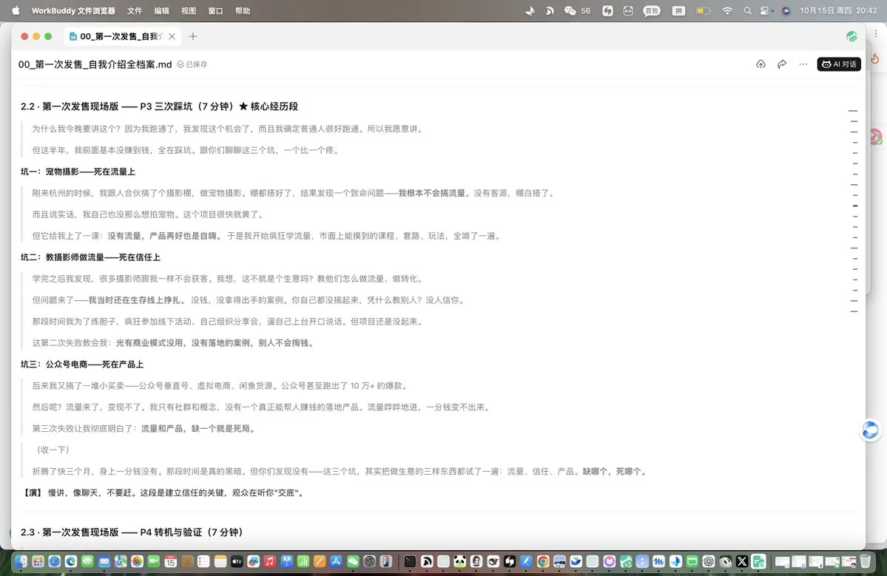

我那两场发售，很大程度上都归功于前期在推特上做了大量的内容铺垫。很多人经常在时间线上刷到我、对我有兴趣，那我之后做任何事、发什么项目，他们自然都会感兴趣。利用他们的兴趣和建立起来的信任做好铺垫，把你塑造成一个活生生的人——只要他信任你，自然就愿意买你的产品。

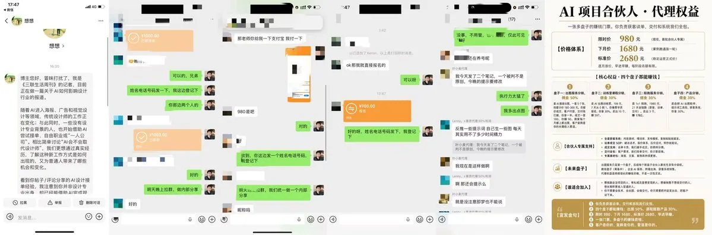

这四步连起来，就是一整套发售的能力。

## 七、我搞砸的一件事：定价

这一节我单独拎出来讲，因为它是我这两场发售里唯一没做好的地方。

三四天一个节点，节点一过我就知道了，这基本上也卖不了太多了。所以我的定价策略当时定得很烂——初期都是 99，后面我把价格抬到 169，基本上就只出零零散散的几单了。

后来那几个区域，我就一直在迭代产品，把它从“能用的 demo”迭代成一个“稳定的产品”。虽然还是有小 bug，每天要修，但对我自己来说——我做出了第一个产品，而且打出了第一炮。

这一炮给我的东西，比那 1 万块重要得多。后面我又接着拿了好几个正反馈：一个是我把这个经历发到生财，拿到了精华帖；另一个是直接接了一个郑州本地同城的陪跑咨询——不需要我做什么，只要出一些方法和方案帮他陪跑，而且这个客户后来还一直在想办法给我介绍客户。

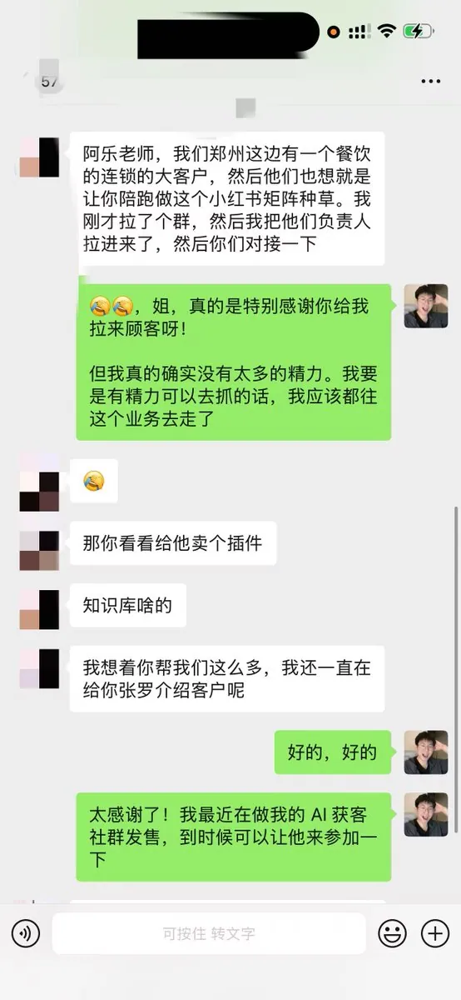

## 八、为什么我最后选择做一个社群

这场发售能成，真正起作用的不是那个插件。

是我前期在推特上的内容铺垫、我那套发售动作、我加人和做信任的方式。产品只是最后那个被卖出去的东西。

因为现在产品越来越不值钱了：

只要你有获客能力、有营销能力，就可以卖出产品。大不了去直接买别人的成品，在别人的产品基础上直接复制、直接去优化。

在产品不值钱的阶段，什么最重要？

1. 获客能力
2. 营销能力
3. 整个项目跑通的能力

这些才是最重要的。

而这些，就是我们整个社群产品围绕的东西。

给项目、给知识库、给工具、给方法，每一个流程都只是为了帮助你们低成本获客：

- 从推特上去搞流量、卖产品​；
- 从公域池里不断去做内容和引流​，把你需要的顾客全部打满；
- 通过搜索流量去埋他们所有的问题点​，让他能找到你，来找你咨询。

其实我们社群也是做这个事情：给你方法、给你工具、给你知识库，甚至教你怎么做，直接带你拿结果。不像之前上那些乱七八糟的大课，到头来自己什么都没落着。

## 写在最后

这篇我写得不客气，因为我不想把它写成一篇励志故事。

它本质上就是一份操作手册​：一个普通人，是怎么在没有任何资源的情况下，把一款产品推出去、收到钱的。

四步法我全讲了：摊开产品 → 做证据链 → 叠流量 → 拉群做人设。 你把它搬到任何一个产品上，都能用。定价那个坑，我也全交出来了，别再踩一遍。

最后说几句掏心窝的话。

第一，这篇是我第一次把这段经历完整写出来。 哪里有没说清的、哪里你想问但我没答的，评论区直接问我，我一条条回。你问的问题，就是我下一篇的选题。

第二，这场发售里，有个瞬间我一直记得。当天晚上我就给我妈打了个电话，我说：“妈，我做到了，我赚到钱了！”

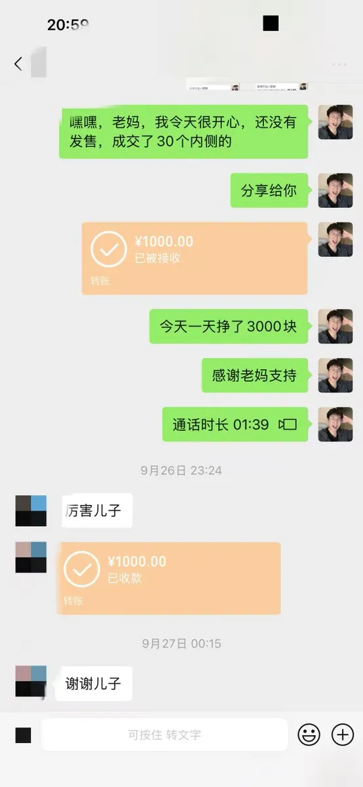

我第一天赚了 3000 块钱，第一天拿到这 3000 块，我就给我妈转了 1000。我真的特别感谢我妈能一直支持我，就是在我最无能、最无助的时候一直帮助我我。说实话，当时交了房租之后，我剩下只有 60 块。我创业大半年一直在负债，经济一直没有好转，都是我妈在给我生活费、帮我想办法。

我知道她也不容易。他们的项目、他们的店铺也出了问题，都需要垫资，现金流没有那么多钱给我。而且在我们自身还有房贷和车贷的情况下，我觉得我妈她已经做得很好了。

我来杭州大半年，一路是往下走的。当时我真的就是最后一根稻草快被压垮了，就因为这一场正反馈，让我绝地翻盘。那会儿我明显感觉到，走路都是轻快的，做什么事都感觉内心有一个怒吼，一定要发泄出去。

我说这些，不是说让你同情我。我是想说：人在低谷的时候，最需要的是一件能做成的事。 你做成一件，信心就回来了，后面的事就一件比一件顺。

第三，也是这篇为什么写出来的原因——

我这个 AI 获客社群，正式发售。

我准备联合 jc 老师一起运营这个 AI 获客社区

社群核心定位：帮“有产品但不会卖”的人，把产品卖出去

轻量化的 AI 获客社群：给工具、给方法、给系统，让有产品但卖不出去、不懂做流量、不懂营销闭环的人，把产品让别人看见、卖出去。

创始人：阿乐

连续 AI 创业者 · 企业 AI 获客咨询顾问

- 3 天发售小红书采集插件（3 天 100 单），累计变现两万

- 团队 100+ 矩阵账号，精通小红书本地同城打法，做海外华人市场

联合项目合伙人：jc 老师，

 小红书矩阵获客专家

- 从 0 到 1 跑出 2 个万粉账号

- 50 个矩阵账号，百万自然流曝光，单周引流千人

交付清单

1. 智能陪跑带教助手「赛博乐乐」（AI 助手，助手说明：蒸馏我的）

2. 阿乐获客内容工厂：批量出图流水线、内容生产流水线 5800 单独搭建

3. 小红书采集工具箱（含小红书采集插件，源码交付）169 源码

4. 阿乐专属获客知识库（阿乐＋JC 老师共同创建） 持续迭代

5. 发售 AI 协同流程作战手册

现在首发价格 399

原价 999/年，把整个阶梯式涨价也全部摆出来：

满 60 人：499

满 100 人：599

满 200 人 ：699 暂停

后面会根据我们的项目、我们的价值、我们的运营策略，不断涨回原价

也希望各位大哥可以支持。感兴趣的，评论区扣个「1」，或者直接进群聊。

最后给各位大哥一个进群的福利：进群就可以找助理领取《小红书运营手册》。

这里面全部是我们自己的一些方法，以及结合生财的案例做成的。

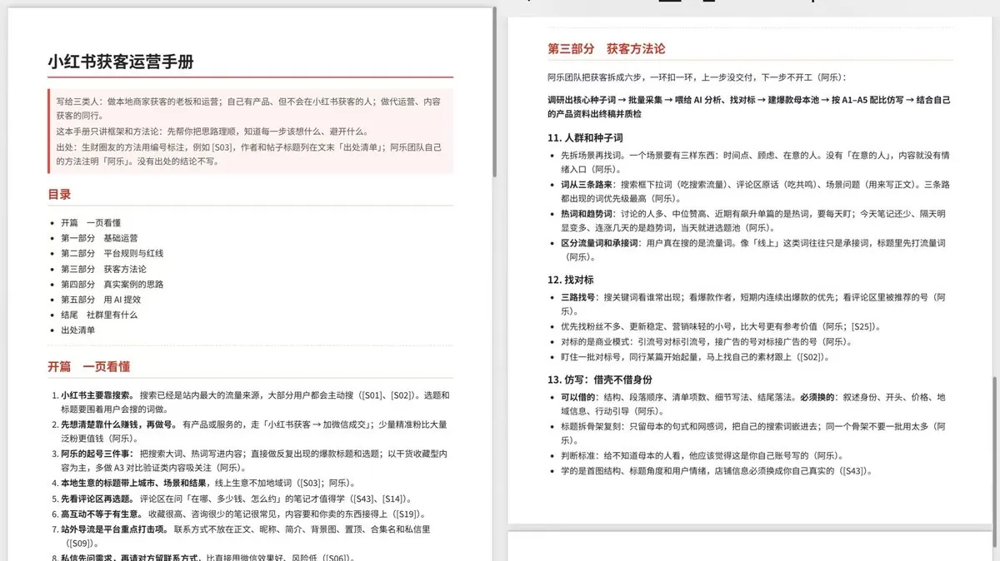

## 相关页面

- [[sources/andyl-ai-automated-revenue-generating-website-guide]]
- [[sources/wangzai-personal-ip-three-word-mantra-copy-surpass-monetize]]
- [[concepts/b2c-conversion]]
- [[concepts/selfmedia-compound-model]]
