# Jingchao（@alswl）：AI Native 实践续篇——迈向 Stage 8（全自动软件交付与认知升级）

> AI 原生工程实践进阶长文：深度探讨从单次会话辅助编程向 Stage 8（多 Agent 自动化协同软件交付）演进的技术路径；剖析上下文生命周期、代码验证门禁、Agent 状态投影与自愈修复机制，为开发团队构建具备高自主性与强确定性的新一代研发操作系统提供前瞻洞察。

<!-- more -->

最近，我重新梳理了自己的工作方式。变化最明显的地方，是我开始把完整任务交给一个负责调度的统筹者，由它组织其他 Agent 推进，自己逐步退出逐个窗口盯进度的状态。

这篇接着[八月那篇 AI Native 实践](https://blog.alswl.com/2026/10/ai-native-work/)往下写：Stage 7 留下了哪些验证问题，迈向 Stage 8 时，我在调度上做了哪些尝试，以及实际跑起来以后遇到的新问题。

[我怎么在 AI Native 下工作 due 2026-08](https://blog.alswl.com/2026/10/ai-native-work/%20%22!banner%20(/images/202610/banner-e7a22f6096cba86a.png)

我用这张 Stage 1—8 演进图定位自己的工作方式：从编辑器辅助，到多个 Coding Agent 并行，再到由统筹者组织执行。下文聚焦 Stage 7 之后的验证问题，以及迈向 Stage 8 的组织实践。

这些还是阶段性的尝试。我开始把调度交给 Agent，但距离完整实现 Stage 8，还需要更多实际任务中的实践和效果呈现。能组织多个 Agent 运行，并不意味着已经能稳定地完成从需求到上线的全过程。

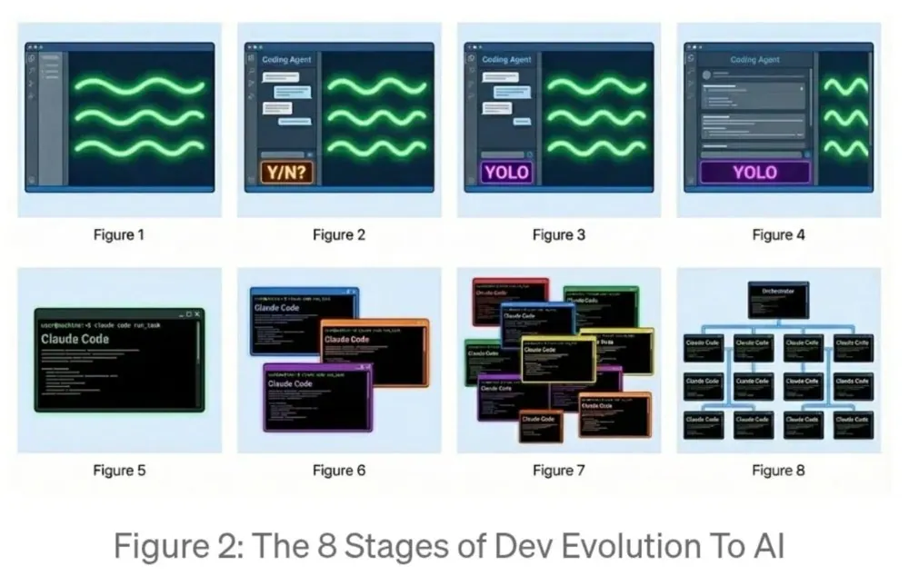

图 1：从编辑器辅助到多 Agent 调度的八阶段演进。

## 达成 Stage 7 之后：验证还没结束

我把达成 Stage 7 的实践归成四项：Spec Driven、Guides、验证和工具链。沿着这条路径走下来，我发现现有的验证还不够。测试通过之后，我还需要确认：这些测试真的能发现问题吗？

规格驱动工具与规范仓库入口如下。

[GitHub - github/spec-kit: 💫 Toolkit to help you get started with SDD or any other process](https://github.com/github/spec-kit%20%22!banner%20(/images/202610/banner-09f8bc864d898a1a.png)!

测试也要被测试

最近我在一个内部测试工具里加了一层验证，也就是「测试测试」。

先完成开发和测试，再有意拆掉一个被测功能的目标代码，重新运行相关测试。预期应该出现失败。如果功能已经被破坏，测试仍然全部通过，就得回头检查：这条测试到底有没有触及它要验证的行为？

失败在这里提供了另一种证据：至少这条测试能抓住这次故障。它不能证明整个系统没有问题，但比单看一片绿色更能回答「测试是否有效」。

这与 mutation testing（变异测试） 的思路相通：有意改变代码，再看测试能不能发现变化。Stryker 的文档把引入的代码变体称为 mutant；测试失败表示这个变体被「杀死」，测试仍通过则表示它「存活」。代码覆盖率说明测试执行到了哪里，变异测试进一步检查测试能否识别故障。我这里先从破坏目标功能入手，还不能把一次故障注入等同于完整的变异测试评估。

[What is mutation testing? | Stryker Mutator](https://stryker-mutator.io/docs/%20%22!banner%20(/images/202610/banner-377646a896425a08.png)

我把验证分成两层：先验证交付物，再检查验证本身是否可信。这个环节值得单独花精力。

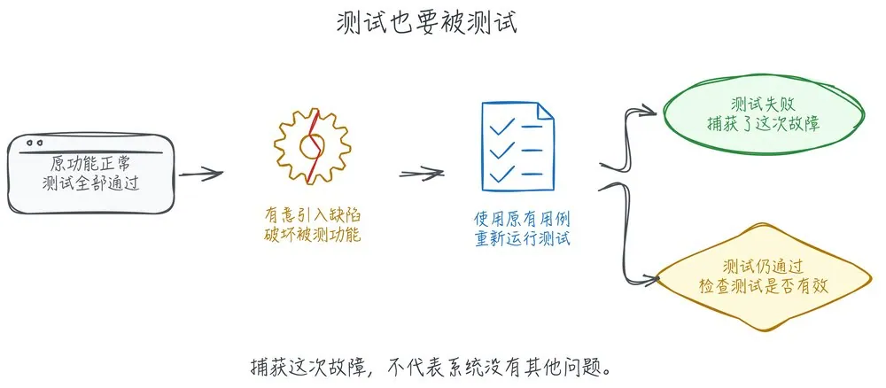

图 2：测试测试的判断路径。故意引入故障后，测试失败才符合预期；这只说明捕获了本次故障。

让 Agent 说明选择的依据

另一个变化，是我会要求 Agent 交代判断依据：考虑过哪些方案，最后选了哪个，为什么这么选，拿什么证据支持这个选择。

给它作判断的空间，也让它解释判断。等到需要我介入时，我能围绕具体分歧讨论，而不用从一大段执行记录里重新猜它为什么走到了这里。

工具链里新增的几个具体用途

最近，我还在使用这些 Skill：

- asr	语音输入，与后面记录思考过程的做法相连
- pr-visual	PR 可视化，帮助查看改动
- ablation	通过消融检查哪些代码可以删减

这些 Skill 收录在我的 Skills 仓库中。

配套的 skm 用来管理 Skills。

[GitHub - alswl/skm: a tiny local-first AI Skill Manager](https://github.com/alswl/skm%20%22!banner%20(/images/202610/banner-694646ef30044df5.png)

我用知识库工具管理信息与文章。

## 迈向 Stage 8：把调度交给 Captain

社区实践：持续运行与组织工作

我参考了下面两种 /loop 的运行方式。一张要求持续关注 issues、审查 PR、实际运行验证，并处理社区反馈；另一张先筛选反馈，再决定是否进入修复和上线流程。

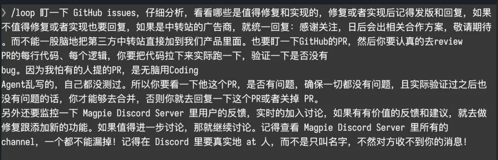

图 3：持续处理 issues、PR 和社区反馈的运行示例。

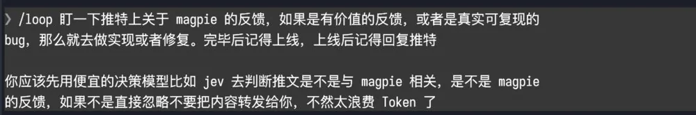

图 4：先判断反馈是否相关，再投入后续处理。

[Yetone on X：并行运行 3 个 loop](https://x.com/yetone/status/2109855710444237018%20%22!banner%20(/images/202610/banner-yetone-loop.png)

另一场分享来自 Lauren Tan，标题是「i shipped 2000 PRs last month」。我听完这场分享，更关注的是怎样组织工作：像经营餐厅一样，安排厨师、改善流程，而不是自己始终下场做每一道菜。

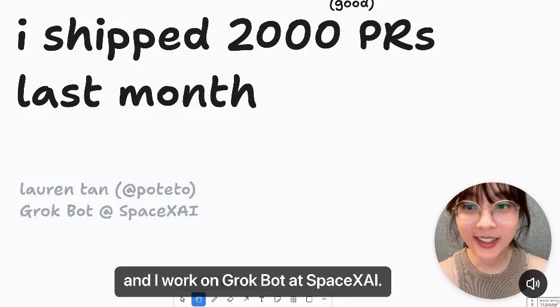

图 5：Lauren Tan 的分享；2000 PR 为分享者自述。

[How I Shipped 2000 PRs Last Month — Trusting AI Agents｜Grok Bot｜Lauren Tan](https://www.youtube.com/watch?v=NjoZoUm85x0%20%22!banner%20(/images/202610/banner-ae97ec5fd18858a6.jpg)“)

我会参考这些社区案例，也会留意它们的适用范围：端侧、客户端应用的经验，不能直接代表所有业务系统。公开开发的项目可以沿着提交过程学习它怎样组织工作；面对自己的系统，仍要检查权限、部署和验收这些环节能不能接上。

我的实践：由 Captain 组织执行

我现在用的是 1+N 的组织方式。一个统筹者对任务负责，其他 Agent 由它按需启动。我看统筹者的进展和结果，下面每个 Agent 的动向交给它管理。

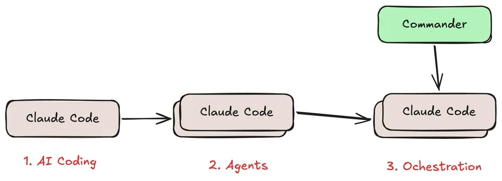

图 6：从单个 Agent、多个 Agent 并行，到统筹者统一调度。

Captain 主要负责调度，避免陷入实现细节

统筹者负责组织任务、分配工作、处理分歧和汇总结果。启动时，它先和我把需求、目标和边界理清楚；短平快的小任务，也可以直接处理。对于复杂任务，我会限制它亲自做实现，有些场景甚至限制它读取具体代码。

这是为了保护它的上下文。如果它持续陷入复杂任务的实现细节，Context 很快会被占满，最初的目标和约束反而容易丢。具体工作分出去，也方便让执行发生在不同机器上。

我没有预先定义一个固定的 Agent Team。需要什么角色、启动多少 Agent，由统筹者按任务决定。保留的是调度职责，执行队伍可以变化。

这套限制目前主要通过 Skill 和 logbook 框架表达，仍然是软约束，Agent 可能忘记。我的做法是给统筹者配更可靠的模型、减少它接触的细节，并把状态落盘；真迷失了，可以重新启动。

用 Herdr 管会话和注意力

我使用的 Herdr 版本帮我管理 Agent 会话、消息和注意力，也支持跨机器运行。工具可以换，我更在意的是它能不能让我看清哪些任务在推进、哪些地方需要我介入。

## 用 logbook 串起交付流程

写清目标、路径和交付约定

我希望串起的完整路径是：需求 → 设计 → 确认 → 开发 → 验证 → 验证验证 → 上线。这些环节全部在 1+N Agent 的管理下推进；确认目标和边界、检查验证是否有效，也是流程中的独立环节。

我用 logbook Kit（lbkit）来组织这套流程。logbook 管的是另一层事情：我要什么，沿什么路径推进，有哪些约束，最终交付什么。

[GitHub - alswl/lbkit: logbook kit](https://github.com/alswl/lbkit%20%22!banner%20(/images/202610/banner-03fe3a0c63df7885.png)

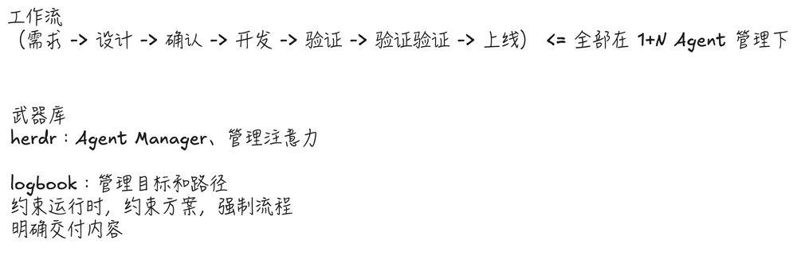

图 7：端到端工作流与工具职责；两层验证分别检查交付物和测试本身。

我对 logbook 的要求很具体：约束运行时，约束方案，强制流程，明确交付内容。我会写清预算、运行位置、权限、可用上下文、必要流程和交付内容。该给的信息要给足，该限制的权限也要写清楚。

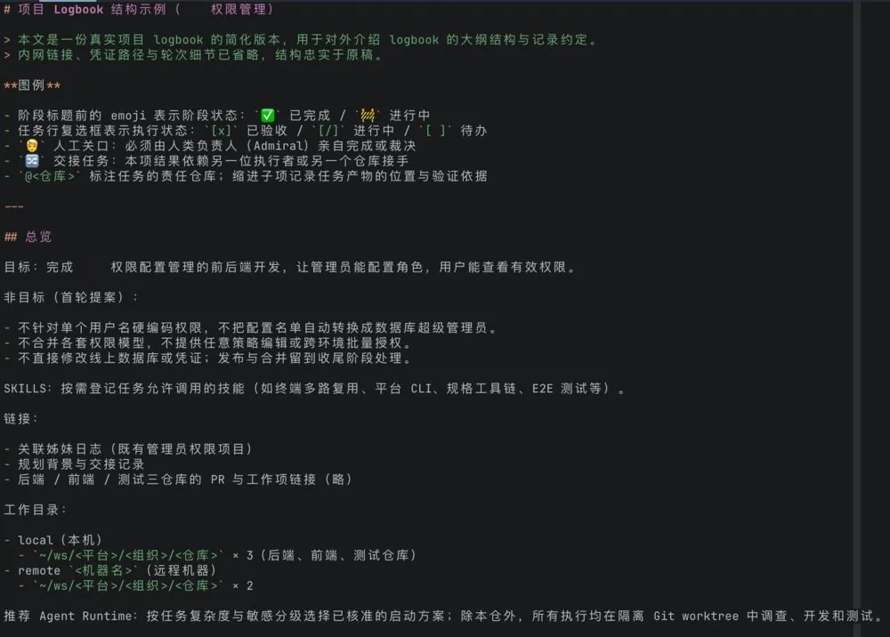

图 8：logbook 结构示例：目标与非目标、技能、关联材料、工作目录和运行约定。

这里有一个边界：logbook 约束方案，但不承载具体方案和代码。设计与实现仍在各自的工作位置，logbook 负责把目标、路径和交付要求串起来。

流程有一定强制性，同时给执行留下自由。每一步需要什么结果要清楚，具体怎么把结果做出来，交给负责它的 Agent。

用阶段和人工关口记录进展

我把任务分成阶段，在阶段内记录待办、产物位置和验证依据。需要人介入的地方单独标记；人工完成合并或登录后，Agent 接着做后续验证。这样看进展时，我能分清任务还在执行，还是已经走到需要我处理的关口。

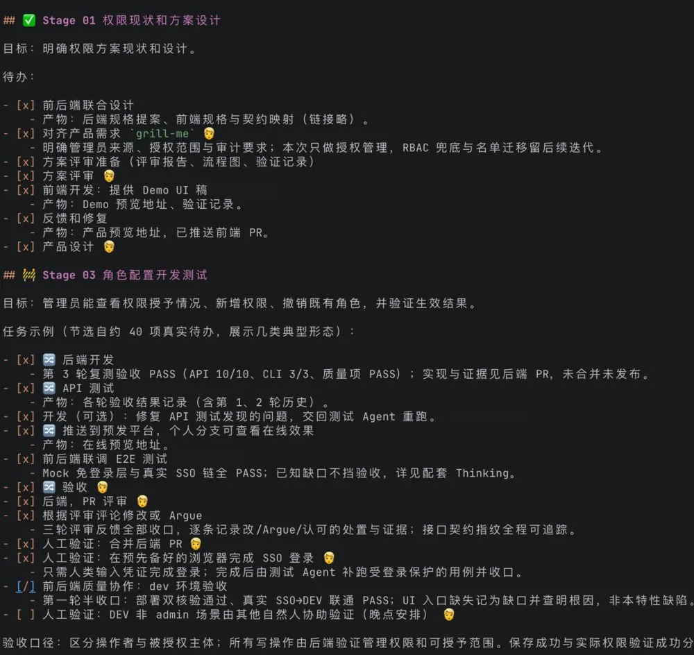

图 9：从方案设计、开发测试、评审修复到人工关口与后续验收。勾选和数字表示该任务在截图时的状态。

我遇到的一个实际问题是：只要 Agent 不断停下来找人确认，任务就很难持续跑下去。我的调整主要有三处。

把关键决策放到开始

先把目标、边界和交付要求谈清楚，再进入执行。开放式问题还没想明白时，我会先和一个高能力 Agent 充分讨论，等方向明确，再交给多 Agent 推进。

多 Agent 更适合承接已经有方向的交付任务。设计本身还在发散时，急着拆给一群 Agent，沟通成本会先上来。

用 Preflight 预演全流程

logbook 的 Preflight 会在执行前预演路径，提前找出需要哪些资源、哪里可能遇到权限问题、哪些节点需要人确认。它把这些点暴露出来后，我再扫一遍。

这样，有些原本要跑到中间才发现的阻碍，可以在出发前处理。Preflight 当然不能消灭所有变化，但能减少一批可以预见的停顿。

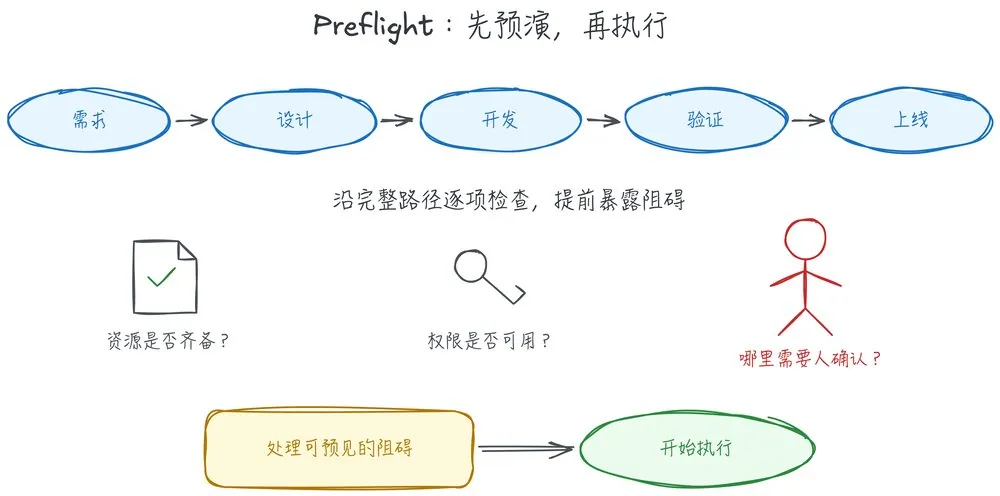

图 10：Preflight 在执行前检查完整路径，提前暴露资源、权限与人工确认点。

让确认发生在能看见结果的时候

有些事情不必在半成品阶段反复问人。可以先推进已明确的部分，把材料准备到足以判断，再把需要我确认的内容一起交过来；遇到不阻塞其他工作的事项，也可以先记录，继续做能做的部分。

需要人工权限或最终决定的关口仍然要保留。目前，合并仍由我来做。我想减少的是中途零碎的打断，让自己能在更完整的结果上作决定。

## 让 Delivery 和 Verify 站在不同立场

我最关心的两种角色是 Delivery 和 Verify。Delivery 负责推动交付，Verify 负责验证。两边各自有要守住的事情，出现分歧是正常的。

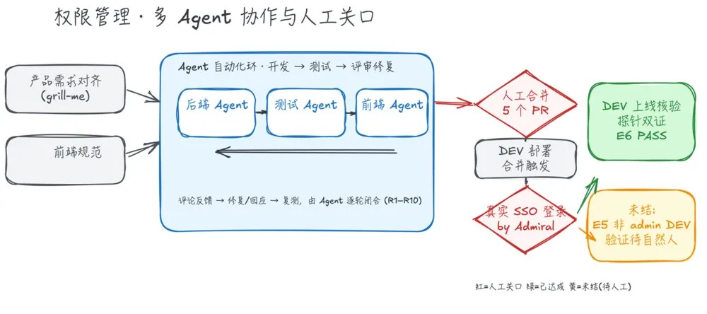

图 11：多 Agent 协作案例，涵盖输入、开发与验证往返、人工关口和后续验收。轮次、PR 数及完成状态仅对应这次任务。

在这个任务里，我先让 Agent 对齐需求和前端规范，再让开发、测试和评审形成往返。测试发现问题，交回开发修复，再复测；有分歧时，几个 Agent 建立沟通，把问题讨论清楚。

Agent 达成一致以后，我还会看截图和验证证据，再处理人工合并、登录等关口。随后验证重新交回 Agent。图里同时保留了已经完成和仍待人工验证的分支，因此「交付」不能只看开发任务有没有结束。

如果所有 Agent 都把「赶紧做完」当作唯一目标，很容易一起跳过问题。我希望验证者认真找缺陷，让交付者拿出解释和证据。它们先讨论，能收敛就继续；收敛不了，统筹者介入；统筹者仍然解决不了，再找我。

Agent 之间的沟通，我用 chatta 来支持。讨论也需要轮次边界。统筹者要负责推动收敛，不能让对话无限延长。最后我会看证据，例如运行结果和截图，而不只看它们有没有说「一致同意」。

[GitHub - alswl/chatta: chatta is chat to agent, tiny CLI and SKILL](https://github.com/alswl/chatta%20%22!banner%20(/images/202610/banner-42ecbf2dfe02b79a.png)

多 Agent 有成本，要挑任务

上下文传递和沟通都要付出成本，多开几个 Agent 不会自动得到更好的结果。

我愿意承担多 Agent 的成本，主要有两个理由。一个是单个 Agent 的上下文有限，把不同工作分开，能减少所有细节挤在同一段上下文里的压力。另一个是立场：即使以后上下文窗口更大，交付、质量和稳定性之间的不同关注点，仍然值得保留。前者是当前能力的限制，后者是组织工作的选择。

我会按任务的规模作一个粗略区分：按传统开发方式估算，半小时、半天的活，通常一个 Agent 就够了；接近一周量级、执行过程中还会不断遇到变化的任务，才更值得引入这套调度和对抗机制。这是个人选任务的经验，不是固定门槛。

即使目标已经明确，执行中也可能出现新情况。让不同立场的 Agent 留在流程里，是为了处理这些变化，而不是只在开工前把任务拆一次。

## 一些新的思考

让带宽落实到完整工作流程

我越来越在意自己的决策密度和带宽。我需要一套适合自己的标准工作流程，涵盖完整路径，让 Agent 运行长一点，让自己轻松一些。

决策密度一直是我的卡点。现在我尝试把端到端路径交给统筹者和 logbook 组织，减少逐个窗口追进展的时间。流程从接到需求一直管到交付，哪个环节缺资源、缺证据或需要人决定，就在哪个环节处理。

我给自己留了一条约定：每个复杂 session 结束都要反思 Retro，把执行中发现的问题回写到 Skill 和文档，让下一次运行用得上。

反思不必等整个任务结束。事情仍在推进时，就可以把这一步的思考和教训记下来，给下一步提供启示。复杂 session 的结束只是一个记录节点，不等于必须等项目收尾才回看。

对抗可能比循环更重要

我认为，对抗可能比循环更重要。现在更值得追问的是：循环里的哪个角色会质疑结果，哪条测试能发现错误，发现分歧以后由谁判断？

Delivery 和 Verify 的不同立场、让 Agent 自证判断、故意破坏目标代码来检查测试，都在回答这个问题。只有推进机制，系统可能很顺畅地把错误往下传。把质疑安排进流程，才有机会让问题在交付前暴露出来。

保护一段完整的注意力

我希望 Agent 能连续运行更久，减少对人的打断。并行任务多了以后，一会儿切进这个窗口、一会儿回复那个问题，很容易让自己的思考断掉。

截至 10 月中旬，我对手头统筹者连续运行时长的个人观察是：常见的中间水平大约在 30—50 分钟，最长接近两小时。这不是统计测量，也不是能力承诺；即便如此，我仍然觉得累，还希望减少中途需要我接手的次数。

这也是我愿意花额外执行成本，让 Agent 先把材料和证据准备好的原因。模型消耗和人的注意力不能只按同一种成本来算。我需要留下完整的时间，去想架构、判断方案，以及处理真正需要我参与的问题。

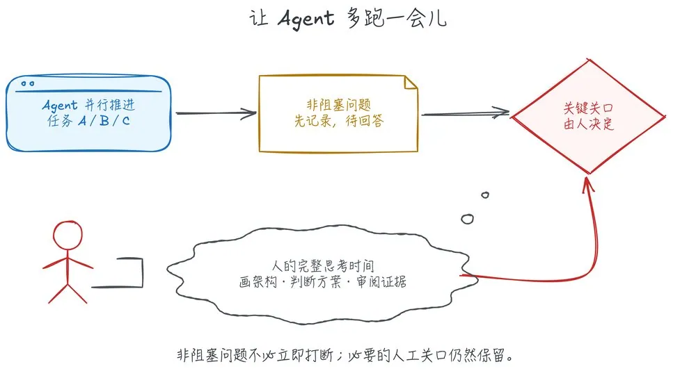

图 12：非阻塞问题先记录，让人保留完整的思考时间；必要的人工关口仍然保留。

把思考过程留下来

我需要掌控自己的注意力、思考过程和决策。保护时间之外，我还希望保留问题是怎么想清楚的：考虑过哪些选择，哪里出现过分歧，最终为什么作这个判断。

我会用语音把正在形成的想法传递给 Agent，再把讨论中考虑过的内容沉淀到 thinking。最终产物和原始材料之外，还要有这一层记录，方便后续继续判断。

记录 thinking 的一个启发来自 DeepSeek-R1。它的论文讨论了通过强化学习发展推理能力，并展示了模型重新审视解题路径、进行自我检查的现象。我由此更在意把考虑过的选择和判断依据留下来。落实到工作里，我保存的是可以回看的方案、取舍与验证证据；这与论文中的模型训练机制有区别，也还需要在自己的任务里验证效果。

[DeepSeek-R1: Incentivizing Reasoning Capability in LLMs via Reinforcement Learning](https://arxiv.org/abs/2501.12948v1%20%22!banner%20(/images/202610/banner-ab77af3fa25e0e90.png)

《思考，快与慢》中，Daniel Kahneman 讨论了快速、直觉式思考与缓慢、审慎思考的区别。这给理解判断过程提供了一个参照。不过，我下面对语音和文字的感受是个人经验，不能直接把两种输入方式对应成书中的两类思考。

[Thinking, Fast and Slow](https://www.penguin.co.uk/books/563861/thinking-fast-and-slow-by-kahneman-daniel/9780141033570%20%22!banner%20(/images/202610/banner-db774a5a922c7c90.jpg)

对我来说，语音和文字是两种不同的思考方式：有些想法在说话时更容易顺着展开，打字时则会停下来整理。因此语音输入的价值不只是快，也在于先把正在形成的思路说出来，再整理成文字。

我不会轻易相信 Agent，也一直在想，怎样才能更有依据地信任它。我的做法是给 Agent 判断和决策的空间，同时要求它证明自己；Delivery 和 Verify 站在不同立场讨论，也服务于这个目的。

架构判断还要自己碰

我仍然会自己画架构图、作架构决策，偶尔抽查代码。这几件事不能因为执行已经交出去，就跟着一起放下。

调度方式给了我更大的执行范围，也要求我更清楚地知道哪些地方需要亲自判断。画图和抽查，是我保留这种接触的具体办法。

## 人和 AI 的关系：执行交出去以后，人站在哪里

让 Agent 多做一些以后，我还需要回答一个问题：执行交出去了，我自己要做什么？

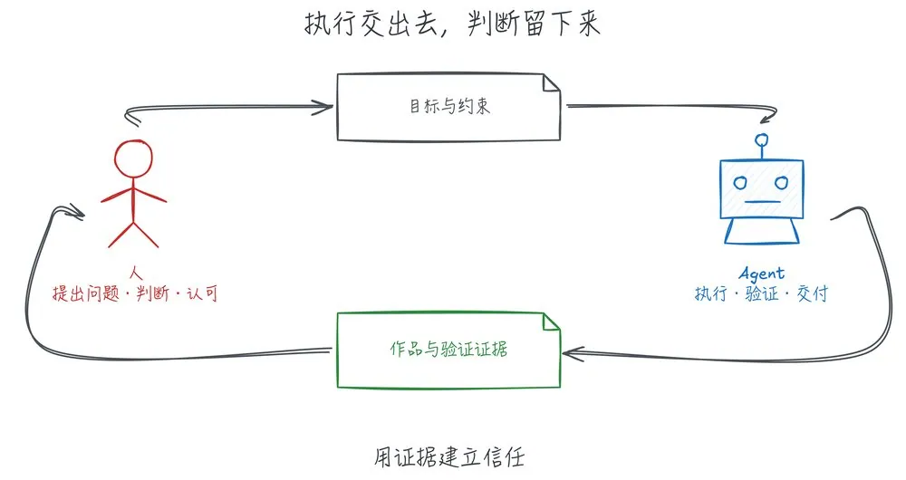

图 13：人负责问题、判断与认可，Agent 执行、验证并交付，用证据建立信任。

从提效回到判断和共识

执行密度、决策密度、共识达成，是我持续关注的三个问题。多 Agent 可以加快执行，但开工前要什么、交付时接受什么、分歧出现后怎么取舍，仍然要有人作判断。

这次我把这些判断落实到具体位置：开始时谈清目标和边界，执行中让统筹者处理调度和一般分歧，必要时再升级给我；最后带着证据交付。AI 的兴奋期过去以后，我更在意这套流程能不能在真实任务里跑通。

让分歧出现，也让人作出承诺

我不喜欢开会，但现在越来越觉得，交流很重要，需要多开会，让分歧更快出现，让大家作出决策和承诺。问题需要被不同立场看见，不能因为执行快了，就把分歧一并跳过。

Agent 之间可以先讨论、验证和收敛。到了目标取舍、人工权限或仍无法收敛的地方，我要接住这个问题。让 Agent 运行更久，是为了把我的参与集中到这些关口。

多一点人味

我把创作拆成「创」和「作」：创是问题、判断、设计；作是生产、展开、润色。AI 可以参与生产，但交出去的内容，我得自己认可。我不能把一篇 AI 生成、连自己都不认可的文档扔给别人。

亲自画图、抽查代码、看运行证据，也包括读完并认可自己交出去的文章，都是我继续参与作品的方式。Agent 可以做更多执行，我仍然要知道自己为什么接受这个结果。

「多一点人味，人味是稀缺的。」最终留下来的，应当有我自己的问题、判断和表达。

隐藏的信息与知识的边界

这里可以借用 tacit knowledge（隐性知识） 这个概念。Michael Polanyi 在《The Tacit Dimension》中用「我们知道的，比能说出来的更多」概括这一问题。它帮助我把关注点说得更具体：交给 Agent 的文字，未必已经包含我判断时依赖的全部经验。至于这些经验能否被表达、学习，乃至用于新的发现，还需要分别讨论。

[The Tacit Dimension](https://press.uchicago.edu/ucp/books/book/chicago/T/bo6035368.html%20’!banner%20(/images/202610/banner-6d676977a487fead.jpg)

我还有一个没想清楚的问题：有些影响判断的信息没有被说出来，也没有进入现成材料；另一些发现，可能超出沿已有知识直接推演的范围。比如，相对论能不能被 AI 发现？我还没有足够依据回答这个问题，但它让我继续思考：人的判断、隐性知识和新发现，在这样的协作中究竟起什么作用？

## 写在最后

现场的一次非代码交付

分享开始前，我还给 Agent 下了一个任务：基于这次分享的文档和内容，做一个介绍视频。到收尾时，我现场打开并播放了生成的结果，再看统筹者和下属 Agent 的协作情况。这个例子把「作品交付」从代码扩展到了内容制作；现场演示说明这次任务产出了可播放的结果，不代表已经完成全面的质量验收。

我更愿意把目前的状态称为「迈向 Stage 8」。调度多 Agent 的方式已经开始用起来，但距离完整实现 Stage 8，还有不少需要继续实践和验证的地方。

接下来，需要用更多真实任务呈现效果：交付质量是否稳定，流程能否可靠地走到上线，遇到变化时能否处理，以及究竟还需要多少人工介入。现在展示的案例只是阶段性的进展，还不足以说明整套方式已经成熟。

对接下来的实践，我给自己留下三个提醒：

- 方法：模拟传统软件开发成功路径。 把需求、设计、确认、开发、验证和上线串起来。
- 思想：创建循环。 执行结果带着证据回来，分歧推动修正和复测。
- 挑战：洞察工程流程的本质。 亲自理解每个环节为什么存在，才能判断哪些工作适合交给 Agent、哪些关口需要自己守住。

我给自己的挑战是「一个月 2000 个 PR，并推上线」。这是尚未达成的目标，后半句和前半句同样重要。接下来要打磨的，是这套组织方式能不能持续把任务交付出去，以及人在其中究竟需要介入多少次。

## 相关页面

- [[sources/alswl-ai-native-workstyle-from-info-to-delivery]]
- [[sources/ruofei-agent-self-write-and-self-inspect-ci-doctor]]
- [[concepts/agentic-architectures]]
- [[concepts/agent-autonomous-pipeline]]
