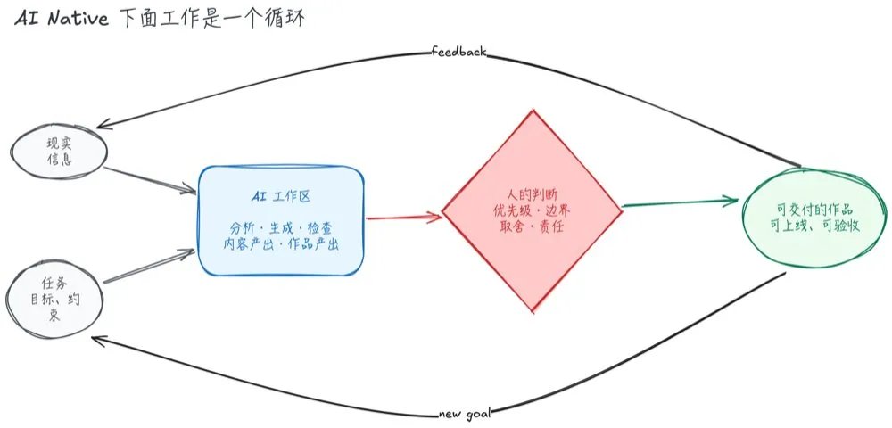
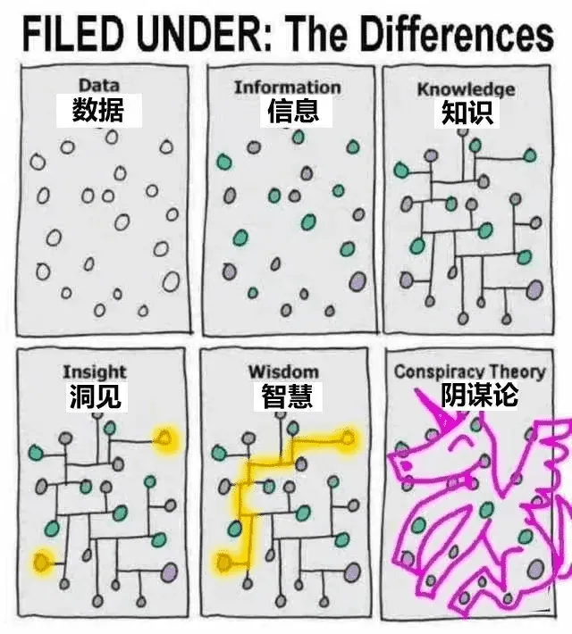
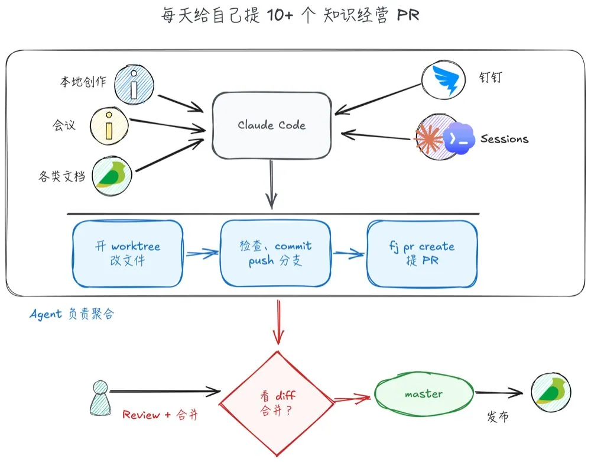
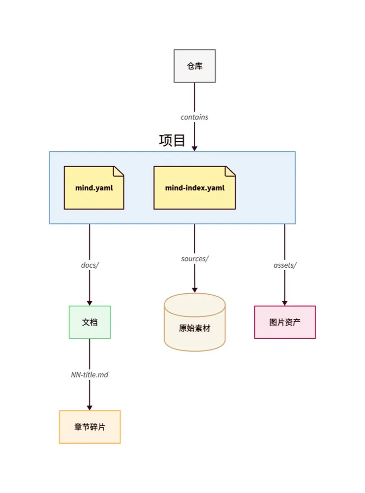
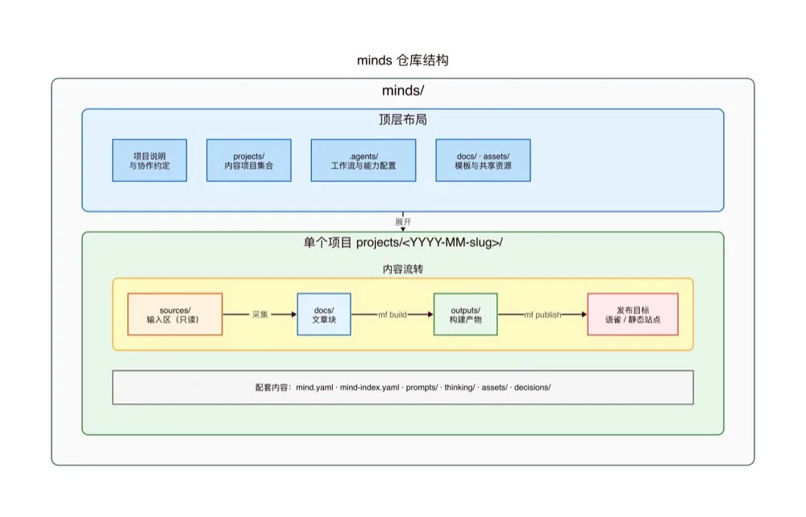
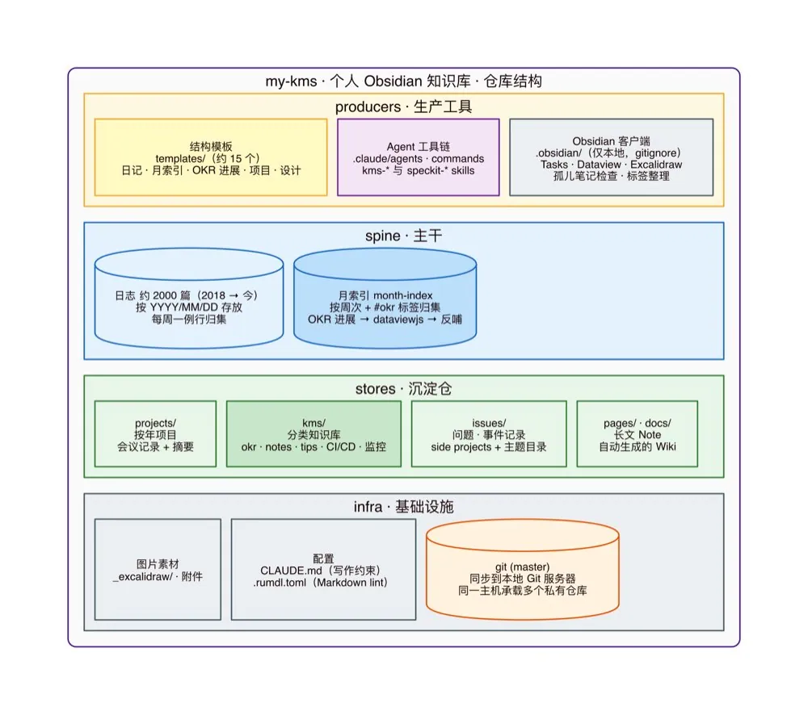
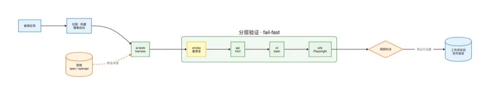
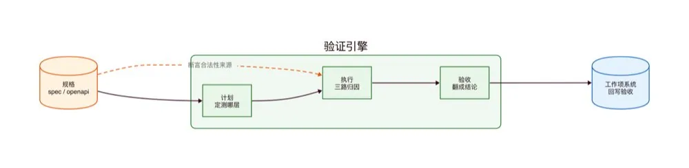

# Jingchao（@alswl）：AI Native 时代的工作方式——从信息到交付

> 资深技术专家探讨 AI 原生时代工作流范式的根本跃迁：从传统基于搜索引擎的「检索信息 → 手工编写」模式，转向「意图定义 → 上下文封装 → Agent 执行 → 结果验证」的以交付为中心的端到端生产闭环，重构工程师与知识工作者的协作界面。

<!-- more -->

在 [2025 年终总结](https://blog.alswl.com/2026/02/my-2025/) 里我写过一句：写代码（Code Typing）未来会成为低效的工程方式，AI Native 应该成为默认选项。

话说出去容易。真到自己每天这么干，问题就具体了：AI 写代码很快，那信息从哪来、方案谁来定、产出怎么验、人到底还管什么？这一年实际跑下来，我对它的理解变了几轮，关注点从「代码写得快」慢慢移到了信息、研发、落地和工具链这一整条链路上。

这篇文章讲的是我目前的工作方式(截止 8 月底）：信息怎么处理、代码怎么写、工具链怎么搭，以及在这套方式跑了大半年之后，我形成的几个判断。

我的背景是 Infra、Kubernetes、PaaS 方向，最近主要语言是 Go。下面的内容都来自我自己的实践，不是方法论综述。本文不是某个产品或团队流程的操作手册，也不打算论证 AI 可以替代负责决策的人。

## AI Native X 工作

认知演进：

- 2 月：Code Typing is unnecessary，快速写代码的兴奋感，每天写到 2 点钟
- 5 月：AI 放大执行；人负责判断，从 2-3 Agents 并行到 7-8 个 Agents 并行
- 8 月：信息、研发、落地、工具链

我们的工作，形式和内容到底是什么？

问题分析 → 方案设计 → 产品制作 → 上线运营 → 反馈增强

核心载体：作品（Artifact）。

为什么翻译最容易被替代？因为作品更静态、结构化更强、表意向量空间更小。软件工程的复杂性，决定了这条链路相对漫长。

文档、代码、会议、报告，都只是工作中的不同形式。

工作本身：

1. 信息整理、结构化、提炼、发展；形成方案，让别人理解和接受。
2. 方案变成产品；写代码、验证、上线、运行。
3. 隐藏线路；优化工具链路，进行效率提升。

小结：文档、代码、会议、报告这些形式会变，工作本身还是这三条线。后面讲信息、AI Coding 和工具链，基本就是顺着这三条线展开的。

## AI Native 加入了什么？

一直在讨论 AI Native。那它到底是什么？

我的理解：把 AIGC 的推理能力放进工作的各个方面。

- 决策
- 内容产出
- 作品产出
- 以及支撑这套工作方式的环境和平台

不是单点工具。是工作方式。

现实信息和任务目标进入 AI 工作区，分析、生成、检查之后，交给人做优先级、边界、取舍和责任的判断，再产出可上线、可验收的作品；作品产生反馈和新目标，回到起点。

小结：AI 进到了分析、生成、检查的每一环，循环转得更快；中间那道「人的判断」没有被拿掉，反而因为转得快，卡得更紧。这也是 5 月那条认知：AI 放大执行，人负责判断。

## 当下我怎么处理信息

从信息到洞见

图源：网络

数据本身没有价值，连起来才是知识，连对了才是洞见。信息处理的目标不是把材料存下来，而是让它能被继续加工。

我的工作流

每天给自己提 10+ 个知识经营 PR。

本地创作、会议、各类文档、IM 消息，统一进入 Agent；Agent 开 worktree 改文件、提交、推分支、发 PR。我只做一件事：看 diff，决定合不合。

我本地有两个知识仓库，一新一旧，两种工作方式：

仓库作用 AI 参与度 mindsAI 协作、文章与项目材料 90%+my-kms 个人传统知识库、每日记录 5%

minds 信息库

minds 管理 AI 协作产生的信息：材料很杂，也需要反复加工。最近的大部分文章，都是在这里完成。我用自己写的 mind-forge 管理这个仓库。

[GitHub - alswl/mind-forge: Forge minds into articles.](https://github.com/alswl/mind-forge)

一个仓库装若干项目，一个项目里分四个区：

- sources/ 输入区，只读，原始素材进来之后不改
- docs/ 文章区，长文按 NN-title.md 切成章节碎片，可以独立迭代
- outputs/ 构建产物，由 mf build 生成，不手工编辑
- prompts/ 和 thinking/ 记录目标、约束与推理过程

这套结构的意义在于：材料、在写的东西、发布物是分开的。Agent 可以改 docs/，但不会污染 sources/；我 review 的时候，看的是 docs/ 的 diff。

仓库根上还有几件东西：一份 CLAUDE.md 写协作原则和红线，一份术语表统一专有名词和口述纠错，一批 skill 承担重复动作。约定写在仓库里，而不是每次对话里重讲一遍。

仓库根目录还用 minds.yaml 注册项目，用术语表和跨项目 thinking 管理共用信息；文章、素材与配置则各自在项目内维护。

my-kms 知识库

my-kms 是持续了多年的个人知识库。产品换过几代（2010 年写过一篇 [我所使用的知识管理系统](https://blog.alswl.com/2010/09/my-kms/)），后来落到 Obsidian（任务管理也一起搬了进去，见 [从 Toodledo 到 Obsidian Tasks](https://blog.alswl.com/2023/02/gtd/)）；内容仍以人工写入为主，至少自己口述。只有少量会议摘要交给 AI 录入。

我的日常信息流：

会议转写 → 摘要 → 当日记录 → 日报 → 方案、文章与分享

每一场会议拿到转写和摘要；每天收口成日报。材料不留在聊天窗口里，而是进入可以回看、检索、继续加工的仓库。

两个仓库都托管在本机自建的 Forgejo 上。好处很实在：私有数据不出机器，但仍然有分支、PR、diff 和历史——也就是说，Agent 的每一次改动都是可 review、可回滚的。

如何保持人味

环节我的做法框架自己构思；结构自己把控长内容先语音；AI 整理、汇总、润色、结构化观点来自自己的输入；不是一段 AI 生成文本图尽量自己画；没有图再用截图

效果和效率都会更好。更重要的是，内容里还留着自己的观点。

下面是和一位运营同学聊写文章的产出：

一点看不出来 AI 痕迹都是 AI 生成。是手搓嘛 我丢， 大哥，可以求赐教下不 AI 怎么能写出这么活人感且专业的文章哇 全仰仗您我写框架，AI 生成。 另外，我还需要给很多批注反馈。就像大学导师里面给学生改论文。 我写框架，AI 生成，然后我给很多批注反馈——像导师给学生改论文。人味不是靠 AI 模仿出来的，是因为框架和观点本来就是自己的。

小结

信息这一段，我的做法可以归成三条：

1. 材料进仓库，不留在聊天窗口里；
2. Agent 负责搬运和加工，改动走 PR，我看 diff 决定合不合；
3. 框架和观点自己出，AI 负责展开和润色。

两个仓库的 AI 参与度一个 90%+、一个 5%，差别很大，但材料都落在可以回看、可以 review 的仓库里。

## 当下我怎么 AI Coding

和之前相比，有三个明显变化。

1. Spec-driven：从个人选择到团队要求

规格、边界、验收标准：研发的起点。

现在是强制要求：用 speckit、superpower，或者任何一个 well-known 的 spec 框架。从个人选择变成团队要求，这是今年最明显的一条变化。

2. 细节代码：越来越少看，但不能不管

在结构比较稳定的系统里，大家对细节代码的关注确实越来越少。过去积累的 Code Review 经验和知识，反而要持续沉淀成约束。

这些约束我统一放在一份 guides 里，把「看什么、不看什么、什么情况下必须看」固化下来：

[GitHub - alswl/guides](https://github.com/alswl/guides)

公开版目前是 v0.0.1-alpha1，收了这几份：

指南技术栈定下了什么 go-cli-guides.mdcobra · viper · log/slog 命令树结构、flag 与配置优先级、输出/退出码/错误处理约定 go-server-guides.mdhuma v2 · chi · GORM 分层 pkg/ 结构、声明式 API 与自动生成 OpenAPI、GORM 只做表映射与基础 CRUDpython-server-guides.mdFastAPI · SQLAlchemy Core · Alembic 分层 src/ 结构、Pydantic schema、只用 Core 显式查询 go-tui-guides.mdBubble Tea · Lip Gloss · BubblesElm 架构落到真实应用，业务分层复用 CLI 指南 fe-page-guide-antd.mdAnt Design v5 · ProComponents 高密度信息页面怎么组织

每份指南只选一套技术栈、固定一种项目结构，规则写成祈使句。它们同时写给人和 AI Coding 工具看，所以每条规则都要短、可核对，不写「视情况而定」。用法也简单：在项目的 CLAUDE.md / AGENTS.md 里引用对应文件，让 Agent 写代码时照着做。前端那份的来龙去脉，我单独写过一篇 [高密度页面怎么组织](https://blog.alswl.com/2026/09/high-density-page-organization/)。

3. 自测 Agent 验证

AI Coding 让需求交付密度爆发。测试资源很难按同样的速度扩张。

我为此提出的方案是一个自测 Agent，核心链路是：

规格 → 分层验证 → 判决 → 回写验收

规格既是开发的起点，也是断言的来源。验证按成本从低到高分层，fail-fast：

层回答什么引擎 smoke 服务能起来吗？健康闸口通吗？组合 APIREST API 合约对吗？HurlCLI 命令行的行为对吗？bash + Go (testify)E2E 前端关键交互还在吗？Playwright

最后一步是判决和回写：跑完不是给一堆日志，而是给一个带运行证据的结论，回写到工作项的验收里。

小结

三个变化放在一起看，是一条线：规格定起点，约束替人看细节，分层验证给结论。代码越来越少需要人逐行盯；写什么、按什么写、怎么算做完，反而要写得更清楚。

## 我的个人工具链

工程师本质上就是通过工具的提升，来加强自己的管理、工作效率和产出速度。所以在这个时代，工具确实比过去更重要。

我自己投入了不少时间来打造自己的工具链。我觉得目前还不错的有这么几个：

- mind-forge
- skills 集合
- skm 管理器，可以跨电脑管理 SKILL，快速部署到远程机器
- mind-forge 知识库管理器
- 一个好用的评审编辑器（我选择了 Vim）

[GitHub - alswl/skm: a tiny local-first AI Skill Manager](https://github.com/alswl/skm)

我最常用的 skills，一部分来自社区：

- speckit —— 基于 spec 的套件
- grilling —— 追问我
- humanizer —— 说人话

一部分是自己写的：

- spec-report-html —— 把本次 spec 汇报成一页纸方案
- spec-status / spec-update —— 更新 spec 状态
- session-retro —— 反思当前 session，改进本地 SKILL
- chat —— 基于 IRC 的 Agent 协作
- distill-memory —— 蒸馏本机 jsonl 记忆
- repo-analyzer —— 仓库快速分析，类似 deepwiki
- mf-cli —— mind-forge 配套 SKILL

前面说工作本身有三条线，第三条是「隐藏线路」：优化工具链路，进行效率提升。这份清单就是我在这条线上的投入。

## 一些观点

提效很快会到瓶颈

- 执行密度上升
- 决策密度：新的卡点
- 信息、判断、共识：不可跳过

AI WoW Time 正在过去

- 新概念：短期兴奋
- 持续价值：如何落地
- 真实业务、真实系统、真实用户，要真刀真枪

开会变得更重要

- AI 加速产出
- 分歧更快出现
- 共识形成：更高价值
- 决策、承诺、责任：需要人

创作 = 创 + 作

- AI 善于「作」：生产、展开、润色
- 人负责「创」：问题、判断、表达
- 大家会对纯 AI 生产的内容乏味
- 保留观点、经验、个人棱角

## 写在最后

从 2 月的「Code Typing is unnecessary」，到 5 月的「AI 放大执行；人负责判断」，再到 8 月把信息、研发、落地、工具链连成一条线，这大半年变来变去的，其实是我对「人站在哪里」的理解。

AI 善于「作」：生产、展开、润色。「创」还是得自己来：问题自己提，判断自己下，观点、经验和个人棱角自己留着。

Update 2026-10-05：因为各种档期问题，我内部的分享延迟了一个月才开展，因此这篇文章发晚了 1 个月。 Agentic 发展太快了，我最新的实践已经和这篇文章相比，已经更进了一步，摸到了 Stage 8 门槛。 当然我依然推荐工程师们一步步走过来，在当下日新月异的时代，亲自体验和上手是完全不一样的感觉。

等我下篇文章吧。

## 扩展阅读

- [alswl/mind-forge](https://github.com/alswl/mind-forge)：minds 仓库用的知识锻造 CLI
- [alswl/skm](https://github.com/alswl/skm)：跨电脑管理 SKILL 的小工具
- [alswl/guides](https://github.com/alswl/guides)：写给人和 Agent 一起看的开发指南
- [github/spec-kit](https://github.com/github/spec-kit)、[obra/superpowers](https://github.com/obra/superpowers)：文中提到的两个 spec 框架
- [2025 年终总结 - 临界点](https://blog.alswl.com/2026/02/my-2025/)
- [高密度页面怎么组织：一份信息呈现指南](https://blog.alswl.com/2026/09/high-density-page-organization/)
- [从 Toodledo 到 Obsidian Tasks - 我的 GTD 最佳实践](https://blog.alswl.com/2023/02/gtd/)
- [我所使用的知识管理系统](https://blog.alswl.com/2010/09/my-kms/)

## 相关页面

- [[sources/dotey-ai-native-thinking-train-yourself-like-an-llm]]
- [[sources/tw93-leading-vs-being-pushed-forward]]
- [[concepts/ai-era-learning-paradigm]]
- [[concepts/engineering-skills]]
