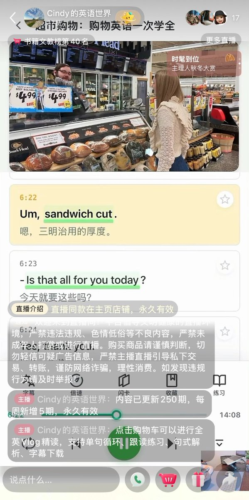
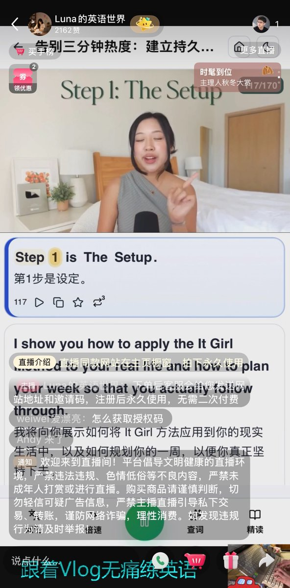
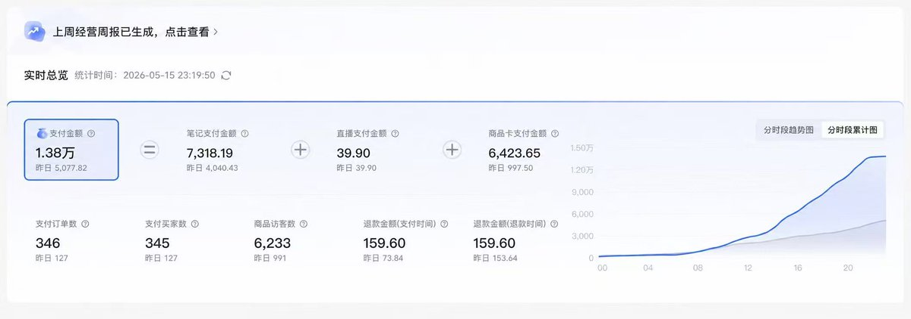
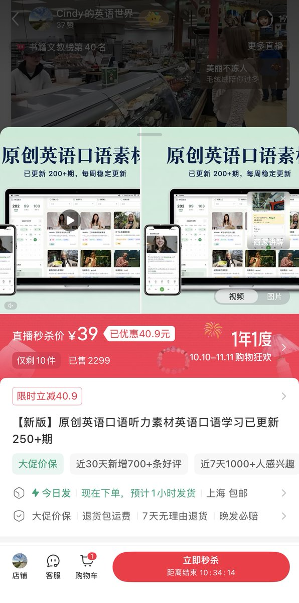

# Andy L（@AndyL5cc）：我用 AI 做了一个自动赚钱的网站——客户自己下单，我睡觉也能收钱

> 出海独立开发者全栈被动收入实战拆解：从痛点需求调研切入，利用 AI 工具链快速生成静态落地页、配置 Stripe 跨境支付通道、绑定自动化交付 Webhook；手把手演示如何打造「客户自主搜索入站 → 极简表单转化 → 自动扣款履约」的零人工值守微型资产闭环。

<!-- more -->

这是我第一个真正用 AI 跑通「产品 → 获客 → 成交 → 自动交付」的项目。

故事开始于我在小红书刷到几个英语学习账号。

它们有个共同特点：

短视频/图文引流 + 24 小时无人直播 + 39.9 元左右的英语学习网站激活码。

用户自己下单，系统自动发货，拿到激活码后直接进入网站学习。

39. 9 元 × 几千单，是一个非常可观的数字。

我后来又看到了一组真实成交数据：单日支付金额 1.38 万，346 个支付订单。

我当时第一反应就是：

这不就是特别适合 AI 做的生意吗？

于是我直接买了一份，进入网站研究它的产品逻辑。

## 1. 先拆产品，再让 AI 开始写

这类网站其实不复杂。

首页是一堆真人英语视频，点进去以后，可以看双语字幕、逐句播放、循环、查单词、录音跟读、做单词卡。

我直接把网站交给 Claude/Codex，让 AI 拆页面、功能和用户路径，再按照这个产品逻辑做自己的版本。

从买服务器到第一版上线：

4 天。

后来继续迭代到 9 个页面、10 个组件、4000 多行前端代码，我自己没碰过代码，全是 AI 来做的。

## 2. 内容也可以交给 AI 加工

接下来就是准备英语素材。

这里一定注意：只使用原创、获得授权或可合法商用的内容。

视频准备好以后，可以继续让 AI：

提取字幕 → 翻译 → 提取重点词汇/短语 → 生成学习内容 → 导入网站。

原本需要大量人工整理的工作，现在 AI 可以批量完成。

## 3. 真正关键的是把“赚钱”也自动化

网站做好后，我开始卖 39.9 元激活码。

后来把抖店、小红书店也接进来，让 AI 帮我做自动发货和自助开通。

最终形成：

内容获得流量 → 用户下单 → 自动发货 → 自动注册 → 用户进入网站学习。

只要前端持续有流量，即使我不在线，也可以成交。

## 4. 然后我连获客内容也开始自动化

网站有了，接下来最重要的就是持续获取流量。

我的做法很简单：

先把已经上传到网站里的英语视频录屏，然后直接交给 Codex 自动剪辑。

包括裁剪、字幕、画面比例、片段整理等，都尽量让 AI 自动完成。

剪好之后，我再把这些短视频定时发布到抖音和小红书。

于是获客也形成了一条流水线：

网站视频 → 录屏 → Codex 自动剪辑 → 定时发布 → 用户看到内容 → 进入商品页 → 下单

这样同一份内容既是网站里的学习素材，又可以变成前端获客内容。

整个项目也就形成了一个比较完整的闭环：

AI 做产品 → AI 处理素材 → AI 剪辑获客内容 → 抖音/小红书引流 → 用户自助下单 → 系统自动交付。

我需要做的事情，逐渐从“亲自干活”，变成了选内容、看数据、调方向。

## 5. 做好之后，它就变成了一门可以自动运转的生意

当网站、内容、支付和自动发货全部跑通以后，后面的事情其实就简单了：

持续发短视频 + 无人直播，然后挂上产品链接。

用户在抖音、小红书刷到你的内容，觉得有用，就可以直接下单；付款后系统自动发货、自动开通，整个过程基本不需要人工介入。

这也是这个项目最吸引我的地方：

前期把产品和自动化链路搭好，后期主要负责持续获取流量。

英语学习又是一个国内长期存在的需求，只要内容做得好，短视频和笔记能持续获得流量，产品就有机会持续成交。

一天被动收入几百并不是很夸张；如果出现爆款、直播流量起来，日入过千甚至更高也有可能。

所以这个项目真正的核心其实很简单：

用 AI 把产品和交付自动化，再用内容持续获取流量。

只要流量不断，后面的成交和交付，就可以全部交给系统来完成。

## 相关页面

- [[sources/noahduck-stripe-complete-guide-from-beginner-to-advanced]]
- [[sources/yaohongan-18-days-10-sites-meme-traffic-playbook]]
- [[concepts/indie-product]]
- [[concepts/b2c-conversion]]
